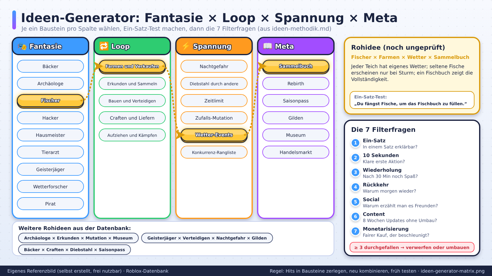

# Ideen-Methodik: Wie man systematisch gute Roblox-Ideen findet

> Stand: 2026-10-24 · Gesamt-Vertrauen: 🧠 (Methodik, gestützt auf die Marktbeobachtungen aus `01-markt-trends/`)

## Kurzfassung
Gute Ideen entstehen selten aus dem Nichts. Sie entstehen aus **Beobachtung (Markt) → Zerlegung (Bausteine) → Neukombination (Twist) → schnellem Test**. Diese Datei gibt dir einen Ablauf, den du in jedem Projekt wiederholen kannst.

## Referenzbilder
Selbst erstellte, beschriftete Referenzbilder (frei nutzbar, Übersicht: `assets/bilder/README.md`).

## Schritt 1 – Markt beobachten (30–60 Minuten)
- Top-Charts ansehen, nicht nur Platz 1: auch **Aufsteiger** der letzten 7–30 Tage.
- Für jedes interessante Spiel notieren: Genre, Core Loop in einem Satz, Session-Länge, Monetarisierung, Event-Takt.
- Kommentare/Likes/Fan-Foren lesen: Was loben Spieler? Was nervt?
- **Lücken-Suche:** Welche Spielerwünsche tauchen immer wieder auf, ohne erfüllt zu werden?

## Schritt 2 – In Bausteine zerlegen
Jedes Spiel besteht aus austauschbaren Bausteinen:

| Baustein | Fragen |
|---|---|
| **Fantasie** | Was fühlt sich der Spieler wie? (Gärtner, Dieb, Überlebender …) |
| **Core Loop** | Aktion → Belohnung → Verbesserung → neue Aktion |
| **Spannungsquelle** | Zeitdruck, Gefahr, Konkurrenz, Zufall, Knappheit |
| **Meta-Schicht** | Sammlung, Rebirth, Ranking, Saison |
| **Social** | Koop, Handel, Konkurrenz, Zuschauen |
| **Ästhetik** | Stil, Humor, Sound, Meme-Identität |
| **Monetarisierung** | Boosts, Slots, Skins, Passes |

## Schritt 3 – Neu kombinieren (Ideen-Generator)
Wähle je 1 Element aus 3–4 Kategorien und prüfe, ob eine **in einem Satz erklärbare** Idee entsteht.

**Fantasie × Loop × Spannung × Meta**
- Fantasie: Bäcker / Archäologe / Fischer / Hacker / Hausmeister / Tierarzt / Geisterjäger / Wetterforscher / Pirat
- Loop: Farmen und Verkaufen / Erkunden und Sammeln / Bauen und Verteidigen / Craften und Liefern / Aufziehen und Kämpfen
- Spannung: Nachtgefahr / Diebstahl durch andere / Zeitlimit / Zufalls-Mutation / Wetter-Events / Konkurrenz-Rangliste
- Meta: Sammelbuch / Rebirth / Saisonpass / Gilden / Museum / Handelsmarkt

**Beispiel-Kombinationen (Rohideen, noch ungeprüft 🧠):**
1. *Archäologe × Erkunden × Mutation × Museum*: Du gräbst Fundstücke aus; jedes Fundstück kann mutieren; du stellst sie in deinem Museum aus; andere besuchen und bewerten.
2. *Fischer × Farmen × Wetter-Events × Sammelbuch*: Jeder Teich hat Wetter; seltene Fische erscheinen nur bei Sturm; ein Fischbuch zeigt Vollständigkeit.
3. *Geisterjäger × Verteidigen × Nachtgefahr × Gilden*: Tagsüber Fallen bauen, nachts Geister jagen; Gilden teilen sich ein Haus.
4. *Bäcker × Craften × Diebstahl × Saisonpass*: Du backst; Nachbarn können Gebäck klauen, wenn du keine Alarmanlage hast.

## Schritt 4 – Die 7 Filterfragen (vor Prototyp)
1. **Ein-Satz-Test:** „Du ___, um ___ zu bekommen." Wenn das nicht in einem Satz geht → zu komplex.
2. **10-Sekunden-Test:** Was macht der Spieler in den ersten 10 Sekunden? (Muss etwas Klares und Befriedigendes sein.)
3. **Wiederhol-Test:** Macht die Kernhandlung nach 30 Minuten noch Spaß?
4. **Rückkehr-Test:** Warum kommt jemand morgen wieder?
5. **Social-Test:** Warum erzählt jemand es einem Freund?
6. **Content-Test:** Kannst du 8 Wochen lang neue Inhalte liefern, ohne das System umzubauen?
7. **Monetarisierungs-Test:** Gibt es einen fairen Kauf, der den Loop beschleunigt, aber nicht zerstört?

Fällt die Idee bei **3 oder mehr** Fragen durch → verwerfen oder umbauen.

## Schritt 5 – Schnelltest
- **Paper/Graybox-Prototyp** (1–3 Tage): Nur Core Loop, hässliche Teile, keine Meta.
- **5–10 Testspieler** (Freunde, Discord): Beobachten, nicht erklären. Wo zögern sie? Wo lachen sie?
- **Kennzahlen:** Zeit bis zur ersten Aktion, Anteil, der nach 5 Minuten noch spielt, Wunsch „noch eine Runde".
- Dann entscheiden: **bauen / ändern / stoppen**. Siehe `checklisten/idee-validieren.md`.

## Typische Denkfehler
- „Das Spiel X hat Millionen, also kopiere ich es." → Du kommst zu spät und ohne deren Event-Maschine.
- „Ich baue erst alles, dann teste ich." → Prototyp zuerst.
- „Mehr Features = besser." → Ein starker Loop schlägt zehn mittelmäßige Systeme.
- „Spieler wollen genau das, was sie sagen." → Beobachte Verhalten, nicht nur Aussagen.

## Do / Don't
| Do | Don't |
|---|---|
| Hits in Bausteine zerlegen | Hits 1:1 nachbauen |
| Ein-Satz-Pitch schreiben | Mit Systemlisten beginnen |
| Früh mit echten Spielern testen | Monatelang im Geheimen bauen |
| Retention über 4 Wochen planen | Nur Launch-Woche planen |

## Verknüpfungen
- Zerlegung von Hits: `01-markt-trends/viral-hits-analyse.md`
- Vorlage: `konzept-vorlage.md`
- Variation: `spiele-abaendern.md`
