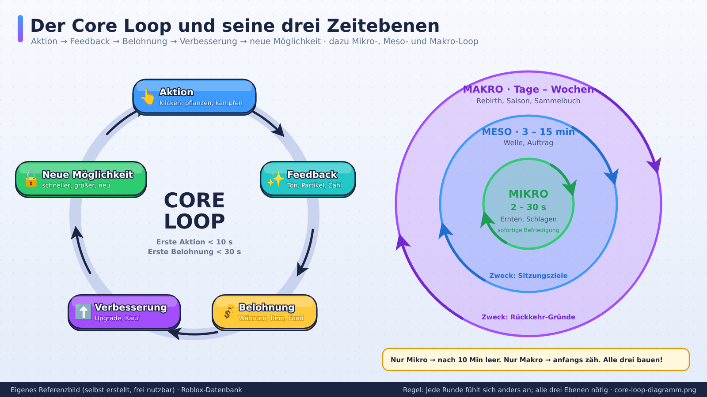
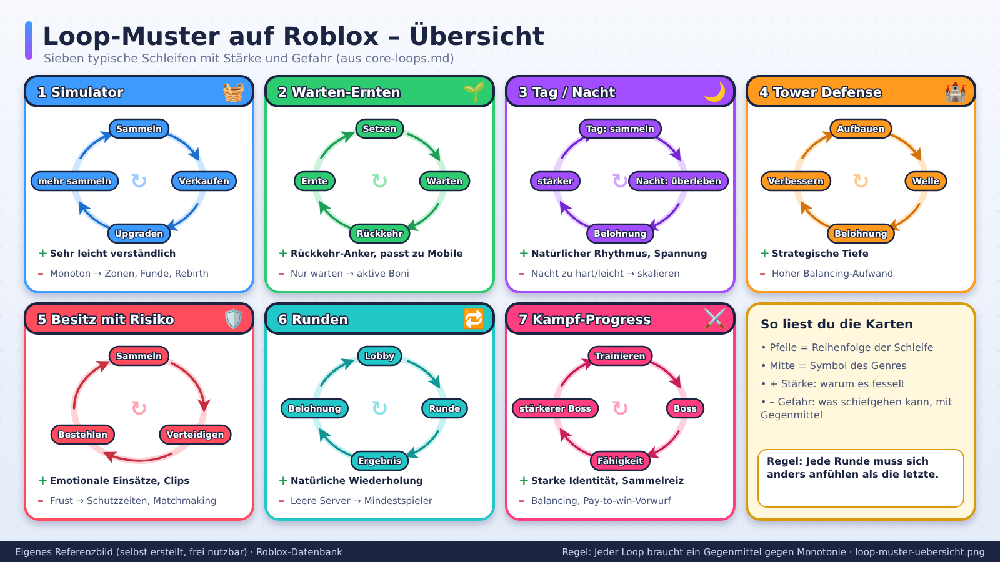

# Core Loops

> Stand: 2026-10-24 · Gesamt-Vertrauen: 🧠 (Designwissen), Beispiele 🟡

## Kurzfassung
Der Core Loop ist die kleinste Handlungsschleife, die der Spieler ständig wiederholt: **Aktion → Belohnung → Verbesserung → neue (bessere) Aktion**. Ein Roblox-Spiel steht und fällt damit, ob dieser Loop in den ersten 10 Sekunden verständlich, in den ersten 5 Minuten befriedigend und nach 30 Minuten noch frisch ist.

## Referenzbilder
Selbst erstellte, beschriftete Referenzbilder (frei nutzbar, Übersicht: `assets/bilder/README.md`).

## Anatomie eines Loops
1. **Aktion:** Was tut der Spieler? (klicken, pflanzen, kämpfen, bauen, laufen)
2. **Feedback:** Sofortige Reaktion (Ton, Partikel, Zahl, Animation) → siehe `04-ui-ux/` und `06-sound-audio/`.
3. **Belohnung:** Währung, Item, Fortschrittsbalken, Fund.
4. **Verbesserung:** Der Spieler investiert die Belohnung (Upgrade, Kauf, Freischaltung).
5. **Neue Möglichkeit:** Die Verbesserung verändert die nächste Aktion spürbar (schneller, größer, neu).

**Regel:** Jede Runde der Schleife sollte sich *anders* anfühlen als die letzte. Reine Wiederholung ermüdet.

## Loop-Zeiten (Mikro, Meso, Makro)
| Ebene | Dauer | Beispiel | Zweck |
|---|---|---|---|
| **Mikro-Loop** | 2–30 Sekunden | Pflanze ernten, Gegner schlagen | Sofortige Befriedigung |
| **Meso-Loop** | 3–15 Minuten | Welle überstehen, Auftrag abschließen | Sitzungsziele |
| **Makro-Loop** | Tage–Wochen | Rebirth, Saison, Sammelbuch | Rückkehr-Gründe |

Jedes erfolgreiche Spiel braucht **alle drei Ebenen**. Ein Spiel mit nur Mikro-Loop wirkt nach 10 Minuten leer. Ein Spiel mit nur Makro-Zielen fühlt sich anfangs zäh an.

## Loop-Muster auf Roblox

### 1) Sammeln-Verkaufen-Upgraden (Simulator)
`Ressource sammeln → verkaufen → Ausrüstung verbessern → mehr sammeln`
- **Stärke:** Sehr leicht verständlich.
- **Gefahr:** Wird monoton. Gegenmittel: Zonen-Wechsel, seltene Funde, Rebirth.

### 2) Warten-Ernten (Idle-Hybrid)
`Setzen → Wartezeit → Rückkehr → Ernte`
- **Stärke:** Rückkehr-Anker, passt zu Mobile.
- **Gefahr:** Spieler wartet nur. Gegenmittel: Aktive Boni zwischendurch, Mini-Aufgaben.

### 3) Tag/Nacht (Survival)
`Tag: sammeln/bauen → Nacht: überstehen → Belohnung → stärker`
- **Stärke:** Natürlicher Rhythmus, Spannung.
- **Gefahr:** Nacht zu hart oder zu leicht. Gegenmittel: Skalierung, Wählbare Schwierigkeit.

### 4) Wellen-Verteidigung (Tower Defense)
`Aufbauen → Welle → Belohnung → verbessern`
- **Stärke:** Strategische Tiefe.
- **Gefahr:** Balancing-Aufwand.

### 5) Besitz mit Risiko (Stehlen/Verteidigen)
`Sammeln → verteidigen → andere bestehlen`
- **Stärke:** Emotionale Einsätze, Clips.
- **Gefahr:** Frust bei Neulingen. Gegenmittel: Schutzzeiten, Matchmaking, Wiederbeschaffung.

### 6) Runden-Loop (Murder Mystery, Obby-Races)
`Lobby → Runde → Ergebnis → Belohnung → nächste Runde`
- **Stärke:** Natürliche Wiederholung.
- **Gefahr:** Leere Server → Bots oder Mindestspieler.

### 7) Kampf-Progress (Anime-Fighter)
`Trainieren → Boss → Fähigkeit/Frucht → stärkerer Boss`
- **Stärke:** Starke Identität, Sammelreiz.
- **Gefahr:** Balancing, Pay-to-win-Vorwurf.

## Loop-Design-Checkliste
- [ ] Ein-Satz-Beschreibung möglich?
- [ ] Erste Aktion in <10 s?
- [ ] Feedback bei jeder Aktion (Ton + Visuell + Zahl)?
- [ ] Jede Belohnung wird sofort sichtbar nutzbar?
- [ ] Gibt es eine „noch eine Runde"-Spannung?
- [ ] Mikro-, Meso- und Makro-Ziele definiert?
- [ ] Ist der Loop ohne Chat verständlich?
- [ ] Neuer Content kann ohne Umbau eingefügt werden?

## Typische Fehler
| Fehler | Folge | Lösung |
|---|---|---|
| Belohnung zu spät | Abbruch in den ersten 2 Minuten | Erste Belohnung <30 s |
| Zu viele Währungen früh | Überforderung | Maximal 1–2 am Anfang, Rest später einführen |
| Upgrade ändert nichts spürbar | Frust | Spürbare Sprünge (2×, neuer Effekt) |
| Kein Ziel in Sicht | Orientierungslos | Sichtbarer nächster Meilenstein |
| Wartezeiten ohne Alternative | Langeweile | Parallele Aktivität oder Kurzaufgabe |

## Verknüpfungen
`retention-und-onboarding.md`, `progression-rebirth.md`, `live-ops-events.md`
