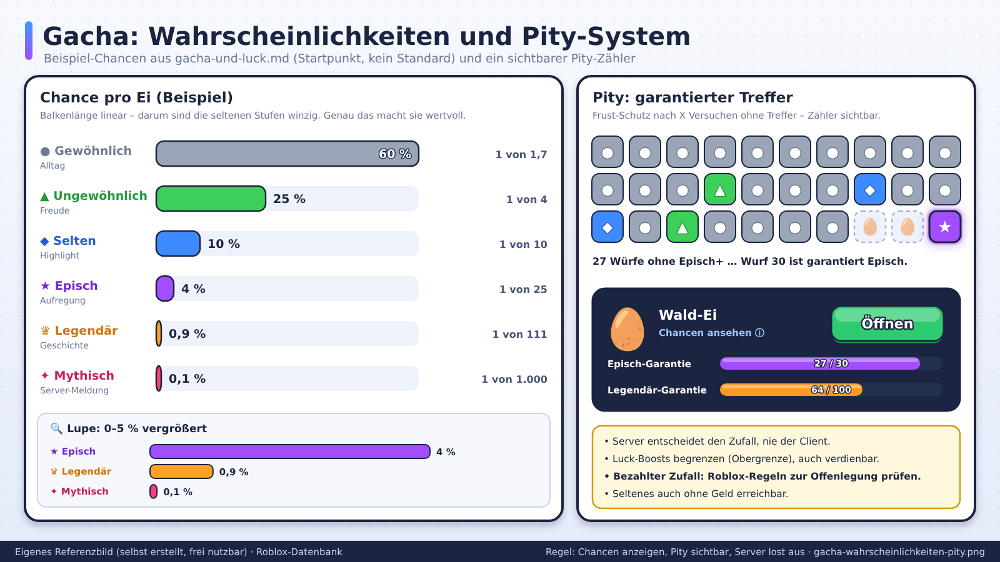
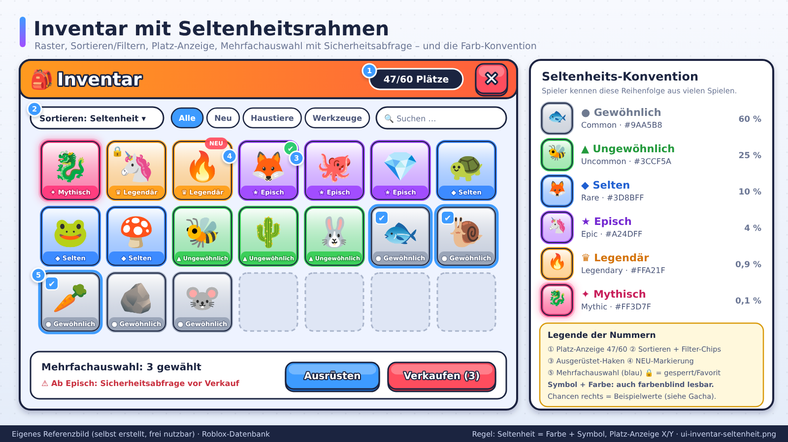
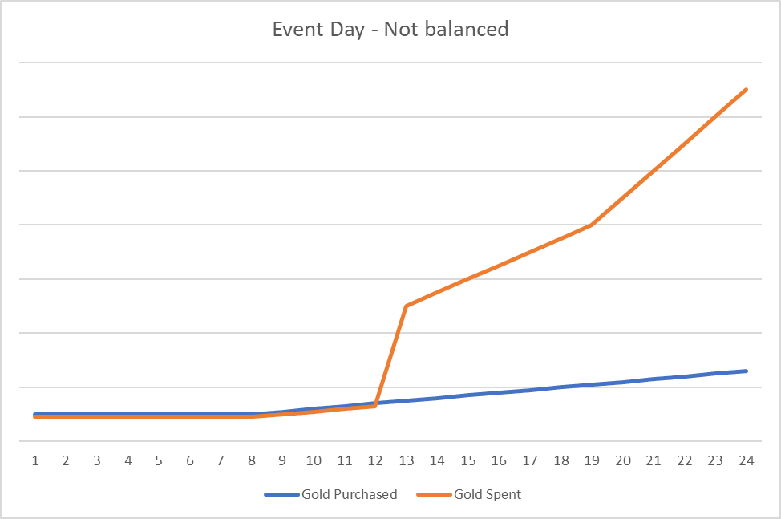
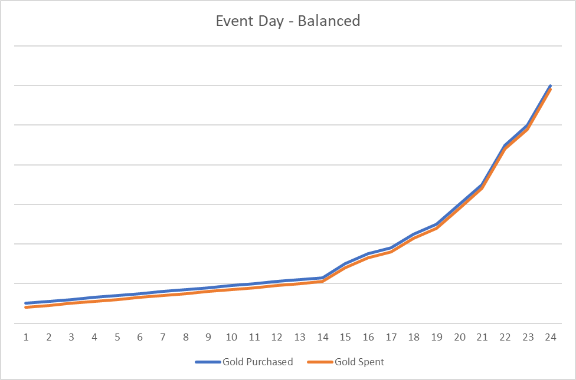
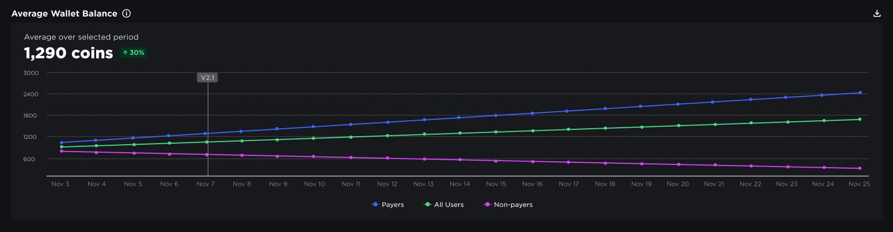

# Gacha, Luck und Seltenheit

> Stand: 2026-10-24 · Nächste Prüfung: 2026-11-24 · Gesamt-Vertrauen: ✅ für die Roblox-Regeln zu bezahlten Zufallsitems (gegen die Creator Docs vom 24.10.2026 geprüft), 🟠 für Beispiele aus Spiele-Guides, 🧠 für Formeln, Rechenbeispiele und Designprinzipien

Rechtlicher Hintergrund, Klagen, Länder: `07-monetarisierung/ethik-und-recht.md`. Preise und Shop: `07-monetarisierung/preisgestaltung-und-shop-design.md`.

## Kurzfassung
Zufallsbelohnungen (Eier, Kisten, Mutationen, Drops) erzeugen Spannung und Geschichten und sind auf Roblox weit verbreitet. Sobald Robux oder mit Robux gekaufte Währung im Spiel sind, gelten **verbindliche Regeln**: alle Ergebnisse mit echten Prozentwerten, Summe genau 100 %, sichtbar vor dem Kauf. Luck-Boosts und Pity-Systeme zählen selbst als bezahlte Zufallsitems ✅ ([Paid random items](https://create.roblox.com/docs/production/monetization/paid-random-items)). Für Spieler, denen bezahlter Zufall nicht erlaubt ist, braucht das Spiel eine Alternative, etwa einen Direktkauf zum Erwartungswert ✅ (ebd.). Baue Zufall **transparent, mit Pity, mit gedeckeltem Luck und nie als Zwang**.

## Referenzbilder
Selbst erstellte und offizielle Referenzbilder (Übersicht: `assets/bilder/README.md` und `assets/bilder/offiziell/README.md`).





*Feline Fishing Fun: Ein Event mit seltenem Fang (Golden Salmon, 0,1 %) ohne Vorab-Rechnung. Gold Spent schießt hoch, Gold Purchased bleibt flach, danach sinkt der Umsatz. Quelle: Roblox Creator Docs, CC BY 4.0 ([Balance virtual economies](https://create.roblox.com/docs/production/game-design/balance-virtual-economies))*


*Dasselbe Event mit Erwartungswert-Rechnung und Senken: Quellen und Senken steigen gemeinsam. Quelle: Roblox Creator Docs, CC BY 4.0 ([Balance virtual economies](https://create.roblox.com/docs/production/game-design/balance-virtual-economies))*


*Durchschnittliches Guthaben nach Zahlern, allen Nutzern und Nichtzahlern. Steigt es dauerhaft, fehlen Senken, oft nach zu starkem Luck. Quelle: Roblox Creator Docs, CC BY 4.0 ([Economy events](https://create.roblox.com/docs/production/analytics/economy-events))*

---

## Wie Roblox-Spiele Zufall aufbauen
Beispiel *Ride a Pet* (Guide, 🟠): 22 Eier in 7 Seltenheitsstufen; vom einfachen Ei mit 1× Luck bis zu extremen Stufen (Billionen-Luck im Guide); Luck wird durch Pets, Mutationen und Rebirths gestapelt; Mutations-Multiplikatoren von 2× bis 100× ([games.gg](https://games.gg/roblox/guides/ride-a-pet-all-eggs-and-how-to-get-them/)).
Beispiel *Adopt Me* (Guide, 🟠): Seltenheit wird beim Schlüpfen zufällig bestimmt; Gamepasses können die Chancen erhöhen. Solche Chancen-Passes sind nach heutiger Regel **Wahrscheinlichkeits-Modifikatoren** und brauchen eine numerische Erklärung ✅ ([Paid random items](https://create.roblox.com/docs/production/monetization/paid-random-items)).
Beispiel *Grow a Garden* (Presse, 🟡): zufällige Samen-Drops und Robux-Restocks, als lootbox-artig kritisiert ([GameDaily](https://gamedaily.com/games/everything-about-grow-a-garden-the-cozy-idle-sim-revolutionizing-roblox-revenue)). Samen mit Robux kaufen und pflanzen ist **indirekter** bezahlter Zufall; nach den älteren Richtlinien mussten die Quoten vor dem Pflanzen sichtbar sein ✅ ([Virtual items policy, alt](https://developer.roblox.com/zh-cn/articles/virtual-items-policy)).

**Muster:**
1. **Eier/Kisten nach Stufen:** Höhere Stufe = teurer, größerer Pool.
2. **Luck-Stat:** Verschiebt Wahrscheinlichkeiten nach oben.
3. **Mutationen:** Zweite Zufallsschicht mit Multiplikatoren.
4. **Seltenheitsstufen:** Common, Uncommon, Rare, Epic, Legendary, Mythic, Secret etc.
5. **Sichtbarkeit:** Server-weite Meldungen bei seltenen Funden (Social Proof).
6. **Limitierte Zufallsitems:** nur für kurze Zeit im Pool, z. B. der Golden Salmon mit 0,1 % für 24 Stunden im offiziellen Beispiel ✅ ([Balance virtual economies](https://create.roblox.com/docs/production/game-design/balance-virtual-economies)).

## Warum Zufall wirkt (🧠 Psychologie, allgemein)
- **Variable Belohnung:** Unvorhersehbare Belohnungen erzeugen mehr Anreiz als feste.
- **Geschichten:** „Ich hab ein Mythic gezogen!" ist erzählbar und teilbar.
- **Sammeldrang:** Fehlende Items in Büchern treiben Wiederkehr.
- **Beinahe-Gewinn:** Seltene Funde „fast" zu haben erhöht die Lust auf Wiederholung.
Diese Mechanismen sind stark. **Verantwortung:** Nutze sie für Spaß, nicht für Druck bei Kindern. Eine Studie der University of Sydney fand irreführende Kaufgestaltung in 14 von 15 beliebten Roblox-Spielen 🟡 ([ACS Information Age](https://ia.acs.org.au/article/2026/roblox-sucking-up-money-from-young-players--study.html)).

---

## Roblox-Regeln für bezahlten Zufall (verifiziert) ✅
Alle Punkte aus [Paid random items policy guidelines](https://create.roblox.com/docs/production/monetization/paid-random-items), sofern nicht anders angegeben.

### Wann die Regeln greifen

| Fall | Regeln gelten? |
|---|---|
| Ei direkt für Robux öffnen | ja |
| Edelsteine für Robux kaufen, dann Ei mit Edelsteinen öffnen | ja (indirekt) |
| Schlüssel, Re-Roll-Token, Spin-Tickets für Robux | ja, Quoten **bevor** die Währung ausgegeben wird |
| Bezahlter Luck-Trank, bezahltes Pity, Rate-up-Scroll | ja (Wahrscheinlichkeits-Modifikator) |
| Bezahlter Trank mit zufälliger Dauer, Upgrade mit Erfolgschance | ja (Verstärkungs-Item) |
| Zwei Eier verschmelzen für bessere Chance (wenn Eier bezahlt) | ja (Kombinations-Item) |
| Ei als Belohnung für eine Quest, Schlüssel in der Welt gefunden | **nein**, keine Offenlegungspflicht |
| Spielwährung nur erspielt, nie für Robux kaufbar | nach Wortlaut nein 🧠, Quoten trotzdem zeigen |

Achtung 🧠: Sobald dieselbe Währung **auch** für Robux kaufbar ist, gilt jeder Zufall, der sie kostet, als bezahlt. Viele Simulatoren haben genau diese Mischung.

### Pflichten bei der Anzeige
1. **Alle Endergebnisse** mit **echten Prozentwerten**; Summe **genau 100 %**.
2. Lange Listen dürfen in ein Pop-up, wenn der Auslöser **„Info“ oder „Details“** heißt. Ein **(i) allein reicht nicht**.
3. Rundung: auf **vier oder mehr Stellen** hinter der ersten Nicht-Null-Stelle, plus Hinweis „Probabilities are rounded; total of displayed individual probabilities may not equal 100%.“
4. Viele gleiche Quoten: „Odds for each item listed below: X%“ ist erlaubt.
5. Kann ein Spieler ein Ergebnis nur einmal bekommen, müssen die Restquoten **für ihn** aktualisiert werden.
6. Luck-Items: Wirkung **numerisch** erklären, Quoten bei aktivem Item **dynamisch** anzeigen.

### Pflichten pro Spieler
- `PolicyService:GetPolicyInfoForPlayerAsync()` → `ArePaidRandomItemsRestricted`. Bei **true** eine von sechs Behandlungen: erspielbarer Weg, feste offengelegte Reihenfolge, **Direktkauf zum Erwartungswert** (10 Robux bei 5 % → 200 Robux), entfernen/verstecken, mit Meldung blockieren, wegteleportieren.
- `IsPaidItemTradingAllowed` → bei **false** kein Handel mit Ergebnissen bezahlter Zufallsitems und anderen bezahlten Items.
- Die Monetarisierungs-Übersicht nennt die Sperre „required“ ✅ ([Monetization](https://create.roblox.com/docs/production/monetization)); die Fragebogen-Seite sagt widersprüchlich „recommended to take the mandatory precautions“ ([Content maturity](https://create.roblox.com/docs/production/promotion/content-maturity)). Als Pflicht behandeln.
- Bezahlte Zufallsitems im Maturity-&-Compliance-Fragebogen angeben ✅ ([Content maturity](https://create.roblox.com/docs/production/promotion/content-maturity)).

### Wo Zufall gar nicht erlaubt ist
- Belohnungen für **Rewarded Video** ✅ ([Rewarded video ads](https://create.roblox.com/docs/production/promotion/rewarded-video-ads)).
- **Promo-Passes** auf der „Buy Robux“-Seite ✅ ([Passes](https://create.roblox.com/docs/production/monetization/passes)).
- Digitale Zugaben zu **Commerce-Produkten** ✅ ([Commerce products](https://create.roblox.com/docs/production/monetization/commerce-products)).
- Spielbares Glücksspiel, auch simuliert ✅ ([Content maturity](https://create.roblox.com/docs/production/promotion/content-maturity)).

**Korrektur gegenüber der alten Fassung:** Hier stand „Pflicht nach Roblox-Regeln prüfen“ und „Offizielle Richtlinien … hier nicht bestätigt“. Die Regeln sind jetzt geprüft und oben zusammengefasst. Eine Länderliste (AU, BE, NL, UK, BR) kursiert in Sekundärquellen 🟠, steht aber nicht in der Doku. Immer per Spieler mit PolicyService prüfen, nie per eigener Länderliste.

---

## Wahrscheinlichkeits-Tabelle (Beispiel, 🧠 Startpunkt)
| Stufe | Gewicht | Chance | „1 von …“ | Gefühl |
|---|---|---|---|---|
| Common | 60 | 60 % | 1,7 | Alltag |
| Uncommon | 25 | 25 % | 4 | Freude |
| Rare | 10 | 10 % | 10 | Highlight |
| Epic | 4 | 4 % | 25 | Aufregung |
| Legendary | 0,9 | 0,9 % | 111 | Geschichte |
| Mythic | 0,1 | 0,1 % | 1.000 | Server-Meldung |
| **Summe** | 100 | **100 %** | | |

### Was „1 von 1.000“ für Spieler bedeutet 🧠
Formel: Chance auf mindestens einen Treffer in n Zügen = 1 − (1 − p)ⁿ.

| Züge | Chance auf mind. ein Mythic (p = 0,1 %) |
|---|---|
| 100 | 9,5 % |
| 500 | 39,4 % |
| 693 | 50 % |
| 1.000 | 63,2 % |
| 2.302 | 90 % |

Lehre: Bei „1 von 1.000“ hat **mehr als ein Drittel** der Spieler nach 1.000 Zügen noch keins. Ohne Pity entsteht Frust, mit Robux-Preis auch Kaufdruck.

---

## Luck-Formeln 🧠
„2× Luck“ kann im Code sehr Verschiedenes bedeuten. Die Regel verlangt, dass die **tatsächlichen** neuen Quoten angezeigt werden. Drei gängige Umsetzungen:

### Methode A: Gewichte seltener Stufen multiplizieren, dann normalisieren
Neue Chance = (Gewicht × Luck) / Summe aller neuen Gewichte. Luck wirkt hier nur auf Rare und besser.

| Stufe | Basis | 2× Luck (A) | 9× Luck (A) |
|---|---|---|---|
| Common | 60 % | 52,174 % | 27,273 % |
| Uncommon | 25 % | 21,739 % | 11,364 % |
| Rare | 10 % | 17,391 % | **40,909 %** |
| Epic | 4 % | 6,957 % | 16,364 % |
| Legendary | 0,9 % | 1,565 % | 3,682 % |
| Mythic | 0,1 % | **0,17391 %** | 0,40909 % |
| Summe der Gewichte | 100 | 115 | 220 |

Zwei Lehren:
- „2× Luck“ macht Mythic nicht doppelt so wahrscheinlich, sondern nur 1,74-mal. „2ד ohne Prozentwerte anzuzeigen wäre irreführend und verstößt gegen die Pflicht zur numerischen Erklärung.
- Bei 9× wird Rare zur häufigsten Stufe. Die Seltenheitsleiter kippt.

### Methode B: Chancen seltener Stufen multiplizieren, Common füllt auf
Neue Chance seltener Stufen = Basis × Luck; Common = 100 % − Rest. Bei 2× auf Rare und besser: Rare 20 %, Epic 8 %, Legendary 1,8 %, Mythic 0,2 %, Uncommon 25 %, Common **45 %**.
Hier verdoppelt sich Mythic wirklich. Bei hohem Luck geht die Summe über 100 %; dann braucht es eine harte Obergrenze pro Stufe oder Methode A.

### Methode C: Luck als zusätzliche Würfe („bestes von n“)
2× Luck = zweimal würfeln, das seltenere Ergebnis behalten. Chance auf mindestens Epic: 1 − (1 − 0,05)² = **9,75 %** (statt 5 %). Mythic: 1 − 0,999² = **0,1999 %**. Fühlt sich natürlich an, die Anzeige muss aber die Ergebnis-Quoten nach dem „Bestes von 2“ zeigen.

### Luck stapeln und deckeln
| Quelle | Wert | Multiplikativ | Additiv |
|---|---|---|---|
| Pet-Bonus | +50 % | × 1,5 | + 0,5 |
| Pass „2× Luck“ | 2× | × 2 | + 1 |
| Trank | 3× | × 3 | + 2 |
| **Gesamt** | | **9×** | **4,5×** |

Empfehlungen:
- Additiv stapeln oder eine harte Obergrenze (z. B. 5×) setzen, sonst explodiert Luck mit Rebirths und Events.
- Luck-Boosts zeitlich begrenzt oder **auch erspielbar**, nicht nur kaufbar.
- Eine **Anzeige „Deine aktuellen Quoten“** neben dem Ei, die alle aktiven Boosts einrechnet. Das erfüllt die Pflicht zur dynamischen Anzeige ✅ und ist ehrlich.

---

## Pity-System 🧠
Pity zählt laut Doku zu den **Wahrscheinlichkeits-Modifikatoren** ✅ ([Paid random items](https://create.roblox.com/docs/production/monetization/paid-random-items)). Wenn Züge bezahlt sind, muss die Pity-Regel also numerisch erklärt werden.

### Beispiel und Rechnung
- Nach 30 Würfen ohne Epic+ → garantiertes Epic.
- Nach 100 Würfen ohne Legendary+ → garantiertes Legendary.
- Zähler sichtbar machen („Garantiert in 27 Zügen“).

Formel für harte Pity bei Zug N: Erwartete Züge bis zum Treffer = (1 − (1 − p)ᴺ) / p.

| Pity | Basischance p | Wie oft greift Pity? | Erwartete Züge | Effektive Rate |
|---|---|---|---|---|
| Epic+ bei 30 | 5 % (4 + 0,9 + 0,1) | 22,6 % der Serien (0,95²⁹) | 15,7 | 6,37 % |
| Legendary+ bei 100 | 1 % (0,9 + 0,1) | 37,0 % der Serien (0,99⁹⁹) | 63,4 | 1,58 % |

Kosten-Beispiel bei 25 Robux pro Ei 🧠:
- Im Schnitt 63,4 × 25 = **ca. 1.585 Robux** bis zum ersten Legendary+, höchstens 2.500 Robux.
- Ohne Pity wären es im Schnitt 25 / 0,01 = 2.500 Robux, nach oben offen.
- Der offizielle Direktkauf zum Erwartungswert für eingeschränkte Spieler rechnet nur mit der Basisquote (Boxpreis ÷ Chance). Wie Pity einzurechnen ist, sagt die Doku nicht. Fairer Ansatz 🧠: den niedrigeren Wert mit Pity ansetzen.

### Anzeige mit Pity
- In der Quotenliste die Basischance **und** die Pity-Regel nennen: „Legendary+: 1 % pro Zug, garantiert spätestens beim 100. Zug ohne Legendary+“.
- Bei **Soft Pity** (Chance steigt ab Zug 75 jeden Zug an) die aktuelle Chance live anzeigen, analog zur Pflicht bei Luck-Items.
- Zähler pro Ei-Typ speichern, serverseitig, zusammen mit dem Inventar in der DataStore. Zähler nie zurücksetzen, wenn ein Event endet, ohne das vorher anzukündigen.

### Keine Duplikate
Regel ✅: Ist ein Ergebnis nur einmal erhältlich, müssen die Restquoten für den Spieler aktualisiert werden. Beispiel 🧠: Ein Event-Ei hat 5 Items zu je 20 %. Nach zwei verschiedenen Treffern zeigt das Ei für diesen Spieler 3 Items zu je 33,33 %.

---

## Erwartungswert (EV) für die Wirtschaft ✅/🧠
Offizielle Definition: Summe aller möglichen Werte, jeweils mal ihrer Wahrscheinlichkeit ✅ ([Balance virtual economies](https://create.roblox.com/docs/production/game-design/balance-virtual-economies)).
Offizielles Beispiel *Feline Fishing Fun*: Ein normaler Angelversuch bringt im Schnitt 7 + 4 + 3 = **14 Gold**, bei 1.000 Versuchen pro Tag 14.000 Gold ✅. Der Golden Salmon mit **0,1 %** und **1.000 Gold** fügt 0,001 × 1.000 = **1 Gold** pro Versuch hinzu (+7 %) 🧠. Gefährlich wurde laut Doku vor allem, dass während des Events viel mehr geangelt wurde als erwartet. Ergebnis: Goldüberschuss, weniger Goldkäufe, sinkender Umsatz nach dem Event ✅.
Sicherste Lösung laut Doku: eine **eigene Event-Währung** mit eigenem Event-Shop ✅ (ebd.).

EV pro Ei 🧠: Ordne jeder Stufe einen Wert in Spielwährung zu (z. B. Verkaufspreis), multipliziere mit der Chance und summiere. Liegt der EV über dem Eipreis, erzeugt das Ei Geld aus dem Nichts (Inflation). Luck-Boosts erhöhen den EV; deshalb jedes Luck-Event vorher durchrechnen.

---

## Verantwortungsvolles Design
| Prinzip | Umsetzung |
|---|---|
| **Transparenz** | Alle Quoten in Prozent, Summe 100 %, vor dem Kauf; „Details“-Button ✅ |
| **Ehrlicher Luck** | aktuelle Quoten mit allen Boosts anzeigen, nicht nur „2ד ✅ |
| **Spielbar ohne Geld** | Seltene Items auch durch Spielen erreichbar |
| **Kein Zwang** | Kein Fortschritts-Block ohne Zufalls-Treffer |
| **Pity-System** | Garantierter Treffer nach X Versuchen, Zähler sichtbar |
| **Ausweg für eingeschränkte Spieler** | Direktkauf zum Erwartungswert oder erspielbarer Weg ✅ |
| **Kein Druck** | Keine Fake-Countdowns, keine Schuld-Texte ✅ ([Monetization](https://create.roblox.com/docs/production/monetization)) |
| **Handel absichern** | `IsPaidItemTradingAllowed` prüfen; Betrug und Duplikat-Bugs verhindern |
| **Kind-gerechte Texte** | „Ei ansehen“ statt „JETZT ÖFFNEN, LETZTE CHANCE!“ ✅ |

## Technik 🧠
- Auslosung **nur auf dem Server**. Der Client zeigt Animation und Ergebnis, entscheidet aber nie.
- Quotenanzeige und Auslosung aus **derselben Tabelle** berechnen, damit Anzeige und Wirklichkeit nie auseinanderlaufen.
- Bezahlte Züge über `ProcessReceipt` idempotent verarbeiten (siehe `08-technik-luau/technik-grundlagen.md`).

```lua
-- Server: gewichtete Auslosung und Quotenanzeige aus derselben Tabelle
local rng = Random.new()

local function getOdds(tiers) -- tiers = { {name = "Common", weight = 60}, ... }
	local total = 0
	for _, tier in tiers do
		total += tier.weight
	end
	local odds = {}
	for _, tier in tiers do
		odds[tier.name] = tier.weight / total * 100 -- Prozent, Summe = 100
	end
	return odds, total
end

local function rollTier(tiers)
	local _, total = getOdds(tiers)
	local r = rng:NextNumber() * total
	for _, tier in tiers do
		r -= tier.weight
		if r < 0 then
			return tier.name
		end
	end
	return tiers[#tiers].name
end
```

## Handel und Wert
- Seltene Items brauchen **Wertstabilität**, sonst sind Besitzer frustriert.
- Verhindere Duplikat-Bugs (serverseitige Validierung, siehe `08-technik-luau/`).
- Regionale Preise erzeugen Arbitrage beim Handel; `GetUsersPriceLevelsAsync` hilft beim Begrenzen ✅ ([Regional pricing](https://create.roblox.com/docs/production/monetization/regional-pricing)).

## Alternativen zu reinem Zufall
- **Crafting:** Zutaten sammeln → Item herstellen (planbar).
- **Gezielte Kreuzung:** Regeln, die Spieler lernen können.
- **Erkunden:** Seltene Items an bestimmten Orten/Zeiten.
- **Aufträge:** Belohnung bei Aufgabe.
- **Feste Reihenfolge:** „1. Dreh 5, 2. Dreh 10, 3. Dreh 20 Edelsteine“ ist laut Doku eine zulässige Alternative für eingeschränkte Spieler ✅.
- **Direktkauf:** jedes Item auch direkt kaufbar, Preis = Boxpreis ÷ Chance ✅.
Ein Mix aus Zufall und Planbarkeit ist langfristig gesünder.

## Do / Don't
| Do | Don't |
|---|---|
| Quoten aus derselben Tabelle anzeigen und auslosen | Anzeige und Code getrennt pflegen |
| „Details“-Button mit Wort | nur (i) |
| Aktuelle Quoten mit Boosts anzeigen | „2× Luck!“ ohne Prozentwerte |
| Pity mit sichtbarem Zähler | Pity verstecken oder still zurücksetzen |
| Luck additiv oder gedeckelt | Luck unbegrenzt multiplikativ stapeln |
| Event-Währung für Zufalls-Events | Hauptwährung mit 0,1-%-Jackpots fluten |
| PolicyService pro Spieler | Länderliste im Code |

## Checkliste
- [ ] Alle Stellen mit Robux-Bezug (direkt oder über Währung) identifiziert
- [ ] Wahrscheinlichkeiten angezeigt, Summe 100 %, korrekt implementiert und gerundet
- [ ] „Info“/„Details“-Beschriftung am Pop-up
- [ ] Luck-Boosts: aktuelle Quoten dynamisch angezeigt
- [ ] Pity-System vorhanden, Regel und Zähler sichtbar
- [ ] Einmalige Items: Restquoten aktualisiert
- [ ] `ArePaidRandomItemsRestricted` und `IsPaidItemTradingAllowed` umgesetzt, im Player Emulator getestet
- [ ] Maturity-Fragebogen: Paid Random Items angegeben
- [ ] Spiel ohne Käufe durchspielbar
- [ ] Luck-Obergrenze gesetzt, EV jedes Eis gegen seinen Preis gerechnet
- [ ] Keine Dark Patterns (Fake-Knappheit, Druck-Texte)
- [ ] Server-seitige Auslosung (Client darf nicht entscheiden)

## Offene Fragen / Recherche-Bedarf
- Wie Pity in den offiziellen „Direktkauf zum Erwartungswert“ einzurechnen ist.
- Ob die Regeln auch für rein erspielte Währungen gelten, wenn ein Teil der Spieler sie über Robux-Pakete erhält (Mischwährungen).
- Offizielle Länderliste der Einschränkungen.
- Psychologie- und Industriequellen zu Loot-Mechaniken (Studien zu Kindern) vertiefen, siehe `07-monetarisierung/ethik-und-recht.md`.

## Quellen
- [Paid random items policy guidelines](https://create.roblox.com/docs/production/monetization/paid-random-items) – Doku-Stand 2026-10-24, ✅
- [Monetization (Richtlinien)](https://create.roblox.com/docs/production/monetization) – ✅
- [PolicyService](https://create.roblox.com/docs/reference/engine/classes/PolicyService) – ✅
- [Content maturity](https://create.roblox.com/docs/production/promotion/content-maturity) – ✅
- [Balance virtual economies](https://create.roblox.com/docs/production/game-design/balance-virtual-economies) – ✅
- [Economy events](https://create.roblox.com/docs/production/analytics/economy-events) – ✅
- [Rewarded video ads](https://create.roblox.com/docs/production/promotion/rewarded-video-ads), [Passes](https://create.roblox.com/docs/production/monetization/passes), [Commerce products](https://create.roblox.com/docs/production/monetization/commerce-products), [Regional pricing](https://create.roblox.com/docs/production/monetization/regional-pricing) – ✅
- [Developer Hub: Virtual items policy (alt)](https://developer.roblox.com/zh-cn/articles/virtual-items-policy) – ✅ (veraltet)
- [DevForum: Clarifying Requirements for Paid Random Items](https://devforum.roblox.com/t/clarifying-requirements-for-paid-random-items/4654622) – Mai 2026, ✅/🟡
- [ACS Information Age: Studien zu Dark Patterns](https://ia.acs.org.au/article/2026/roblox-sucking-up-money-from-young-players--study.html) – 2026, 🟡
- [GameDaily: Grow a Garden](https://gamedaily.com/games/everything-about-grow-a-garden-the-cozy-idle-sim-revolutionizing-roblox-revenue) – 2025, 🟡
- [Ride a Pet Eggs – games.gg](https://games.gg/roblox/guides/ride-a-pet-all-eggs-and-how-to-get-them/) – 🟠
