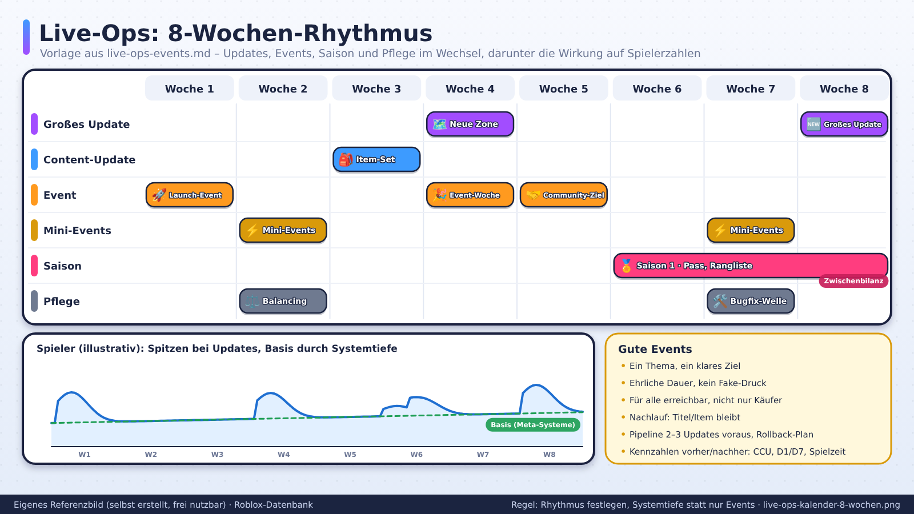
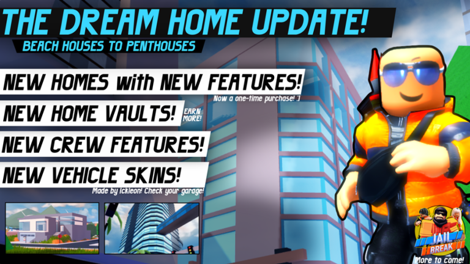
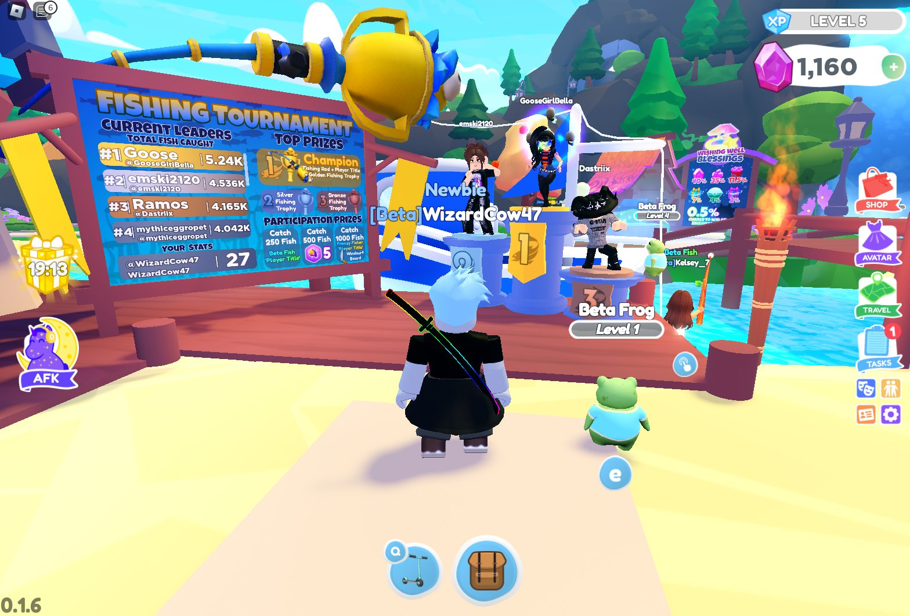
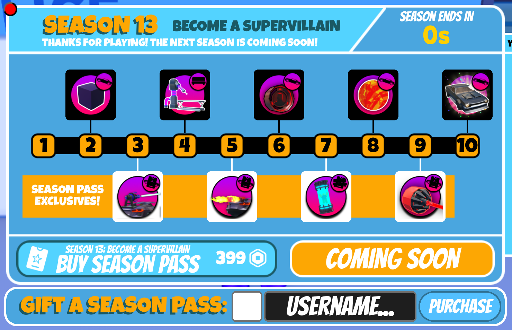
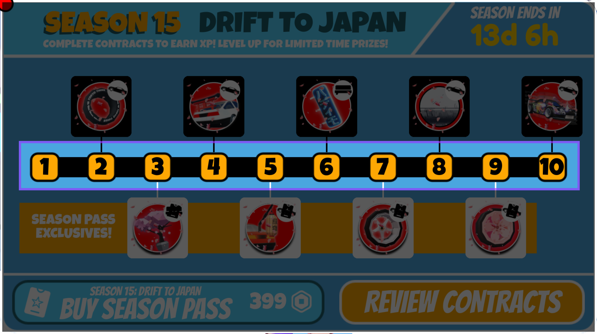
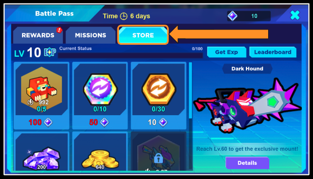

# Live-Ops, Events, Season Pass und Updates

> Stand: 2026-10-24 · Nächste Prüfung: 2026-11-21 · Gesamt-Vertrauen: ✅ für offizielle LiveOps-, Season-Pass-, Wirtschafts- und Event-Regeln (Creator Docs), 🟡/🟠 für Beobachtungen bei Hit-Spielen, 🧠 für Pläne und Rechenbeispiele

## Kurzfassung
LiveOps besteht laut Roblox aus vier Teilen: **Content-Kadenz, große Updates, Quality-of-Life-Verbesserungen und Bugfixes**. ✅ Zur Update-Frequenz widerspricht sich die Doku: „weekly ideal, monthly minimum“ (Monetarisierung), „kleinere Updates alle 2–4 Wochen, größere alle 2–3 Monate“ (Retention) und „viele Spiele alle zwei Wochen bis einen Monat“ (Content updates). ✅ Season Passes starten laut Doku am besten mit **1 Monat Laufzeit, mindestens 1 Woche Pause, etwa 10 Stufen** und doppelter XP in der letzten Woche. ✅ Events müssen vorab wirtschaftlich modelliert werden (Erwartungswert, eigene Event-Währung), sonst sinkt der Umsatz nach dem Event. ✅ Die Hits von 2025 fuhren wöchentliche Samstags-Updates mit Live-„Admin Abuse“-Events. Das erzeugte Rekordspitzen, gilt aber als Burnout-Tretmühle. Selbst BIG Games und Grow a Garden 2 sind davon abgerückt. 🟡/🟠

## Referenzbilder
Selbst erstellte, beschriftete Referenzbilder (frei nutzbar, Übersicht: `assets/bilder/README.md`).

Offizielle Bilder aus der Roblox Creator Documentation (CC BY 4.0, Übersicht und Lizenz: `assets/bilder/offiziell/README.md`).

*Jailbreak: Update-Banner „The Dream Home Update!“ mit Feature-Liste. Quelle: Roblox Creator Docs, CC BY 4.0 ([LiveOps essentials](https://create.roblox.com/docs/production/game-design/liveops-essentials))*

*Overlook Bay 2: „Fishing Tournament“ mit Live-Leaderboard. Spieleraktionen, KPIs und Wirtschaftsfolgen vorher planen. Quelle: Roblox Creator Docs, CC BY 4.0 ([LiveOps planning](https://create.roblox.com/docs/production/game-design/liveops-planning))*

*„Event Day – Not balanced“: Gold Spent steigt, Gold Purchased bleibt flach. Quelle: Roblox Creator Docs, CC BY 4.0 ([Balance virtual economies](https://create.roblox.com/docs/production/game-design/balance-virtual-economies))*

*„Event Day – Balanced“: Quellen und Senken steigen gemeinsam. Quelle: Roblox Creator Docs, CC BY 4.0 ([Balance virtual economies](https://create.roblox.com/docs/production/game-design/balance-virtual-economies))*

*Jailbreak Season 13: zehn Stufen, Free- und Premium-Belohnungen nebeneinander. Quelle: Roblox Creator Docs, CC BY 4.0 ([Season pass design](https://create.roblox.com/docs/production/game-design/season-pass-design))*

*Jailbreak Season 15: die Reihe der zehn Tiers. Quelle: Roblox Creator Docs, CC BY 4.0 ([Season pass design](https://create.roblox.com/docs/production/game-design/season-pass-design))*

*Bot Clash Simulator: Tabs Rewards/Missions/Store, gut auffindbar integriert. Quelle: Roblox Creator Docs, CC BY 4.0 ([Monetization foundations](https://create.roblox.com/docs/production/game-design/monetization-foundations))*

## Warum das wichtig ist
- „Without LiveOps updates, even dedicated players lose interest.“ ✅ ([LiveOps essentials](https://create.roblox.com/docs/production/game-design/liveops-essentials))
- Regelmäßige Updates sind der offizielle Hebel für **D30**. ✅ ([Retention](https://create.roblox.com/docs/production/analytics/retention))
- Es ist leichter, aktive Spieler zu halten, als verlorene zurückzuholen. ✅ ([Monetization](https://create.roblox.com/docs/production/monetization))
- Die neuen Rekorde der Plattform kamen mit Update-Terminen: Grow a Garden erreichte neue CCU-Spitzen an Update-Tagen, der Plattformrekord von 47,3 Mio. gleichzeitigen Nutzern (23.08.2025) fiel auf einen Samstag mit Admin-Events. 🟡 ([Insider Gaming](https://insider-gaming.com/roblox-grow-a-garden-shatters-all-time-player-record-for-second-week-in-a-row/); [Notebookcheck](https://www.notebookcheck.net/Roblox-achieves-record-breaking-47-4-million-concurrent-players-in-August-despite-recent-legal-controversies.1096346.0.html))

## Details

### 1. Die vier Bausteine von LiveOps ✅
Quelle: [LiveOps essentials](https://create.roblox.com/docs/production/game-design/liveops-essentials)

| Baustein | Was | Wer arbeitet daran | Frequenz | Beispiele aus der Doku |
|---|---|---|---|---|
| **Content-Kadenz** | neue Inhalte auf **bestehenden** Systemen | vor allem Art | wöchentlich bis monatlich | Pets, Fahrzeuge, Waffen, Maps, Quests; Limited-Time-Events, saisonale Inhalte, UGC-Wettbewerbe |
| **Große Updates** | neue oder erweiterte **Systeme** | Art, Design, Code | „many months“ Entwicklung möglich | Social (Gilden, Gruppen, Handel, Partys), Kompetitiv (PvP, Ranglisten, Turniere), Sammlungen/Achievements (Pets, Season Pass), Live-Events (Map-Umbau, neue Rollen, um verlorene Spieler zurückzuholen) |
| **Quality of Life** | bestehendes Spiel polieren | gemischt | nach Bedarf | UI-Layouts, UX-Flows, Optik-Refresh, Barrierefreiheit, Performance; Beispiel *Doors* |
| **Bugfixes** | Fehler beheben | Code | laufend | Priorisieren nach Schwere, Aufwand, Zahl betroffener Spieler; Beispiel *Doors* |

**Best Practices laut Doku:** auf Spieler hören (Discord, Gruppen; wichtiger als der konkrete Vorschlag ist der Grund dahinter), Gameplay verbessern (alles muss am Core Loop hängen, Analytics nutzen), **„Prioritize mental health“**: realistisch einschätzen, wie oft das Team liefern kann, ohne die Work-Life-Balance zu verlieren. ✅

### 2. Update-Kadenz: was die Doku sagt (und wo sie sich widerspricht)
| Doku-Seite | Aussage | Link |
|---|---|---|
| Monetization | „A **weekly cadence** for updates is ideal. At the bare minimum, aim for **monthly** updates.“ | ✅ [Monetization](https://create.roblox.com/docs/production/monetization) |
| Retention | „smaller updates on the existing mechanics every **2–4 weeks**, and bigger updates of new features every **2–3 months**“ (als „common frequency“) | ✅ [Retention](https://create.roblox.com/docs/production/analytics/retention) |
| Content updates | „many games release content cadence updates every **two weeks to one month**“; Aufwand pro Kadenz-Update **unter drei Wochen** | ✅ [Content updates](https://create.roblox.com/docs/production/game-design/content-updates) |
| LiveOps essentials | Kadenz „ranging from weekly to monthly releases“, je nach Team | ✅ [LiveOps essentials](https://create.roblox.com/docs/production/game-design/liveops-essentials) |

**Einordnung (🧠):** Die Seiten widersprechen sich nur scheinbar. Der gemeinsame Nenner: **mindestens monatlich etwas Neues, kleine Drops alle 2–4 Wochen, ein großes System alle 2–3 Monate, wöchentlich nur mit Team-Kapazität.** Für ein kleines Team ist der Rhythmus „alle 2 Wochen ein Drop unter 3 Wochen Aufwand, alle 2–3 Monate ein großes Update, dazu ein fester Live-Termin“ realistisch. Wöchentlich lohnt erst, wenn die DAU ein eigenes LiveOps-Team tragen.

**Weitere offizielle Update-Regeln** ✅ ([Monetization](https://create.roblox.com/docs/production/monetization))
- Updates **unter ein Thema** stellen (Beispiel: neuer Zoo im Rollenspiel, alles hängt am Zoo-Thema).
- Spieler sollen sich den Zugang **verdienen**, über Monetarisierung oder Voraussetzungen im Spiel.
- Mit jedem großen Update neue Thumbnails testen und danach bis zum nächsten Update nichts ändern. ✅ ([Thumbnails](https://create.roblox.com/docs/production/publishing/thumbnails))
- Home-Traffic hat meist **samstags** die Wochenspitze. ✅ ([Discovery](https://create.roblox.com/docs/discovery)) → Updates vor dem Wochenende veröffentlichen ist naheliegend. 🧠

### 3. Content-Kadenz richtig bauen ✅
Quelle: [Content updates](https://create.roblox.com/docs/production/game-design/content-updates)
- **Richtige Inhalte:** Avatar-Items, Möbel, Pets, Fahrzeuge, Waffen, Level/Maps, Quests. Ideal: einfache Varianten (z. B. nur Farbe), die wenige Leute schnell bauen können. Beispiel: **Pet-Varianten in *Adopt Me!*** (gefleckt, farbig) und **thematische Updates**.
- Braucht ein Inhalt ein neues System, ist es eine Erweiterung und keine Kadenz mehr.
- **Scope:** weniger als **drei Wochen** Aufwand pro Kadenz-Update.
- **Routine:** fester Rhythmus, damit Spieler den nächsten Release erwarten und darüber spekulieren.
- **Nachhaltigkeit:** Kadenz-Inhalt darf nicht sofort verbraucht sein, sonst muss immer schneller nachgeliefert werden. Drei Wege:
  1. **Progression:** neuen Inhalt ans Ende der Progression setzen (Veteranen spielen sofort, Neue haben ein Ziel).
  2. **Limited-Time-Content:** über Quests, Meilensteine oder Event-Währung verdient; so balanciert, dass die meisten Spieler **Wochen** brauchen.
  3. **Season Pass** (siehe Abschnitt 6).
- Saisonale Themen sind nicht universell. Prüfen, welche Feiertage das eigene Publikum anspricht.

### 4. Events planen, kommunizieren, auswerten ✅
Quelle: [LiveOps planning](https://create.roblox.com/docs/production/game-design/liveops-planning)

**Planen**
- Ziel-KPI festlegen (z. B. DAU). Events beeinflussen meist mehrere KPIs gleichzeitig.
- Gewünschte Spieleraktionen und ihre Wirkung auf KPIs klären.
- Wirkung auf Verdienen und Kaufen von Währung und Items abschätzen. Beispiel *Overlook Bay 2*: Ein Angelturnier zeigt Spielern eine wichtige Verdienstquelle und erzeugt viel Engagement, die Belohnung muss aber so gewählt sein, dass sie die Wirtschaft nicht beschädigt.

**Kommunizieren**
- Extern: Social Media, Community-Tools. Intern: Login-Pop-ups, UI-Hinweise, Lobby-Anzeigen (Beispiel *World//Zero*).
- **Früh ankündigen:** Spieler planen ihre Rückkehr. **Spontan:** wirkt überraschend, wird aber leicht verpasst.
- Einen eindrucksvollen Event-Start gestalten.

**Auswerten**
- Daten **zeitnah**: stündliche Daten am selben Tag, um zu sehen, ob zu viele Preise ausgeschüttet werden.
- Daten **vergleichbar**: Event gegen Nicht-Event-Zeit, **Woche davor gegen Woche danach**.
- Erfolgs-KPIs: kurz- und längerfristige Retention während und nach dem Event, Item- und Währungsverkäufe während und nach dem Event.
- Im Retention-Dashboard: Kohorte, die während des Events startete, gegen frühere Kohorten (7D-Playtime, 7D-Conversion, 7D/30D-Umsatz pro Nutzer). ✅ ([Retention](https://create.roblox.com/docs/production/analytics/retention))

### 5. Event-Ökonomie: Quellen, Senken, Erwartungswert ✅
Quelle: [Balance virtual economies](https://create.roblox.com/docs/production/game-design/balance-virtual-economies)

**Das Doku-Beispiel „Feline Fishing Fun“**
- Währung Gold (G), verdient durch Fischverkauf, kaufbar im Shop.
- Fische: Wels 70 % / 10 G, Forelle 20 % / 20 G, Lachs 10 % / 30 G.
- **Erwartungswert pro Angelversuch:** 7 G + 4 G + 3 G = **14 G**. Bei 1.000 Versuchen pro Tag: **14.000 G** an einem normalen Tag.
- Event: **Golden Salmon**, 24 Stunden, **0,1 %** Fangchance, **1.000 G** wert.
- Ohne Vorab-Schätzung: Gold-Ausgaben steigen stark, Gold-Käufe bleiben flach → Goldüberschuss → Spieler kaufen nach dem Event kaum Gold → **Umsatz sinkt nach dem Event**.
- Hinweis: Die Doku schreibt in der Rechnung „Salmon = 30 Gold x 30% = 3G“. Das ist ein Tippfehler, gemeint sind 10 %, sonst ergäbe sich nicht 3 G. 🧠

**Eigene Weiterrechnung (🧠, Annahmen markiert)**
| Szenario | EV pro Versuch | Versuche/Tag | Gold/Tag | Faktor |
|---|---|---|---|---|
| Normaltag | 14 G | 1.000 | 14.000 G | 1,0× |
| Event, gleiche Beteiligung | 14 G + 0,001 × 1.000 G = **15 G** (Annahme: Lachs ersetzt anteilig nichts) | 1.000 | 15.000 G | 1,07× |
| Event, dreifache Beteiligung (Annahme) | 15 G | 3.000 | **45.000 G** | 3,2× |
Lesart: Der seltene Fang erhöht den EV pro Versuch nur um ~7 %. Der eigentliche Überschuss entsteht durch **mehr Versuche**. Deshalb immer die Beteiligung schätzen, nicht nur den EV.

**Senken laut Doku**
- Event-Kosmetik (z. B. limitierte goldene Accessoires).
- Sequenzielle Events, die die Währung des vorherigen Events verbrauchen.
- Ein Event-Shop mit kleinem Vorteil für Ausgaben während des Events.
- **„The safest solution … is to have an event generate a unique event currency that is only used to purchase items from a special event shop.“**

**Weitere Regeln:** Limitierte Items in jedes EV-Modell aufnehmen. Preise und Rabatte per **Experiments** testen, Flash-Sales per **Configs** auslösen. Jede neue Quelle braucht einen Plan für die Senke. ✅

**Vorlage EV-Rechner (🧠)**
| Ergebnis | Wert | Chance | Wert × Chance |
|---|---|---|---|
| A | … | …% | … |
| B | … | …% | … |
| Event-Item | … | …% | … |
| **Summe = EV pro Versuch** | | 100 % | … |
| × erwartete Versuche/Tag | | | = Währung/Tag |
| ÷ Tagesbedarf für sinnvolle Käufe | | | = Tage bis Überschuss |

### 6. Season Pass: offizielle Gestaltungsregeln ✅
Quelle: [Season pass design](https://create.roblox.com/docs/production/game-design/season-pass-design), ergänzt durch [Monetization foundations](https://create.roblox.com/docs/production/game-design/monetization-foundations)

**Ziele:** am Core Loop ausgerichtet (Missionen für jedes System, führt Spieler an neue Systeme heran), motivierend (Missionen fressen nicht die ganze Tageszeit), verständlich (automatische Teilnahme, sichtbarer Fortschritt, Restzeit), Vorfreude auf die nächste Saison (lohnende Premium- und Finalbelohnung).

| Parameter | Offizielle Empfehlung |
|---|---|
| Saisonlänge | **1 Monat** als Startpunkt, abhängig von Team-Kapazität |
| Pause zwischen Saisons | **mindestens 1 Woche** (schützt Spieler vor Burnout, gibt dem Team Zeit) |
| Stufen | **10 Tiers** als Startpunkt: häufiger Fortschritt, nicht abschreckend |
| Tier-Belohnungen | gewollt, aber nicht zu wertvoll: Verbrauchsgüter, kleine Mengen Währung, temporäre Buffs (z. B. 10 % Schild), kleine Kosmetik |
| Finalbelohnung | **neues Asset**, nach der Saison **retired** (exklusiv); 3D-Belohnungen in der Welt zeigen |
| Belohnung abholen | per **Claim-Button** mit Badge; nicht Abgeholtes am Saisonende **automatisch** gutschreiben |
| Free Pass | automatisch für alle; tägliche Missionen; eigene Belohnungen; keine Premium-Missionen |
| Premium Pass | Preis passend zum Wert; Bonusmissionen täglich (für alle sichtbar, nur für Premium abschließbar) |
| Upgrade mitten in der Saison | Premium-Belohnungen **rückwirkend** für alle erreichten Stufen |
| Aufholmechanik | **doppelte XP in der letzten Woche** |
| Wöchentliche Missionen | schwer, hohe Belohnung, für Vielspieler |
| Koop-Missionen | Teams tragen gemeinsam zum Fortschritt bei |
| Neue Features | jeweils neue Missionen dafür |

**Missionsdesign** ✅
- Neue Missionen **täglich**, Reset **täglich**; Kategorien und Schwierigkeiten variieren; selten wiederholen.
- Mindestens **3 Kategorien** im Spiel (Beispiele: Erkunden, Sammeln, Kampf, Social, Anpassung, Überleben).
- Schwierigkeit **Easy / Medium / Hard**; Tagesmissionen nicht zu schwer, sonst sinkt das Interesse.
- **Nie Hard Currency verlangen.**
- Abstand der Belohnungen relativ zur **durchschnittlichen Sitzungszeit** planen; XP pro Level klar zeigen. ([Monetization foundations](https://create.roblox.com/docs/production/game-design/monetization-foundations))
- Sichtbarkeit: große, farbige Buttons, sichtbarer Timer, HUD im Saisonthema, Hinweis beim ersten Login nach Start, Badges, Preis-Showcase in der Welt.

**Doku-Ressourcen:** Season-Pass-Feature-Package, PDF-Systementwurf, **Tier-Balance-Rechner (XLSX)**, UI-Wireframes. ✅ ([Season pass design](https://create.roblox.com/docs/production/game-design/season-pass-design))

**Beispiel-Rechnung Season Pass (🧠, eigene Annahmen)**
- 28 Tage, 10 Tiers. Ziel: Ein Spieler, der an 4 von 7 Tagen spielt (~16 Spieltage), erreicht Tier 10 knapp.
- Free-Missionen: 3 pro Tag à 100 XP → 300 XP/Spieltag → 4.800 XP in 16 Tagen.
- XP pro Tier ansteigend, Summe ≈ 4.500 XP (z. B. 250, 300, 350, 400, 450, 500, 500, 550, 600, 600).
- Doppelte XP in Woche 4 als Puffer für Spieler mit nur ~12 Spieltagen.
- Premium-Bonusmissionen (+2/Tag) lassen Premium-Spieler Tier 10 ~1 Woche früher erreichen.
- Passt zum RFY-Signal „Spieltage Tag 2–7 / 8–28“, weil die Rückkehr verteilt wird. ✅ ([Discovery](https://create.roblox.com/docs/discovery))

### 7. Plattform-Werkzeuge für Events ✅
| Werkzeug | Regel | Quelle |
|---|---|---|
| Experience Events | max. **10** laufende/kommende Events; bis zu 5 Thumbnails; „Notify Me“ | [Experience events](https://create.roblox.com/docs/production/promotion/experience-events) |
| Trending Events | Event startete in den letzten **7 Tagen**, mind. **1.000 RSVPs**, Rang nach DAU | [Experience events](https://create.roblox.com/docs/production/promotion/experience-events) |
| Update-Ankündigung | max. **60 Zeichen**, nur **alle 3 Tage** | [Experience events](https://create.roblox.com/docs/production/promotion/experience-events) |
| Submit for Featuring | mind. **7 Tage** vor Start einreichen; „The best events run for **7–30 days**“; Auswahl nach DAU-Wachstum, Spielzeit, Retention, Monetarisierung | [Experience events](https://create.roblox.com/docs/production/promotion/experience-events) |
| Experience Notifications | ab 100 Besuchen; opt-in-Nutzer ab 13; **1 pro Tag und Spiel** | [Experience notifications](https://create.roblox.com/docs/production/promotion/experience-notifications); [User notifications](https://create.roblox.com/docs/cloud/guides/experience-notifications) |
| Today's Picks | redaktionell; bei jedem bemerkenswerten Update neu nominieren | [Today's Picks](https://create.roblox.com/docs/creator-programs/todays-picks-home) |

### 8. Das „Admin Abuse“-Muster der Hits 2025 🟡/🟠
- **Grow a Garden:** wöchentliches Event, typischerweise **samstags** mit dem großen Update. Entwickler lösen live **Wetter-Events** aus und manipulieren **Shop-Bestände**; zweiter Termin „Watering Wednesday“; nur auf **öffentlichen** Servern. 🟠 ([GAG Wiki](https://growagarden.fandom.com/wiki/Admin_Abuse))
- **Steal a Brainrot:** Update „almost every Saturday“ mit neuen Brainrots, Events, Mutationen; wöchentliches Admin-Abuse-Event; wer es verpasst, wartet eine Woche. 🟠 ([playbrainrot](https://www.playbrainrot.org/en/updates/); [Eldorado](https://www.eldorado.gg/blog/steal-a-brainrot-en/steal-a-brainrot-admin-abuse-schedule-explained/))
- **Plattformrekord 23.08.2025:** 47,3 Mio. CCU; Grow a Garden und Steal a Brainrot (Admin-Events) sollen fast 80 % des Traffics gestellt haben. 🟡 ([Notebookcheck](https://www.notebookcheck.net/Roblox-achieves-record-breaking-47-4-million-concurrent-players-in-August-despite-recent-legal-controversies.1096346.0.html); [CogConnected](https://cogconnected.com/2025/08/roblox-breaks-concurrent-user-record-with-47-3-million-players/))
- **Grow a Garden 2 (2026):** wöchentliches Admin Abuse laut Community-Berichten ersetzt durch kleinere, über die Woche verteilte Drops und unregelmäßige „Admin Parties“. 🟠 ([roonby](https://roonby.com/2026/07/03/does-grow-a-garden-2-have-admin-abuse-everything-we-know-so-far/))

**Warum es wirkt (🧠):** Updates werden zu Terminen, öffentliche Server werden attraktiv (soziale Dichte), Knappheit erzeugt Clips. **Warum es riskant ist:** hohe Kosten (Grow a Garden band rund 12 Entwickler, 🟡 [GamesBeat](https://gamesbeat.com/janzen-madsen-interview/)), FOMO steht unter regulatorischem Druck, und Spitzen fallen danach tief.

### 9. Burnout und Anti-Patterns
**Offiziell** ✅
- „Prioritize mental health“, realistische Release-Frequenz. ([LiveOps essentials](https://create.roblox.com/docs/production/game-design/liveops-essentials))
- Mindestens 1 Woche Pause zwischen Saisons. ([Season pass design](https://create.roblox.com/docs/production/game-design/season-pass-design))
- Kadenz-Arbeit unter 3 Wochen Aufwand; regelmäßiger Rhythmus hilft auch dem Team. ([Content updates](https://create.roblox.com/docs/production/game-design/content-updates))

**Studios und Community**
- **BIG Games** stellte die wöchentlichen Updates bei *Pet Simulator 99* Anfang 2024 ein und veröffentlicht seitdem, wenn Inhalte fertig sind, mit Wochen zwischen Updates. 🟡 ([BIG Games](https://www.biggames.io/post/pet-simulator-99-update-4))
- Ein Meinungsartikel (Jan. 2026) beschreibt Entwickler, die sich mit wöchentlichen Updates ausbrennen, und kritisiert 1–2-wöchige Gacha-Fenster als Breite statt Tiefe. 🟠 ([Slyther Games](https://www.slythergames.com/2026/01/09/i-wish-roblox-developers-focused-on-depth-over-constant-updates/))
- **Dubit** empfiehlt ein **monatlich rollierendes LiveOps-Budget** mit festem Team. 🟡 Studio-Marketing ([Dubit](https://dubit.io/blog/how-we-build-hit-roblox-games))

**Regulatorischer Druck auf FOMO** 🟡
- Beschwerde von Interessengruppen (Mai 2026) gegen limitierte Items, die „manufacture urgency“, Lootboxen, Glücksräder und die Robux-Schicht. Vorwürfe nicht entschieden. ([Fortune](https://fortune.com/2026/05/20/exclusive-advocacy-groups-file-complaint-roblox-manipulative-design/))
- Roblox sperrte bezahlte Zufallsitems für unter 18-Jährige in Großbritannien und für alle in Australien. ([ACS Information Age](https://ia.acs.org.au/article/2026/roblox-sucking-up-money-from-young-players--study.html))
- Sicherere Alternativen (🧠): erspielbare Event-Items mit offenen Quoten, Free-Track-Belohnungen, rein kosmetische Zeit-Exklusives, Aufholmechaniken.

| Falle | Folge | Besser | Beleg |
|---|---|---|---|
| Events ersetzen Systemtiefe | Aktivität bricht zwischen Events ein | Meta-Systeme, Endgame | 🧠 |
| Wöchentliche Tretmühle ohne Team | Burnout, Qualitätsverlust | Rhythmus nach Kapazität | ✅ / 🟡 |
| Inhalt sofort verbraucht | immer schnellere Kadenz nötig | Ende der Progression, Wochen-Events, Season Pass | ✅ |
| Event-Währung im Hauptgeld | Inflation, Umsatz sinkt danach | eigene Event-Währung + Event-Shop | ✅ |
| Exklusiv nur für Käufer | Frust, Downvotes | Free-Track, verdienbare Wege | ✅ |
| Fake-Knappheit, Dauer-„Sale“ | Vertrauens- und Regelrisiko; „A discount is not genuine if an item is always on sale“ | ehrliche Fristen und Rabatte | ✅ [Monetization](https://create.roblox.com/docs/production/monetization) |
| Bugs im Event | Rufschaden | Testen, Rollback, Crash-Rate/FPS live prüfen | ✅ |
| Event-Start überraschend ohne Ankündigung | wird verpasst | früh ankündigen, intern und extern | ✅ |

### 10. Rhythmus-Vorlage (8 Wochen, 🧠)
| Woche | Inhalt | Bezug |
|---|---|---|
| 1 | Launch-Event + Startbelohnung; Thumbnails testen | ✅ Thumbnails pro Update |
| 2 | Kadenz-Drop (Varianten), Balancing-Patch | ✅ 2-Wochen-Kadenz |
| 3 | QoL- und Bugfix-Welle | ✅ QoL |
| 4 | Kadenz-Drop + Wochen-Event (eigene Event-Währung) | ✅ Event-Ökonomie |
| 5 | Season-Start (28 Tage, 10 Tiers) | ✅ Season Pass |
| 6 | Kadenz-Drop, Community-Ziel | – |
| 7 | QoL, Season-Zwischenbilanz | – |
| 8 | Doppelte XP (letzte Saisonwoche); großes Update in Vorbereitung (alle 2–3 Monate) | ✅ Catch-up |
| 9 | **Pause-Woche** zwischen Saisons | ✅ mind. 1 Woche |

### 11. Kennzahlen für Events und Updates
- CCU vor / während / nach; Woche davor vs. Woche danach ✅ ([LiveOps planning](https://create.roblox.com/docs/production/game-design/liveops-planning))
- D1/D7 der Event-Kohorte, 7D-Playtime, 7D/30D-Umsatz pro Nutzer ✅ ([Retention](https://create.roblox.com/docs/production/analytics/retention))
- Währungs-Netto und Wallet nach Segment (stündlich während des Events) ✅
- Crash-Rate und FPS nach dem Release ✅ (Uplift-Beispiel, siehe `fallstudien.md`)
- Social: Einladungen, Co-Play, Handel 🧠
- Qualität: Bug-Reports, Like-Ratio 🧠

## Beispiele aus echten Spielen
- **Jailbreak:** Kadenz plus große Updates, Season Pass mit Free- und Premium-Track und gezeigter Finalbelohnung. ✅ ([LiveOps essentials](https://create.roblox.com/docs/production/game-design/liveops-essentials); [Season pass design](https://create.roblox.com/docs/production/game-design/season-pass-design))
- **Doors:** QoL-Updates und Bug-Triage. ✅ ([LiveOps essentials](https://create.roblox.com/docs/production/game-design/liveops-essentials))
- **Adopt Me!:** Pet-Varianten und thematische Updates als nachhaltige Kadenz. ✅ ([Content updates](https://create.roblox.com/docs/production/game-design/content-updates))
- **Murder Mystery 2:** Sommer-Event am 23.07.2026 hob den 7-Tage-Schnitt auf 596.960 CCU, Rekord 1.349.555 im August 2026. 🟠 ([Bloxodes](https://bloxodes.com/stats/reports/roblox-july-2026))
- Ausführlich: `fallstudien.md`.

## Do / Don't
| Do | Don't |
|---|---|
| Kadenz nach Team-Kapazität festlegen | Wöchentlich versprechen, monatlich liefern |
| Kadenz auf bestehenden Systemen (< 3 Wochen Aufwand) | Jedes Update als neues System |
| Event-Währung + Event-Shop | Event-Belohnungen im Hauptgeld ohne EV-Modell |
| Season Pass: 1 Monat, 1 Woche Pause, 10 Tiers, Free-Track | Season Pass nur für Zahler, Missionen mit Hard Currency |
| Früh ankündigen, Woche davor/danach vergleichen | Event ohne Messplan |
| Mentale Gesundheit des Teams einplanen | Dauer-Crunch für CCU-Spitzen |

## Checkliste
Siehe auch `checklisten/update-live-ops.md`.
- [ ] Kadenz-Plan (Drops, große Updates, QoL) für 8–12 Wochen
- [ ] Jedes Update mit Thema und neuen Thumbnails
- [ ] Event: Ziel-KPI, Spieleraktionen, EV-Modell, Beteiligungsschätzung
- [ ] Eigene Event-Währung und Event-Shop
- [ ] Kommunikation intern (Pop-up, Lobby) und extern; Experience Event angelegt
- [ ] Stündliches Monitoring während des Events (Währung, Preise, Crash-Rate)
- [ ] Auswertung Woche davor/danach, Event-Kohorte
- [ ] Season Pass nach Doku-Parametern, Pause eingeplant
- [ ] Rollback-Plan und Testserver

## Offene Fragen / Recherche-Bedarf
- Keine öffentlichen Daten, wie stark Admin-Events die Retention (nicht nur CCU) erhöht haben.
- Keine Primärinterviews zur Arbeitslast bei Grow a Garden oder Steal a Brainrot.
- Wirkung des 28-Tage-RFY-Fensters auf wöchentliche vs. monatliche Kadenz ist unbelegt (🧠: Tiefe könnte stärker belohnt werden als ständige Neuheit).

## Quellen
- [Creator Docs: LiveOps essentials](https://create.roblox.com/docs/production/game-design/liveops-essentials) – Stand 2026-10-24, ✅
- [Creator Docs: LiveOps planning](https://create.roblox.com/docs/production/game-design/liveops-planning) – ✅
- [Creator Docs: Content updates](https://create.roblox.com/docs/production/game-design/content-updates) – ✅
- [Creator Docs: Season pass design](https://create.roblox.com/docs/production/game-design/season-pass-design) – ✅
- [Creator Docs: Balance virtual economies](https://create.roblox.com/docs/production/game-design/balance-virtual-economies) – ✅
- [Creator Docs: Monetization](https://create.roblox.com/docs/production/monetization) und [Monetization foundations](https://create.roblox.com/docs/production/game-design/monetization-foundations) – ✅
- [Creator Docs: Retention](https://create.roblox.com/docs/production/analytics/retention) – ✅
- [Creator Docs: Experience events](https://create.roblox.com/docs/production/promotion/experience-events), [Experience notifications](https://create.roblox.com/docs/production/promotion/experience-notifications), [Thumbnails](https://create.roblox.com/docs/production/publishing/thumbnails), [Discovery](https://create.roblox.com/docs/discovery) – ✅
- [BIG Games: Pet Simulator 99 Update 4](https://www.biggames.io/post/pet-simulator-99-update-4) – 2024, 🟡
- [GamesBeat: Interview Janzen Madsen](https://gamesbeat.com/janzen-madsen-interview/) – 2025, 🟡
- [Notebookcheck: Plattformrekord 47,3 Mio.](https://www.notebookcheck.net/Roblox-achieves-record-breaking-47-4-million-concurrent-players-in-August-despite-recent-legal-controversies.1096346.0.html) – 2025, 🟡
- [Fortune: Beschwerde zu manipulativem Design](https://fortune.com/2026/05/20/exclusive-advocacy-groups-file-complaint-roblox-manipulative-design/) – Mai 2026, 🟡
- [ACS Information Age](https://ia.acs.org.au/article/2026/roblox-sucking-up-money-from-young-players--study.html) – 2026, 🟡
- [Dubit: How we build hit Roblox games](https://dubit.io/blog/how-we-build-hit-roblox-games) – 🟡
- [GAG Wiki: Admin Abuse](https://growagarden.fandom.com/wiki/Admin_Abuse), [roonby](https://roonby.com/2026/07/03/does-grow-a-garden-2-have-admin-abuse-everything-we-know-so-far/), [Eldorado](https://www.eldorado.gg/blog/steal-a-brainrot-en/steal-a-brainrot-admin-abuse-schedule-explained/), [Slyther Games](https://www.slythergames.com/2026/01/09/i-wish-roblox-developers-focused-on-depth-over-constant-updates/), [Bloxodes](https://bloxodes.com/stats/reports/roblox-july-2026) – 🟠

## Verknüpfungen
`retention-und-onboarding.md`, `progression-rebirth.md`, `analytics-und-experimente.md`, `fallstudien.md`, `01-markt-trends/viral-hits-analyse.md`, `checklisten/update-live-ops.md`
