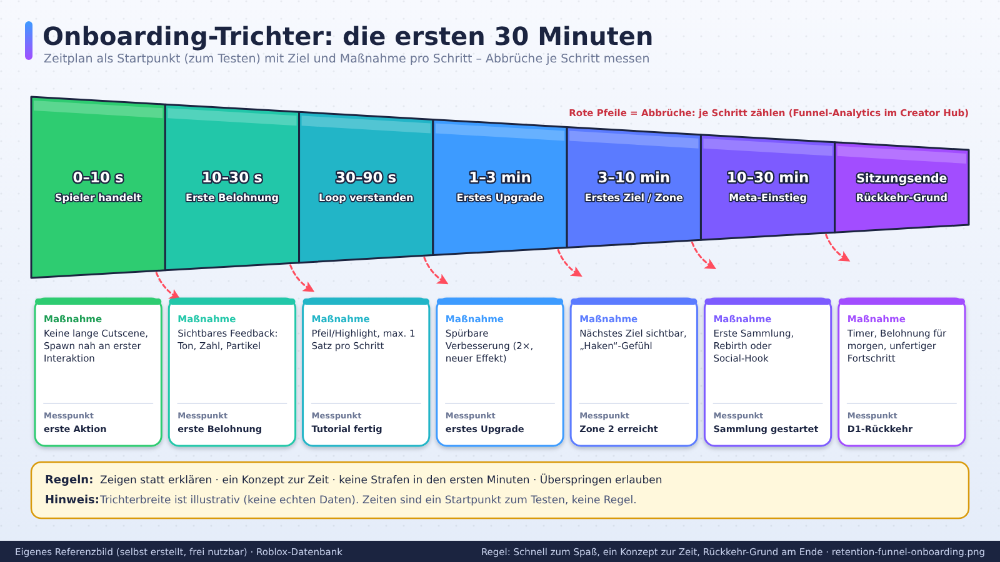
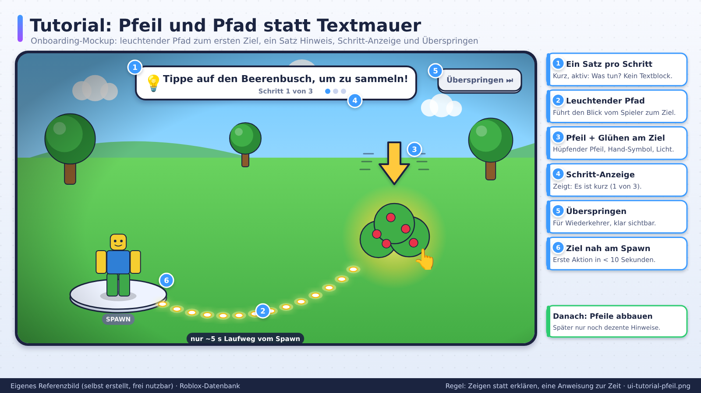

# Retention und Onboarding

> Stand: 2026-10-24 · Gesamt-Vertrauen: ✅ für Definitionen/Roblox-Hinweise (Creator Hub), 🟠 für Genre-Zahlen, 🧠 für Maßnahmen

## Kurzfassung
Retention misst, wie viele Spieler **nach 1, 7 und 30 Tagen** zurückkommen. Roblox rät, **D1 und Sitzungsdauer zuerst** zu verbessern, bevor man Traffic einkauft. Der Onboarding-Teil (die ersten Minuten) entscheidet D1. Discovery misst inzwischen über 28 Tage (siehe `01-markt-trends/discovery-algorithmus.md`).

## Referenzbilder
Selbst erstellte, beschriftete Referenzbilder (frei nutzbar, Übersicht: `assets/bilder/README.md`).

## Definitionen ✅
- **D1:** Anteil der Spieler, die am Tag nach ihrem ersten Besuch zurückkehren.
- **D7, D30:** analog nach 7 bzw. 30 Tagen.
- **Kohorte:** Spieler, die am selben Tag erstmals spielten.
- **Benchmarks:** Creator Hub zeigt ab ca. 100 DAU Scorecards im Vergleich zu ähnlichen Spielen, täglich aktualisiert. Sie sind kein direktes Discovery-Signal. ✅
- **Funnel-Analytics:** Zeigt Abbrüche im Onboarding. ✅
- Roblox empfiehlt A/B-Tests einzelner Tutorial-Schritte (z. B. kurzer Dialog vs. geführter Pfeil). ✅

## Zahlen (Vorsicht)
Roblox veröffentlicht keine festen D1/D7-Zielwerte. Ein Drittanbieter-Artikel nennt für gute Obbys D1 25–35 % und D7 10–15 %, Roleplay/Social mit niedrigerem D1 aber stärkerem Spätverlauf. 🟠 → Nutze die Scorecards im Creator Hub statt fixer Zielzahlen.

## Onboarding (FTUE)

### Ziele
1. **Lehre das Nötigste.**
2. **Komme schnell zum Spaß.**
3. **Mach Lust auf mehr.** (Roblox-Doku ✅)

### Zeitplan als Startpunkt (🧠 zum Testen, keine Regel)
| Zeit | Ziel | Maßnahme |
|---|---|---|
| 0–10 s | Spieler handelt | Kein langer Cutscene, Spawn nah an erster Interaktion, klare Spielfigur-Steuerung |
| 10–30 s | Erste Belohnung | Sichtbares Feedback, Ton, Zahl, Partikel |
| 30–90 s | Loop verstanden | Geführter Pfeil/Highlight, kurzer Text (max. 1 Satz pro Schritt) |
| 1–3 min | Erstes Upgrade | Spürbare Verbesserung |
| 3–10 min | Erstes Ziel/Zone | Nächstes Ziel sichtbar, „Haken"-Gefühl |
| 10–30 min | Meta-Einstieg | Erste Sammlung/Rebirth/Social-Hook |
| Ende der Sitzung | Rückkehr-Grund | Timer, Belohnung für morgen, unvollendeter Fortschritt |

### Onboarding-Regeln
- **Zeige, erkläre nicht.** Eine Handlung ist besser als ein Textblock.
- **Ein Konzept zur Zeit.** Nicht Währung, Inventar, Handel, Rebirth gleichzeitig.
- **Spieler darf nicht scheitern** in den ersten Minuten (keine Strafen).
- **Kein Zwang zum Lesen.** Wichtige Infos visuell (Pfeil, Glühen, Icons).
- **Mobile zuerst testen.** Touch-Steuerung, große Buttons, kein Hover.
- **Überspringen erlauben** für Wiederkehrer.
- **Mess es.** Funnel-Schritte definieren (Spawn → erste Aktion → erster Verkauf → erstes Upgrade …) und Abbrüche zählen.

## Retention-Hebel (nach Zeitraum)

### D1 (Tag 1)
- Starker Einstieg, schnelle Belohnung
- Tageszeit-Belohnung („Komm morgen wieder für …")
- Unfertiges Ziel hinterlassen (Quest-Fortschritt, wachsende Pflanze, Timer)
- Push-Mechanik: Roblox-seitig begrenzt; prüfe offizielle Benachrichtigungs-Optionen in der Doku.

### D7 (Woche 1)
- Tägliche Aufgaben ohne Pflichtgefühl (kein Streak-Bestrafen)
- Neue Zone/Mechanik nach 3–5 Tagen
- Erste Sammlung (Bücher, Sets) mit sichtbarem Fortschritt
- Soziale Bindung: Freund einladen, Handel, Koop

### D30 (Monat)
- Rebirth/Prestige
- Saisons und Rangliste
- Gilden/Clans
- Regelmäßige Updates, siehe `live-ops-events.md`
- Identität: Name, Titel, Showcase

## Retention-Fallen
| Falle | Warum schädlich | Besser |
|---|---|---|
| Streak-Bestrafung | Druck, Frust | Streak mit Puffer, „Rettungstag" |
| Login-Belohnung ohne Inhalt | Kurzfristig, keine Bindung | Belohnung führt zu Spiel-Zielen |
| Zu viel Grind | Abbruch bei Wand | Gestufte Ziele, Zwischenbelohnungen |
| Zu schnelle Progression | Nichts mehr zu tun | Tiefe Systeme, späte Freischaltungen |
| Fake-Dringlichkeit (Countdown-Druck) | Manipulation, Plattform-/Elternkritik | Echte Events, ehrliche Kommunikation |

## Diagnose-Tabelle
| Symptom | Mögliche Ursache | Maßnahme |
|---|---|---|
| D1 niedrig, Sitzung kurz | Onboarding schwach | FTUE vereinfachen, Funnel-Abbrüche finden |
| D1 ok, D7 niedrig | Mittelspiel leer | Meta-Systeme, Zonen, Sammlung |
| D7 ok, D30 niedrig | Endgame fehlt | Rebirth, Saisons, Gilden |
| Besuche hoch, Spielzeit niedrig | Clickbait-Thumbnail/Icon | Erwartung und Spiel angleichen |
| Hoher Drop in Mobile | UI/Performance | Mobile-First-Review, siehe `04-ui-ux/mobile-first.md` |

## Quellen
- [Creator Hub: Analytics](https://create.roblox.com/docs/production/analytics) ✅
- [Creator Hub: Retention](https://create.roblox.com/docs/en-us/production/analytics/retention) ✅
- [Creator Hub: Onboarding](https://create.roblox.com/docs/en-us/production/game-design/onboarding) ✅
- [Retention Benchmarks by Genre – rowatcher](https://rowatcher.com/news/retention-benchmarks-by-roblox-genre-what-good-actually-looks-like) 🟠
- [How we build hit Roblox games – Dubit](https://dubit.io/blog/how-we-build-hit-roblox-games) 🟡
