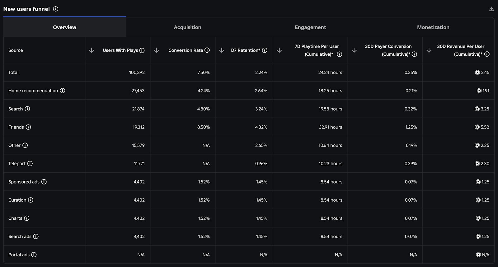

# Social Loops: Freunde, Koop, Handel, Gruppen

> Stand: 2026-10-24 · Nächste Prüfung: 2026-11-21 · Gesamt-Vertrauen: ✅ für Discovery-Signal, Chat-/Altersregeln, Preset- und Einladungs-APIs (Creator Docs, Newsroom), 🟡/🟠 für Beispiele aus Hit-Spielen, 🧠 für Maßnahmen

## Kurzfassung
Soziales Spielen ist auf Roblox Wachstums- **und** Retention-Motor: Freunde laden Freunde ein, und Spieler sind füreinander „evergreen sources of content“. Einzelspieler-Spiele halten schwerer. ✅ Die Home-Empfehlung zählt **„intentional co-play days“** (Spieltage mit Freunden über Join, Einladung oder privaten Server) als wichtiges Signal. ✅ Seit Januar 2026 braucht Text-Chat weltweit eine **Altersprüfung**, und Chat ist auf ähnliche Altersgruppen beschränkt. Social-Systeme müssen deshalb **ohne freien Text** funktionieren: strukturierte Handels-UIs, Emotes, Quick Words, Koop-Ziele, Live-Events. ✅ Preset-Systeme sind über Altersgrenzen hinweg erlaubt, aber nur für Spielkoordination, nicht für Unterhaltungen. ✅

## Referenzbilder
Offizielle Bilder aus der Roblox Creator Documentation (CC BY 4.0, Übersicht und Lizenz: `assets/bilder/offiziell/README.md`).

*Neue-Nutzer-Funnel nach Quelle, darunter „Friends“: Wie gut halten über Freunde gewonnene Spieler? Quelle: Roblox Creator Docs, CC BY 4.0 ([Acquisition](https://create.roblox.com/docs/production/analytics/acquisition))*

*Bot Clash Simulator: Season Pass mit Missionen-Tab. Die Doku empfiehlt Social- und Koop-Missionen. Quelle: Roblox Creator Docs, CC BY 4.0 ([Monetization foundations](https://create.roblox.com/docs/production/game-design/monetization-foundations))*

Hinweis: Für Social-Mechaniken gibt es in den Bildordnern kein eigenes Doku-Bild. Eigene Screenshots gehören nach `assets/eigene-referenzen/`.

## Warum das wichtig ist
- „Many users treat Roblox as a place to hang out with their friends.“ Spiele, die soziale Interaktion fördern, wachsen über Einladungen. ✅ ([Design for Roblox](https://create.roblox.com/docs/production/game-design/design-for-roblox))
- Social-Mechaniken sind ein offizieller Hebel für **D30**: Handel, Partys, Gilden, PvP, Turniere, Ranglisten. ✅ ([Retention](https://create.roblox.com/docs/production/analytics/retention))
- RFY-Signal **„Intentional co-play days per user“**, gemessen für Tag 1, Tag 2–7 und Tag 8–28. ✅ ([Discovery](https://create.roblox.com/docs/discovery))
- Roblox nennt Altersprüfungen und Chat-Einschränkungen als Gegenwind für Neukunden-Gewinnung (Q1/Q2 2026). ✅ ([Q2-2026-Shareholder-Letter](https://s27.q4cdn.com/984876518/files/doc_financials/2026/q2/Roblox-Q2-2026-Earnings-Shareholder-Letter.pdf))

## Details

### 1. Offizielle Social-Prinzipien ✅
Quelle: [Design for Roblox](https://create.roblox.com/docs/production/game-design/design-for-roblox), soweit nicht anders angegeben
- Einladungen zum Teil des Gameplays machen, z. B. über **Partys und Handel**.
- Soziale Rollenspiele wie *Brookhaven* geben Werkzeuge. Die Interaktionen werden zum spontanen Inhalt.
- Avatare sind Identität: Spieler wollen gesehen werden. Den Avatar nur mit gutem Grund ersetzen.
- **Private Server nicht zu teuer machen**, sonst spielen Freundesgruppen nicht zusammen. Achtung: Eine **Preisänderung bei privaten Servern kündigt alle aktiven Abos**. ✅ ([Private servers](https://create.roblox.com/docs/production/monetization/private-servers))
- **Influencer:** Viele Nutzer folgen YouTubern in neue Spiele. Fragen: Kann ein Streamer gute Inhalte machen, Freunde einbinden? *Brookhaven* hat eine „Creator Cam“ ohne UI.
- Hürden für soziale Interaktion entfernen, Gruppenspiel unterstützen. ✅ ([Engagement](https://create.roblox.com/docs/production/analytics/engagement))
- Für soziale Spiele Matchmaking-Parameter im FTUE per **Experiments** testen. ✅ ([Onboarding](https://create.roblox.com/docs/production/game-design/onboarding))
- Zeitgesteuerter Hinweis auf den **Handels-Button**, wenn ein Spieler in den ersten zwei Sitzungen nicht gehandelt hat. ✅ ([Onboarding techniques](https://create.roblox.com/docs/production/game-design/onboarding-techniques))
- Season-Pass-Missionen der Kategorie **Social** (Party geben oder besuchen, Rennen) und **Koop-Missionen** mit gemeinsamem Fortschritt. Missionen mit anderen Spielern sind in der Regel schwerer als Solo-Missionen. ✅ ([Season pass design](https://create.roblox.com/docs/production/game-design/season-pass-design))

### 2. Chat und Altersprüfung: was sich 2026 geändert hat
**Fakten** ✅
- Angekündigt im November 2025, weltweit live Anfang Januar 2026: Chat erfordert **Gesichts-Altersschätzung oder Ausweis**. Altersgruppen: **unter 9, 9–12, 13–15, 16–17, 18–20, 21+**. Chat nur mit ähnlichen Altersgruppen. Roblox gibt eine mittlere Abweichung von **1,4 Jahren** bei unter 18-Jährigen an. ([Roblox Newsroom, Nov. 2025](https://about.roblox.com/newsroom/2025/11/roblox-requires-age-checks-limits-minor-and-adult-chat); [DevForum: live globally](https://devforum.roblox.com/t/age-check-requirement-to-chat-now-live-globally/4226101))
- Die Creator Docs nennen die Altersbänder selbst nicht, sondern verweisen auf „similar age to chat“ und das Help Center. ([Preset system guidelines](https://create.roblox.com/docs/chat/preset-system-guidelines))
- Chat-Standard nach Konto-Stufe: **Roblox Kids** (5–8): aus, nach Altersprüfung über ein verknüpftes Elternkonto aktivierbar. **Roblox Select** (9–15): aus für selbst angegebene Konten, nach Altersprüfung schrittweise mit Schutzmaßnahmen. **Roblox** (16+, geprüft): an, wo in der Region verfügbar. ([Roblox Kids and Select](https://create.roblox.com/docs/production/publishing/kids-and-select))
- Rund 51 % der globalen DAU waren in Q1 2026 altersgeprüft (USA 65 %). 🟡 ([Q1-2026-Letter](https://s27.q4cdn.com/984876518/files/doc_financials/2026/q1/Q1-2026-Earnings-Shareholder-Letter.pdf); [Motley Fool](https://www.fool.com/earnings/call-transcripts/2026/04/30/roblox-rblx-q1-2026-earnings-call-transcript/))
- Ein DevForum-Entwickler meldete Fehleinstufungen und einen „massive dent in the traffic“. Einzelmeinung, keine Daten. 🟠 ([DevForum](https://devforum.roblox.com/t/age-check-requirement-to-chat-now-live-globally/4226101))

**Werkzeuge** ✅
- `TextChatService:GetChatGroupsAsync()` (Feb. 2026): Server-Methode, liefert Chat-Gruppen-IDs. Spieler mit gleicher ID können chatten. Gedacht für **Matchmaking und Teleports**, effizienter als paarweise `CanUsersChatAsync()`. IDs sind pro Universe, ändern sich und dürfen nach dem Verlassen nicht gespeichert werden. Muss unter Experience Settings → Communication aktiviert werden. ([TextChatService](https://create.roblox.com/docs/reference/engine/classes/TextChatService); [DevForum](https://devforum.roblox.com/t/new-chat-apis-teleport-users-who-can-chat-together/4337233))
- **Preset-Systeme** ([Preset system guidelines](https://create.roblox.com/docs/chat/preset-system-guidelines)):
  - Erlaubt **unabhängig von Alter und Altersprüfung**, wenn sie nur Spielaktionen, Bestätigungen oder einfache Reaktionen übermitteln.
  - Erlaubt: taktische Befehle („Attack“, „Defend“), Koop-Befehle („Follow me“, „Ready“), Callouts („Reloading“, „Nice shot“), neutrale Sätze („Well played“, „Thanks“).
  - Nicht erlaubt: freie Unterhaltung simulieren, Komplimente ohne Spielbezug, Hin-und-her-Dialog über Altersgrenzen, Buchstabenräder oder Zahlencodes, Frage-Antwort-Strukturen, „Hi! / Hello! / How are you?“.
  - Vorgaben: keine Satzzeichen am Ende, **Rate-Limit 10 Sekunden** pro Senden, **höchstens 12 Presets** pro Universe.
- **Quick Words** (eingebaut, regelkonform): bis zu **3 eigene Kategorien** mit **3–10 Quick Words**, jedes **unter 25 Zeichen**, nur auf Englisch eingegeben, automatisch übersetzt, vor Veröffentlichung geprüft. ([Quick Words](https://create.roblox.com/docs/chat/quick-words))
- **Links:** Social-Media-Links nur auf der Spielseite, **nicht im Spiel**. Erlaubt ist ein Hinweis wie „Check out our social media links on our game's page“. Nur für altersgeprüfte 16+ sichtbar. ([Social media links](https://create.roblox.com/docs/production/promotion/social-media-links))
- **Handel mit Bezahl-Items:** Wenn `IsPaidItemTradingAllowed` false ist, darf der Spieler Ergebnisse bezahlter Zufallsitems und andere bezahlte Items nicht handeln. ([Paid random items](https://create.roblox.com/docs/production/monetization/paid-random-items); [PolicyService](https://create.roblox.com/docs/reference/engine/classes/PolicyService))

**Folgen für das Design (🧠)**
| Früher üblich | Risiko seit 2026 | Ersatz |
|---|---|---|
| Handel per Chat aushandeln | Viele Paare können nicht chatten | Strukturiertes Handelsfenster, Wertanzeige, Handelsterminal mit Suche |
| Gilden-Koordination im Chat | Altersgemischte Gilden zerfallen | Gilden-Ziele, Rollen-Icons, Pings, Quick Words |
| Lobby nach Zufall | Teams können nicht reden | Matchmaking mit `GetChatGroupsAsync` |
| „Schreib mir auf Discord“ | Links im Spiel verboten | Hinweis auf Spielseite |
| Social Proof über Chat | eingeschränkt | Sichtbare Seltenheiten, Server-Events, Showcases |

### 3. Social-Bausteine

**1) Koop**
- Rollen mit nützlicher Aufgabe, gemeinsames Server-/Teamziel mit sichtbarem Balken. 🧠
- Koop-Missionen mit geteiltem Fortschritt (Season Pass). ✅ ([Season pass design](https://create.roblox.com/docs/production/game-design/season-pass-design))
- Kommunikation ohne Text: Pings, Marker, Emotes, Quick Words, Rollen-Icons. ✅/🧠

**2) Einladungen und Empfehlungen** ✅
- `SocialService:PromptGameInvite()` mit `ExperienceInviteOptions`: eigene Nachricht, Ziel-Freund, **Launch Data** (max. **200 Zeichen**, im Spiel über `Player:GetJoinData()` lesbar, z. B. um Eingeladene direkt zum Freund zu leiten). ([Invite prompts](https://create.roblox.com/docs/production/promotion/invite-prompts))
- **Friend Referral System:** `ReferredByPlayerId` in `GetJoinData()` füllt sich bei allen Einladungsarten automatisch; Belohnungen für **Einladende und Eingeladene**; eigener Belohnungsbanner im Einladungsmenü. ([Friend referral system](https://create.roblox.com/docs/production/promotion/referral-system))
- `GetFriendsOnline` liefert seit 2025 nur noch Freunde, deren Online-Status der Creator sehen darf. Roblox empfiehlt für Empfehlungssysteme `PromptGameInvite`. ✅ ([DevForum](https://devforum.roblox.com/t/upcoming-changes-to-the-getfriendsonline-api/3632813))
- Natürliche Anlässe: „Mit Freund doppelt so schnell“, Party-Boni. 🧠
- **Creator Rewards (Audience Expansion):** Neue oder zurückkehrende Nutzer über Share Links können Belohnungen auslösen (Details in `07-monetarisierung/monetarisierung.md`). ✅ ([Creator Rewards](https://create.roblox.com/docs/creator-rewards))

**3) Handel**
- Reiz: seltene Items, Sammlungen vervollständigen, Wert-Spekulation. 🧠
- Risiken: Scams, Duplikate (Dupes), Inflation. 🧠
- Schutz: Bestätigungsfenster mit Zeitverzögerung, Wertanzeige, Server-Validierung, Handelslog, Rang- oder Alterssperren nach Plattformregeln. 🧠 (`IsPaidItemTradingAllowed` ✅)
- Infrastruktur, die Hits bauten: *Pet Simulator 99* **Trading Terminal** (gesuchte Items suchen, Teleport zur Handelsplaza) und Wegfall von Rangbeschränkungen beim Handel 🟡 ([BIG Games Update 48](https://www.biggames.io/post/pet-simulator-99-update-48)); *Steal a Brainrot* dauerhafter Handel und Trade-Plaza-Verbesserungen 🟠 ([Eldorado](https://www.eldorado.gg/blog/steal-a-brainrot-update-log/)); *Murder Mystery 2* Handelsökonomie mit Hunderten „Godlies“, saisonale Boxen werten alte Inventare um 🟠 ([Earnaldo](https://earnaldo.com/blog/best-roblox-games-2026.html)).
- Externe Wertlisten-Seiten entstehen um erfolgreiche Handelsspiele herum (z. B. für Grow a Garden). 🟠 ([growagardengame.com](https://growagardengame.com/))

**4) Wettbewerb**
- Ranglisten täglich/wöchentlich/saisonal, damit Neue eine Chance haben. 🧠
- Offiziell als großes Update-Thema genannt: PvP, Ranglisten, Turniere. ✅ ([LiveOps essentials](https://create.roblox.com/docs/production/game-design/liveops-essentials))
- Beispiel: *Pet Simulator 99* World-Cup-Update mit Fußball-Minispielen und **Ranglisten**. 🟡 ([BIG Games Update 82](https://www.biggames.io/post/pet-simulator-99-update-82))

**5) Gruppen und Gilden**
- Gemeinsame Ziele, Rangsystem, Gilden-Boni. Offiziell als Social-System für große Updates genannt. ✅ ([LiveOps essentials](https://create.roblox.com/docs/production/game-design/liveops-essentials))
- Moderation von Namen, Beschreibungen, Rollen. 🧠

**6) Sichtbarer Status und Social Proof**
- Titel, Rahmen, Pets/Items am Charakter. Seltene Funde für andere sichtbar. 🧠
- Server-weite Live-Events wirken als **chatloser Social Proof**: Alle sehen dasselbe zur gleichen Zeit. Grow a Garden und Steal a Brainrot hielten Admin-Events bewusst auf **öffentlichen** Servern. 🟠/🧠 ([GAG Wiki](https://growagarden.fandom.com/wiki/Admin_Abuse))

**7) Besuchen und Zeigen**
- Fremde Basen, Inseln, Museen ansehen, bewerten, liken. Gibt Spielern ein Publikum. 🧠

### 4. Spannungsfeld private vs. öffentliche Server (🧠)
- Private Server fördern Co-Play mit Freunden (zählt als „intentional co-play“ ✅ [Discovery](https://create.roblox.com/docs/discovery)) und bringen Umsatz.
- Exklusive Live-Events nur auf öffentlichen Servern bündeln Spieler und erzeugen Dichte.
- Hits wählten öffentliche Events. Für ein kleineres Spiel: private Server günstig halten, große Events zusätzlich auf öffentlichen Servern sichtbar machen.

### 5. Social messen
- Akquisequelle **Friends** im Dashboard: Conversion, D7, 7D-Playtime, 30D-Umsatz. ✅ ([Acquisition](https://create.roblox.com/docs/production/analytics/acquisition))
- Custom Events: Einladung gesendet, Einladung angenommen (`ReferredByPlayerId`), Handel abgeschlossen, Party gegründet, Koop-Mission erfüllt. ✅ (API) / 🧠 (Auswahl)
- `GetPlayerSegmentsAsync` liefert `UserAcquisitionSource` für Personalisierung im Spiel. ✅ ([AnalyticsService](https://create.roblox.com/docs/reference/engine/classes/AnalyticsService))

### Social ohne Text: Werkzeugliste
| Werkzeug | Zweck | Regel/Beleg |
|---|---|---|
| Quick Words | Koordination über Altersgrenzen | ✅ 3 Kategorien × 3–10, < 25 Zeichen |
| Eigenes Preset-Rad | Taktik-Callouts | ✅ max. 12 Presets, 10 s Rate-Limit, kein Dialog |
| Emote-Wheel | Ausdruck | 🧠 |
| Ping/Marker | Ziele zeigen | 🧠 |
| Rollen-Icons | Wer macht was | 🧠 |
| Team-Fortschrittsbalken | gemeinsames Ziel | 🧠 |
| Strukturiertes Handelsfenster | Handel ohne Chat | 🧠 (`IsPaidItemTradingAllowed` ✅) |
| Einladung mit Launch Data | Freund direkt zu sich holen | ✅ 200 Zeichen |
| Chat-Gruppen-Matchmaking | Teams, die reden dürfen | ✅ `GetChatGroupsAsync` |

## Social-Risiken
- **Toxizität/Mobbing:** Meldewege, Mute, Block. 🧠
- **Betrug:** Handel absichern, Server-Validierung. 🧠
- **Leere Server:** Matchmaking, Mindestspieler, Solo-Fallback. 🧠
- **Ausgrenzung:** Anfängerschutz, Solo-Modus. Einzelspieler halten schwerer, aber Solo muss möglich bleiben. ✅/🧠
- **Plattformregeln:** keine Off-Platform-Links im Spiel, keine Preset-Umgehung der Chat-Regeln, Handel nach PolicyService. ✅
- **Datenschutz:** Chat-Gruppen-IDs nicht speichern. ✅

## Beispiele aus echten Spielen
- **Brookhaven:** Werkzeuge statt Ziele, Spieler erzeugen den Inhalt, Creator Cam für Streamer. ✅ ([Design for Roblox](https://create.roblox.com/docs/production/game-design/design-for-roblox))
- **Pet Simulator 99:** Trading Terminal, Handelsplaza, Ranglisten-Events. 🟡 ([BIG Games](https://www.biggames.io/post/pet-simulator-99-update-48))
- **Murder Mystery 2:** Handelsökonomie als Langzeitmotor, Rekord-CCU nach Event 2026. 🟠 ([Bloxodes](https://bloxodes.com/stats/reports/roblox-july-2026))
- **Steal a Brainrot / Steal An Egg:** sozialer Konflikt durch Stehlen erzwingt Rückkehr. 🟡/🟠
- Details: `fallstudien.md`.

## Do / Don't
| Do | Don't |
|---|---|
| Koop mit klaren Rollen und Koop-Missionen | Pflicht-Textchat |
| Beidseitige Einladungsbelohnung (Referral System) | Druck-Texte („Lade jetzt 5 Freunde ein!“) |
| Handel mit Fenster, Wertanzeige, Server-Prüfung | Handel per Chat-Absprache ohne Validierung |
| Quick Words / Presets für Spielkoordination | Presets als Chat-Ersatz („Hi“, Fragen, Komplimente) |
| Matchmaking nach Chat-Gruppen | Discord-Link im Spiel |
| Private Server bezahlbar | Private Server so teuer, dass Freunde nicht zusammen spielen |
| Solo-Weg ermöglichen | Spiel nur mit Gruppe spielbar |

## Checkliste
- [ ] Mindestens ein Grund, mit Freunden zu spielen (Bonus, Koop-Ziel)
- [ ] Einladung mit `PromptGameInvite`, Referral-Belohnung für beide Seiten
- [ ] Spiel ohne Text-Chat vollständig verständlich und spielbar
- [ ] Quick Words oder regelkonformes Preset-System
- [ ] Handel (falls vorhanden): strukturiertes UI, Server-Validierung, `IsPaidItemTradingAllowed` geprüft
- [ ] Team-Matchmaking berücksichtigt `GetChatGroupsAsync`
- [ ] Keine Off-Platform-Links im Spiel
- [ ] Akquisequelle „Friends“ und Co-Play im Dashboard beobachtet

## Offene Fragen / Recherche-Bedarf
- Keine öffentlichen Daten, wie stark die Altersprüfung Retention in Social- und Handelsspielen verändert hat.
- Keine Fallstudien zu Gilden-Systemen auf Roblox gefunden.
- Regeln für Voice-Chat-Berechtigung nicht geprüft.

## Quellen
- [Creator Docs: Design for Roblox](https://create.roblox.com/docs/production/game-design/design-for-roblox) – Stand 2026-10-24, ✅
- [Creator Docs: Retention](https://create.roblox.com/docs/production/analytics/retention) und [Engagement](https://create.roblox.com/docs/production/analytics/engagement) – ✅
- [Creator Docs: Discovery](https://create.roblox.com/docs/discovery) – ✅
- [Creator Docs: Preset system guidelines](https://create.roblox.com/docs/chat/preset-system-guidelines) und [Quick Words](https://create.roblox.com/docs/chat/quick-words) – ✅
- [Engine-Referenz: TextChatService](https://create.roblox.com/docs/reference/engine/classes/TextChatService) und [PolicyService](https://create.roblox.com/docs/reference/engine/classes/PolicyService) – ✅
- [Creator Docs: Invite prompts](https://create.roblox.com/docs/production/promotion/invite-prompts) und [Friend referral system](https://create.roblox.com/docs/production/promotion/referral-system) – ✅
- [Creator Docs: Roblox Kids and Select](https://create.roblox.com/docs/production/publishing/kids-and-select) – ✅
- [Creator Docs: Social media links](https://create.roblox.com/docs/production/promotion/social-media-links) – ✅
- [Creator Docs: Private servers](https://create.roblox.com/docs/production/monetization/private-servers) – ✅
- [Creator Docs: Season pass design](https://create.roblox.com/docs/production/game-design/season-pass-design) und [LiveOps essentials](https://create.roblox.com/docs/production/game-design/liveops-essentials) – ✅
- [Roblox Newsroom: Age checks (Nov. 2025)](https://about.roblox.com/newsroom/2025/11/roblox-requires-age-checks-limits-minor-and-adult-chat) – ✅
- [DevForum: Age check live globally](https://devforum.roblox.com/t/age-check-requirement-to-chat-now-live-globally/4226101) – Jan. 2026, ✅ (Ankündigung) / 🟠 (Entwicklerkommentare)
- [DevForum: New Chat APIs](https://devforum.roblox.com/t/new-chat-apis-teleport-users-who-can-chat-together/4337233) – Feb. 2026, ✅
- [Roblox Q2-2026-Shareholder-Letter](https://s27.q4cdn.com/984876518/files/doc_financials/2026/q2/Roblox-Q2-2026-Earnings-Shareholder-Letter.pdf) – ✅
- [BIG Games: Update 48](https://www.biggames.io/post/pet-simulator-99-update-48) und [Update 82](https://www.biggames.io/post/pet-simulator-99-update-82) – 🟡
- [Eldorado: Steal a Brainrot Update Log](https://www.eldorado.gg/blog/steal-a-brainrot-update-log/), [Bloxodes](https://bloxodes.com/stats/reports/roblox-july-2026), [Earnaldo](https://earnaldo.com/blog/best-roblox-games-2026.html), [GAG Wiki](https://growagarden.fandom.com/wiki/Admin_Abuse) – 🟠

## Verknüpfungen
`01-markt-trends/discovery-algorithmus.md`, `01-markt-trends/plattform-regeln-2026.md`, `live-ops-events.md`, `analytics-und-experimente.md`, `08-technik-luau/technik-grundlagen.md`
