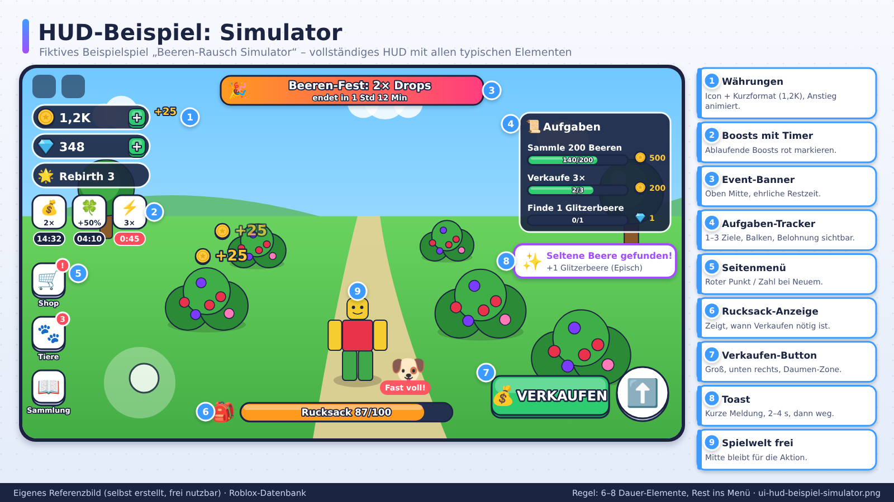
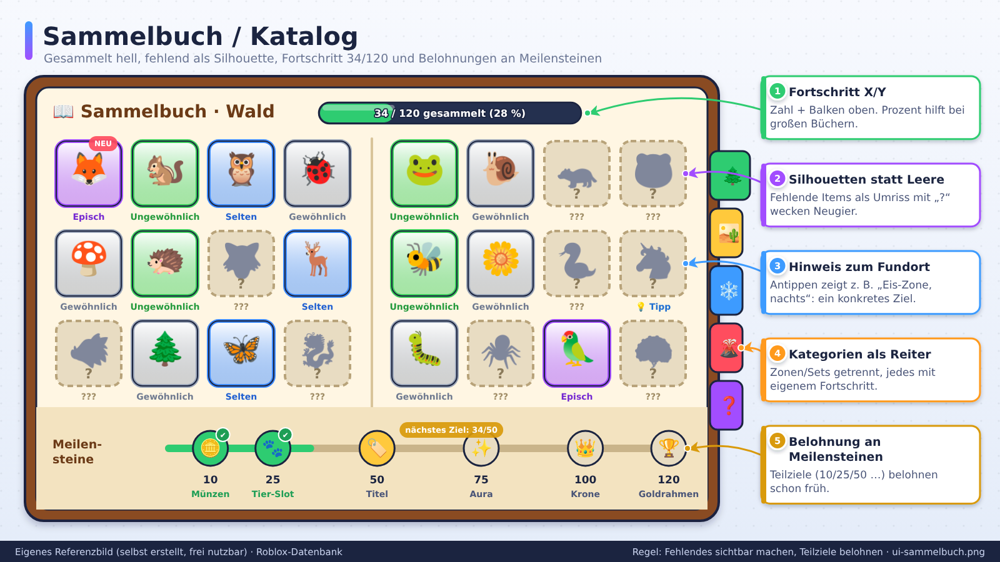
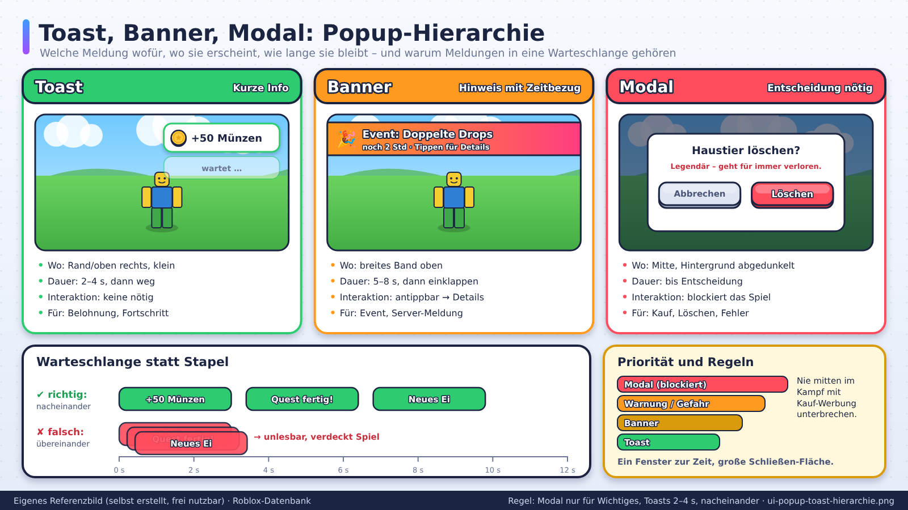

# HUD, Shop, Menüs und Popups

> Stand: 2026-10-24 · Gesamt-Vertrauen: 🧠 (Designwissen), Konvention beobachtet bei Sammel-/Simulator-Spielen 🟡

## Kurzfassung
Das **HUD** zeigt dauerhaft das Wichtigste, **Menüs** halten alles Weitere, der **Shop** muss klar, fair und schnell bedienbar sein. Auf Mobile gilt: wenige Elemente, große Flächen, kurze Wege.

## Referenzbilder
Selbst erstellte, beschriftete Referenzbilder (frei nutzbar, Übersicht: `assets/bilder/README.md`).

## HUD (Heads-up-Display)

### Was gehört hinein
- **Währung(en)** (1–2 sichtbar), mit Icon + Zahl
- **Fortschritt** (Level/XP, Zonenfortschritt)
- **Gesundheit/Ressourcen** (nur wenn nötig)
- **Aktuelles Ziel** (kurzer Text/Icon)
- **Wichtige Aktionen** (Verkaufen, Angriff, Interaktion)
- **Boosts/Effekte** (kleine Icons mit Timer)

### Was NICHT ins HUD gehört
Alles, was nur selten gebraucht wird → ins Menü. Mehr als ca. 6–8 Dauer-Elemente überfordern (🧠, Faustregel).

### HUD-Regeln
- Zahlen **kurz formatieren** (1,2K, 3,4M, 1B), damit sie nicht überlaufen.
- Zahlen **animieren** beim Anstieg.
- **Seitenmenü-Buttons** (Shop, Inventar, Quests) als Icon-Spalte, mit Benachrichtigungspunkt bei Neuem.
- **Sicherheitsränder** beachten (siehe `mobile-first.md`).
- **Roblox-Core-UI** nicht überdecken (Top-Bar, Chat-Button, Menü).

## Menüs

### Struktur
- **Hauptmenü-Ebene:** Maximal 5–7 Hauptbereiche (Inventar, Shop, Quests, Sammlung, Einstellungen, Freunde).
- **Tiefe:** Höchstens 2 Ebenen. Zurück-Button immer sichtbar.
- **Tabs** für verwandte Inhalte; aktiver Tab klar hervorgehoben.
- **Schließen:** Großer X-Button, zusätzlich Tippen außerhalb (wenn sicher) und Zurück-Taste (Gamepad/Back).
- **Ein Menü zur Zeit** offen, keine übereinander gestapelten Fenster.

### Inventar
- Raster mit Seltenheitsrahmen
- Sortieren und Filtern (Seltenheit, Neu, Typ)
- Vergleich (neu vs. ausgerüstet)
- Mehrfachauswahl für Verkaufen/Löschen mit **Sicherheitsabfrage bei seltenen Items**
- Platz-Anzeige (X/Y Slots)

### Sammelbuch/Katalog
- Alle Items sichtbar (gesammelt hell, fehlend als Silhouette/Fragezeichen)
- Fortschrittsanzeige (z. B. 34/120)
- Belohnung bei Teilmeilensteinen

### Quests/Ziele
- Aktuell 1–3 Ziele, mit Fortschrittsbalken
- Belohnung klar sichtbar
- Direktlink („Gehe zu") wenn möglich

## Shop

### Aufbau
- **Kategorien:** Boosts, Komfort, Kosmetik, Pakete.
- **Highlight:** Ein „Beliebt"/„Angebot"-Bereich (ehrlich, ohne Fake-Knappheit).
- **Karten:** Bild/Icon, Name, Nutzen in einem Satz, Preis (Robux-Symbol), Kaufbutton.
- **Vorschau** für Kosmetik, **klare Wirkung** für Boosts („2× Geld, 15 Min").

### Kauf-Ablauf
1. Auswahl → 2. Bestätigung (Name, Preis, Wirkung) → 3. Roblox-Kaufdialog → 4. Erfolgs-Feedback (Animation + Ton) → 5. Sofort sichtbar/nutzbar.
- **Fehlerfälle** abdecken: Kauf abgebrochen, zu wenig Robux, Fehler. Verständliche Meldung, kein Absturz.
- **Nie** Kauf auslösen, ohne dass der Spieler den Preis klar gesehen hat.

### Shop-Ethik (🧠, relevant bei jungem Publikum)
- Keine Fake-Timer, keine Schuld-Texte.
- Kein „Pay-to-win"-Zwang für Grundfortschritt.
- Eltern-Freundlich: klare Preise, keine versteckten Käufe.
- Siehe `07-monetarisierung/monetarisierung.md`.

## Popups und Benachrichtigungen
- **Toast-Meldungen** (kurze Einblendungen) für Belohnungen, Fortschritt.
- **Modale Popups** nur für Wichtiges (Kauf, Löschen, Fehler).
- **Nicht beim Spielen unterbrechen**, besonders nicht mit Werbung für Käufe.
- **Reihenfolge:** Mehrere Meldungen in Warteschlange, nicht übereinander.
- **Dauer:** 2–4 Sekunden bei Toasts.

## Ladebildschirm
- Fortschrittsanzeige, kurzer Tipp, Markenidentität.
- Nicht zu lang; Inhalte im Hintergrund vorladen (`ContentProvider:PreloadAsync`).
- Ladebildschirm darf nicht „hängen" wirken (Animation).

## Tutorial-UI
- **Pfeile und Highlights** statt Textmauern.
- **Eine Anweisung** zur Zeit.
- **Überspringen** möglich (für Wiederkehrer).

## Barrierefreiheit und Sprache
- Kontrast, Icons zusätzlich zu Farbe, Schriftgröße.
- Lokalisierung planen (Platz für Texte, keine Texte in Bildern).
- Gamepad-Navigation testen.

## Typische Fehler
| Fehler | Folge | Lösung |
|---|---|---|
| Zu viele HUD-Elemente | Überladen, Mobile unspielbar | Auslagern in Menü |
| Kauf-Button ohne Bestätigung | Versehentliche Käufe, Beschwerden | Bestätigung mit Preis |
| Menü verdeckt Spielwelt | Frust | Halbtransparent/nur kurz |
| Winzige X-Buttons | Spieler kommen nicht raus | Große Schließen-Fläche |
| Zahlen laufen aus Feld | Unlesbar | Kurzformat, TextScaled + Constraint |

## Verknüpfungen
`ui-grundlagen.md`, `mobile-first.md`, `checklisten/ui-review.md`
