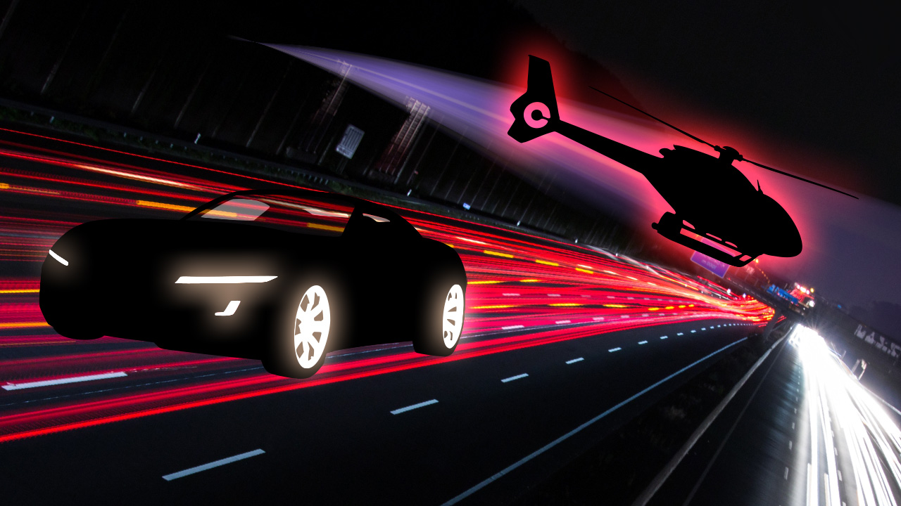
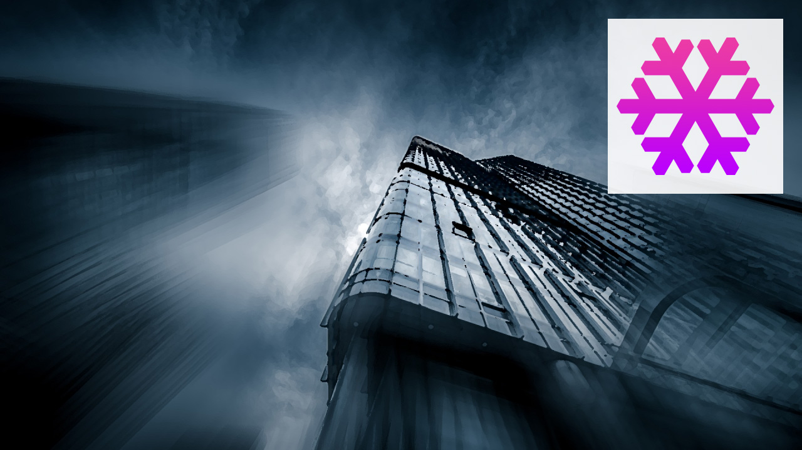
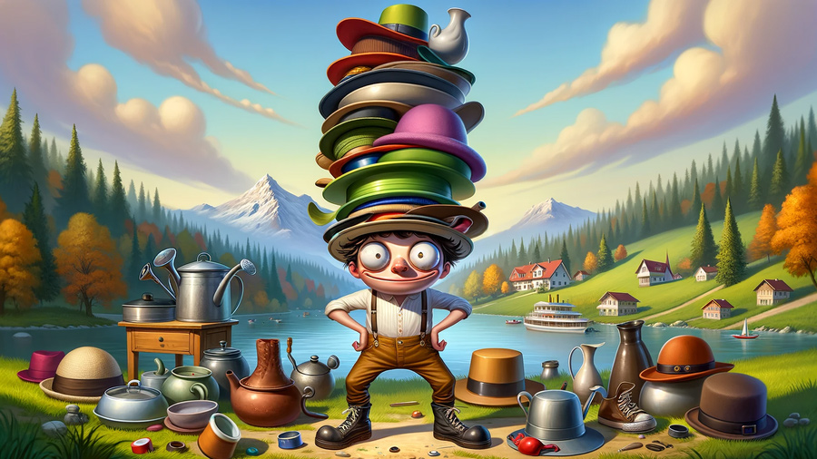
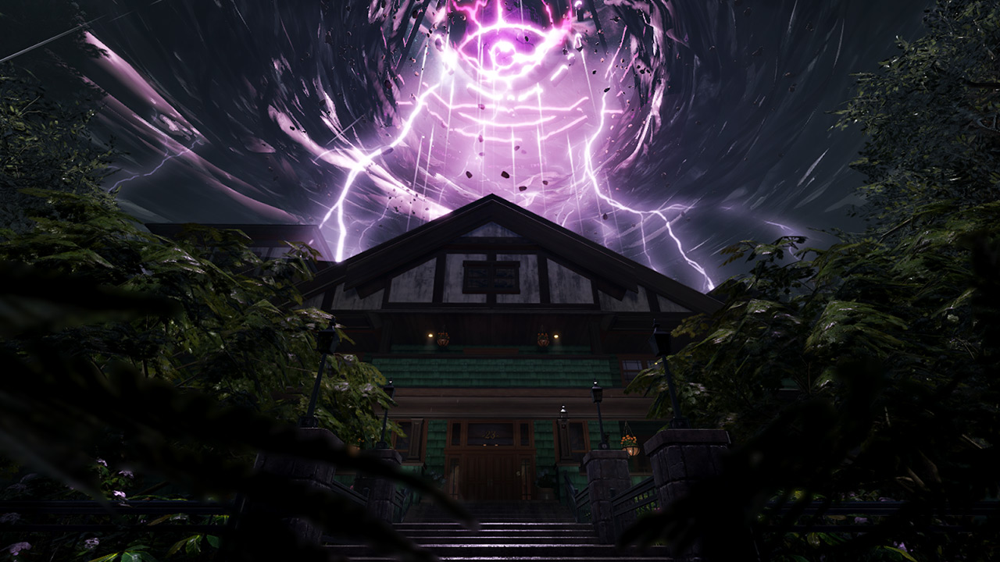
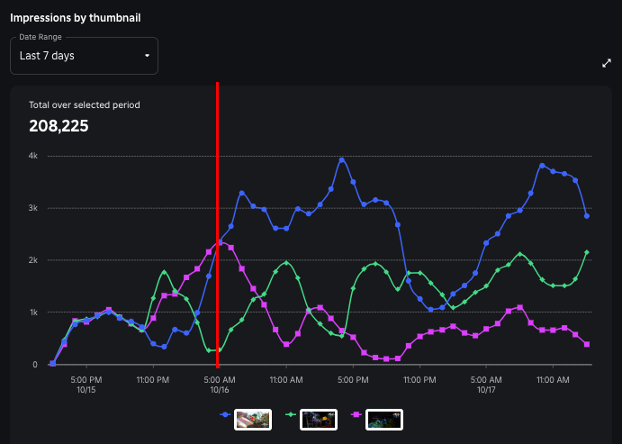
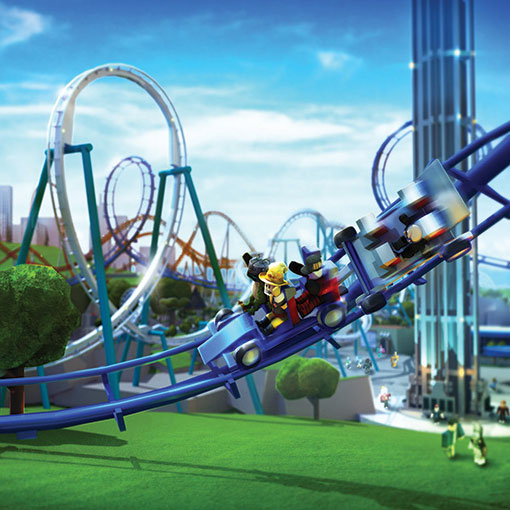
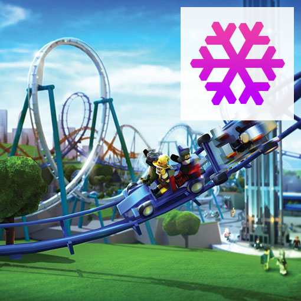
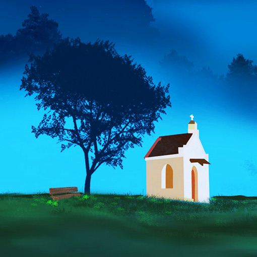
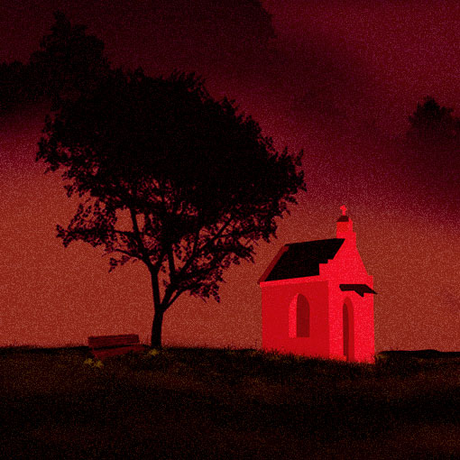
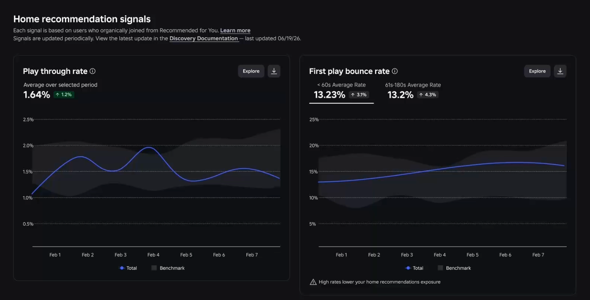

# Thumbnails und Icons

> Stand: 2026-10-24 · Nächste Prüfung: 2026-12-24 · Gesamt-Vertrauen: ✅ für Formate, Limits, Personalisierung und Discovery-Regeln (Creator Docs, lokal am Quelltext geprüft), 🟡 für DevForum-Ankündigungen, die nur als Suchauszug vorlagen, 🟠 für Drittquellen-Tipps, 🧠 für Gestaltungswissen

## Kurzfassung
Icon und Thumbnail entscheiden, ob jemand auf der Home-Seite überhaupt klickt. Offizielle Specs: **Icon quadratisch, mindestens 512×512, wird bis auf etwa 150×150 verkleinert angezeigt**; **Thumbnail 16:9, ideal 1920×1080**, für die Personalisierung **unter 3 MB**; **2–5 aktive Thumbnails** starten die Personalisierung, die in Tests im Schnitt **+8,5 % qualified Play-Through-Rate** brachte (einzelne Spiele +50 %) ✅ ([Icons](https://create.roblox.com/docs/production/publishing/experience-icons), [Thumbnails](https://create.roblox.com/docs/production/publishing/thumbnails)). **Ohne eigenes Thumbnail bekommt ein Spiel keine Impressionen aus den Home-Empfehlungen** ✅ ([Discovery](https://create.roblox.com/docs/discovery)). Motiv muss zum tatsächlichen Spiel passen, sonst sinkt die Sichtbarkeit.

## Warum das wichtig ist
- **Play-Through-Rate (PTR)** = Anteil der Nutzer, die das Spiel nach dem Sehen in „Recommended For You“ spielen; sie ist ein zentrales Home-Signal ✅ ([Discovery](https://create.roblox.com/docs/discovery)). Icon und Thumbnail sind das Erste, was Nutzer sehen 🧠.
- Ein Rückgang der Impressionen folgt typischerweise auf sinkende PTR, Spieltage und Spielzeit pro Nutzer und steigende First-Play-Bounce-Rate ✅ (ebd.).
- „Mismatched metadata and content“ (z. B. Dinosaurier im Thumbnail, aber generischer Obby) wird **nicht empfohlen** und in der Suche schlechter gezeigt ✅ (ebd.).
- „Non-unique games“ (Titel/Visuals wie ein bestehendes Spiel) werden nicht mehr priorisiert ✅ (ebd.).
- Mehr zum Algorithmus: `01-markt-trends/discovery-algorithmus.md`.

## Referenzbilder
Offizielle Bilder aus der Roblox Creator Documentation (Übersicht: `assets/bilder/offiziell/README.md`):

*Gut: Sportwagen und Helikopter vor Lichtstreifen – Action-Racing sofort erkennbar. Quelle: Roblox Creator Docs, CC BY 4.0*

*Schlecht: unklare Hochhaus-Szene mit zusammenhanglosem Schneeflocken-Logo. Quelle: Roblox Creator Docs, CC BY 4.0*

*Farbstimmung passend zum Genre: hell und gesättigt vs. dunkel mit Kontrast. Quelle: Roblox Creator Docs, CC BY 4.0*

*„Impressions by thumbnail“: drei aktive Thumbnails über die Zeit. Quelle: Roblox Creator Docs, CC BY 4.0*

*Scharf (512×512+) vs. unscharf. Quelle: Roblox Creator Docs, CC BY 4.0*

*Avatare in der Achterbahn zeigen das Thema; die zusätzliche Schneeflocke verwässert es. Quelle: Roblox Creator Docs, CC BY 4.0*

*Gleiche Komposition, andere Farbe = anderes Genre-Signal. Quelle: Roblox Creator Docs, CC BY 4.0*

*Dashboard „Home recommendation signals“: Play-Through-Rate und First-Play-Bounce-Rate. Quelle: Roblox Creator Docs, CC BY 4.0*

## Details

### 1. Offizielle Spezifikationen auf einen Blick ✅
| Asset | Format / Größe | Weitere Regeln | Quelle |
|---|---|---|---|
| **Spiel-Icon** | Quadratisch, **mind. 512×512**; Vorlage 512×512 | Wird an manchen Stellen auf z. B. **150×150** verkleinert → in klein prüfen. **Ein Icon pro Sprache (Locale).** Moderation. Beim ersten Veröffentlichen automatisch ein Standard-Icon. | [Icons](https://create.roblox.com/docs/production/publishing/experience-icons) |
| **Thumbnail (Bild)** | **16:9**, ideal **1920×1080**; `.jpg`, `.gif`, `.png`, `.tga`, `.bmp` | Wird immer auf 16:9 **gestreckt**, egal welches Format hochgeladen wird. Kostenlos. Alt-Text möglich. | [Thumbnails](https://create.roblox.com/docs/production/publishing/thumbnails) |
| **Thumbnail für Personalisierung** | **unter 3 MB** und 1920×1080 | 2–5 aktiv | ebd. |
| **Video-Thumbnail** | Echte Spielaufnahme | **3 Uploads pro Monat** kostenlos; abgelehnte Videos zählen mit. Nicht auf Xbox, PlayStation, VR. | ebd. |
| **Auto-generiertes Bild** | Aus der Studio-Kameraposition beim letzten Publish | Zählt **nicht** als eigenes Thumbnail für Home-Empfehlungen 🧠 (die Doku verlangt ein „custom thumbnail“) | ebd., [Discovery](https://create.roblox.com/docs/discovery) |
| **Detailseite gesamt** | bis zu **10 Bilder oder Videos** | Reihenfolge änderbar | [Thumbnails](https://create.roblox.com/docs/production/publishing/thumbnails) |
| **Event-Thumbnails** | bis zu **5** pro Event + primärer Event-Typ | | [Discovery](https://create.roblox.com/docs/discovery) |
| **Badge-Icon** | Vorlage **512×512** | Wird **kreisförmig** zugeschnitten, nichts Wichtiges außerhalb des Kreises | [Badges](https://create.roblox.com/docs/production/publishing/badges) |
| **Pass- / Developer-Product-Icon** | **höchstens 512×512**, `.jpg`/`.png`/`.bmp` | Nichts Wichtiges außerhalb der **Kreisgrenze** | [Passes](https://create.roblox.com/docs/production/monetization/passes), [Developer products](https://create.roblox.com/docs/production/monetization/developer-products) |

Verwaltung: Creator Dashboard → Spiel → Configurations → Places → Thumbnails, Tabs **„Home Page“** und **„Experience Detail Page“**; Icon unter dem Startplatz (Stern) → Icon ✅ ([Thumbnails](https://create.roblox.com/docs/production/publishing/thumbnails), [Icons](https://create.roblox.com/docs/production/publishing/experience-icons)).

### 2. Pflicht: eigenes Thumbnail ✅
„A custom thumbnail is required for your game to receive impressions from homepage recommendations. If your game only has a default thumbnail, it is not eligible.“ ([Discovery](https://create.roblox.com/docs/discovery)). Die zugehörige DevForum-Ankündigung heißt „Homepage Recommendation Eligibility Now Requires a Custom Thumbnail“ 🟡 ([DevForum](https://devforum.roblox.com/t/homepage-recommendation-eligibility-now-requires-a-custom-thumbnail/4945086); Inhalt nicht selbst gelesen, Regel aber in der Doku bestätigt).

### 3. Thumbnail-Personalisierung ✅
Quelle: [Thumbnails – Home page personalization](https://create.roblox.com/docs/production/publishing/thumbnails).
- **Ziel:** die *qualified* Play-Through-Rate (qPTR) erhöhen = Anteil der Nutzer, die sich „für eine signifikante Zeit“ aktiv mit dem Spiel beschäftigen.
- **Ergebnis im Test:** im Schnitt **+8,5 % qPTR**, einzelne Spiele **+50 %**.
- **Start:** erst ab **2 aktiven Thumbnails**; mit nur einem sehen alle dasselbe. Aktiv schalten: „Edit active thumbnails“ → **2–5** auswählen → Save → „Start“.
- **Algorithmus (Wortlaut der Doku):** zeigt jedes Thumbnail einer zufälligen Nutzergruppe, misst qPTR pro Gruppe, gibt dem Gewinner pro Gruppe mehr Impressionen, den anderen weiter **minimalen Traffic** zur Exploration. Den Begriff „Multi-Armed Bandit“ verwendet die Doku nicht (er stammt aus Presse/DevForum) 🟡.
- **Mehrere aktiv lassen:** „keep multiple thumbnails active instead of choosing one winner“ – Trends ändern sich, ein früh entferntes Bild hätte später das zweitbeste werden können.
- **Test-Rhythmus:** Mit jedem großen Update mehrere neue Thumbnails testen, dann bis zum nächsten Update nichts mehr ändern.
- **Auswertung** (Tabelle „Thumbnail Performance“, nach einigen Stunden gefüllt):

| Spalte | Bedeutung |
|---|---|
| Status | aktiv für Personalisierung? |
| Impressions | Impressionen aus Home-Empfehlungen |
| Qualified Plays | qualifizierte Spiele aus Home-Empfehlungen |
| Average Playtime | Ø Sitzungsminuten pro qualifiziertem Spiel |
| Qualified Play Through Rate | qualifizierte Spiele ÷ Impressionen |
| Winning Segment | Thumbnail mit der höchsten PTR im aktuellen Durchlauf |

- Dazu die Graphen „Impressions by thumbnail“ und „Qualified play through rate by thumbnail“.
- **Zeitleiste (nicht in der Doku, 🟡):** Start der Personalisierung um den **13. Nov. 2024** ([Roblox auf X](https://x.com/Roblox/status/1856760513038110792), [DevForum](https://devforum.roblox.com/t/live-now-personalize-your-thumbnails-to-attract-more-users/3257233)); seit **Juli 2025** setzen neue Test-Thumbnails den Traffic nicht mehr gleichmäßig zurück, der bisherige Gewinner behält den Großteil ([DevForum](https://devforum.roblox.com/t/thumbnail-personalization-now-remembers-your-existing-winning-thumbnails/3793665)); seit **Aug. 2026** gibt es Open-Cloud-APIs für Thumbnail-Personalisierung ([DevForum](https://devforum.roblox.com/t/new-opencloud-apis-for-analytics-events-experiments-and-thumbnail-personalization/4828676)). Eine Drittquelle warnt, dass Schreibzugriffe ohne den richtigen Scope (`universe.thumbnail:write`) scheinbar erfolgreich sind, aber nichts ändern → nach dem Schreiben zurücklesen 🟠 ([ZehnStudio99](https://zehn-studio26.com/news/experiment-targeting-and-analytics-apis/)).
- Ein eigenes A/B-Testing für **Icons** dokumentiert Roblox nicht ✅ (nicht in der Doku).

### 4. Offizielle Best Practices für Thumbnails ✅
Quelle: [Thumbnails – Best practices](https://create.roblox.com/docs/production/publishing/thumbnails).
1. **Qualität und Format:** 16:9, 1920×1080, scharf; falsches Format wird verzerrt.
2. **Unten frei halten:** Keine wichtigen Texte oder Elemente am **unteren Rand**, dort können Metadaten wie die Spielerzahl liegen.
3. **Relevanter, einzigartiger Inhalt:** zeigen, was Spieler erwartet; mehrdeutige Bilder oder Grafiken verwirren.
4. **Thema und Farbe:** Stimmung über Farbe vermitteln, damit Spieler einschätzen können, ob es zu ihnen passt.
5. **Video-Genauigkeit:** echte Spielszenen, keine übertriebene Version.
6. **Einzigartig und original:** eigene Bilder; Trends mit eigenem Dreh in Titel, Bildern, Beschreibung und Inhalt ✅ ([Discovery](https://create.roblox.com/docs/discovery)).
7. **Keine Geldversprechen:** Metadaten, die monetäre Belohnungen andeuten („Robux! Play now!“), werden nicht priorisiert ✅ (ebd.).
8. **Wiederverwenden ist erlaubt:** Zwischen alten und neuen Icons/Thumbnails wechseln schadet laut FAQ nicht ✅ ([Discovery FAQ](https://create.roblox.com/docs/discovery-faq)).

### 5. Regeln für Video-Thumbnails ✅
Quelle: [Thumbnails – Videos](https://create.roblox.com/docs/production/publishing/thumbnails).
| Erlaubt | Verboten (Ablehnung, zählt gegen das Kontingent von 3/Monat) |
|---|---|
| Kamerafahrten und Perspektiven mit echtem Gameplay (Freecam) | Gameplay, UI oder Interaktionen zeigen, die es im Spiel nicht gibt |
| Leichte Nachbearbeitung (Helligkeit, Kontrast), Logo-Einblendung | Grafik künstlich aufwerten |
| Zusammengeschnittene Highlight-Sequenzen mit echten Mechaniken | Echtes Filmmaterial von Personen/Orten, externe Inhalte |
| In-Game-UI-Text (Namen, Menüs, Meldungen) | Gesprochenes: Voice-over, Erzähler, Voice-Chat, **Musik mit Gesang** |
| Musik aus dem Roblox-Audiokatalog | Werbung, Rabatt- oder Gratis-Versprechen („50% off“, „Free UGC!“); Text nur sparsam zur Erklärung („Collect coins to boost jumps“) |

Ein freigegebenes Video steht **an erster Stelle** der Detailseite und kann auch auf Home erscheinen ✅.

**Freecam** für Screenshots/Videos: im Solo-Playtest **Left Shift + P**; danach mit Tastatur/Maus oder Gamepad steuerbar ✅ ([Free camera](https://create.roblox.com/docs/workspace/camera/free-camera)).

### 6. Offizielle Best Practices für Icons ✅
Quelle: [Icons – Best practices](https://create.roblox.com/docs/production/publishing/experience-icons).
1. **Quadratisch, mindestens 512×512**, scharf (nicht hochskaliert, nicht rechteckig).
2. **Relevant und einzigartig:** zeigt, was Spieler erwartet; das Standard-Icon passt nicht zum Thema; **mehrdeutige Zusatzgrafiken weglassen**.
3. **Farbe und Kontrast** transportieren Thema, Ton und Genre.
4. Icon soll laut Doku **Thema, Ton und/oder Genre** ausdrücken; es steht prominent in mehreren Home-Bereichen.

### 7. Gestaltungsregeln aus Praxis und Drittquellen
| Regel | Begründung | Beleg |
|---|---|---|
| Icon als **150-px-Asset** denken: ein Motiv, Gesicht/Emotion, gesättigter Kontrast, keine kleine Schrift | Wird so klein angezeigt | 🧠 (gestützt auf 150×150 ✅) |
| „Squint-/Briefmarken-Test“: Bild verkleinern und blinzeln | Silhouette muss lesbar bleiben | 🟠 ([generalistprogrammer](https://generalistprogrammer.com/tutorials/how-to-make-a-roblox-game-icon)) |
| Helle, kontrastreiche Farben, die sich vom dunklen Roblox-Theme abheben | Auffallen im Raster | 🟠 ([axefm](https://axefm.co.uk/reads/2026/03/30/how-to-create-roblox-game-icons-that-attract-players.html)) |
| Wenig oder kein Text im Icon, höchstens wenige große Wörter | Bei 150 px unlesbar | 🟠 (ebd.) |
| Icon in 1024×1024 gestalten, als 512 exportieren | Schärfere Kanten | 🟠 ([vizzbees](https://vizzbees.com/blog/roblox-thumbnail-size-guide)) |
| Thumbnail mindestens 768×432 | Drittquelle; offiziell nur „ideal 1920×1080“ | 🟠 (ebd.) |
| Thumbnail trägt den Gameplay-Kontext (Ort, Ziel, Aktion), Icon die Identität (Figur/Item) | Arbeitsteilung | 🧠 |
| Immer 3–5 Thumbnails aktiv, saisonale/Update-Varianten einwechseln | Personalisierung braucht Auswahl | 🧠 (gestützt auf Doku-Empfehlung ✅) |
| Text im Thumbnail oben oder mittig, nie unten | Metadaten-Überlagerung unten | ✅ |
| Eine Variante pro Zielgruppen-Motiv (z. B. Pet-Fokus, Kampf-Fokus, Social-Fokus) | Personalisierung wählt pro Gruppe | 🧠 |

**Achtung:** Die oft wiederholte Behauptung „gute Thumbnails steigern die CTR um bis zu 40 %“ (angeblich Roblox-intern) ist **nicht belegt** und nur auf minderwertigen Spiegelseiten zu finden 🟠. Roblox selbst misst **PTR/qPTR**, nicht CTR, und nennt keine CTR-Benchmarks ✅.

### 8. Ablauf für ein neues Spiel 🧠 (auf Basis der offiziellen Regeln)
1. Icon-Konzept: 3 Skizzen, auf 150 px verkleinern, beste wählen.
2. 3–5 Thumbnails mit unterschiedlichem Fokus, alle **echt** aus dem Spiel (Freecam, Shift+P).
3. Text nur oben/mittig, nichts Wichtiges am unteren Rand, 16:9, 1920×1080, < 3 MB.
4. Hochladen, 2–5 aktiv schalten, Personalisierung starten.
5. Nach einigen Stunden „Thumbnail Performance“ prüfen, aber Verlierer **nicht** sofort entfernen.
6. Bei jedem großen Update: neue Varianten testen, dann bis zum nächsten Update ruhen lassen.
7. Gesamtsignale beobachten: PTR, First-Play-Bounce-Rate. Ein kurzzeitiger PTR-Rückgang bei steigenden Impressionen ist laut Doku normal ✅ ([Discovery](https://create.roblox.com/docs/discovery)).

## Beispiele aus echten Spielen
Die offiziellen Bilder oben stammen aus der Doku (Urban Racing, Freizeitpark, Fantasy-/Horror-Varianten). Gemeinsame Merkmale erfolgreicher Icons laut Drittquellen: eine hochwertige Figur oder ein erkennbares Item im Zentrum, kräftige Farben, kaum Text 🟠 ([generalistprogrammer](https://generalistprogrammer.com/tutorials/how-to-make-a-roblox-game-icon), [obby.fun](https://www.obby.fun/blog/roblox-game-icon-thumbnail-maker)). Eine systematische Studie der Top-100-Icons gibt es nicht ✅ (nicht gefunden).

## Do / Don't
| Do | Don't |
|---|---|
| Eigenes Thumbnail hochladen (Pflicht für Home) | Nur das Standard- oder Auto-Thumbnail |
| 16:9, 1920×1080, < 3 MB | Andere Seitenverhältnisse (werden gestreckt) |
| 2–5 Thumbnails aktiv lassen | Nach einem Tag den „Gewinner“ allein lassen |
| Echte Spielszenen, Genre-Farben | Motive, die es im Spiel nicht gibt |
| Icon in 150 px prüfen | Kleine Schrift, viele Details |
| Unteren Rand frei halten | Logo/Text unten |
| Eigene, originale Bilder | Bilder anderer Spiele nachbauen |
| Videos ohne Sprache und Gesang | Voice-over, Musik mit Text, „50% off“ |
| Badge-/Pass-Icons im Kreis gestalten | Wichtiges in den Ecken |

## Checkliste
- [ ] Eigenes Icon, quadratisch, ≥ 512×512, in 150 px lesbar, keine mehrdeutigen Zusatzgrafiken
- [ ] Mindestens 2 (besser 3–5) eigene Thumbnails, 16:9, 1920×1080, < 3 MB
- [ ] Nichts Wichtiges am unteren Rand
- [ ] Motive zeigen echtes Gameplay und passen zu Titel und Beschreibung
- [ ] Keine Geld-/Robux-Versprechen in Metadaten
- [ ] Personalisierung gestartet, Performance-Tabelle nach einigen Stunden geprüft
- [ ] Video-Thumbnail (optional): echtes Gameplay, keine Sprache/Gesang, keine Werbetexte
- [ ] Badge-, Pass- und Product-Icons kreistauglich, ≤ 512×512
- [ ] Icon pro Sprache (Locale) geprüft, falls lokalisiert

## Offene Fragen / Recherche-Bedarf
- Keine offiziellen CTR- oder qPTR-Benchmarks pro Genre.
- Volltext der DevForum-Ankündigung zur Custom-Thumbnail-Pflicht (Stichtag) nicht gelesen.
- Open-Cloud-API für Thumbnail-Personalisierung (Aug. 2026) nicht in der lokalen Doku geprüft.

## Verknüpfungen
`01-markt-trends/discovery-algorithmus.md`, `ui-grundlagen.md`, `03-mechaniken-retention/live-ops-events.md`

## Quellen
- [Creator Docs: Thumbnails](https://create.roblox.com/docs/production/publishing/thumbnails) – Stand 2026-10-24, ✅
- [Creator Docs: Icons](https://create.roblox.com/docs/production/publishing/experience-icons) – ✅
- [Creator Docs: Discovery](https://create.roblox.com/docs/discovery), [Discovery FAQ](https://create.roblox.com/docs/discovery-faq) – ✅
- [Creator Docs: Badges](https://create.roblox.com/docs/production/publishing/badges), [Passes](https://create.roblox.com/docs/production/monetization/passes), [Developer products](https://create.roblox.com/docs/production/monetization/developer-products) – ✅
- [Creator Docs: Free camera mode](https://create.roblox.com/docs/workspace/camera/free-camera) – ✅
- [DevForum: Homepage Recommendation Eligibility Now Requires a Custom Thumbnail](https://devforum.roblox.com/t/homepage-recommendation-eligibility-now-requires-a-custom-thumbnail/4945086) – 🟡
- [DevForum: Live now – Personalize your thumbnails](https://devforum.roblox.com/t/live-now-personalize-your-thumbnails-to-attract-more-users/3257233) – Nov. 2024, 🟡
- [DevForum: Thumbnail personalization now remembers your existing winning thumbnails](https://devforum.roblox.com/t/thumbnail-personalization-now-remembers-your-existing-winning-thumbnails/3793665) – Juli 2025, 🟡
- [DevForum: New Open Cloud APIs for analytics, events, experiments and thumbnail personalization](https://devforum.roblox.com/t/new-opencloud-apis-for-analytics-events-experiments-and-thumbnail-personalization/4828676) – Aug. 2026, 🟡
- [Roblox auf X](https://x.com/Roblox/status/1856760513038110792) – Nov. 2024, 🟡
- [vizzbees](https://vizzbees.com/blog/roblox-thumbnail-size-guide), [generalistprogrammer](https://generalistprogrammer.com/tutorials/how-to-make-a-roblox-game-icon), [axefm](https://axefm.co.uk/reads/2026/03/30/how-to-create-roblox-game-icons-that-attract-players.html), [obby.fun](https://www.obby.fun/blog/roblox-game-icon-thumbnail-maker), [ZehnStudio99](https://zehn-studio26.com/news/experiment-targeting-and-analytics-apis/) – 🟠
