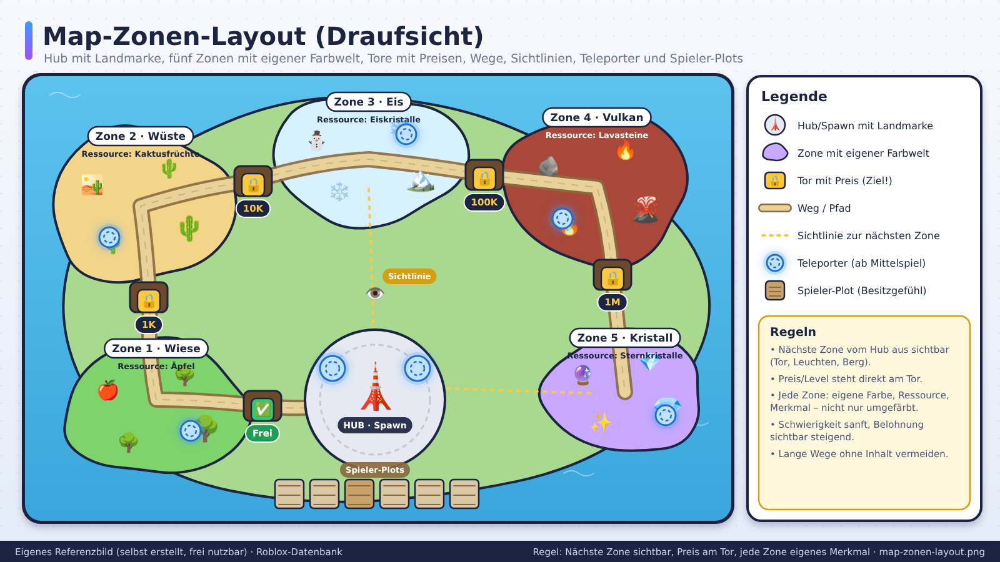
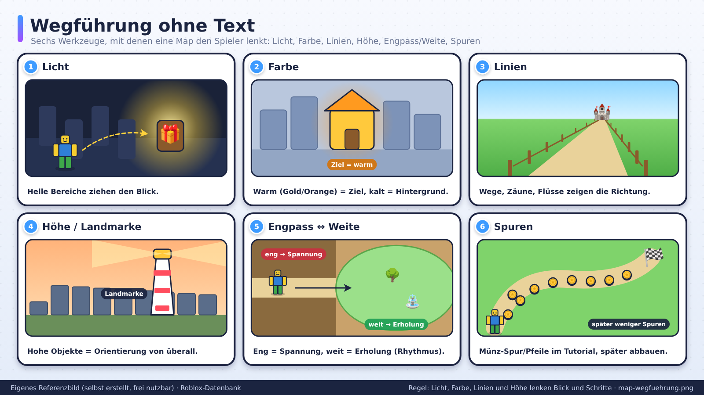
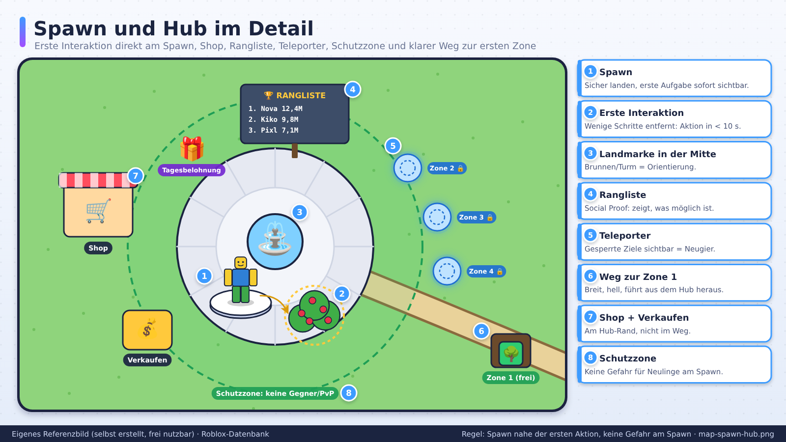

# Map- und Leveldesign

> Stand: 2026-10-24 · Gesamt-Vertrauen: 🧠 (Designwissen), ✅ für Onboarding-Hinweise der Creator-Hub-Doku

## Kurzfassung
Eine gute Roblox-Map **führt den Spieler ohne Text**, zeigt **sofort, wo es Aktion gibt**, hat **klare Zonen** mit steigendem Reiz und läuft **flüssig auf Handys**. Der Spawn ist die wichtigste Fläche der ganzen Map: Hier entscheidet sich D1.

## Referenzbilder
Selbst erstellte, beschriftete Referenzbilder (frei nutzbar, Übersicht: `assets/bilder/README.md`).

## Prinzipien
1. **Lesbarkeit:** Auf einen Blick erkennbar, was begehbar, interaktiv, gefährlich ist.
2. **Führung:** Licht, Farbe, Linien, Wege, Höhe lenken den Blick und die Schritte.
3. **Rhythmus:** Wechsel aus Ruhe und Aktion, Eng und Weit, Hoch und Tief.
4. **Identität:** Jede Zone hat Farbwelt, Form und Ton, damit man weiß, wo man ist.
5. **Belohnte Neugier:** Abseits liegt etwas (Fund, Geheimnis, Abkürzung).
6. **Performance:** Teile, Effekte und Sichtweite kontrollieren.

## Spawn und Hub (die ersten 60 Sekunden)
- **Spawn nahe der ersten Aktion** (nicht erst laufen müssen).
- **Klare Sichtlinie** zum ersten Ziel.
- **Wiedererkennbarer Hub:** Shop, Inventar-Stationen, Teleporter, Rangliste an einem Ort.
- **Nicht überladen:** Nicht alle Funktionen sofort zeigen.
- **Schutzraum:** Keine Gefahr direkt am Spawn für Neulinge.
- **Visuelle Anker:** Ein großes, unverwechselbares Objekt als Orientierungspunkt (Turm, Baum, Leuchtturm).

## Zonen-Design (typisch für Simulator/Progression)
| Zone | Zweck | Gestaltung |
|---|---|---|
| Start | Lernen, Sicherheit | Hell, freundlich, einfach |
| Zone 2–3 | Erste Vertiefung | Neue Farbwelt, neue Ressource |
| Mittelzonen | Abwechslung | Jede mit eigenem Gimmick |
| Späte Zonen | Prestige | Dramatischer, gefährlicher, seltener Loot |
| Endzone/Hub 2 | Rebirth-Anker | Spektakel, Belohnung |

**Zonen-Regeln:**
- **Sichtbar machen, was kommt:** Spieler sehen die nächste Zone (Tor, Berg, Leuchten) und wollen hin.
- **Zugang als Ziel:** Preis/Level steht am Tor.
- **Schwierigkeit** steigt sanft; Belohnung steigt sichtbar.
- **Wiederholung vermeiden:** Jede Zone mindestens ein eigenes Merkmal (Ressource, Gegner, Mechanik, Look).

## Wegführung
- **Licht:** Helle Bereiche ziehen den Blick.
- **Farbe:** Warm (Gold/Orange) = Ziel, Kalt = Hintergrund.
- **Linien:** Wege, Zäune, Fluss, Bäume zeigen Richtung.
- **Höhe:** Höhere Objekte als Landmarken.
- **Engpässe und Öffnungen:** Eng → Spannung, Weit → Erholung.
- **Pfeile/Spuren** im Tutorial, später abbauen.
- **Kein Verlaufen:** Minimap oder Wegmarken in größeren Maps.

## Maßstab und Navigation
- Roblox-Figur als Maßstab: Tür ca. 1,5–2× Figurhöhe, Wege breit genug für mehrere Spieler.
- **Laufzeiten prüfen:** Zu lange Wege ohne Inhalt sind der häufigste Langeweile-Faktor. Teleporter/Schnellreise ab Mittelspiel.
- **Sprung-/Kletter-Mechaniken** nur, wenn sie zum Spiel passen und mobil bedienbar sind.

## Umweltgeschichten
- Objekte erzählen (Spuren, Ruinen, Ablagen, Beschriftungen).
- Keine Textmauern; Bilder, Symbole, Details.

## Multiplayer-Aspekte
- **Platz pro Spieler:** Bei vielen Spielern nicht zu eng (Farm-Plots, Basen).
- **Plot-Systeme:** Jeder Spieler hat eigenen Bereich (Sicherheit, Besitzgefühl).
- **Server-Größe:** Passende Spielerzahl zur Kartengröße.
- **Sichtbare Mitspieler:** Social Proof (Rangliste, Show-Plätze).
- **Fairness:** Spawn/Ressourcen gleichmäßig verteilt.

## Beleuchtung und Atmosphäre
- **Lighting-Einstellungen** je Zone (Stimmung): Farbton, Nebel, Himmel.
- **Kontrast:** Wichtige Objekte heben sich ab.
- **Tag/Nacht** nur, wenn es Gameplay hat.
- **Performance:** Schatten und viele dynamische Lichter auf Mobile prüfen.

## Performance
- Teile zusammenfassen, Meshes statt Hunderter Parts, wiederverwendete Assets.
- `StreamingEnabled` einsetzen und testen (offizielle Doku lesen).
- Kollisionen vereinfachen (`CanCollide`, `CollisionFidelity`).
- Sichtweite/Nebel als Gestaltung und Sparmaßnahme.
- Auf Low-End-Handy testen.

## Map-Workflow
1. **Graybox:** Nur Blöcke, Wege, Zonen. Spielen, Laufzeiten messen.
2. **Erste Kunstpass:** Farben, Silhouetten, Landmarken.
3. **Gameplay-Pass:** Interaktionen, Gefahren, Belohnungen platzieren.
4. **Detail-Pass:** Deko, Licht, Ton.
5. **Performance-Pass:** Messen und aufräumen.
6. **Testlauf** mit Fremden, Beobachten ohne Erklären.

## Do / Don't
| Do | Don't |
|---|---|
| Spawn nahe der ersten Aktion | Langer Weg bis zum Spaß |
| Landmarken zur Orientierung | Gleichförmige Landschaft |
| Zonen mit eigener Identität | Zonen nur recoloren |
| Graybox zuerst | Erst Kunst, dann Gameplay |
| Mobil testen | Nur am PC prüfen |

## Quellen
- [Creator Hub: Onboarding](https://create.roblox.com/docs/en-us/production/game-design/onboarding) ✅
- Weitere Leveldesign-Quellen bei nächstem Update recherchieren (offizielle Roblox-Studio-Doku zu Streaming, Terrain, Lighting)
