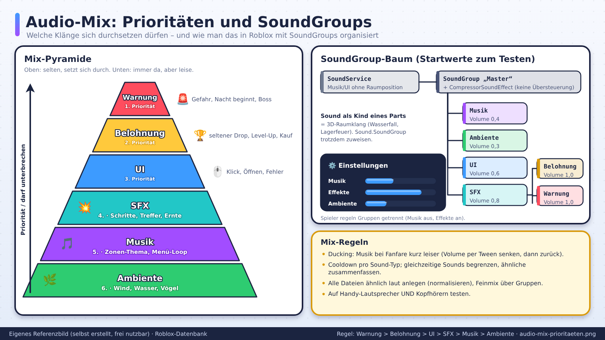
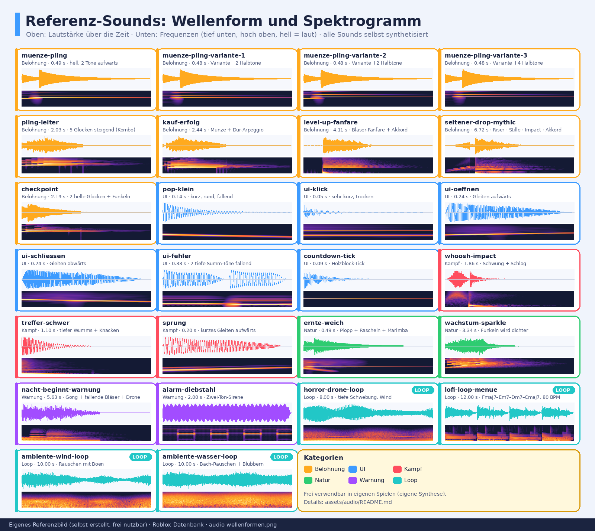

# Sound und Audio

> Stand: 2026-10-24 · Gesamt-Vertrauen: ✅ für Roblox-Sound-Objekte (Creator Hub), 🟠 für Community-Zahlen, 🧠 für Designprinzipien

## Kurzfassung
Sound macht Aktionen **befriedigend** (Feedback), gibt Zonen **Stimmung** und lenkt **Aufmerksamkeit**. Auf Roblox ist Ton ein günstiger Hebel: Ein gutes „Ding!" bei jeder Belohnung verbessert das Spielgefühl mehr als viele Grafik-Updates. Aber: Lautstärke, Wiederholung und Mobile-Performance beachten.

## Referenzbilder
Selbst erstellte, beschriftete Referenzbilder (frei nutzbar, Übersicht: `assets/bilder/README.md`).

## Referenz-Sounds
Selbst synthetisierte Beispiel-Sounds (frei nutzbar, auch zum Hochladen in eigene Spiele; Roblox-Upload-Regeln beachten). Beschreibung nach Hör-Raster und empfohlene SoundGroup/Lautstärke: `assets/audio/README.md`. Jede Datei gibt es als `.ogg` und `.wav`.

| Rolle | Sounds |
|---|---|
| Feedback/Belohnung | [muenze-pling](../assets/audio/muenze-pling.ogg) · [Variante 1](../assets/audio/muenze-pling-variante-1.ogg) · [Variante 2](../assets/audio/muenze-pling-variante-2.ogg) · [Variante 3](../assets/audio/muenze-pling-variante-3.ogg) · [pling-leiter](../assets/audio/pling-leiter.ogg) · [kauf-erfolg](../assets/audio/kauf-erfolg.ogg) · [checkpoint](../assets/audio/checkpoint.ogg) |
| Belohnungs-Fanfare | [level-up-fanfare](../assets/audio/level-up-fanfare.ogg) · [seltener-drop-mythic](../assets/audio/seltener-drop-mythic.ogg) (Stille vor dem Impact) |
| UI-Sounds | [ui-klick](../assets/audio/ui-klick.ogg) · [ui-oeffnen](../assets/audio/ui-oeffnen.ogg) · [ui-schliessen](../assets/audio/ui-schliessen.ogg) · [ui-fehler](../assets/audio/ui-fehler.ogg) · [pop-klein](../assets/audio/pop-klein.ogg) · [countdown-tick](../assets/audio/countdown-tick.ogg) |
| Kampf/Bewegung | [whoosh-impact](../assets/audio/whoosh-impact.ogg) · [treffer-schwer](../assets/audio/treffer-schwer.ogg) · [sprung](../assets/audio/sprung.ogg) |
| Farming/Cozy | [ernte-weich](../assets/audio/ernte-weich.ogg) · [wachstum-sparkle](../assets/audio/wachstum-sparkle.ogg) |
| Warnsignale | [nacht-beginnt-warnung](../assets/audio/nacht-beginnt-warnung.ogg) · [alarm-diebstahl](../assets/audio/alarm-diebstahl.ogg) |
| Musik (Loop) | [lofi-loop-menue](../assets/audio/lofi-loop-menue.ogg) (12 s, nahtlos) |
| Ambiente (Loop) | [horror-drone-loop](../assets/audio/horror-drone-loop.ogg) · [ambiente-wind-loop](../assets/audio/ambiente-wind-loop.ogg) · [ambiente-wasser-loop](../assets/audio/ambiente-wasser-loop.ogg) |

## Technische Grundlagen (Roblox) ✅
- **`Sound`-Objekt:** spielt eine Audiodatei ab. Der Ort bestimmt Ausgabe und Lautstärkeverlauf.
  - In **`SoundService`** oder direkt im Client: globaler Sound (Musik, UI) ohne Raumposition. Offizielle Doku nennt `SoundService` für Musik/Soundtracks aus mehreren Dateien.
  - Als Kind eines **Parts/Attachments**: 3D-Raumklang, Lautstärke nach Entfernung.
- **`SoundGroup`:** Mehrere Sounds gruppieren (z. B. Musik, SFX, UI, Ambiente), Lautstärke pro Gruppe regeln, Effekte anwenden. Grundlage für ein Lautstärke-Menü der Spieler.
- **Sound-Effekte** (Kinder von Sound/SoundGroup): z. B. `CompressorSoundEffect` (maximale Lautstärke begrenzen), `ReverbSoundEffect` (Hall/Räume). Weitere Effekte in der Referenz.
- **Vorladen:** `ContentProvider:PreloadAsync()` für Assets, die sofort bereit sein müssen (z. B. Belohnungs-Sounds). 🟡 (verbreitete Praxis; Doku bei Nutzung prüfen)
- **Audio-Quellen:** Roblox-Audiobibliothek (Creator Store), eigene Uploads (Prüfung/Moderation und Gebühren/Regeln beachten, bei Nutzung aktuell nachlesen).
- **Rechte:** Nur Audio verwenden, das du nutzen darfst (Creator Store, eigene Produktion, lizenziert).

## Die Rollen von Audio
| Rolle | Wirkung | Beispiel |
|---|---|---|
| **Feedback-SFX** | Aktion fühlt sich gut an | Münzen, Treffer, Ernte, Kauf |
| **UI-Sounds** | Bedienung klar | Klick, Öffnen/Schließen, Fehler |
| **Belohnungs-Fanfare** | Höhepunkt | Seltener Drop, Level-Up |
| **Musik** | Stimmung, Identität | Zonen-Themen, Menü-Musik |
| **Ambiente** | Raumgefühl | Wind, Vögel, Nacht, Wasser |
| **Warnsignale** | Gefahr | Nacht beginnt, Boss erscheint |
| **Stimme/Voice-Lines** (optional) | Charakter | NPC-Ausrufe (Moderation und Sprache bedenken) |

## Gestaltungsprinzipien (🧠)

### Feedback-Sounds
- **Sofort** (<0,1 s nach Aktion), **kurz** (0,1–0,5 s), **klar** (kein Matsch).
- **Tonhöhe steigt mit Wert:** kleiner Gewinn tief, großer Gewinn hoch und heller.
- **Variation:** Pro Aktion 3–5 Varianten oder leichte zufällige Tonhöhe (`PlaybackSpeed`), damit Wiederholung nicht nervt.
- **Schichten bei großen Momenten:** Anstieg → Impact → Nachklang.
- **Rare Drops klingen besonders:** Eigene Fanfare, Stille davor (kurze Pause erzeugt Spannung), ggf. Server-Hinweis.

### Musik
- **Loop ohne hörbaren Übergang.**
- **Zonen-Themen:** Jede Zone eigene Stimmung, sanfte Überblendung (Fade 1–3 s).
- **Dynamik:** Ruhig beim Sammeln, intensiver bei Gefahr/Boss.
- **Nicht zu laut:** Musik unter den Feedback-Sounds halten.
- **Genre-Wahl:** Aufgeweckt für Simulatoren, düster für Horror, beruhigend für Farming/Cozy.
- **Spieler-Kontrolle:** Musik/SFX getrennt regelbar; Mute-Schalter.

### Ambiente
- Raumklang (3D) für Quellen (Wasserfall, Lagerfeuer).
- Dezent, Loops mit Variation.
- Nacht/Tag unterscheiden.

### Mischung (Mixing)
- **Prioritäten:** Warnung > Belohnung > UI > SFX > Musik > Ambiente.
- **SoundGroups** nutzen: Musik, SFX, UI, Ambiente.
- **Kompressor** auf Haupt-Gruppen, damit nichts übersteuert.
- **Lautstärke-Normalisierung:** Alle Sounds ähnlich laut anlegen.
- **Auf Handy-Lautsprecher und Kopfhörern testen.**

## Performance und Limits (🟠/🧠)
- **Gleichzeitige Sounds begrenzen:** Eine Community-Quelle nennt ca. 4–5 gleichzeitige Tracks als Faustregel, nicht offiziell bestätigt 🟠. Praxis: Priorisieren, ähnliche Sounds zusammenfassen, Cooldown pro Sound-Typ.
- **Speicher:** Kleine Dateien für häufige SFX; lange Musik gestreamt/nicht doppelt laden.
- **Vorladen** kritischer Sounds.
- **Viele Spieler/Pets:** Nicht jeden Treffer eines jeden Spielers hörbar; nach Entfernung/Priorität filtern.
- **Looping:** Hintergrundmusik und Ambiente loopen; SFX nur, wenn nötig (sonst Ohrenqual).

## Sound-Design nach Genre
| Genre | Musik | Feedback-SFX | Besonderheit |
|---|---|---|---|
| Simulator | hell, rhythmisch | Münze/Pop/Pling, steigende Töne | Sehr viele Mikro-Belohnungen |
| Farming/Cozy | sanft, akustisch | weiche Töne, Pflanzen-Rascheln | Beruhigend, kein Stress |
| Horror | minimalistisch, Drones | Stille als Waffe, leise Details, Schreck-Stinger | Dynamik und Pausen |
| Kampf/Anime | energetisch, Orchester/Beat | Wuchtige Treffer, Schwung-Whoosh | Impact und Tiefe |
| Tycoon | locker, Jazz/Lofi | Kassen, Maschinen | Industrieklang |
| Obby | Beat-getrieben | Sprung/Checkpoint-Töne | Rhythmus passt zu Bewegung |

## Referenzmaterial pflegen
Siehe `assets/referenz-audio.md`: Dort Referenzen sammeln (Beschreibung, was funktioniert, Link). Konkrete Audio-IDs aus dem Creator Store nur eintragen, wenn Lizenz geprüft ist.

## Checkliste
- [ ] Jede wichtige Aktion hat Feedback-Sound
- [ ] Musik und SFX getrennt regelbar (SoundGroups)
- [ ] Seltene Drops haben eigenen Moment
- [ ] Mix auf Handy-Lautsprecher getestet
- [ ] Keine Überlappungs-Kakophonie (Limits/Cooldowns)
- [ ] Musik loopt sauber
- [ ] Alle Audio-Rechte geklärt

## Quellen
- [Creator Hub: Sound-Objekte](https://create.roblox.com/docs/sound/objects) ✅
- [Creator Hub: Sound (Übersicht)](https://create.roblox.com/docs/sound) ✅
- Hinweis: Mehrere SEO-Seiten zu „Roblox Sound Guide" waren unzuverlässig (teils erfundene API-Namen) 🟠, darum hier nur offizielle Grundlagen als Fakten.
