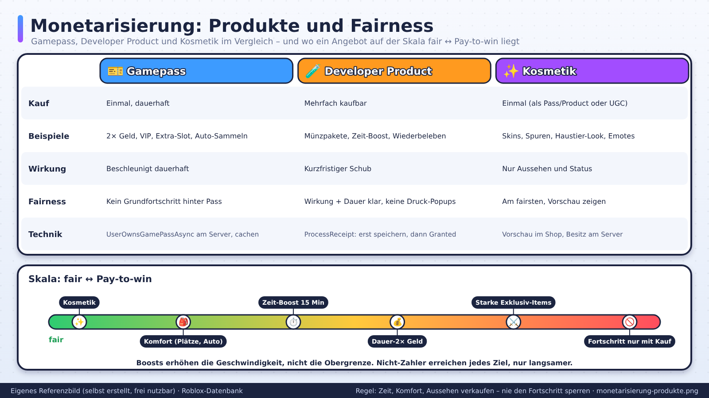
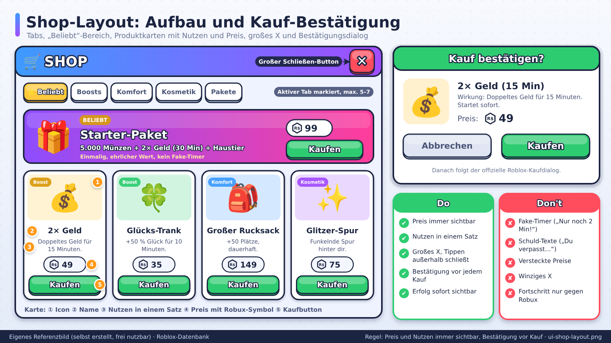

# Monetarisierung (Übersicht)

> Stand: 2026-10-24 · Nächste Prüfung: 2026-11-24 · Gesamt-Vertrauen: ✅ für Produkte, Sätze und Regeln (gegen den Quelltext der Creator Docs vom 24.10.2026 geprüft), 🟡 für Plattformzahlen aus Finanzberichten und Presse, 🟠 für Benchmarks und Umsatzschätzungen aus Drittquellen, 🧠 für Designprinzipien

## Kurzfassung
Roblox-Spiele verdienen über **Passes**, **Developer Products**, **Subscriptions**, **private Server**, **Paid Access**, **Avatar-Item-Kommissionen**, **Werbung**, **Creator Rewards** und **Roblox-Plus-Prämien** ✅ ([Monetization](https://create.roblox.com/docs/production/monetization)). Bei Passes und Developer Products bleiben **70 %** beim Creator ✅ ([Roblox Plus](https://create.roblox.com/docs/production/monetization/roblox-plus)), DevEx tauscht seit dem 5.9.2025 zu **0,0038 $ pro Robux** ✅ ([Developer Exchange](https://create.roblox.com/docs/production/monetization/developer-exchange)). Discovery wertet Ausgaben (Spend Days, Robux pro Nutzer) als Signal ✅ ([Discovery](https://create.roblox.com/docs/discovery)), aber Nutzer downvoten Monetarisierung, die sie ablehnen ✅ ([Monetization](https://create.roblox.com/docs/production/monetization)). Ziel: **fairer Mehrwert, der den Loop beschleunigt oder verschönert, ohne ihn zu brechen**.

## Dateien in diesem Ordner

| Datei | Inhalt | Wann lesen |
|---|---|---|
| `monetarisierung.md` (diese) | Überblick, Kennzahlen, Designprinzipien, Genre-Ideen, Technik | Einstieg |
| `einnahmequellen-und-auszahlungen.md` | alle Einnahmequellen mit Sätzen, DevEx (0,0035 / 0,0038 / 0,0054), 18+-Kurs, Creator Rewards, Plus, Subscriptions, Paid Access, Transfers, Werbung, Avatar-Items, Commerce, Steuern, Plattform-Auszahlungen | Geschäftsmodell rechnen |
| `preisgestaltung-und-shop-design.md` | Managed/Regional Pricing, Price Optimization, Preisgrenzen, Preisleiter, Starter-Paket, Shop- und Kontextkauf-Design, Benchmarks, Top-Spiel-Umsätze (🟠), A/B-Tests mit Experiments | Shop bauen, Preise setzen |
| `ethik-und-recht.md` | Regeln für bezahlte Zufallsitems, PolicyService, Länder, Darstellungsregeln, Klagen, Studien, Dark Patterns, Regeln für junges Publikum | vor jedem Zufalls- oder Angebotsfeature |
| `03-mechaniken-retention/gacha-und-luck.md` | Quoten, Luck-Formeln, Pity-Rechnung, EV | Eier, Kisten, Luck |

## Referenzbilder
Selbst erstellte, beschriftete Referenzbilder (frei nutzbar, Übersicht: `assets/bilder/README.md`) und offizielle Bilder (Übersicht: `assets/bilder/offiziell/README.md`).

*Doors: Die gekaufte Taschenlampe hat einen sofort verständlichen Nutzen. Quelle: Roblox Creator Docs, CC BY 4.0 ([Monetization foundations](https://create.roblox.com/docs/production/game-design/monetization-foundations))*

*Der eingebaute Roblox-Shop ist über das In-Game-Menü erreichbar. Quelle: Roblox Creator Docs, CC BY 4.0 ([Shop](https://create.roblox.com/docs/production/monetization/shop))*

*Jailbreak: zehn Season-Stufen als Startpunkt. Quelle: Roblox Creator Docs, CC BY 4.0 ([Season pass design](https://create.roblox.com/docs/production/game-design/season-pass-design))*

*Alle Währungsquellen und -senken mit Netto-Fluss. Quelle: Roblox Creator Docs, CC BY 4.0 ([Economy events](https://create.roblox.com/docs/production/analytics/economy-events))*

*Payer Conversion und ARPPU gegen ähnliche Spiele. Quelle: Roblox Creator Docs, CC BY 4.0 ([Analytics](https://create.roblox.com/docs/production/analytics))*

---

## Produkttypen ✅

| Typ | Was | Dein Anteil | Typische Nutzung | Quelle |
|---|---|---|---|---|
| **Pass** | Einmalkauf, dauerhaft | 70 % | 2× Geld, VIP, Extra-Slot, Werkzeug | [Passes](https://create.roblox.com/docs/production/monetization/passes) |
| **Developer Product** | mehrfach kaufbar, 1 bis 1 Mrd. Robux | 70 % | Währungspakete, Boosts, Wiederbeleben | [Developer products](https://create.roblox.com/docs/production/monetization/developer-products) |
| **Subscription** | monatlich, Robux (ab 49) oder 2,99–14,99 $ | 70 % bzw. 70 %→100 % | VIP-Club, monatliche Pakete, Season Pass | [Subscriptions](https://create.roblox.com/docs/production/monetization/subscriptions) |
| **Privater Server** | monatliche Robux-Gebühr | eigener Preis; Plus-Ersatz bis 100 Robux | Freundesgruppen, Streamer | [Private servers](https://create.roblox.com/docs/production/monetization/private-servers) |
| **Paid Access** | Eintritt, 25–1.000 Robux oder 9,99/29,99/49,99 $ | lokal 50/60/70 % | Premium-Spiele, Closed Beta | [Paid access](https://create.roblox.com/docs/production/monetization/paid-access-robux) |
| **Avatar-Items im Spiel** | Kleidung, Accessoires | 40 % als Spielbesitzer, 30 % als Creator | Kleiderladen, Avatar-Editor | [Marketplace fees](https://create.roblox.com/docs/marketplace/marketplace-fees-and-commissions) |
| **Creator Rewards** | Plattform-Prämie | 5 Robux/Active Spender/Tag; 35 % auf max. 100 $ je geworbenem Nutzer | tägliche Gewohnheit, Share Links | [Creator Rewards](https://create.roblox.com/docs/creator-rewards) |
| **Roblox Plus** | Plattform-Prämie | bis 750 Robux je Abo-Abschluss; bis 100 Robux je Plus-Nutzer im privaten Server | Plus-Prompt im Spiel | [Roblox Plus](https://create.roblox.com/docs/production/monetization/roblox-plus) |
| **Robux-Transfers** | Plus-Nutzer senden 10–500 Robux | 10 % | Spenden, Geschenke | [Robux transfers](https://create.roblox.com/docs/production/monetization/robux-transfers) |
| **Rewarded Video / Immersive Ads** | Werbung | EPM × Impressionen | freiwillige Belohnung, Werbetafeln | [Rewarded video ads](https://create.roblox.com/docs/production/promotion/rewarded-video-ads) |
| **Commerce** | echte Produkte über Shopify, nur US-Käufer | Split nicht dokumentiert | Merch | [Commerce products](https://create.roblox.com/docs/production/monetization/commerce-products) |
| **Creator Store** | Modelle (ab 2,99 $) und Plugins (ab 4,99 $) | 100 % netto | Werkzeuge für andere Creator | [Monetization](https://create.roblox.com/docs/production/monetization) |

Details und Rechenbeispiele: `einnahmequellen-und-auszahlungen.md`.

## Die wichtigsten Zahlen auf einen Blick

| Kennzahl | Wert | Vertrauen | Quelle |
|---|---|---|---|
| Creator-Anteil Pass / Developer Product | 70 % | ✅ | [Roblox Plus](https://create.roblox.com/docs/production/monetization/roblox-plus) |
| DevEx Standard | 0,0038 $/Robux (114 $ je 30.000) | ✅ | [Developer Exchange](https://create.roblox.com/docs/production/monetization/developer-exchange) |
| DevEx Altguthaben (vor 5.9.2025) | 0,0035 $/Robux, wird zuerst ausgezahlt | ✅ | wie oben |
| DevEx US 18+ (ab 8.6.2026) | 0,0054 $/Robux, nur reine R15-Spiele | ✅ | [18+ rate](https://create.roblox.com/docs/production/monetization/18-plus-devex-rate) |
| DevEx-Minimum | 30.000 Earned Robux, ab 13 Jahren, kein Premium nötig | ✅ | [Developer Exchange](https://create.roblox.com/docs/production/monetization/developer-exchange) |
| 100.000 Robux in US-$ | 350 $ (alt) / 380 $ (Standard) / 540 $ (18+) | 🧠 | Rechnung |
| Regionale Preise | 30–100 % des Standardpreises | ✅ | [Regional pricing](https://create.roblox.com/docs/production/monetization/regional-pricing) |
| Price Optimization ab | 60.000 Transaktionen in 30 Tagen | ✅ | [Price optimization](https://create.roblox.com/docs/production/monetization/price-optimization) |
| Rewarded Video ab | 2.000 einzigartige Besucher pro Monat, ID + 2FA | ✅ | [Rewarded video ads](https://create.roblox.com/docs/production/promotion/rewarded-video-ads) |
| Active Spender | mind. 9,99 $ Käufe in 60 Tagen | ✅ | [Creator Rewards](https://create.roblox.com/docs/creator-rewards) |
| Spielübergreifende Verkäufe | abgeschaltet seit 30.5.2026 | ✅ | [Passes](https://create.roblox.com/docs/production/monetization/passes) |
| US-Quellensteuer (Nicht-US) ab 1.11.2026 | 0–30 % mit gültigem W-8 bis 31.10.2026, sonst bis 24 % auf alles | ✅ | [Tax information](https://create.roblox.com/docs/production/monetization/tax-information) |
| DevEx-Auszahlungen 2025 | 1,503 Mrd. $ (+63 %), über 23.500 Creator | ✅ | [10-K FY2025](https://www.sec.gov/Archives/edgar/data/1315098/000131509826000024/rblx-20251231.htm) |
| Anteil der Bookings, der als DevEx ankommt | ca. 22 % (1,503 / 6,8 Mrd. $) | 🟡/🧠 | 10-K + [Naavik](https://naavik.co/deep-dives/the-state-of-ugc-games-2026/) |
| Payer Conversion pro Tag | Praxis 1–5 %, keine offizielle Zahl | 🟠 | [DevForum](https://devforum.roblox.com/t/very-low-arppu-in-floor-race/3566999) |

## Korrekturen gegenüber der früheren Fassung

| Früher hier | Jetzt (verifiziert) |
|---|---|
| DevEx-Kurs „0,0035 $ pro Robux“ 🟠 | **0,0038 $** seit 5.9.2025; 0,0035 $ nur für Altguthaben ✅ |
| Mindestbetrag „Quellen widersprechen sich“ | **30.000 Earned Robux** ✅ |
| Marketplace-Gebühr 30 % „im Creator Hub bestätigen“ 🟠 | 70 % Creator-Anteil, belegt über die Plus-Tabelle ✅ (bei Avatar-Items gilt dagegen 30 %/40 %) |
| „Premium-Engagement: Verdienst durch Spielzeit von Premium-Mitgliedern“ | **eingestellt am 24.7.2025**, ersetzt durch Creator Rewards ✅ |
| Subscriptions „prüfen, ob verfügbar“ | verfügbar; Robux ab 49 oder 5 Preisstufen in $; 70 % bzw. 70 %→100 % ✅ |
| Gesamtauszahlungen 2025 „1,1–1,5 Mrd. $“ 🟠 | **1,503 Mrd. $** laut 10-K ✅ |
| „Lokale Preise: Robux-Preise werden an Kaufpakete angepasst; krumme Preise testen“ | Regionale Preise automatisch zwischen 30 und 100 %; Managed Pricing für neue Items standardmäßig an ✅ |
| Werbung „Regeln im Creator Hub prüfen“ | Rewarded Video ab 2.000 Besuchern/Monat; die alte 100.000-DAU-Schwelle gilt nicht mehr ✅ |
| Zufallsprodukte „Pflicht prüfen“ | Quoten-Pflicht, PolicyService-Pflicht und sechs Alternativen verifiziert, siehe `ethik-und-recht.md` ✅ |

## Designprinzipien (🧠, mit offiziellen Belegen wo vorhanden)

### 1) Monetarisiere Zeit, Komfort und Aussehen
- **Komfort:** Mehr Inventar-Slots, Auto-Sammeln, Schnellreise.
- **Beschleunigung:** 2× Geld/XP (nicht Fortschritt blockieren, nur beschleunigen).
- **Kosmetik:** Skins, Effekte, Haustier-Aussehen, Basis-Deko.
- **Status:** Titel, Rahmen, VIP-Bereich (ohne Spielvorteil).
- Offiziell ✅: Mische **langlebige** und **verbrauchbare** Items sowie **Enhancement** und **Expression** ([Monetization foundations](https://create.roblox.com/docs/production/game-design/monetization-foundations)).

### 2) Spiel muss ohne Kauf fair sein
Nicht-Zahler müssen jedes Ziel erreichen können, nur langsamer. Sonst entsteht „Pay-to-win"-Ruf, Spieler brechen ab und Retention (Discovery-Signal) sinkt. Offiziell ✅: Nichtzahler sollen weiter Belohnungen verdienen können, z. B. über die Gratis-Spur im Season Pass ([Monetization foundations](https://create.roblox.com/docs/production/game-design/monetization-foundations)).

### 3) Erster Kauf früh und klein
- Ein günstiges Einstiegsangebot (Starter-Paket) nach dem ersten Erfolgserlebnis. Roblox definiert es als Angebot „in den ersten Minuten“ ✅, aber nicht im allerersten Ladebildschirm ✅ ([Contextual purchases](https://create.roblox.com/docs/production/game-design/contextual-purchases)).
- Preisstufen: klein, mittel, groß, mit sichtbarem Wertzuwachs; „variety of price points“ ✅ ([Monetization analytics](https://create.roblox.com/docs/production/analytics/monetization)).

### 4) Wert klar machen
- Konkrete Wirkung („2× Geld für 30 Minuten").
- Vorschau für Kosmetik.
- Keine versteckten Bedingungen; Beschreibungen müssen wahr sein ✅.

### 5) Zeitpunkt
- **Gute Momente:** Nach einem Erfolg, vor einer Runde (Pre-Play), in der Lobby, in Menüs ✅ ([Contextual purchases](https://create.roblox.com/docs/production/game-design/contextual-purchases)).
- **Schlechte Momente:** Mitten im Kampf (der Robux-Kaufablauf dauert mehrere Sekunden ✅), direkt nach Niederlage (wirkt wie Ausnutzung), ständig wiederholende Popups, Modals übereinander ✅.
- **Plattform-Besonderheit ✅:** Timer, die man wegkaufen oder vorziehen kann, sind bei Roblox-Spielern unbeliebt ([Monetization](https://create.roblox.com/docs/production/monetization)).

### 6) Preisgestaltung
- Mehrere Preispunkte (Anker): ein hoher Preis macht den mittleren attraktiv 🟠.
- Pakete mit Bonus-Wert.
- **Preise nie hart codieren:** Regionalpreise, Preistests und Plus-Rabatte ändern den Betrag ✅.
- **A/B-Tests** mit Experiments (14–60 Tage, ab etwa 1.000 DAU sinnvoll) ✅ ([Experiments](https://create.roblox.com/docs/production/experiments)).
Details: `preisgestaltung-und-shop-design.md`.

### 7) Junges Publikum schützen
- Keine Druck-Texte, kein Fake-Timer, keine Schuld-Formulierungen. Roblox nennt konkrete Formulierungen: statt „GET IT NOW“ lieber „View Item“ ✅ ([Monetization](https://create.roblox.com/docs/production/monetization)).
- Rabatte nur echt und nicht nur für Sekunden ✅.
- Bezahlter Zufall: Quoten vor dem Kauf, PolicyService-Sperre ✅. Siehe `ethik-und-recht.md` und `gacha-und-luck.md`.

### 8) Live-Ops tragen den Umsatz
Roblox nennt einen **wöchentlichen** Update-Rhythmus ideal und **monatlich** das Minimum ✅ ([Monetization](https://create.roblox.com/docs/production/monetization)); die Analytics-Doku nennt kleine Updates alle 2–4 Wochen ✅ ([Retention](https://create.roblox.com/docs/production/analytics/retention)). Diese Angaben weichen voneinander ab. Neue Inhalte dürfen verdient oder monetarisiert werden, damit Spieler das Update als Errungenschaft erleben ✅. Virale Umsätze fallen innerhalb eines Jahres stark (🟠, siehe Preisdatei); Bindung schlägt Launch-Spike 🧠.

## Produkt-Ideen nach Genre (🧠)
| Genre | Passes | Developer Products | Weitere Quellen |
|---|---|---|---|
| Simulator | 2× Geld, Auto-Collect, Extra-Pets-Slot | Währungspakete, Luck-Boost (zeitlich, Quoten anzeigen!) | Season Pass, Creator Rewards durch tägliche Routine |
| Tycoon | Auto-Collect, VIP, 2× | Cash-Pakete | private Server |
| Survival/Koop | Extra-Slot, Kosmetik | Wiederbeleben, Start-Pakete | private Server, Plus-Ersatz |
| Kampf | Kosmetik-Effekte, Slots | Boosts, Reset-Optionen | Season Pass, Rewarded Video in der Lobby |
| Roleplay | Autos, Häuser-Slots, Kosmetik | Kleingeld-Items | **Avatar-Item-Laden (40 % für den Spielbesitzer)**, Subscriptions |
| Obby | Skip-Stage (vorsichtig), Effekte | Checkpoint/Skip-Pakete | Rewarded Video an Rundenende |
| Erwachsene, R15-only | wie oben | wie oben | 18+-DevEx-Kurs 0,0054 $ |

## Wirtschaft balancieren
- Premium-Boosts erhöhen die **Geschwindigkeit**, nicht die Obergrenze.
- Bedenke Inflation: Boosts + Rebirth + Luck multiplizieren sich. Rechne durch (siehe `progression-rebirth.md`, `gacha-und-luck.md`).
- **Erwartungswert (EV)** jedes Events vorab rechnen. Offizielles Beispiel: Ein Event-Fisch mit 0,1 % Chance erzeugte Goldüberschuss und senkte danach den Umsatz ✅ ([Balance virtual economies](https://create.roblox.com/docs/production/game-design/balance-virtual-economies)).
- Sicherste Lösung: eigene **Event-Währung** mit Event-Shop ✅ (ebd.).
- Economy-Events tracken. **Doku-Widerspruch ✅:** Die Limit-Tabelle erlaubt 10 Ressourcentypen, AnalyticsService-Referenz und Economy-Dashboard nennen 5 ([Event types](https://create.roblox.com/docs/production/analytics/event-types); [Economy events](https://create.roblox.com/docs/production/analytics/economy-events)). Mit höchstens fünf Währungen planen.

## Kennzahlen ✅
| Kennzahl | Definition (Roblox-Dashboard) |
|---|---|
| Conversion Rate | Anteil der DAU, die zahlen |
| ARPPU | Umsatz pro zahlendem Nutzer |
| ARPDAU | Umsatz pro DAU = Conversion × ARPPU |
| Retention nach Kauf | eigenes Funnel- oder Custom-Event 🧠 |

Quelle: [Monetization analytics](https://create.roblox.com/docs/production/analytics/monetization). Roblox nennt keine Zielwerte, sondern Benchmarks „ähnlicher Spiele“ (50.–90. Perzentil) ✅ ([Analytics dashboard](https://create.roblox.com/docs/production/analytics/analytics-dashboard)). Hohe ARPPU bei niedriger ARPDAU heißt: Der Umsatz hängt an wenigen Spielern ✅.

## Technik-Hinweise
- Käufe nur **serverseitig** verarbeiten (`MarketplaceService`; Developer Products über `ProcessReceipt`, korrekt bestätigen, Idempotenz sichern). Details in `08-technik-luau/technik-grundlagen.md`.
- Ohne korrektes `ProcessReceipt` verkauft Roblox Developer Products **nicht außerhalb des Spiels** (Startseite, Suche, nach Robux-Kauf) ✅ ([Developer products](https://create.roblox.com/docs/production/monetization/developer-products)).
- Pass-Besitz serverseitig prüfen und zwischenspeichern.
- Preise mit `GetProductInfoAsync` / `GetDeveloperProductsAsync` anzeigen, Plus-Rabatte über `PriceDiscountDetails` ✅ ([Roblox Plus](https://create.roblox.com/docs/production/monetization/roblox-plus)).
- `PolicyService:GetPolicyInfoForPlayerAsync()` für Zufallsitems, Handel, Abos, Commerce, Werbung ✅ ([Monetization](https://create.roblox.com/docs/production/monetization)).
- Roblox speichert keine Kaufhistorie pro Spieler; Käufe selbst in der DataStore protokollieren ✅ ([Monetization](https://create.roblox.com/docs/production/monetization)).

## Do / Don't
| Do | Don't |
|---|---|
| Komfort, Tempo, Aussehen verkaufen | Fortschritt hinter Geld oder Zufall sperren |
| Mehrere Preispunkte, kleiner Erstkauf | ein einziges teures Paket |
| Preise dynamisch anzeigen | feste Zahlen im UI |
| Kaufmomente in Pausen und Lobby | Kauf-Prompt im Kampf oder nach Niederlage |
| Quoten offen, Pity sichtbar | „2× Luck“ ohne Prozentwerte |
| Echte Rabatte mit echtem Ende | Dauer-Sale, neu startende Countdowns |
| Live-Ops-Rhythmus (wöchentlich bis monatlich) | Launch-Spike als Geschäftsmodell |
| Benchmarks „ähnliche Spiele“ lesen | Fremde Faustregeln als Ziel setzen |

## Checkliste
- [ ] Produktmix: mindestens ein Pass, ein Developer Product, ein Starter-Paket; Subscription oder privater Server geprüft
- [ ] Jedes Item hat klaren Zweck und wahre Beschreibung
- [ ] Spiel ohne Käufe vollständig spielbar
- [ ] Preise dynamisch (Dynamic Price Check bestanden)
- [ ] `ProcessReceipt` idempotent, Developer Products auf „Listed“
- [ ] Bezahlter Zufall: Quoten, PolicyService, Alternative (siehe `ethik-und-recht.md`)
- [ ] Texte kindgerecht, keine Fake-Timer, keine falsche Knappheit
- [ ] Event-EV gerechnet, Event-Währung erwogen
- [ ] Funnel für Shop angelegt, Conversion/ARPPU gegen Benchmark gelesen
- [ ] DevEx-Voraussetzungen und Steuerformular (Frist 31.10.2026) erledigt
- [ ] 18+-Kurs-Entscheidung (R15-only) getroffen

## Offene Fragen / Recherche-Bedarf
- Offizielle Genre-Benchmarks für Conversion, ARPPU, ARPDAU (nur im eigenen Dashboard sichtbar).
- Commerce-Umsatzanteil, EPM-Spannen für Werbung, Umrechnung der Audience-Expansion-Prämie.
- EU- und deutsches Recht zu Lootboxen und Kaufdruck.
- DevEx-Summen 2026 (Q3-Zahlen um den 29.10.2026 erwartet).

## Verknüpfungen
`einnahmequellen-und-auszahlungen.md`, `preisgestaltung-und-shop-design.md`, `ethik-und-recht.md`, `03-mechaniken-retention/gacha-und-luck.md`, `03-mechaniken-retention/progression-rebirth.md`, `03-mechaniken-retention/live-ops-events.md`, `01-markt-trends/discovery-algorithmus.md`, `01-markt-trends/plattform-regeln-2026.md`, `04-ui-ux/hud-shop-menues.md`, `08-technik-luau/technik-grundlagen.md`, `08-technik-luau/kaeufe-und-sicherheit.md`, `03-mechaniken-retention/analytics-und-experimente.md`, `01-markt-trends/plattform-kennzahlen.md`

## Quellen
- [Monetization (Übersicht und Richtlinien)](https://create.roblox.com/docs/production/monetization) – Doku-Stand 2026-10-24, ✅
- [Developer Exchange](https://create.roblox.com/docs/production/monetization/developer-exchange), [U.S. 18+ exchange rate](https://create.roblox.com/docs/production/monetization/18-plus-devex-rate), [Tax information](https://create.roblox.com/docs/production/monetization/tax-information) – ✅
- [Roblox Plus](https://create.roblox.com/docs/production/monetization/roblox-plus), [Creator Rewards](https://create.roblox.com/docs/creator-rewards) – ✅
- [Passes](https://create.roblox.com/docs/production/monetization/passes), [Developer products](https://create.roblox.com/docs/production/monetization/developer-products), [Subscriptions](https://create.roblox.com/docs/production/monetization/subscriptions), [Private servers](https://create.roblox.com/docs/production/monetization/private-servers), [Paid access](https://create.roblox.com/docs/production/monetization/paid-access-robux), [Robux transfers](https://create.roblox.com/docs/production/monetization/robux-transfers) – ✅
- [Managed pricing](https://create.roblox.com/docs/production/monetization/managed-pricing), [Regional pricing](https://create.roblox.com/docs/production/monetization/regional-pricing), [Price optimization](https://create.roblox.com/docs/production/monetization/price-optimization), [Shop](https://create.roblox.com/docs/production/monetization/shop) – ✅
- [Paid random items](https://create.roblox.com/docs/production/monetization/paid-random-items) – ✅
- [Rewarded video ads](https://create.roblox.com/docs/production/promotion/rewarded-video-ads), [Immersive ads](https://create.roblox.com/docs/production/monetization/immersive-ads), [Commerce products](https://create.roblox.com/docs/production/monetization/commerce-products), [Marketplace fees](https://create.roblox.com/docs/marketplace/marketplace-fees-and-commissions) – ✅
- [Monetization foundations](https://create.roblox.com/docs/production/game-design/monetization-foundations), [Contextual purchases](https://create.roblox.com/docs/production/game-design/contextual-purchases), [Balance virtual economies](https://create.roblox.com/docs/production/game-design/balance-virtual-economies), [Season pass design](https://create.roblox.com/docs/production/game-design/season-pass-design) – ✅
- [Monetization analytics](https://create.roblox.com/docs/production/analytics/monetization), [Analytics dashboard](https://create.roblox.com/docs/production/analytics/analytics-dashboard), [Event types](https://create.roblox.com/docs/production/analytics/event-types), [Economy events](https://create.roblox.com/docs/production/analytics/economy-events), [Retention](https://create.roblox.com/docs/production/analytics/retention), [Experiments](https://create.roblox.com/docs/production/experiments) – ✅
- [Discovery](https://create.roblox.com/docs/discovery) – ✅
- [Roblox 10-K FY2025](https://www.sec.gov/Archives/edgar/data/1315098/000131509826000024/rblx-20251231.htm) – ✅
- [Roblox Newsroom: RDC 2025](https://about.roblox.com/newsroom/2025/09/roblox-rdc-2025) – ✅
- [Naavik: State of UGC Games 2026](https://naavik.co/deep-dives/the-state-of-ugc-games-2026/) – 🟡
- [Nasdaq: Roblox raises creator payouts](https://www.nasdaq.com/articles/roblox-raises-creator-payouts-will-margins-face-pressure-2026), [Benzinga](https://www.benzinga.com/analyst-stock-ratings/reiteration/25/09/47551437/roblox-analysts-cheer-developer-payout-hike-see-path-to-stronger-growth) – 🟡
- [DevEx Math 2026 – rowatcher](https://rowatcher.com/news/devex-math-in-2026-what-you-actually-take-home-per-1-000-players), [DevEx Requirements 2026 – rolearn](https://rolearn.dev/guidance/roblox-devex-requirements-2026) – 🟠 (teilweise veraltet)
- [DevForum: Floor Race ARPPU](https://devforum.roblox.com/t/very-low-arppu-in-floor-race/3566999) – 🟠
