# Performance und Tooling (Profiling, Parallel Luau, Native, Workflows, KI-Werkzeuge)

> Stand: 2026-10-24 · Nächste Prüfung: 2027-01-24 · Gesamt-Vertrauen: ✅ für Werkzeuge, Limits und API-Verhalten (gegen den Quelltext der offiziellen Creator Docs, Snapshot `4e795e6` vom 24.10.2026, geprüft), 🟡 für Release-Termine (DevForum, Luau-Blog, Presse), 🟠 für Community-Versionsstände und Einzelquellen, 🧠 für Empfehlungen

## Kurzfassung
- **Budget-Denken:** 60 FPS heißt **16,67 ms pro Frame**; der Server-Heartbeat ist auf 60 gedeckelt; Server-Speicher = **6,25 GiB + 100 MiB × Spitzen-Spielerzahl**, davon unter 50 % bleiben ✅ ([Identify performance issues](https://create.roblox.com/docs/performance-optimization/identify)).
- **Auf schwachen Geräten messen:** Android stellt rund **65 %** der Spieler, davon ~60 % mit **2–4 GB RAM** ✅ ([Test on hardware](https://create.roblox.com/docs/performance-optimization/test-on-hardware)). Die 1.000 Draw Calls / 1 Mio. Dreiecke der Doku sind nur ein Beispiel für ein selbst gewähltes Basisgerät ✅.
- **Werkzeuge:** Developer Console (F9), MicroProfiler (Frame-Spitzen), Script Profiler (CPU pro Funktion, 1 oder 10 kHz), Luau Heap (Speicher-Snapshots), Performance Dashboard (live) ✅.
- **Luau-Beschleuniger:** Parallel Luau braucht **mehrere Actors**, `require()` ist in der parallelen Phase verboten; `--!native`/`@native` kompiliert zu Maschinencode, mit Code-Größenlimit ✅. Neu: `const`, Require-by-String ✅, neuer Type Solver allgemein verfügbar 🟡.
- **Workflows 2026:** Studio **Script Sync** (bis 10.000 Skripte pro Wurzel, 128 Wurzeln) oder **Rojo + Rokit + Wally**; Studio hat einen **eingebauten MCP-Server** (u. a. `execute_luau`, Playtest-Steuerung, Eingabe-Simulation); Assistant mit **Planning Mode**; Open Cloud **Luau Execution** für Tests (Skript ≤ 4 MB, ≤ 5 min) ✅.

## Referenzbilder
Offizielle Abbildungen aus den Roblox Creator Docs (Index: `assets/bilder/offiziell/README.md`).

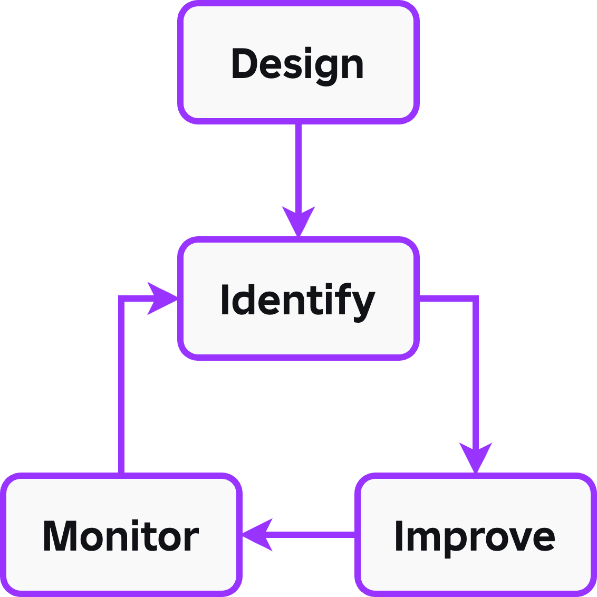
*Performance ist ein Kreislauf: mitdesignen, Probleme finden, verbessern, nach Releases überwachen. Quelle: Roblox Creator Docs, CC BY 4.0*

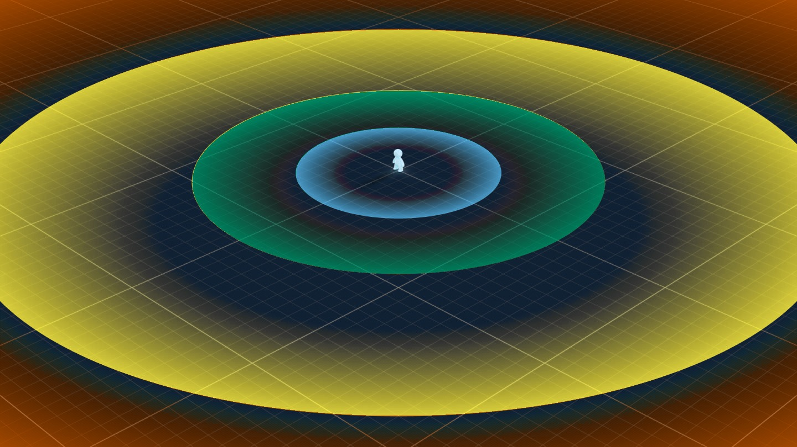
*SLIM rendert mit wachsender Entfernung immer stärker vereinfacht. Quelle: Roblox Creator Docs, CC BY 4.0*

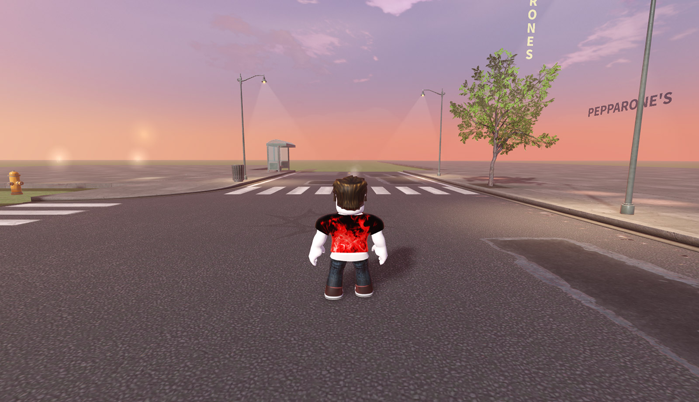
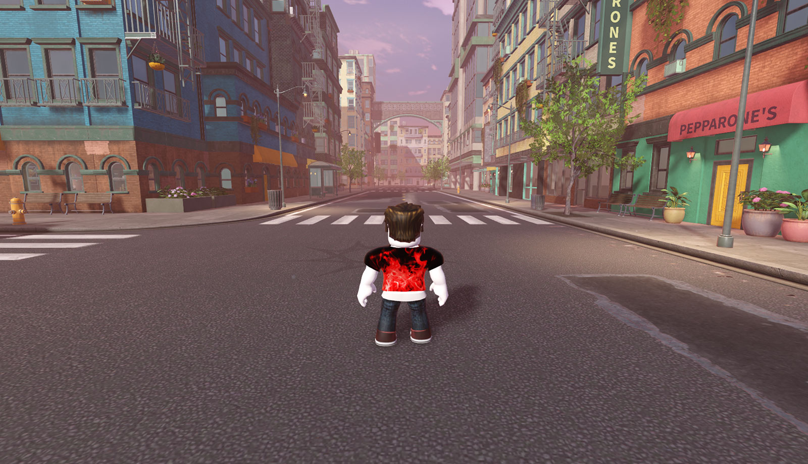
*Vorher/Nachher: Ohne SLIM verschwindet die Ferne, mit SLIM bleibt die Silhouette bei geringer Last. Quelle: Roblox Creator Docs, CC BY 4.0*

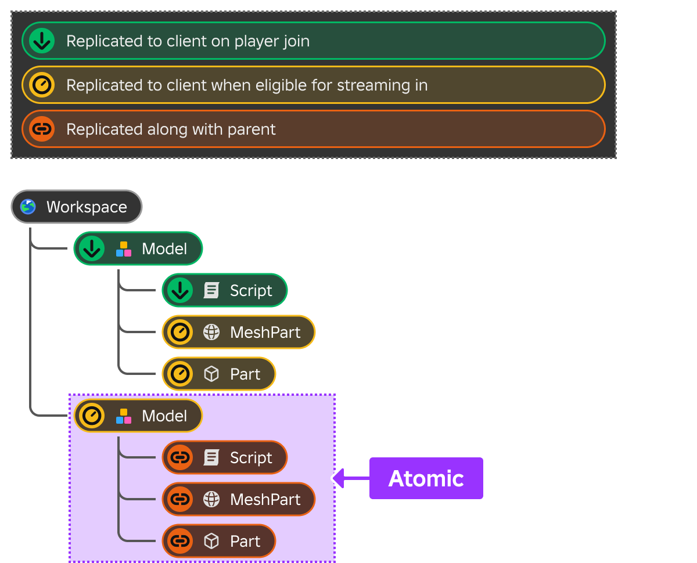
*Atomic-Modelle werden mit allen Kindern gemeinsam gestreamt. Quelle: Roblox Creator Docs, CC BY 4.0*

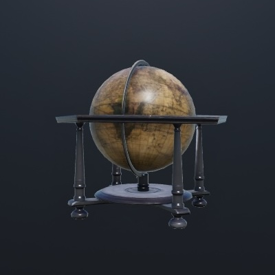
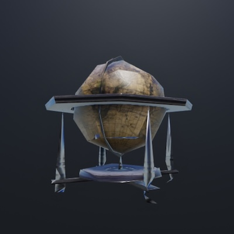
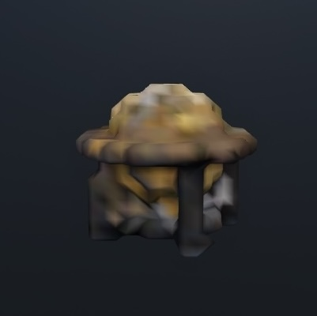
*LOD-Stufen eines Modells: Original, SLIM-Vereinfachung, Imposter. Quelle: Roblox Creator Docs, CC BY 4.0*

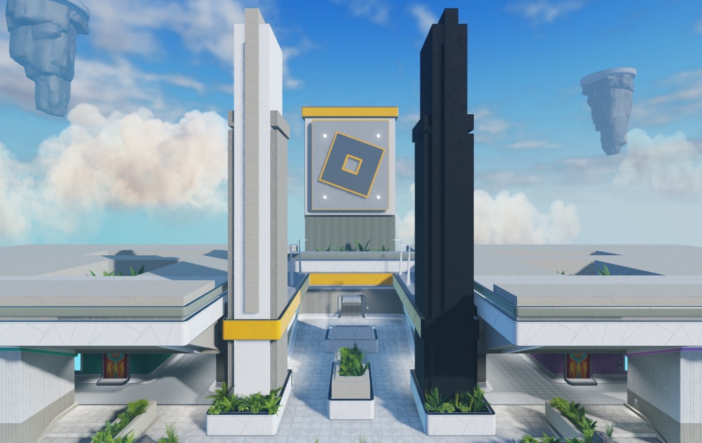
*Weniger einzigartige Meshes bedeuten weniger Draw Calls. Quelle: Roblox Creator Docs, CC BY 4.0*

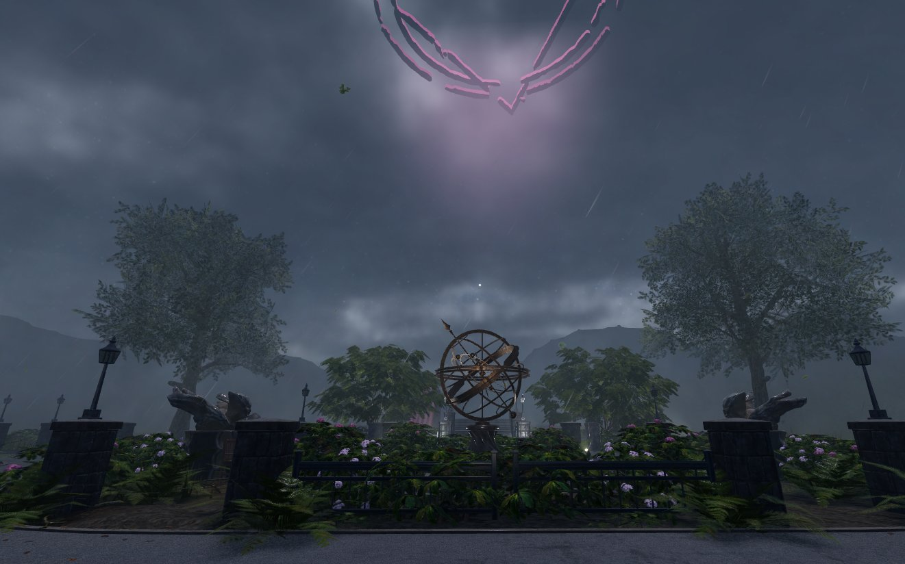
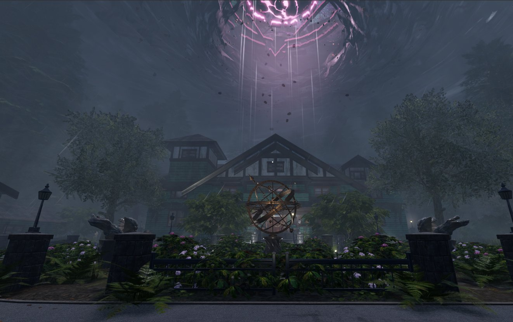
*Zu kleiner Streaming-Radius (64) lässt Blickziele verschwinden, 1.024 zeigt sie. Quelle: Roblox Creator Docs, CC BY 4.0*

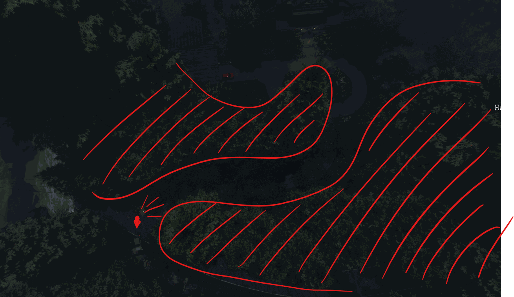
*Streaming-freundliches Leveldesign: kurvige Wege und Sichtblocker verbergen nicht geladene Bereiche. Quelle: Roblox Creator Docs, CC BY 4.0*

## Warum das wichtig ist
„Performant games often have higher user engagement, better user retention, and make more money" ✅ ([Performance optimization](https://create.roblox.com/docs/performance-optimization)). Speicher entscheidet, ob Spieler mit schwachen Handys überhaupt spielen können; Ladezeit entscheidet, ob sie vor dem ersten Frame abspringen. Die Mehrheit spielt auf günstigen Mobilgeräten, der eigene Entwickler-PC verdeckt Probleme ✅.

---

## Teil A: Performance

### 1. Kennzahlen und Budgets
| Kennzahl | Wert | Vertrauen / Quelle |
|---|---|---|
| Ziel-Framerate (Standard) | 60 FPS = 16,67 ms pro Frame | ✅ [Performance optimization](https://create.roblox.com/docs/performance-optimization) |
| Frame-Zeit-Tabelle | 33,33 ms = 30 FPS · 16,67 ms = 60 · 8,33 ms = 120 · 4,17 ms = 240 | ✅ [MicroProfiler](https://create.roblox.com/docs/performance-optimization/microprofiler) |
| Client-FPS-Obergrenze | Standard 60, auf Windows vom Nutzer bis 240 erhöhbar | ✅ [Identify](https://create.roblox.com/docs/performance-optimization/identify) |
| Server-Heartbeat | auf 60/s gedeckelt; Prüfung: Dev Console ⟩ Server Jobs ⟩ Heartbeat ⟩ Steps Per Sec | ✅ [Identify](https://create.roblox.com/docs/performance-optimization/identify) |
| Server-Speicher gesamt | **6,25 GiB + 100 MiB × größte Zahl gleichzeitig verbundener Spieler** (30 Spieler ≈ 9,18 GiB; sinkt nicht, wenn Spieler gehen) | ✅ [Identify](https://create.roblox.com/docs/performance-optimization/identify) |
| Server-Speicher-Ziel | unter 50 % nutzen | ✅ [Identify](https://create.roblox.com/docs/performance-optimization/identify) |
| Client-Crash-Rate | einige Crashes normal; ab **2–3 %** untersuchen | ✅ [Identify](https://create.roblox.com/docs/performance-optimization/identify) |
| Draw Calls / Dreiecke | „unter 1.000 Draw Calls und 1.000.000 Dreiecken" nur als **Beispiel** für ein Basisgerät | ✅ [Design for performance](https://create.roblox.com/docs/performance-optimization/design) |
| Konservatives Mobile-Ziel | 500 Draw Calls, 500.000 Dreiecke, < 1,3 GB Client-Speicher | 🟠 Community ([DevForum](https://devforum.roblox.com/t/3127146)) |
| 600 Draw Calls / 650.000 Dreiecke | **steht nicht in der Doku** | 🟠 (verworfen) |
| Geräteverteilung | Android ≈ **65 %** der Spieler; davon ~**60 % 2–4 GB**, ~35 % 4–8 GB, ~5 % > 8 GB RAM | ✅ [Test on hardware](https://create.roblox.com/docs/performance-optimization/test-on-hardware) |
| Leistungsklasse | über 50 % der Spieler auf Geräten mit **10.000–20.000 Passmark**-Punkten | ✅ [Test on hardware](https://create.roblox.com/docs/performance-optimization/test-on-hardware) |
| Thermal-Test | 10–15 Minuten aktives Spielen auf dem Handy, auf FPS-Abfall achten | ✅ [Test on hardware](https://create.roblox.com/docs/performance-optimization/test-on-hardware) |
| Beispiel-Testgeräte | Infinix Smart 9, Motorola Moto G05, Oppo A18, Amazon Fire HD 10 (2023), Samsung Galaxy S22 Ultra | ✅ [Test on hardware](https://create.roblox.com/docs/performance-optimization/test-on-hardware) |

Wichtig ✅: Der Studio-Geräteemulator taugt für Seitenverhältnis und Steuerung, **nicht für Speicher**, weil Studio Client und Server zusammen ausführt ([Design for performance](https://create.roblox.com/docs/performance-optimization/design)).

### 2. Der Optimierungskreislauf ✅
Quelle: [Performance optimization](https://create.roblox.com/docs/performance-optimization)
1. **Design for performance**: Best Practices schon beim Bauen (Basisgerät wählen, Streaming, Materialien statt Texturen, Packages gegen Asset-Duplikate, Transparenz nur 0 oder 1, ereignisbasierter Code).
2. **Identify**: Probleme in einer von drei Kategorien finden: Frame-Rate (Rechenzeit), Speicher, Ladezeit.
3. **Improve**: bekannte Ursachen beheben.
4. **Monitor**: Performance Dashboard nach jedem Release beobachten und mit Business-Metriken vergleichen.

### 3. Diagnose-Werkzeuge ✅
Quelle: [Identify performance issues](https://create.roblox.com/docs/performance-optimization/identify)

| Werkzeug | Wofür | Aufruf |
|---|---|---|
| **Developer Console** | Logs, Speicher, Netzwerk, Server-Stats, Skript-Stats, startet Client-/Server-MicroProfiler | F9 |
| **MicroProfiler** | Rechenzeit jeder Engine-Aufgabe pro Frame, Dumps | Ctrl+Alt+F6 (⌘⌥F6) laut Diagnose-Tabelle; Ctrl+F6 (⌘F6) laut MicroProfiler-Seite ✅ (Doku uneinheitlich) |
| **Scene Analysis** | Ressourcenverbrauch von Client- und Server-Szene, verantwortliche Instanzen | nur Studio |
| **Performance Stats** | Leiste mit Speicher, CPU, GPU, Netzwerk, Ping | Ctrl+Alt+F7 (⌘⌥F7) |
| **Debug Stats** | Overlays für Grafik, Physik, Netzwerk, FPS | Shift+Ctrl+F1 … F5; im Client Shift+F5 (Summary), Shift+F2 (Render), Shift+F3 (Netzwerk) |
| **Network Simulation** | Latenz, Jitter, Paketverlust im Playtest | Studio-Einstellungen (Alt+S) |
| **Performance Dashboard** | Live-Diagramme: Client-/Server-Speicher, Client-FPS, Server-Heartbeat, Crash-Raten | Creator Hub |
| **Print Join Size Breakdown** | Top-20-Instanzen nach Größe beim Join | Studio Settings ⟩ Network |

### 4. MicroProfiler im Detail ✅
Quelle: [MicroProfiler](https://create.roblox.com/docs/performance-optimization/microprofiler)
- Fokus liegt **ausschließlich auf Frame-Zeit** und Spitzen. 59 Frames mit 10 ms und einer mit 410 ms ergeben 60 FPS, fühlen sich aber wie ein Ruckler an.
- **Mobil profilieren**: Im Client-Menü MicroProfiler einschalten, dann im Browser eines Rechners im selben Netz `IP:1338` öffnen; Standard sind die **30 letzten Frames**, mehr über `IP:1338/90` ✅.
- **Farben im Frame-Graph:** **Orange** = Worker-Threads (Skripte, Physik, Animation) länger als Render-Thread → Skript/Physik prüfen; **Blau** = Render-Thread länger → Objektdichte, Bewegung, Licht; **Rot** = Render länger **und** GPU-Wartezeit > **2,5 ms** → Komplexität, Texturen, Effekte ✅. Keine Farbe ist „gut", entscheidend ist die Frame-Zeit.
- **Threads:** Main („RBX Main": Input, Humanoids, Animation/Tweening, Sound, wartende Skripte), Worker („RBX Worker": Netzwerk, Physik, Pathfinding), Render („GPU": prepare, perform, present) ✅.
- Bedienung: Spitze im Graph anklicken, in der Timeline das breiteste **Kind**-Label suchen, Rechtsklick zoomt auf die Aufgabe, Ctrl+F springt zum teuersten Vorkommen ✅.
- Eigene Abschnitte markieren mit `debug.profilebegin`/`debug.profileend` ✅ ([Improve performance](https://create.roblox.com/docs/performance-optimization/improve)).
- RunService-Scopes: `RunService.PreRender`, `RunService.PreSimulation` (Stepped), `RunService.PostSimulation`/`RunService.Heartbeat` (Heartbeat) ✅.

```lua
--!strict
local RunService = game:GetService("RunService")

RunService.Heartbeat:Connect(function(_deltaTime: number)
	debug.profilebegin("PetAI.Update") -- erscheint als eigenes Label im MicroProfiler
	-- ... teure Logik ...
	debug.profileend()
end)
```

### 5. Script Profiler ✅
Quelle: [Script Profiler](https://create.roblox.com/docs/studio/optimization/scriptprofiler)
- In der Developer Console; zeichnet **CPU-Zeit** aller laufenden Skripte auf (Luau-Funktionen, Methodenaufrufe, Property-Zugriffe); wartende Threads werden nicht erfasst.
- Umgebung: **Client** (Standard) oder **Server** (Server-Daten werden am Sitzungsende gelöscht).
- Frequenz **1 kHz** (Standard) oder **10 kHz** (genauer, teurer); Dauer 1, 5, 10 Minuten oder manuell; Live-Polling sekündlich optional.
- Ansichten: **Callgraph** (nach Frame-Aufgaben gruppiert) und **Functions**; Einheit ms oder %; Durchschnitt pro 1 s/1/5/10 min (auch hochgerechnet).
- **Export als JSON** (Felder `Version`, `SessionStartTime`, `Categories`, `Nodes`, `Functions` mit `TotalDuration` in Mikrosekunden; `Flags` Bit 0 = nativ ausgeführt, Bit 1 = Plugin).
- Nativ ausgeführte Funktionen werden markiert; fehlt die Markierung bei `@native`, liegt eine Deoptimierung vor ✅ ([Native code generation](https://create.roblox.com/docs/luau/native-code-gen)).

### 6. Speicher ✅
Quellen: [Memory usage](https://create.roblox.com/docs/studio/optimization/memory-usage), [Improve performance](https://create.roblox.com/docs/performance-optimization/improve)
- Kategorien in der Dev Console ⟩ Memory: **CoreMemory** (Engine), **PlaceMemory** (eigene Inhalte: `HttpCache`, `Instances`, `Signals`, `LuaHeap`, `Script`, `PhysicsCollision`, `PhysicsParts`, `GraphicsMeshParts`, `GraphicsTexture`, `GraphicsParticles`, `GraphicsTerrain`, `Sounds`, `StreamingSounds`, `TerrainVoxels`, `Gui`, `Animation`, `Navigation` u. a.), **UntrackedMemory**, **PlaceScriptMemory** (pro Skript und eigene Memory-Tags), **CoreScriptMemory**. Am wichtigsten: PlaceMemory und PlaceScriptMemory.
- Asset-Speicher auf dem Client: vor allem `GraphicsMeshParts`, `GraphicsTexture`, `Sounds` ✅ ([Identify](https://create.roblox.com/docs/performance-optimization/identify)).
- **Leck-Indikatoren:** wachsender `LuaHeap`, stetig steigender `InstanceCount`, einzelne Skripte in `PlaceScriptMemory`, die mit jeder Interaktion wachsen.
- **Luau Heap**: Snapshots mit Ansichten Graph, Object Tags, Memory Categories, Object Classes, Unique References und **Unparented Instances** (Instanzen ohne Parent, nur noch von Skripten gehalten); Elemente < 2 KB werden im Graph zusammengefasst.
- **Typische Lecks:** (1) **Verbindungen**, die nie getrennt werden; die Engine räumt Verbindungen und alles, was der Callback referenziert, nicht von selbst weg. Besonders tückisch: **`Player`-Objekte und Charaktere werden beim Verlassen nicht automatisch zerstört**, also bleiben `CharacterAdded`-Verbindungen bestehen. (2) **Tabellen**, die pro Spieler wachsen und nie geleert werden.
- **Gegenmittel:** `Disconnect()`, Instanz mit `Destroy()` zerstören oder das Skript zerstören; `Workspace.PlayerCharacterDestroyBehavior` aktivieren oder selbst aufräumen:

```lua
--!strict
-- Offizielles Aufräum-Muster (MIT-Code der Creator Docs, mit Typen ergänzt)
local Players = game:GetService("Players")

Players.PlayerAdded:Connect(function(player: Player)
	player.CharacterRemoving:Connect(function(character: Model)
		task.defer(character.Destroy, character)
	end)
end)

Players.PlayerRemoving:Connect(function(player: Player)
	task.defer(player.Destroy, player)
end)
```

### 7. Skript-Rechenzeit ✅
Quellen: [Design for performance](https://create.roblox.com/docs/performance-optimization/design), [Improve performance](https://create.roblox.com/docs/performance-optimization/improve)
- **Ereignisbasiert statt pro Frame**: Bei 60 FPS bleiben 16,67 ms für alles.
- Ein 100-ms-Block jedes Frame ergibt 10 FPS; einmal pro Sekunde ausgeführt einen deutlichen Ruckler. Besser: in Stücke teilen (z. B. 5 ms pro Frame, Ergebnis alle 20 Frames).
- Teure Operationen nicht an `PreAnimation`, `PreRender`, `PreSimulation`, `PostSimulation`, `Heartbeat` hängen, wenn es nicht nötig ist; Serialisierung, Deep-Clone und große rekursive Tabellenoperationen sind teuer.
- Werte einmal abfragen und zwischenspeichern; nicht alles in `ReplicatedStorage` legen (der Client lädt alles darin), Server-only-Inhalte in `ServerStorage`.
- Reicht die Server-CPU nach Optimierung nicht: **Extended Services for Compute** ✅.

```lua
--!strict
-- Lange Arbeit über mehrere Frames verteilen (Zeitbudget pro Frame)
local FRAME_BUDGET = 0.004 -- 4 ms, Rest bleibt für Engine und andere Skripte

local function processAll<T>(items: { T }, process: (T) -> ())
	local sliceStart = os.clock()
	for _, item in items do
		process(item)
		if os.clock() - sliceStart > FRAME_BUDGET then
			task.wait() -- nächster Frame
			sliceStart = os.clock()
		end
	end
end
```

### 8. Physik, Humanoids, Rendering, Netzwerk (Kurzreferenz) ✅
Quelle: [Improve performance](https://create.roblox.com/docs/performance-optimization/improve)

| Bereich | Häufige Ursache | Gegenmittel laut Doku |
|---|---|---|
| Physik | Fixed-Modus erzwingt **240 Hz** (4× pro Frame); adaptiv sind 60/120/240 Hz | adaptives Stepping, statische Teile **verankern**, weniger Constraints, Selbstkollision begrenzen |
| Kollision | `CollisionFidelity = PreciseConvexDecomposition` überall | Box/Hull für kleine oder nicht interaktive Objekte, eigene unsichtbare Kollisionsteile für große Meshes; auch ohne Kollision bleibt Geometrie im Speicher |
| Humanoids | alle `HumanoidStateType`s aktiv, häufiges Respawnen (v. a. mit Layered Clothing), Animationen vieler NPCs vom Server | ungenutzte States per `SetStateEnabled` aus, NPC-Pooling, Animationen auf dem Client, `AnimationController` für statische NPCs, `Motor6D.Transform` statt `C0/C1` |
| Rendering | viele einzigartige Meshes/Texturen, Schatten, teiltransparente Überlagerung, bewegte Skinned Meshes ohne Humanoid | identische Meshes instanzieren, `CastShadow` aus, `RenderFidelity` Automatic/Performance, Streaming + `LevelOfDetail = SLIM`, `Workspace.EnableSLIMAvatars` |
| Netzwerk | Daten jedes Frame repliziert, ungedrosselte Eingaben, zu große Payloads, Server-Tweens | Daten bündeln und drosseln, Effekte nur auf dem Client, Tweens auf dem Client, komplexe Bäume in Teilen laden |

Streaming-Fakten (aus der Doku-Prüfung) ✅: Streaming ist für neue Places standardmäßig an; `StreamingMinRadius` 64 und `StreamingTargetRadius` 1.024 als Standard; `ModelStreamingBehavior.Improved` empfohlen; `StreamOutBehavior.Opportunistic` gegen Out-of-Memory-Abstürze; `ModelLevelOfDetail.Automatic` entspricht derzeit **Disabled**, SLIM muss man also explizit setzen ([Instance streaming](https://create.roblox.com/docs/workspace/streaming), [ModelLevelOfDetail](https://create.roblox.com/docs/reference/engine/enums/ModelLevelOfDetail)). Details zu Map und Streaming: `05-map-leveldesign/map-grundlagen.md`.

### 9. Ladezeit ✅
Quelle: [Identify performance issues](https://create.roblox.com/docs/performance-optimization/identify)
- Ablauf: (1) `ReplicatedFirst` repliziert, eigener Ladebildschirm erscheint; (2) restliches DataModel inkl. `ReplicatedStorage` und `Workspace` (mit Streaming nur die Umgebung des Spawns); (3) Avatar lädt.
- Kein eingebautes Messwerkzeug; Stoppuhr reicht. Plötzlich längere Ladezeit = meist neuer Inhalt in `ReplicatedStorage` oder größere Assets.
- Unerwartet lange Ladezeit → nach versteckten/obfuskierten Skripten aus Free Models suchen, die tausende Instanzen erzeugen ✅.

### 10. Parallel Luau ✅
Quelle: [Parallel Luau](https://create.roblox.com/docs/scripting/multithreading)
- Code muss unter **`Actor`**-Instanzen liegen. Skripte **desselben** Actors laufen nacheinander → für echte Parallelität **mehrere Actors**. Mehr Actors als Kerne ist ok (bessere Lastverteilung).
- In die parallele Phase wechseln: `task.desynchronize()` oder `RBXScriptSignal:ConnectParallel()`; zurück: `task.synchronize()`.
- **`require()` ist in der parallelen Phase verboten**; Module vorher seriell laden.
- Thread-Safety-Stufen der API: **Unsafe** (nicht parallel), **Read Parallel** (lesen ja, schreiben nein), **Local Safe** (innerhalb desselben Actors), **Safe**. Ohne Angabe gilt Unsafe.
- Kommunikation: **Actor Messaging** (`Actor:SendMessage`, `BindToMessage`, `BindToMessageParallel`), **SharedTable** (ohne Kopie geteilt, atomare Updates, sofort sichtbar), direkt über DataModel (eingeschränkt, da parallel meist nicht geschrieben werden darf).
- Best Practices: keine langen, nie yieldenden Berechnungen; genug Actors.
- Community-Tipp 🟡: In SharedTables nur in der seriellen Phase schreiben und Änderungen lokal puffern ([DevForum](https://devforum.roblox.com/t/sharedtable-best-practices/2574316)).

```lua
--!strict
-- Script "Worker" unter einem Actor; mehrere Actors mit je einer Kopie teilen sich die Arbeit
local actor = script:GetActor()
assert(actor, "Dieses Script muss unter einem Actor liegen")

local CHUNK = 16
local HEIGHT_SCALE = 20

actor:BindToMessageParallel("BuildChunk", function(chunkX: number, chunkZ: number)
	-- PARALLEL: nur rechnen, nichts im DataModel ändern
	local heights = table.create(CHUNK * CHUNK, 0)
	for x = 1, CHUNK do
		for z = 1, CHUNK do
			local worldX = chunkX * CHUNK + x
			local worldZ = chunkZ * CHUNK + z
			heights[(x - 1) * CHUNK + z] = math.noise(worldX / 64, worldZ / 64) * HEIGHT_SCALE
		end
	end

	task.synchronize()
	-- SERIELL: jetzt dürfen Instanzen erzeugt werden
	local folder = Instance.new("Folder")
	folder.Name = string.format("Chunk_%d_%d", chunkX, chunkZ)
	for index, height in heights do
		local x = (index - 1) // CHUNK
		local z = (index - 1) % CHUNK
		local part = Instance.new("Part")
		part.Anchored = true
		part.Size = Vector3.new(4, 1, 4)
		part.Position = Vector3.new((chunkX * CHUNK + x) * 4, height, (chunkZ * CHUNK + z) * 4)
		part.Parent = folder
	end
	folder.Parent = workspace
end)
```
Verteilung von einem seriellen Script aus: `workerActors[i]:SendMessage("BuildChunk", x, z)` reihum über alle Actors ✅ (Methode laut [Parallel Luau](https://create.roblox.com/docs/scripting/multithreading)).

### 11. Native Codegenerierung ✅/🟡
Quelle: [Native code generation](https://create.roblox.com/docs/luau/native-code-gen)
- `--!native` am Skriptanfang (alle Funktionen, falls lohnend) oder `@native` vor einzelnen Funktionen. Verhalten bleibt identisch, nur die Geschwindigkeit ändert sich ✅.
- Die Doku beschreibt es für **Server-Skripte** mit viel Zahlenrechnung (Mathe, Tabellen, besonders `buffer`) ✅. Laut Luau-Jahresrückblick läuft Native Codegen seit Dezember 2025 auch auf **Android** und wurde in Produktion getestet 🟡 ([Luau Recap 2025](https://luau.org/news/2025-12-19-luau-recap-runtime-2025/)); die Creator Docs erwähnen Client-Nutzung nicht → vor Einsatz auf dem Client selbst messen.
- Nicht in jedes Skript setzen: Kompilierzeit verlängert den Serverstart, zusätzlicher Speicher, **Gesamtlimit für nativen Code pro Spiel** ✅.
- Deoptimierung durch `getfenv`/`setfenv`, Built-ins mit falschen Argumenttypen, falsch getypte Argumente an getypte Funktionen ✅.
- **Typannotationen helfen**, vor allem `Vector3` (sonst nimmt der Compiler eine Tabelle an) ✅.
- Interne Limits (Fehlermeldungen in der Output): **64K Instruktionen pro Codeblock**, **32K Blöcke pro Funktion**, **1 Mio. Instruktionen pro Skript**, Speicherlimit für nativen Code ✅.
- Größe prüfen: im Server-View `debug.dumpcodesize()` in der Command Bar ✅.
- Breakpoints deaktivieren die native Ausführung der betroffenen Funktionen; im Luau Heap erscheinen native Funktionen als `[native]` ✅.
- Typische Beschleunigung 1,5–2,5× bei rechenlastigem Code 🟠 (Sekundärquelle).

```lua
--!strict
-- Nur die heiße Funktion nativ kompilieren, nicht das ganze Skript
@native
local function sumComponents(v: Vector3): number -- Vector3-Annotation erzeugt spezialisierten Code
	return v.X + v.Y + v.Z
end

@native
local function dampAll(positions: { Vector3 }, factor: number): { Vector3 }
	local result = table.create(#positions)
	for i, p in positions do
		result[i] = p * factor
	end
	return result
end
```

### 12. Luau-Sprache 2025/2026
- **Typmodi** ✅: `--!nocheck`, `--!nonstrict` (prüft nur annotierte Typen), `--!strict` (prüft alles, auch Inferiertes) ([Type checking](https://create.roblox.com/docs/luau/type-checking)).
- **Neuer Type Solver** 🟡: allgemein verfügbar seit Ende 2025; der Beta-Schalter in Studio fiel mit dem ersten Release 2026 (7. Januar 2026) weg, Nutzer wurden automatisch migriert. Neu: schreibgeschützte Tabellen-Properties, bessere Verfeinerungen, Type Functions; bekannter Nachteil: ausführlichere Fehlermeldungen ([DevForum General Release](https://devforum.roblox.com/t/general-release-luau%E2%80%99s-new-type-solver/4084991)). Nicht in den Creator Docs beschrieben.
- **`const`** ✅: wie `local`, aber nicht neu zuweisbar (auch nicht per `+=`); mit Typannotation möglich; `const function` schützt den Funktionsnamen; schützt **nicht den Inhalt** von Tabellen → `table.freeze()`. `const` ist **kontextabhängig**, alter Code mit einer Variable namens `const` läuft weiter ([Variables](https://create.roblox.com/docs/luau/variables)). Konvention: `LOUD_SNAKE_CASE`.
- **Require-by-String** ✅: `./` = ab `script.Parent`, `../` = ab `script.Parent.Parent`, `@self/` = ab `script`, `@game/` = ab `game`; **nicht blockierend** (wartet nicht auf das ModuleScript, wirft sonst einen Fehler). Module laufen pro Seite (Client/Server) nur einmal und liefern dasselbe Rückgabeobjekt ([LuaGlobals](https://create.roblox.com/docs/reference/engine/globals/LuaGlobals)). Die Doku zeigt auch `require("@rbx/AvatarAbilities")` für die Character Controller Library ✅.
- **64-Bit-Integer** 🟠: RFC existiert, Umsetzung in Roblox nicht bestätigt ([RFC](https://rfcs.luau.org/type-long-integer.html)).

```lua
--!strict
const MAX_PETS = 50
const RARITY_WEIGHTS = table.freeze({ Common = 60, Rare = 30, Epic = 9, Legendary = 1 })

-- MAX_PETS += 1           -- Fehler: const kann nicht neu zugewiesen werden
-- RARITY_WEIGHTS.Epic = 0 -- Laufzeitfehler: Tabelle ist eingefroren

local Config = require("./Config") -- ModuleScript neben diesem Skript
local Signal = require("@game/ReplicatedStorage/Packages/Signal") -- absoluter Pfad ab game
```
Hinweis 🟠: Ob Formatter/Linter (StyLua, Selene) in den hier genannten Versionen `const` bereits parsen, ist nicht geprüft; bei Parse-Fehlern vorerst `local` nutzen.

---

## Teil B: Tooling und Workflows

### 13. Zwei Workflows: Script Sync oder Rojo
| | Studio Script Sync | Rojo-Toolchain |
|---|---|---|
| Ansatz | Studio bleibt Quelle der Wahrheit, Skripte werden auf die Platte gespiegelt | Dateisystem ist Quelle der Wahrheit („file system-first") |
| Synchronisiert | nur `Script`, `LocalScript`, `ModuleScript`, `Folder` ✅ | ganze Projekte inkl. Instanzen (laut Rojo-Doku) 🟡 |
| Team Create | unterstützt, Sync-Icons, automatische Namens-Suffixe ✅ | eingeschränkt (Drittanbieter-Tools „often do not") ✅ |
| Versionskontrolle des ganzen Projekts | nein; Doku: dafür ist Rojo „a better choice" ✅ | ja |
| Einrichtung | Rechtsklick ⟩ „Sync to…" ✅ | Rokit, Rojo-Server + Studio-Plugin ✅ |

#### 13.1 Script Sync ✅
Quelle: [Script Sync](https://create.roblox.com/docs/scripting/sync)
- Limits: **bis 10.000 Skripte pro Top-Level-Instanz** und **bis 128 Top-Level-Instanzen**.
- Konfliktdialog beim Start/Fortsetzen: „Keep Studio" vs. „Keep Disk" mit Liste der Änderungen.
- **Attribute und Tags werden ignoriert** → Skripte mit Attributen/Tags nicht syncen (Datenverlust möglich). Packages syncbar, `PackageLink` wird nicht geschrieben. Debugger lässt sich nicht aus externen Editoren steuern.
- Dateiregeln:

| Datei auf der Platte | Instanz in Studio |
|---|---|
| `name.luau` | ModuleScript |
| `name.server.luau` | Script, RunContext Server |
| `name.client.luau` | Script, RunContext Client |
| `name.local.luau` | LocalScript |
| `name.legacy.luau` | Script, RunContext Legacy |
| `name.plugin.luau` | Script, RunContext Plugin |
| `name/` | Folder |
| `name/init.*.luau` | Script mit Kindern |

- Sprachserver: **Luau Language Server** (VS Code, luau-lsp) **plus** Studio-Plugin **„Luau Language Server Companion"**, das die DataModel-Hierarchie liefert. Die oft gehörte Kritik „keine Sourcemap" ist damit für Script Sync gelöst ✅.
- Empfohlene Erweiterungen laut Doku: luau-lsp, **selene** (Linting), **StyLua** (Formatierung), jeweils Community-gepflegt ✅.
- Status: DevForum meldet den Full Release etwa im Juni 2026 🟡 ([DevForum](https://devforum.roblox.com/t/full-release-studio-script-sync/4688454)). **Widerspruch in der Doku:** Die Anleitung „Build with a coding harness" sagt noch „Script Sync is a beta feature" und lässt es unter File ⟩ Beta Features aktivieren ✅ ([Coding harness](https://create.roblox.com/docs/ai/coding-harness)); die Script-Sync-Seite selbst trägt kein Beta-Label.

#### 13.2 Rojo, Rokit, Wally und Co.
- Doku-Beispiel einer `rokit.toml` ✅ ([Third-party tools](https://create.roblox.com/docs/projects/external-tools)): `rojo = "rojo-rbx/rojo@7.6.1"`, `wally = "upliftgames/wally@0.3.2"`, `lune = "lune-org/lune@0.10.4"`. Rokit pinnt Versionen pro Projekt, ähnlich `nvm`.
- Befehle laut Doku ✅: `rokit install`, `rojo plugin install`, `rojo init <name>`, `rojo build -o <datei>.rbxl`, `rojo serve`; Wally: `wally init`, Pakete in `wally.toml`, `wally install` erzeugt `Packages/`, Pfad in `default.project.json` eintragen.
- Community-Versionsstände Oktober 2026 🟠 (Einzelquelle, ein GitHub-PR): Rojo **7.7.1**, Selene **0.32.0**, luau-lsp **1.70.1**, StyLua **2.5.2**, Wally **0.3.2** ([KeepBlox PR #22](https://github.com/XopoIII/KeepBlox/pull/22)). Vor dem Pinnen die Release-Seiten prüfen.
- Alternativen aus der Community 🟠: Azul (Studio-first, erzeugt Rojo-kompatible Sourcemap), RbxSync (Zwei-Wege-Sync aller Instanztypen).
- Die Tools werden **nicht von Roblox gepflegt** und können sich jederzeit ändern ✅.

```toml
# rokit.toml (Beispielwerte; Versionen vor dem Pinnen prüfen)
[tools]
rojo = "rojo-rbx/rojo@7.7.1"
wally = "upliftgames/wally@0.3.2"
selene = "Kampfkarren/selene@0.32.0"
stylua = "JohnnyMorganz/StyLua@2.5.2"
luau-lsp = "JohnnyMorganz/luau-lsp@1.70.1"
```

#### 13.3 Studio-Kommandozeile ✅
Quelle: [Studio command-line interface](https://create.roblox.com/docs/studio/cli)
- Studio liegt unter Windows in `%localappdata%\Roblox\Versions\[version]\RobloxStudioBeta.exe`, auf dem Mac unter `/Applications/RobloxStudio.app/Contents/MacOS/RobloxStudio`; beim Start von der Kommandozeile gibt es ausführlichere Logs auf `stdout`.
- `--task EditPlace --placeId <id> --universeId <id>` (neueste Version), `--task EditPlaceRevision … --placeVersion <n>`, `--task EditFile --localPlaceFile "<pfad>.rbxl"`; optional `--targetInstanceId`, `--annotationId`, Skripte direkt öffnen.

### 14. Tests und CI
#### 14.1 Open Cloud Luau Execution ✅
Quelle: [Luau Execution (Open Cloud)](https://create.roblox.com/docs/cloud/reference/features/luau-execution) (aus `cloud.docs.json` gelesen)

| Eigenschaft | Wert |
|---|---|
| Skriptgröße | **≤ 4 MB** ✅ |
| Laufzeit | **≤ 5 Minuten** (`timeout`, Standard 5 min) ✅ |
| Rückgabewerte | JSON-serialisiert, **≤ 4 MB** gesamt ✅ |
| Logs | `print`-Ausgaben, **max. 450 KB** behalten (ältere werden verworfen) ✅ |
| Binäre Eingabe | **≤ 100 MiB**, Upload-Link **15 Minuten** gültig, mehrfach nutzbar ✅ |
| Binäre Ausgabe | `enableBinaryOutput`, Download-URI **15 Minuten** gültig ✅ |
| Umgebung | **keine Physik**, Server- und LocalScripts des Place starten **nicht** automatisch; DataModel-Änderungen werden nicht gespeichert ✅ |
| Achtung | **DataStore- und andere Cloud-APIs wirken auf echte Daten** ✅ |
| Fehlercodes | `SCRIPT_ERROR`, `DEADLINE_EXCEEDED`, `OUTPUT_SIZE_LIMIT_EXCEEDED`, `INTERNAL_ERROR` ✅ |
| Scopes | `universe.place.luau-execution-session:write` (und `:read`) ✅ |
| Status | Endpunkte im OpenAPI-Dokument als `STABLE` markiert ✅ (Beta-Start 2024 laut DevForum 🟡) |
| „10 parallele Tasks pro Place" | **nicht in der Doku** 🟠 |

Ablauf 🧠: CI startet per `POST /cloud/v2/universes/{universe_id}/places/{place_id}/luau-execution-session-tasks` mit Feld `script` einen Task, fragt den Task per `GetLuauExecutionSessionTask` ab, bis `state` fertig ist, und liest Logs über `ListLuauExecutionSessionTaskLogs`. Test-Place getrennt vom Live-Spiel halten, weil DataStores echt sind. Referenzprojekt laut DevForum: `place-ci-cd-demo` 🟡.

```lua
-- Inhalt des Feldes "script" eines Luau-Execution-Tasks (läuft ohne Physik, Place-Skripte starten nicht)
local ReplicatedStorage = game:GetService("ReplicatedStorage")
local Loot = require(ReplicatedStorage.Shared.Loot)

local failures = {}
local total = 0
for _ = 1, 10000 do
	total += 1
	local result = Loot.roll()
	if result == nil then
		table.insert(failures, "roll() lieferte nil")
	end
end
print(("Loot-Test: %d Würfe, %d Fehler"):format(total, #failures))
return { passed = #failures == 0, failures = failures } -- Rückgabe ≤ 4 MB, als JSON
```

#### 14.2 Test-Frameworks 🟡
- **TestEZ** (Roblox) ist archiviert 🟡; **Jest-Lua** (jsdotlua, Port von Jest, Fork von Roblox' jest-roblox) läuft nur innerhalb von Roblox 🟡 ([Roblox GitHub](https://github.com/roblox)). Beide stehen nicht in den Creator Docs.
- Pragmatisch 🧠: reine Logik (Ökonomie, Loot, Formeln) in ModuleScripts ohne Engine-Abhängigkeit halten; dann laufen Tests per Luau Execution oder lokal mit Lune.

### 15. KI-Werkzeuge in Studio ✅
#### 15.1 Studio MCP-Server ✅
Quelle: [Connect to the Roblox Studio MCP server](https://create.roblox.com/docs/studio/mcp)
- In Studio eingebaut; läuft lokal, Transport **stdio**. Aktivieren: Assistant ⟩ … ⟩ Manage MCP Servers ⟩ „Enable Studio as MCP server"; grüner Indikator zeigt verbundene Clients.
- **Quick Connect** für Antigravity, Codex CLI, **Claude Code**, Claude Desktop, Cursor, Gemini CLI, Visual Studio Code. Sonst JSON-Konfiguration: Windows `cmd.exe /c %LOCALAPPDATA%\Roblox\mcp.bat`, macOS `/Applications/RobloxStudio.app/Contents/MacOS/StudioMCP`.
- Jeder Tool-Aufruf nimmt eine `studio_id`; `list_roblox_studios` listet offene Studio-Instanzen (mehrere Instanzen und Agenten gleichzeitig möglich).
- Werkzeuge:

| Gruppe | Tools |
|---|---|
| Skripte | `script_read`, `multi_edit` (legt fehlende Skripte an), `script_search` (max. 10 Treffer), `script_grep` (max. 50 Treffer) |
| Generierung | `generate_mesh`, `generate_material`, `generate_procedural_model`, `wait_job_finished`, `search_asset`, `insert_asset`, `upload_image`, `store_image` |
| DataModel | `subagent` (`explore`, `playtest`), `search_game_tree`, `inspect_instance` |
| Luau | `execute_luau` (`datamodel_type` Edit, Client oder Server) |
| Playtest | `get_studio_state`, `start_stop_play`, `get_console_output`, `screen_capture` |
| Eingabe-Simulation | `character_navigation`, `user_keyboard_input`, `user_mouse_input` |
| Doku/Skills | `http_get` (nur erlaubte Roblox-Doku-URLs), `skill` |
| Sitzungen | `list_roblox_studios` |

- Sicherheit ✅: „MCP clients can read and modify content in your open Roblox places. Make sure to only connect clients you trust." 🧠: Agenten mit `execute_luau` können beliebigen Code ausführen, also auch DataStores beschreiben → nur in Test-Places mit API-Zugriff arbeiten.
- Die Doku-Anleitung „Build with a coding harness" kombiniert Script Sync (Code) und MCP (alles, was Script Sync nicht erreicht, z. B. `StarterGui`, `StarterPack`) mit Git ✅ ([Coding harness](https://create.roblox.com/docs/ai/coding-harness)).

#### 15.2 Assistant ✅
Quellen: [Assistant guide](https://create.roblox.com/docs/assistant/guide), [Build with Assistant](https://create.roblox.com/docs/ai/build-with-assistant), [Skills](https://create.roblox.com/docs/assistant/skills)
- **Planning Mode**: Dropdown ⟩ „Plan" oder `/plan`. Pläne sind **editierbare Markdown-Dokumente**, cloud-gespeichert pro Experience und Creator, privat; Änderungen im Editor werden an Assistant zurückgespielt; **keine automatische Ausführung**, erst nach Klick auf **Build** ✅. Empfohlener Ablauf: Plan → Build and Playtest → Refine and Polish ✅.
- **Eigene API-Schlüssel**: Assistant ⟩ … ⟩ Manage API Keys für Modelle von **Anthropic, OpenAI oder Google** ✅.
- **Skills**: Markdown-Dokumente mit Frontmatter (`name`, `description`, `enabled`); Präfix `rbx-` ist für Roblox reserviert ✅.
- Chats pro **Place** (nicht pro Experience), cloud-synchronisiert, kein hartes Limit; Screen-Capture-Subagent beschreibt den Viewport ✅.
- Generierung: `/generate_mesh` (Text **oder** Bild, optional Bounding-Box-Part, Dreieckslimit Standard **10.000**), `/generate_procedural_model` (**50 pro rollierende 24 h**), Segmentierung in bis zu **8 Teile** bzw. `/segment_mesh` mit bis zu **5 Namen** pro Durchgang, `/insert_asset` ✅.
- Presse/DevForum 🟡: Studio „going agentic" (16.04.2026) mit Planning Mode, Playtest-Agent, Mesh- und Procedural-Model-Generierung ([Roblox Newsroom](https://about.roblox.com/newsroom/2026/04/roblox-studio-going-agentic)).

---

## Teil C: Neue Engine-Systeme (Überblick)

### 16. Input Action System (IAS) ✅
Quelle: [Input Action System](https://create.roblox.com/docs/input/input-action-system)
- **`InputContext`** bündelt Aktionen (z. B. `PlayContext`, `NavContext`), mit `Priority` (Beispiel 2.000) und `Sink` (verbraucht Eingaben für niedrigere Prioritäten); ein- und ausschaltbar.
- **`InputAction`** mit `Type` (`Enum.InputActionType`):

| Typ | Nutzung |
|---|---|
| `Bool` | Springen, Schießen, Sprinten (mit Schwellwerten für Analog-Trigger) |
| `Direction1D` | Gaspedal, Zoom |
| `Direction2D` | Bewegung, Kamera-Drehung |
| `Direction3D` | Flugzeug/Schwebefahrzeug |
| `ViewportPosition` | Mausposition, Cursor, Raycast-Auswahl |

- **`InputBinding`** als Kind einer Aktion: `KeyCode`, `UIButton` (Touch-Button), zusammengesetzte Richtungen (`Up`/`Down`/`Left`/`Right`), `Scale` (z. B. 0,01 für `MouseDelta`/`TouchDelta`), `PressedThreshold`. Für Cross-Platform pro Aktion eine Bindung je Gerätetyp.
- Events: `Pressed`, `Released` (nur `Bool`), `StateChanged` (alle Typen); `InputAction:GetState()`; `PreferredBinding` liefert die Bindung des aktuellen Geräts (für Button-Hinweise).
- `Workspace.PlayerScriptsUseInputActionSystem` stellt die Standard-Player-Skripte auf IAS um; Pflicht für Server Authority ✅.
- `InputActionLabel` und der **Input Action Manager** sind laut Doku noch **Beta** ✅. Full Release des IAS etwa Mitte 2026 🟡 ([DevForum](https://devforum.roblox.com/t/full-release-input-action-system-ias-newly-converted-player-scripts/4678416)).

```lua
--!strict
-- LocalScript: auf eine im Editor angelegte Aktion reagieren
local ReplicatedStorage = game:GetService("ReplicatedStorage")

local sprint = ReplicatedStorage:WaitForChild("Inputs"):WaitForChild("PlayContext"):WaitForChild("CharacterSprint") :: InputAction

sprint.Pressed:Connect(function()
	print("Sprint gedrückt")
end)
sprint.Released:Connect(function()
	print("Sprint losgelassen")
end)
```

### 17. Matchmaking ✅
Quellen: [Matchmaking](https://create.roblox.com/docs/matchmaking), [Attributes and signals](https://create.roblox.com/docs/matchmaking/attributes-and-signals)
- Ablauf: Spieler will beitreten → passende Server suchen (volle, private, reservierte und bald endende werden ausgefiltert) → Server per **gewichteter Summe** der Signale bewerten → bester Server gewinnt.
- **Attribute** numerisch (Abstand zum Server-Durchschnitt, z. B. Skill) oder kategorisch (Anteil gleicher Werte, z. B. Sprache). Roblox-Signale nutzen u. a. Standort, Altersgruppe, Latenz.
- **Eigene Attribute** lesen Spielerwerte aus einem DataStore (Schlüssel-Template mit `{UserId}`, Value-Path im JSON, Scope, Standard `global`). Gewichte im Creator Hub anpassen und mit Mock-Servern simulieren; eigenes Analytics-Dashboard.
- `MatchmakingService:GetServerAttribute`, `SetServerAttribute`, `InitializeServerAttributesForStudio` ✅ ([MatchmakingService](https://create.roblox.com/docs/reference/engine/classes/MatchmakingService)).
- Verfügbar für alle Experiences; TextChat-Signal seit Frühjahr 2026 🟡 ([DevForum](https://devforum.roblox.com/t/custom-matchmaking-is-now-available-to-all-experiences-on-roblox/4051419)).

### 18. Animation Graphs ✅/🟡
Quellen: [Animation Graph Editor](https://create.roblox.com/docs/animation/graph-editor), [Graph Editor state machines](https://create.roblox.com/docs/animation/graph-editor-state-machine)
- Knotenbasiertes Werkzeug (Avatar-Tab ⟩ Graph Editor) für Blend Trees und Animationslogik ohne Skript; Animation Editor bleibt für einzelne Clips zuständig. Entwickler können Knoten per Code ansteuern ✅.
- **State Machines** (Idle, Walk, Run, Jump) mit Übergangsbedingungen; Zustände können Clips, Blend-Knoten oder weitere State Machines sein ✅. Dazu eine Seite zu Luau-Expressions ✅.
- Animation Graphs live seit Juli 2026; State Machines und Luau Expressions im Oktober 2026 als Studio Beta angekündigt 🟡 ([DevForum](https://devforum.roblox.com/t/studio-beta-introducing-state-machines-and-luau-expressions-for-animation-graphs/4921939)).

### 19. TextGenerator (LLM für NPCs) ✅
Quelle: [TextGenerator](https://create.roblox.com/docs/reference/engine/classes/TextGenerator)
- Eigenschaften: `SystemPrompt`, `Temperature` (Bereich **0,4–1,0**, Standard **0,7**), `TopP` (**0,5–1,0**, Standard **0,9**), `Seed` (Standard 0, für reproduzierbare Antworten).
- `GenerateTextAsync(request)` mit `UserPrompt`, `ContextToken` (Gesprächsverlauf), `MaxTokens`, `JsonSchema` (strukturierte Ausgabe); Rückgabe `GeneratedText`, `ContextToken`, `Model`. (Die Parameter-Kurzbeschreibung der Referenz nennt `JsonSchema` noch nicht, die Methodenbeschreibung schon.)
- **Rate-Limit: anfangs 100 Anfragen pro Minute**, skaliert mit der Spielerzahl ✅.
- Offen 🟠: Ob Ein- und Ausgaben automatisch gefiltert werden, steht nicht in der Referenz → Spielereingaben wie jeden Chat-Text behandeln und filtern.

```lua
--!strict
-- Script (Server): NPC-Dialog mit Gesprächsgedächtnis pro Spieler
local generator = Instance.new("TextGenerator")
generator.SystemPrompt = "Du bist ein freundlicher Händler in einem Fantasy-Dorf. Antworte in höchstens zwei kurzen Sätzen."
generator.Temperature = 0.7

local contexts: { [Player]: string } = {}

local function askMerchant(player: Player, question: string): string?
	local ok, response = pcall(function()
		return generator:GenerateTextAsync({
			UserPrompt = question,
			ContextToken = contexts[player],
			MaxTokens = 80,
		})
	end)
	if not ok then
		warn("TextGenerator-Fehler (evtl. Rate-Limit):", response)
		return nil
	end
	contexts[player] = response.ContextToken
	return response.GeneratedText
end

game:GetService("Players").PlayerRemoving:Connect(function(player: Player)
	contexts[player] = nil -- Gesprächsverlauf freigeben, kein Speicherleck
end)
```

### 20. 4D-Generierung (GenerationService) ✅/🟠
Quellen: [GenerationService](https://create.roblox.com/docs/reference/engine/classes/GenerationService), [Model generation](https://create.roblox.com/docs/parts/model-generation)
- Basiert auf Roblox' **Cube-3D**-Modell; erzeugt statische Props und **funktionale Modelle** (Fahrzeuge, die fahren, Flugzeuge, Waffen); im Spiel erzeugte Objekte replizieren an alle Spieler ✅.
- `GenerateModelAsync(inputs, schema, options)`: `inputs` mit `TextPrompt` und/oder `Image`, optional `Size`, `MaxTriangles`, `GenerateTextures` (Standard `true`); `schema` mit genau einem von `PredefinedSchema` (`"Car5"` = Fahrgestell aus fünf Modellen, `"Body1"` = ein Mesh) oder `SchemaDefinition` (`Groups` mit Teilnamen); immer in `pcall` (Prompt-Ablehnung, Timeouts, Schema-Fehler) ✅.
- Weitere Methoden: `LoadGeneratedMeshAsync`, `SegmentMeshAsync`; `GenerateMeshAsync` ist laut Referenz „scheduled for future deprecation" ✅.
- DevForum 🟡: Early Access Januar 2026, Beta für alle Experiences Februar 2026, TextGenerator mit JSON-Ausgabe ([DevForum](https://devforum.roblox.com/t/beta-4d-generation-unlock-new-types-of-gameplay/4331818)). Die DevForum-Angabe, die Mesh Generation API sei am 18.03.2026 abgeschaltet worden, steht im Widerspruch zur Referenz, die `GenerateMeshAsync` noch führt 🟠.

### 21. RDC26 und Roadmap (September 2026) 🟡
Quellen: [Creator Roadmap 2026 Fall Update](https://devforum.roblox.com/t/creator-roadmap-2026-fall-update/4880208), [RDC26: What We Announced](https://devforum.roblox.com/t/rdc26-what-we-announced/4865880), [Roblox IR, 11.09.2026](https://ir.roblox.com/news/news-details/2026/Roblox-Unveils-New-Ways-to-Play-Build-and-Grow-at-the-Roblox-Developers-Conference-RDC/default.aspx)
- 72 neue Roadmap-Einträge; seit RDC25 130 Features ausgeliefert, 79 % pünktlich 🟡.
- **Compute Functions**: serverloses Luau (ereignisgesteuert oder geplant) ohne laufenden Spielserver, Ziel Anfang 2027 🟡.
- **Studio Debugger Luau API** (Beta), erweiterte Netzwerksimulation, **mehrere Client-Ansichten** fürs Multiplayer-Debugging, Client-Sessions und Logs (Ende 2026) 🟡.
- **2D-Spiele**: orthografische Kamera, animierte Bild-Container, Sprite-Sheet-Import; UI-Blur, Textschatten, bessere Verläufe; Turn-based Notifications (Studio Beta Oktober 2026) 🟡.
- **Browser-Spielen in Chrome** bis Ende 2026, **Offline-Solo** 2027 (Presse) 🟡/🟠.
- Diese Punkte stehen (noch) nicht in den Creator Docs; vor Nutzung den Status prüfen.

---

## Do / Don't
| Do | Don't |
|---|---|
| Ein günstiges Android-Gerät als Basisgerät festlegen und regelmäßig darauf messen | Nur auf dem Entwickler-PC oder im Studio-Emulator testen |
| Frame-Zeit (ms) und Spitzen betrachten | Nur auf die FPS-Zahl schauen |
| MicroProfiler-Labels mit `debug.profilebegin/end` setzen | Ins Blaue optimieren |
| Ereignisbasiert arbeiten, lange Arbeit in Zeitscheiben teilen | Schwere Logik an jedes `Heartbeat` hängen |
| Verbindungen trennen, Spieler/Charaktere aufräumen | Pro-Spieler-Tabellen nie leeren |
| Server-Speicher < 50 %, Crash-Rate im Dashboard < 2–3 % | Wachsenden `LuaHeap` ignorieren |
| Mehrere Actors für Parallel Luau, Module seriell laden | `require()` in der parallelen Phase |
| `@native` gezielt auf heiße, getypte Rechenfunktionen | `--!native` in jedes Skript |
| `--!strict` + Typannotationen (auch für Native) | Untypisierte Vector3-Mathematik in heißen Pfaden |
| `const` + `table.freeze` für Konfiguration | Annehmen, `const` friere Tabelleninhalte ein |
| Script Sync für Studio-first-Teams, Rojo für Datei-first + volles Git | Skripte mit Attributen/Tags per Script Sync syncen |
| Toolchain mit Rokit pinnen | Jeder im Team mit eigener Rojo-Version |
| Luau Execution gegen einen Test-Place | Tests gegen den Live-Place mit echten DataStores |
| Nur vertrauenswürdige MCP-Clients verbinden, Agenten-Änderungen reviewen | KI-Agenten ungeprüft im Live-Place arbeiten lassen |
| IAS für alle Eingaben, die das Gameplay beeinflussen | `UserInputService` in der Server-Authority-Simulation |

## Checkliste
- [ ] Basisgerät gewählt (z. B. Android mit 2–4 GB RAM), Test-Routine inkl. 10–15-min-Thermal-Test
- [ ] Frame-Zeit auf dem Basisgerät gemessen (MicroProfiler mobil über Port 1338)
- [ ] Draw Calls/Dreiecke im dichtesten Bereich notiert und als eigenes Budget festgehalten
- [ ] Client-Speicher in der Dev Console (auf dem Gerät) geprüft, Server-Speicher < 50 %
- [ ] Langzeit-Test auf Speicherlecks (LuaHeap, InstanceCount, PlaceScriptMemory)
- [ ] `PlayerCharacterDestroyBehavior` aktiv oder manuelles Aufräumen
- [ ] Streaming an, SLIM für statische Modelle gesetzt, Atomic nur wo nötig
- [ ] Heiße Pfade profiliert (Script Profiler), ggf. `@native` + Typen, Größe mit `debug.dumpcodesize()` geprüft
- [ ] Rechenintensive, DataModel-freie Arbeit auf mehrere Actors verteilt
- [ ] `--!strict` in neuen Modulen, Require-by-String-Pfade konsistent
- [ ] Workflow entschieden (Script Sync oder Rojo), Toolchain gepinnt (Rokit), luau-lsp + Companion-Plugin
- [ ] Tests für Ökonomie/Loot per Luau Execution in CI (Test-Place)
- [ ] MCP nur mit vertrauenswürdigen Clients, Test-Place mit API-Zugriff
- [ ] Performance Dashboard nach jedem Release geprüft

## Offene Fragen / Recherche-Bedarf
- Offizielles Speicherlimit für mobile Clients und Dreiecks-Obergrenze pro Mesh: nicht in der Doku 🟠.
- Native Codegen auf Clients (Android/iOS): nur Luau-Blog, nicht Creator Docs 🟡.
- Concurrency-Limit von Luau Execution pro Place: nicht in der Doku 🟠.
- `const`-Unterstützung in StyLua/Selene/luau-lsp: nicht geprüft 🟠.
- Offizielle SharedTable-Größenlimits: nicht gefunden 🟠.

## Quellen
- [Performance optimization](https://create.roblox.com/docs/performance-optimization), [Design](https://create.roblox.com/docs/performance-optimization/design), [Identify](https://create.roblox.com/docs/performance-optimization/identify), [Improve](https://create.roblox.com/docs/performance-optimization/improve), [Monitor](https://create.roblox.com/docs/performance-optimization/monitor), [Test on hardware](https://create.roblox.com/docs/performance-optimization/test-on-hardware) – Creator Docs, Stand 24.10.2026, ✅
- [MicroProfiler](https://create.roblox.com/docs/performance-optimization/microprofiler), [Script Profiler](https://create.roblox.com/docs/studio/optimization/scriptprofiler), [Memory usage](https://create.roblox.com/docs/studio/optimization/memory-usage) – ✅
- [Parallel Luau](https://create.roblox.com/docs/scripting/multithreading), [Native code generation](https://create.roblox.com/docs/luau/native-code-gen), [Type checking](https://create.roblox.com/docs/luau/type-checking), [Variables (const)](https://create.roblox.com/docs/luau/variables), [LuaGlobals (require)](https://create.roblox.com/docs/reference/engine/globals/LuaGlobals) – ✅
- [Instance streaming](https://create.roblox.com/docs/workspace/streaming), [ModelLevelOfDetail](https://create.roblox.com/docs/reference/engine/enums/ModelLevelOfDetail) – ✅
- [Script Sync](https://create.roblox.com/docs/scripting/sync), [Third-party tools](https://create.roblox.com/docs/projects/external-tools), [Studio CLI](https://create.roblox.com/docs/studio/cli) – ✅
- [Luau Execution (Open Cloud)](https://create.roblox.com/docs/cloud/reference/features/luau-execution) – OpenAPI `cloud.docs.json`, ✅
- [Studio MCP server](https://create.roblox.com/docs/studio/mcp), [Assistant guide](https://create.roblox.com/docs/assistant/guide), [Build with Assistant](https://create.roblox.com/docs/ai/build-with-assistant), [Skills](https://create.roblox.com/docs/assistant/skills), [Coding harness](https://create.roblox.com/docs/ai/coding-harness) – ✅
- [Input Action System](https://create.roblox.com/docs/input/input-action-system), [Matchmaking](https://create.roblox.com/docs/matchmaking), [MatchmakingService](https://create.roblox.com/docs/reference/engine/classes/MatchmakingService), [Animation Graph Editor](https://create.roblox.com/docs/animation/graph-editor), [TextGenerator](https://create.roblox.com/docs/reference/engine/classes/TextGenerator), [GenerationService](https://create.roblox.com/docs/reference/engine/classes/GenerationService), [Model generation](https://create.roblox.com/docs/parts/model-generation) – ✅
- [Luau Recap 2025: Runtime](https://luau.org/news/2025-12-19-luau-recap-runtime-2025/) – Dezember 2025, 🟡
- DevForum: [New Type Solver GA](https://devforum.roblox.com/t/general-release-luau%E2%80%99s-new-type-solver/4084991), [Script Sync Full Release](https://devforum.roblox.com/t/full-release-studio-script-sync/4688454), [IAS Full Release](https://devforum.roblox.com/t/full-release-input-action-system-ias-newly-converted-player-scripts/4678416), [4D Generation Beta](https://devforum.roblox.com/t/beta-4d-generation-unlock-new-types-of-gameplay/4331818), [Animation Graph State Machines](https://devforum.roblox.com/t/studio-beta-introducing-state-machines-and-luau-expressions-for-animation-graphs/4921939), [Creator Roadmap Fall 2026](https://devforum.roblox.com/t/creator-roadmap-2026-fall-update/4880208), [RDC26](https://devforum.roblox.com/t/rdc26-what-we-announced/4865880) – 🟡
- [Roblox Newsroom: Studio going agentic](https://about.roblox.com/newsroom/2026/04/roblox-studio-going-agentic) – 16.04.2026, 🟡
- [KeepBlox PR #22 (Toolchain-Versionen)](https://github.com/XopoIII/KeepBlox/pull/22) – Oktober 2026, 🟠
- [DevForum: Optimierungs-Richtwerte Mobile](https://devforum.roblox.com/t/3127146) – 2024, 🟠
- Bilder: Roblox Creator Docs, CC BY 4.0; Code-Beispiele der Creator Docs: MIT-Lizenz (LICENSE-CODE, © 2023 Roblox Corporation)
