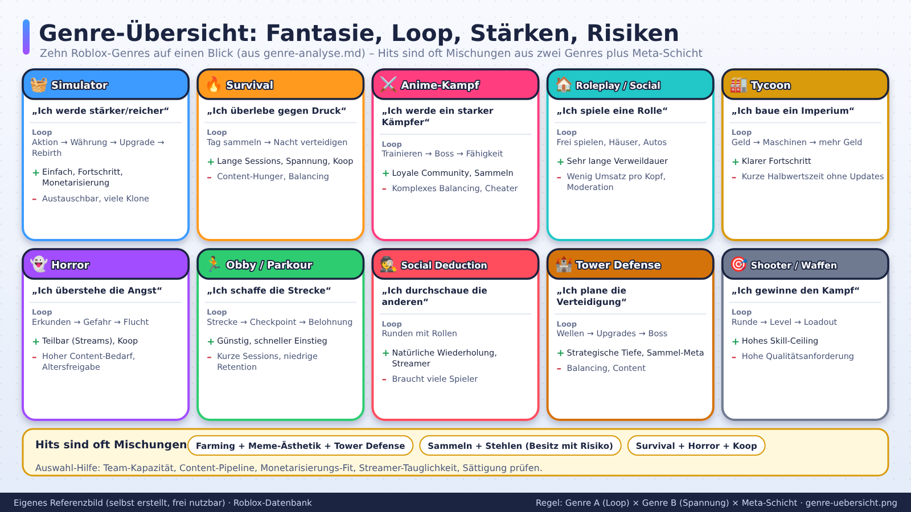
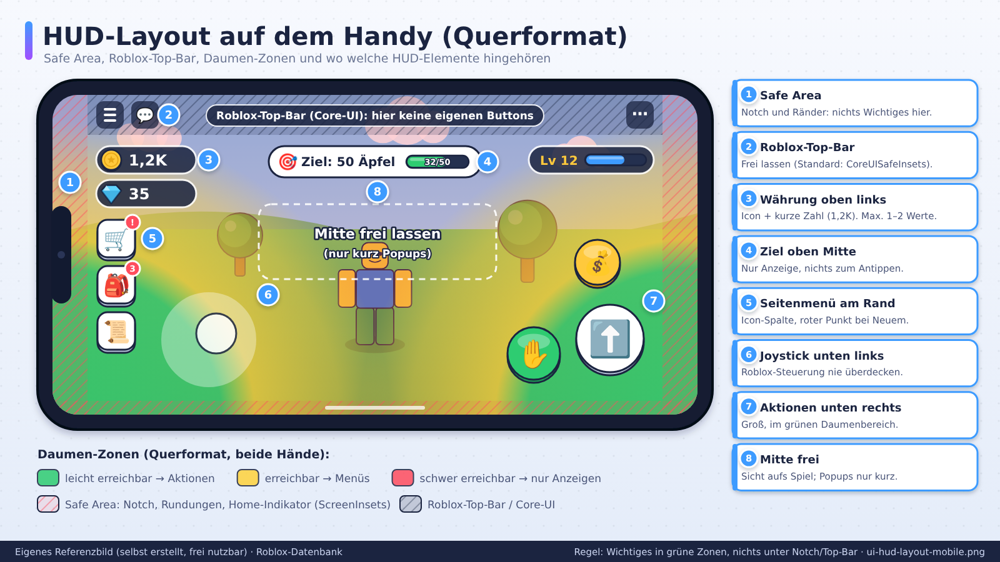
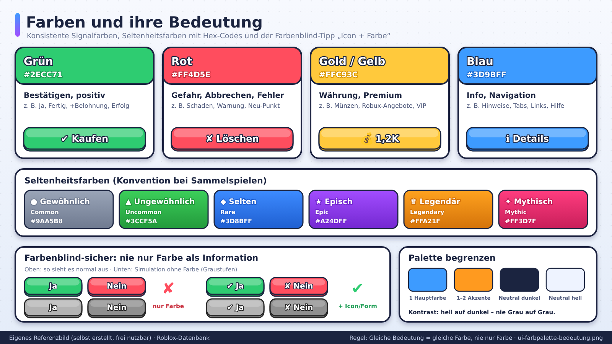
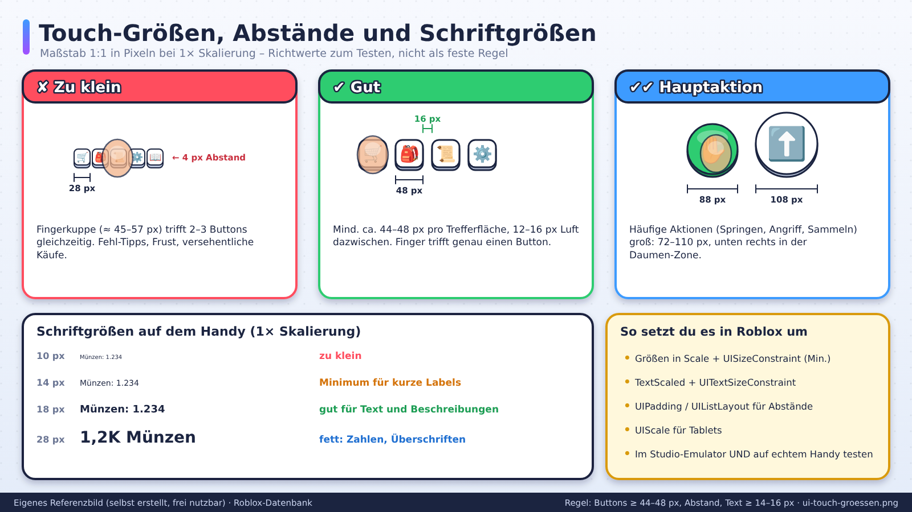
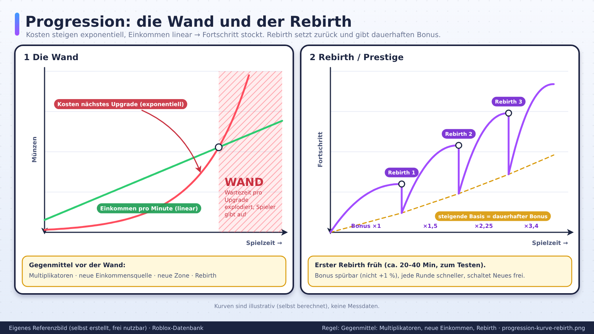
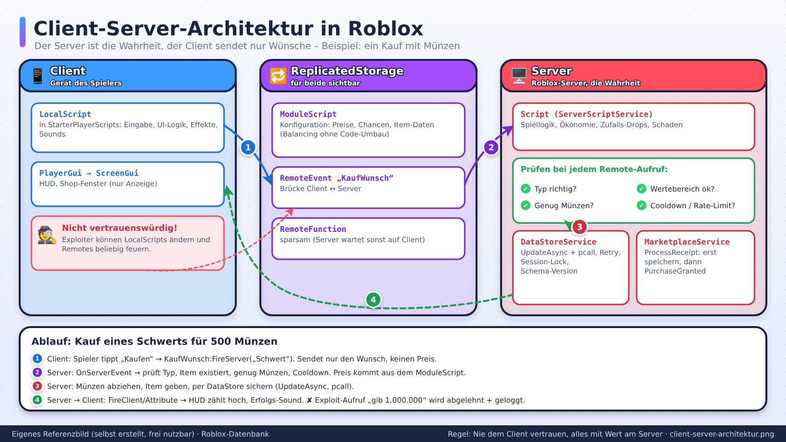

# Eigene Referenzbilder (selbst erstellt)

> Stand: 2026-10-24 · Alle Bilder in diesem Ordner (außer `offiziell/`) sind **selbst gezeichnet** (SVG-Code, mit Chromium zu PNG gerendert). Sie zeigen **fiktive** Spiele und Oberflächen, keine Screenshots echter Spiele. Frei nutzbar für eigene Projekte, Präsentationen und Claude Projects.

## Warum selbst gemacht?
- Echte Spiel-Screenshots und Soundtracks sind urheberrechtlich geschützt und gehören nicht ohne Erlaubnis in ein Repo.
- Die Bilder hier zeigen deshalb die **Designregeln** aus der Datenbank als eigene, beschriftete Mockups und Diagramme (Texte auf Deutsch).
- Jedes Bild gibt es zweimal: `.svg` (Quelle, verlustfrei skalierbar, mit Texteditor änderbar) und `.png` (1600 × 900 px, für Claude Projects, Präsentationen, Discord).
- Neu erzeugen oder ändern: siehe `tools/README.md` (`python3 tools/bilder/erzeuge_bilder.py` und danach `node tools/bilder/render.js`).
- Alle Zahlen in den Bildern (Preise, Chancen, Zeiten) sind **Beispiele/Startwerte aus der Datenbank**, keine Messdaten.

## Übersicht

| Datei | Zeigt | Welche Regel | Zugehörige Datenbank-Datei |
|---|---|---|---|
| `ui-hud-layout-mobile.png` | Handy quer mit Notch, Safe Area, Roblox-Top-Bar, Daumen-Zonen (grün/gelb/rot), HUD-Positionen | Wichtiges in grüne Zonen, nichts unter Notch/Top-Bar, Mitte frei | `04-ui-ux/mobile-first.md`, `04-ui-ux/ui-grundlagen.md` |
| `ui-hud-beispiel-simulator.png` | Komplettes HUD des fiktiven „Beeren-Rausch Simulator“: Währungen (1,2K), Boosts mit Timer, Benachrichtigungspunkte, Aufgaben, Verkaufen | 6–8 Dauer-Elemente, Kurzformat für Zahlen, Rest ins Menü | `04-ui-ux/hud-shop-menues.md` |
| `ui-shop-layout.png` | Shop-Fenster mit Tabs, „Beliebt“-Bereich, Produktkarten, großem X, Bestätigungsdialog, Do/Don't | Preis und Nutzen immer sichtbar, Bestätigung vor Kauf, keine Fake-Timer | `04-ui-ux/hud-shop-menues.md`, `07-monetarisierung/monetarisierung.md` |
| `ui-inventar-seltenheit.png` | Inventar-Raster mit Seltenheitsrahmen, Sortieren/Filter, Platz-Anzeige 47/60, Mehrfachauswahl, Legende mit Hex-Codes | Seltenheit = Farbe + Symbol, Sicherheitsabfrage bei seltenen Items | `04-ui-ux/hud-shop-menues.md`, `03-mechaniken-retention/gacha-und-luck.md` |
| `ui-sammelbuch.png` | Sammelbuch: gesammelt vs. Silhouette, Fortschritt 34/120, Reiter, Meilenstein-Belohnungen | Fehlendes sichtbar machen, Teilziele belohnen | `04-ui-ux/hud-shop-menues.md`, `03-mechaniken-retention/progression-rebirth.md` |
| `ui-farbpalette-bedeutung.png` | Signalfarben (Grün/Rot/Gold/Blau), Seltenheitsfarben mit Hex, Farbenblind-Test (Graustufen) | Gleiche Bedeutung = gleiche Farbe, nie nur Farbe als Information | `04-ui-ux/ui-grundlagen.md` |
| `ui-touch-groessen.png` | Touch-Ziele zu klein vs. gut (≥ 44–48 px) vs. Hauptaktion, Abstände, Schriftgrößen 1:1 | Buttons ≥ 44–48 px mit Abstand, Text ≥ 14–16 px | `04-ui-ux/mobile-first.md`, `04-ui-ux/ui-grundlagen.md` |
| `ui-tutorial-pfeil.png` | Onboarding-Mockup: leuchtender Pfad, hüpfender Pfeil, ein Satz Hinweis, Schritt 1/3, Überspringen | Zeigen statt erklären, eine Anweisung zur Zeit | `03-mechaniken-retention/retention-und-onboarding.md`, `04-ui-ux/hud-shop-menues.md` |
| `ui-popup-toast-hierarchie.png` | Toast vs. Banner vs. Modal, Dauer, Warteschlange statt Stapel, Prioritäten | Modal nur für Wichtiges, Toasts 2–4 s, nacheinander | `04-ui-ux/hud-shop-menues.md` |
| `core-loop-diagramm.png` | Core Loop (Aktion → Feedback → Belohnung → Verbesserung → neue Möglichkeit) und Mikro/Meso/Makro-Ringe | Jede Runde fühlt sich anders an; alle drei Zeitebenen nötig | `03-mechaniken-retention/core-loops.md` |
| `loop-muster-uebersicht.png` | 7 Loop-Muster (Simulator, Warten-Ernten, Tag/Nacht, Tower Defense, Besitz mit Risiko, Runden, Kampf-Progress) mit Stärke/Gefahr | Jeder Loop braucht ein Gegenmittel gegen Monotonie | `03-mechaniken-retention/core-loops.md` |
| `retention-funnel-onboarding.png` | Onboarding-Trichter 0–10 s bis Sitzungsende mit Ziel, Maßnahme, Messpunkt | Schnell zum Spaß, ein Konzept zur Zeit, Rückkehr-Grund am Ende | `03-mechaniken-retention/retention-und-onboarding.md` |
| `progression-kurve-rebirth.png` | Exponentielle Kosten vs. lineares Einkommen (Wand) und Rebirth-Sägezahn mit steigender Basis | Gegenmittel vor der Wand: Multiplikatoren, neue Einkommen, Rebirth | `03-mechaniken-retention/progression-rebirth.md` |
| `gacha-wahrscheinlichkeiten-pity.png` | Balken 60/25/10/4/0,9/0,1 %, „1 von X“, Lupe 0–5 %, Pity-Zähler 27/30 und 64/100 | Chancen anzeigen, Pity sichtbar, Server lost aus | `03-mechaniken-retention/gacha-und-luck.md` |
| `map-zonen-layout.png` | Draufsicht: Hub mit Landmarke, 5 Zonen mit Farbwelten, Tore mit Preisen, Wege, Sichtlinien, Teleporter, Plots | Nächste Zone sichtbar, Preis am Tor, jede Zone eigenes Merkmal | `05-map-leveldesign/map-grundlagen.md` |
| `map-wegfuehrung.png` | 6 Werkzeuge der Wegführung: Licht, Farbe, Linien, Höhe/Landmarke, Engpass ↔ Weite, Spuren | Spieler ohne Text führen | `05-map-leveldesign/map-grundlagen.md` |
| `map-spawn-hub.png` | Nahansicht Spawn/Hub: erste Interaktion, Shop, Verkaufen, Rangliste, Teleporter, Schutzzone, Weg zu Zone 1 | Spawn nahe der ersten Aktion, keine Gefahr am Spawn | `05-map-leveldesign/map-grundlagen.md` |
| `live-ops-kalender-8-wochen.png` | 8-Wochen-Kalender (Updates, Events, Mini-Events, Saison, Pflege) plus illustrative Spielerkurve | Rhythmus festlegen, Systemtiefe statt nur Events | `03-mechaniken-retention/live-ops-events.md` |
| `audio-mix-prioritaeten.png` | Mix-Pyramide (Warnung > Belohnung > UI > SFX > Musik > Ambiente) und SoundGroup-Baum mit Startwerten | Wichtiges setzt sich durch, Gruppen getrennt regelbar | `06-sound-audio/audio-grundlagen.md` |
| `client-server-architektur.png` | Client / ReplicatedStorage / Server mit LocalScript, ModuleScript, RemoteEvent, Validierung, DataStore, MarketplaceService | Nie dem Client vertrauen, alles mit Wert am Server | `08-technik-luau/technik-grundlagen.md` |
| `monetarisierung-produkte.png` | Gamepass vs. Developer Product vs. Kosmetik (Matrix) und Skala fair ↔ Pay-to-win | Zeit, Komfort, Aussehen verkaufen, nie den Fortschritt sperren | `07-monetarisierung/monetarisierung.md` |
| `ideen-generator-matrix.png` | Ideen-Generator: Fantasie × Loop × Spannung × Meta mit markierter Beispiel-Kombination, Rohidee, Ein-Satz-Test, 7 Filterfragen | Hits in Bausteine zerlegen, neu kombinieren, ≥ 3 Fragen durchgefallen → umbauen | `02-spielkonzepte/ideen-methodik.md` |
| `genre-uebersicht.png` | 10 Roblox-Genres als Karten: Kern-Fantasie, Loop, Stärken, Risiken, typische Mischungen | Genre A (Loop) × Genre B (Spannung) × Meta-Schicht | `01-markt-trends/genre-analyse.md` |
| `../audio/audio-wellenformen.png` | Wellenform + Spektrogramm aller Referenz-Sounds | Damit Claude Projects die Sounds „sehen“ kann | `06-sound-audio/audio-grundlagen.md`, `assets/audio/README.md` |

## Alle Bilder

### Spielkonzepte und Markt

### UI und UX

### Mechaniken und Retention

### Map und Leveldesign

### Sound, Technik, Monetarisierung

## Weitere Ordner
- `offiziell/`: Bilder aus der offiziellen Roblox Creator Documentation (CC BY 4.0, Lizenzhinweis in `offiziell/README.md` beachten). Diese sind **nicht** selbst erstellt.
- `../eigene-referenzen/`: Platz für **deine eigenen** Screenshots aus Studio und eigenen Spielen.

## Hinweise zur Nutzung
- In Claude Projects die PNGs zusammen mit den Markdown-Dateien hochladen (Claude liest Bilder, SVG-Code nicht immer bildlich).
- Die Mockups sind **Startpunkte**, keine fertigen Layouts. Immer auf echten Handys testen (siehe `checklisten/ui-review.md`).
- Das „R$“-Sechseck ist ein neutraler Platzhalter für Robux-Preise, nicht das offizielle Symbol. Die Block-Spielfigur ist generisch.
- Emojis (Icons in Mockups) werden je nach Betrachter-Programm unterschiedlich dargestellt; die PNGs zeigen die Noto-Emoji-Variante.
