# Offizielle Referenzbilder aus der Roblox Creator Documentation

> **Lizenz / Namensnennung:** Bilder aus der offiziellen Roblox Creator Documentation, © Roblox Corporation, lizenziert unter CC BY 4.0, https://creativecommons.org/licenses/by/4.0/ — Quelle: https://github.com/Roblox/creator-docs; ggf. verkleinert/umbenannt

**Details zur Herkunft**

- Quelle: Repository [Roblox/creator-docs](https://github.com/Roblox/creator-docs), Commit `4e795e65a41f` (Stand 24.10.2026). Die Dokumentationsinhalte (Text und Bilder) stehen dort unter [CC BY 4.0](https://creativecommons.org/licenses/by/4.0/) (Datei `LICENSE`), Code-Beispiele unter MIT (`LICENSE-CODE`).
- Änderungen: Alle Dateien wurden **umbenannt** (sprechende deutsche Dateinamen). Bilder über ca. 0,8 MB wurden auf max. 1600 px Breite **verkleinert** und/oder als JPG **neu komprimiert**; das ist in der Spalte „Datei“ vermerkt. Inhaltlich wurde nichts verändert.
- Die Bilder zeigen teils Screenshots bekannter Roblox-Spiele (z. B. Jailbreak, Doors, Dragon Adventures), so wie Roblox sie in der eigenen Doku als Beispiele verwendet. „Roblox“ ist eine Marke der Roblox Corporation; diese Sammlung ist nicht von Roblox autorisiert oder unterstützt.
- Bei Weiterverwendung bitte den Lizenzhinweis oben mitkopieren und auf die jeweilige Original-Doku-Seite verlinken.

**Umfang:** 121 Bilder in 9 Themenordnern, zusammen ca. 30.1 MB.

## Inhalt

- [UI-Design (Safe Area, Layouts, HUD, Wireframes, Styling)](#ui-design) – `ui-design/` (22 Bilder)
- [Game Design (Core Loop, Onboarding, Quests, Prototyping)](#game-design) – `game-design/` (12 Bilder)
- [Monetarisierung, Shop-UI, Wirtschaft & Live Ops](#monetarisierung-liveops) – `monetarisierung-liveops/` (13 Bilder)
- [Analytics-Dashboards (Retention, Funnels, Economy, Benchmarks, Experimente)](#analytics) – `analytics/` (13 Bilder)
- [Discovery (Empfehlungsalgorithmus, Thumbnails, Icons)](#discovery) – `discovery/` (13 Bilder)
- [Level-Design & Umgebung (Greybox, Laser-Tag-Layout, Licht, Atmosphäre, Terrain)](#level-design-umgebung) – `level-design-umgebung/` (19 Bilder)
- [Performance (Streaming, SLIM/LOD, Optimierung)](#performance) – `performance/` (12 Bilder)
- [Audio (Audio-API-Verkabelung, Rolloff, Mixing)](#audio) – `audio/` (9 Bilder)
- [Effekte (Partikel, Beams, Lichtquellen, Highlights)](#effekte) – `effekte/` (8 Bilder)

## UI-Design (Safe Area, Layouts, HUD, Wireframes, Styling)

| Vorschau | Datei | Was es zeigt | Designlehre | Original-Doku-Seite | Originaldatei-Pfad |
|---|---|---|---|---|---|
| 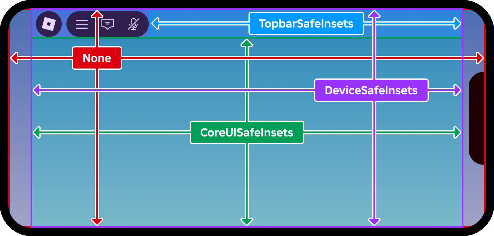 | `safe-area-inset-regionen-uebersicht.png` | Alle vier ScreenInsets-Regionen (None, DeviceSafeInsets, CoreUISafeInsets, TopbarSafeInsets) übereinander auf einem Smartphone im Querformat mit Notch. | Safe Areas: Wichtige HUD-Elemente gehören in den CoreUI-Safe-Bereich, nur Hintergründe dürfen bis an den Rand (None). | [reference/engine/enums/ScreenInsets](https://create.roblox.com/docs/reference/engine/enums/ScreenInsets) | [`content/en-us/assets/engine-api/enums/ScreenInsets/Inset-Regions-All.png`](https://github.com/Roblox/creator-docs/blob/4e795e65a41fd48624fd85442292a81baa6bb3f5/content/en-us/assets/engine-api/enums/ScreenInsets/Inset-Regions-All.png) |
| 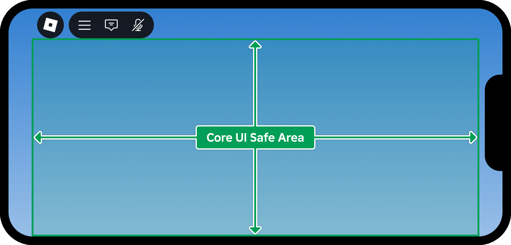 | `safe-area-coreui-safeinsets.png` | Der Core-UI-Safe-Bereich: Fläche unterhalb der Roblox-Topbar-Buttons und innerhalb der Geräte-Ausschnitte. | Standard-Inset für interaktive UI – nichts kollidiert mit Roblox-Menü, Chat-Button oder Notch. | [ui/on-screen-containers](https://create.roblox.com/docs/ui/on-screen-containers) | [`content/en-us/assets/engine-api/enums/ScreenInsets/CoreUISafeInsets.png`](https://github.com/Roblox/creator-docs/blob/4e795e65a41fd48624fd85442292a81baa6bb3f5/content/en-us/assets/engine-api/enums/ScreenInsets/CoreUISafeInsets.png) |
| 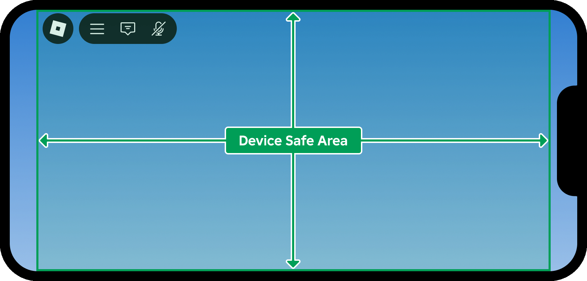 | `safe-area-device-safeinsets.png` | Der Geräte-Safe-Bereich: berücksichtigt nur Notch/Kamera-Ausschnitt, reicht aber nach oben bis in die Topbar-Zeile. | Für Elemente, die die volle Höhe brauchen, aber nicht unter der Notch verschwinden dürfen. | [ui/on-screen-containers](https://create.roblox.com/docs/ui/on-screen-containers) | [`content/en-us/assets/engine-api/enums/ScreenInsets/DeviceSafeInsets.png`](https://github.com/Roblox/creator-docs/blob/4e795e65a41fd48624fd85442292a81baa6bb3f5/content/en-us/assets/engine-api/enums/ScreenInsets/DeviceSafeInsets.png) |
| 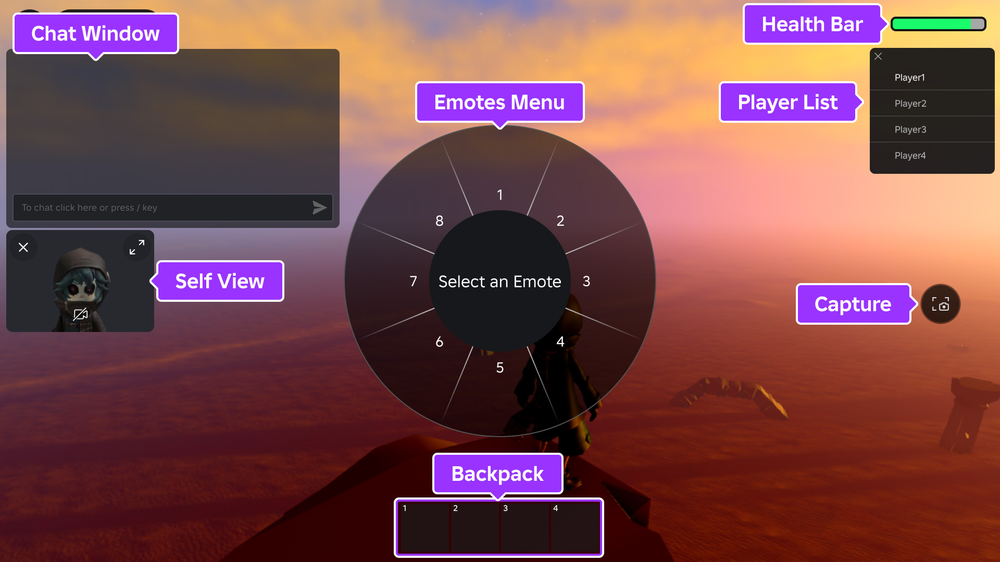 | `standard-coregui-elemente.jpg` | Annotierter Screenshot aller Standard-UI-Elemente von Roblox: Chat, Self View, Emote-Rad, Backpack, Spielerliste, Lebensleiste, Capture. | Vor dem Wireframing wissen, welcher Bildschirmplatz bereits von Roblox belegt ist – eigene UI nicht darüber legen. | [tutorials/curriculums/user-interface-design/wireframe-your-layouts](https://create.roblox.com/docs/tutorials/curriculums/user-interface-design/wireframe-your-layouts) | [`content/en-us/assets/ui/misc/CoreGui-Elements.jpg`](https://github.com/Roblox/creator-docs/blob/4e795e65a41fd48624fd85442292a81baa6bb3f5/content/en-us/assets/ui/misc/CoreGui-Elements.jpg) |
| 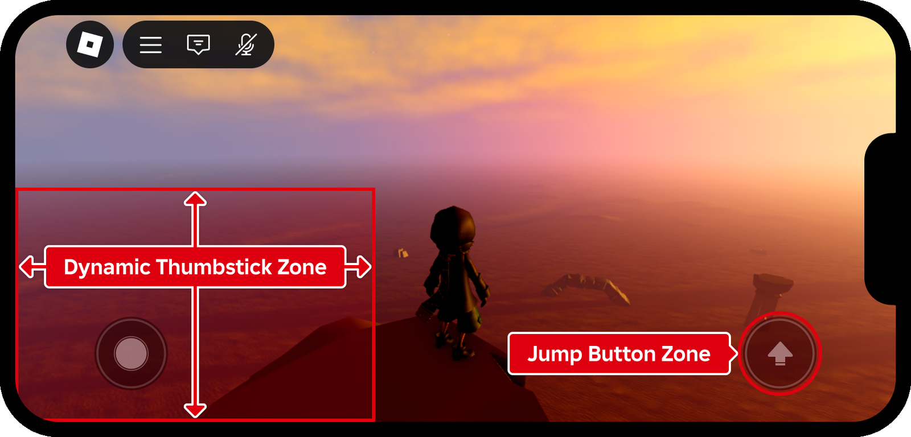 | `touch-reservierte-zonen.png` *auf 1600 px Breite verkleinert (Original 1680×806)* | Mobile Ansicht mit markierter Dynamic-Thumbstick-Zone (links unten) und Jump-Button-Zone (rechts unten). | Reservierte Touch-Zonen freihalten, sonst blockiert eigene UI Bewegung und Springen auf dem Handy. | [ui/position-and-size](https://create.roblox.com/docs/ui/position-and-size) | [`content/en-us/assets/ui/misc/Touch-Reserved-Zones.png`](https://github.com/Roblox/creator-docs/blob/4e795e65a41fd48624fd85442292a81baa6bb3f5/content/en-us/assets/ui/misc/Touch-Reserved-Zones.png) |
| 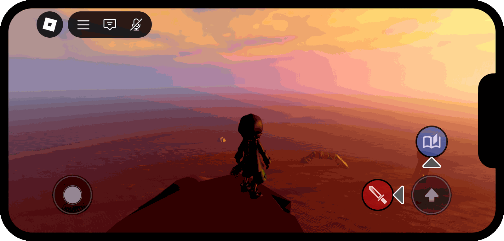 | `daumenzone-buttons-neben-sprung.png` *auf 1600 px Breite verkleinert (Original 1680×806)* | Eigene Aktions-Buttons (Schwert, Buch) kreisförmig um den Sprung-Button angeordnet. | Daumenzonen: Häufige Aktionen dort platzieren, wo der rechte Daumen ohnehin ruht. | [ui/position-and-size](https://create.roblox.com/docs/ui/position-and-size) | [`content/en-us/assets/ui/misc/Custom-Buttons-Near-Jump.png`](https://github.com/Roblox/creator-docs/blob/4e795e65a41fd48624fd85442292a81baa6bb3f5/content/en-us/assets/ui/misc/Custom-Buttons-Near-Jump.png) |
| 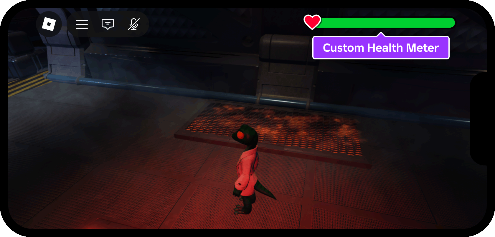 | `hud-lebensleiste-ergebnis.png` | Fertige eigene Lebensleiste (Herz-Icon + grüner Balken) oben rechts im HUD auf einem Smartphone. | Ziel-Look eines HUD-Meters: kompakt, ikonisch, innerhalb der Safe Area und nahe der Bildschirmecke. | [tutorials/use-case-tutorials/ui/create-hud-meters](https://create.roblox.com/docs/tutorials/use-case-tutorials/ui/create-hud-meters) | [`content/en-us/assets/tutorials/creating-hud-meters/Intro.png`](https://github.com/Roblox/creator-docs/blob/4e795e65a41fd48624fd85442292a81baa6bb3f5/content/en-us/assets/tutorials/creating-hud-meters/Intro.png) |
| 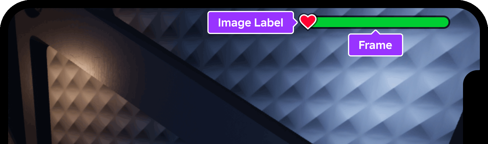 | `hud-lebensleiste-bauteile.png` | Zerlegung der Lebensleiste in ihre Bausteine: ImageLabel (Herz) und Frame (Balken). | HUD-Elemente aus wenigen einfachen Bausteinen (Frame + Fill + Icon) zusammensetzen. | [tutorials/use-case-tutorials/ui/create-hud-meters](https://create.roblox.com/docs/tutorials/use-case-tutorials/ui/create-hud-meters) | [`content/en-us/assets/tutorials/creating-hud-meters/Meter-Design-Components.png`](https://github.com/Roblox/creator-docs/blob/4e795e65a41fd48624fd85442292a81baa6bb3f5/content/en-us/assets/tutorials/creating-hud-meters/Meter-Design-Components.png) |
| 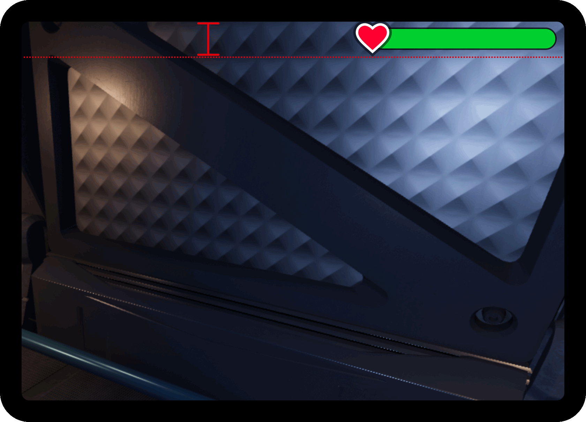 | `hud-tablet-ohne-groessenlimit.png` | Tablet-Emulation: Die prozentual skalierte Lebensleiste wird zu hoch (rot markiert). | Reine Scale-Größen wachsen auf großen Bildschirmen unschön mit – Vorher-Bild zum Vergleich. | [tutorials/use-case-tutorials/ui/create-hud-meters](https://create.roblox.com/docs/tutorials/use-case-tutorials/ui/create-hud-meters) | [`content/en-us/assets/tutorials/creating-hud-meters/Emulation-Tablet-Unconstrained.png`](https://github.com/Roblox/creator-docs/blob/4e795e65a41fd48624fd85442292a81baa6bb3f5/content/en-us/assets/tutorials/creating-hud-meters/Emulation-Tablet-Unconstrained.png) |
| 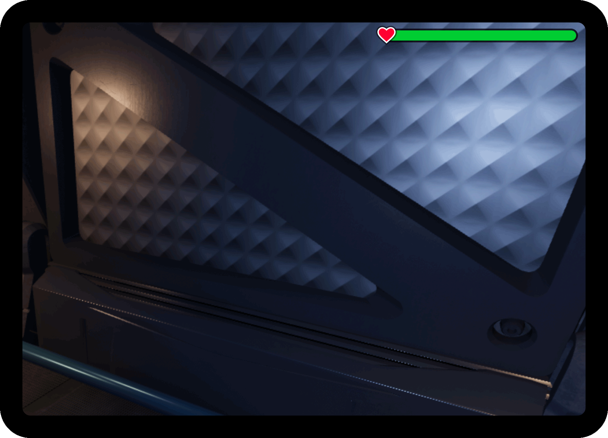 | `hud-tablet-mit-groessenlimit.png` | Dieselbe Tablet-Ansicht mit UISizeConstraint: Die Leiste bleibt schlank. | Mit UISizeConstraint/UIAspectRatioConstraint Maximalgrößen setzen – Nachher-Bild. | [tutorials/use-case-tutorials/ui/create-hud-meters](https://create.roblox.com/docs/tutorials/use-case-tutorials/ui/create-hud-meters) | [`content/en-us/assets/tutorials/creating-hud-meters/Emulation-Tablet-Constrained.png`](https://github.com/Roblox/creator-docs/blob/4e795e65a41fd48624fd85442292a81baa6bb3f5/content/en-us/assets/tutorials/creating-hud-meters/Emulation-Tablet-Constrained.png) |
| 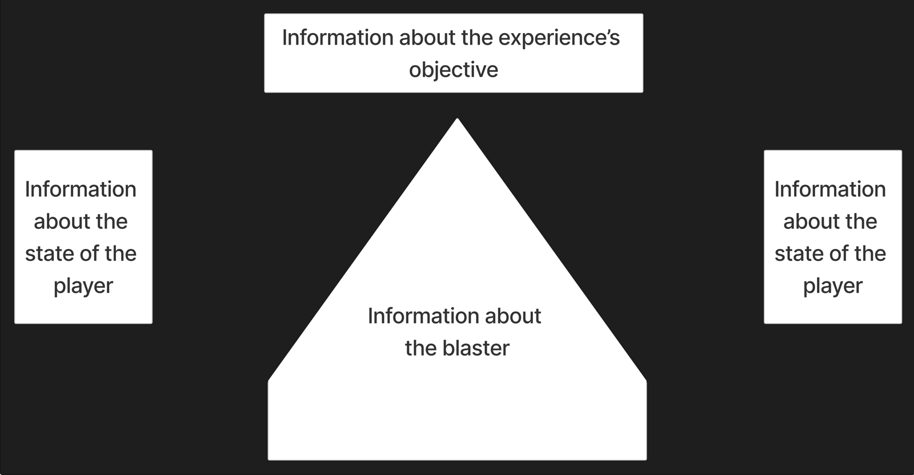 | `wireframe-visuelle-hierarchie.png` | Schema der visuellen Hierarchie im Laser-Tag-Beispiel: Ziel-Info oben, Blaster-Info in der Mitte, Spielerstatus an den Seiten. | Informationen nach Wichtigkeit auf Bildschirmregionen verteilen – Zentrum für Aktion, Ränder für Peripherie. | [tutorials/curriculums/user-interface-design/wireframe-your-layouts](https://create.roblox.com/docs/tutorials/curriculums/user-interface-design/wireframe-your-layouts) | [`content/en-us/assets/tutorials/user-interface-design/Section2/VisualHierarchy.png`](https://github.com/Roblox/creator-docs/blob/4e795e65a41fd48624fd85442292a81baa6bb3f5/content/en-us/assets/tutorials/user-interface-design/Section2/VisualHierarchy.png) |
| 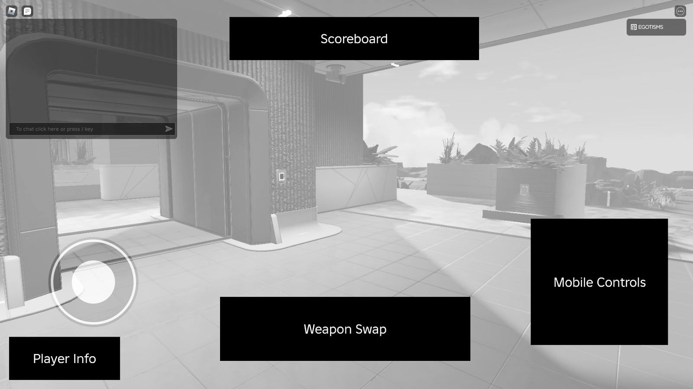 | `wireframe-blockin-mobile.png` | Graustufen-Block-in des HUDs auf Mobilgeräten: Scoreboard, Weapon Swap, Player Info, Mobile Controls als schwarze Boxen. | Erst mit Platzhalter-Boxen Layout und Platzbedarf klären, bevor Grafiken entstehen; mobile Steuerung einplanen. | [tutorials/curriculums/user-interface-design/wireframe-your-layouts](https://create.roblox.com/docs/tutorials/curriculums/user-interface-design/wireframe-your-layouts) | [`content/en-us/assets/tutorials/user-interface-design/Section2/MobileBlockIn.png`](https://github.com/Roblox/creator-docs/blob/4e795e65a41fd48624fd85442292a81baa6bb3f5/content/en-us/assets/tutorials/user-interface-design/Section2/MobileBlockIn.png) |
| 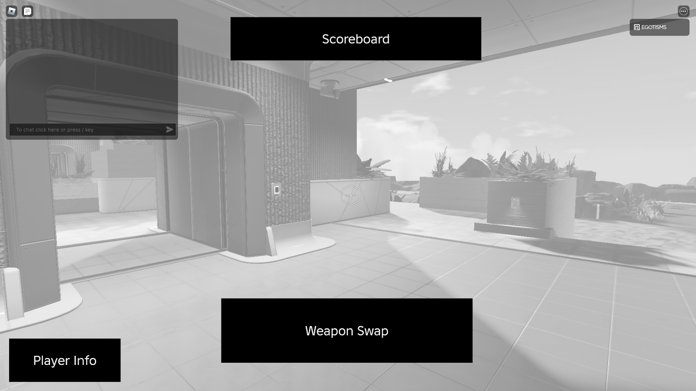 | `wireframe-blockin-pc.png` | Dasselbe Block-in für PC ohne Touch-Steuerelemente. | Plattformspezifische Wireframes: Auf PC fallen Mobile-Controls weg, Platz wird anders genutzt. | [tutorials/curriculums/user-interface-design/wireframe-your-layouts](https://create.roblox.com/docs/tutorials/curriculums/user-interface-design/wireframe-your-layouts) | [`content/en-us/assets/tutorials/user-interface-design/Section2/PCBlockIn.png`](https://github.com/Roblox/creator-docs/blob/4e795e65a41fd48624fd85442292a81baa6bb3f5/content/en-us/assets/tutorials/user-interface-design/Section2/PCBlockIn.png) |
| 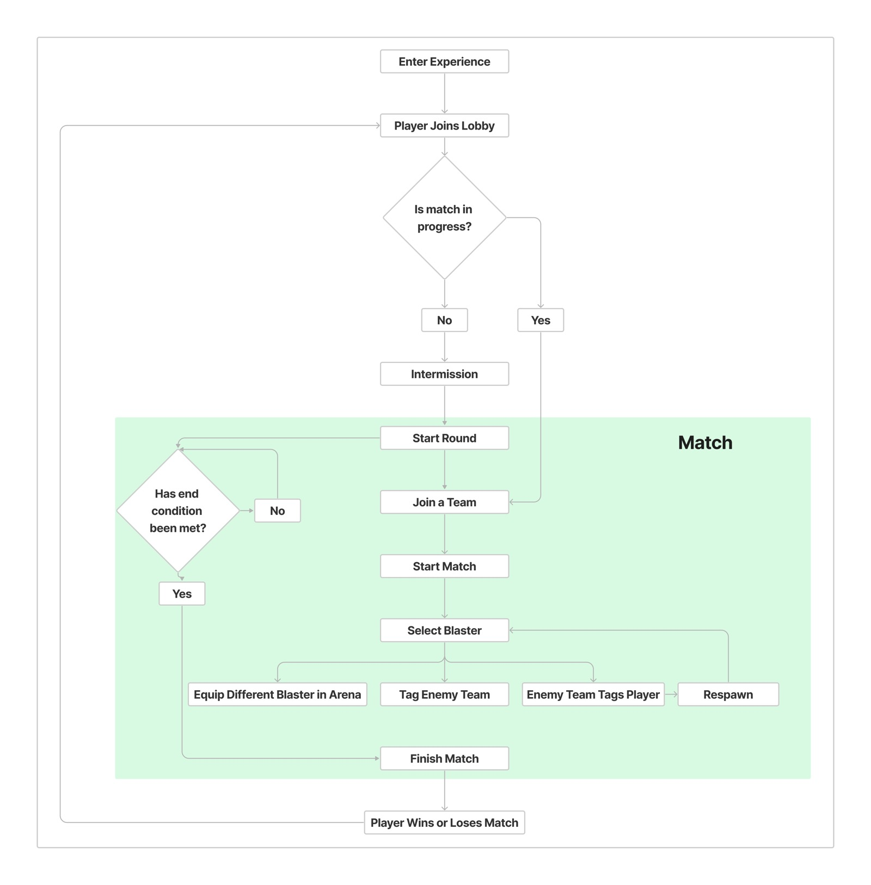 | `user-flow-diagramm.jpg` | Flussdiagramm des Spielerwegs im Laser-Tag-Spiel: Lobby, Runde läuft?, Team beitreten, Blaster wählen, taggen, respawnen, Matchende. | User Flows vor dem UI-Design skizzieren, um alle Screens und Zustände zu kennen. | [tutorials/curriculums/user-interface-design/wireframe-your-layouts](https://create.roblox.com/docs/tutorials/curriculums/user-interface-design/wireframe-your-layouts) | [`content/en-us/assets/tutorials/user-interface-design/Section2/UserFlowChart.jpg`](https://github.com/Roblox/creator-docs/blob/4e795e65a41fd48624fd85442292a81baa6bb3f5/content/en-us/assets/tutorials/user-interface-design/Section2/UserFlowChart.jpg) |
| 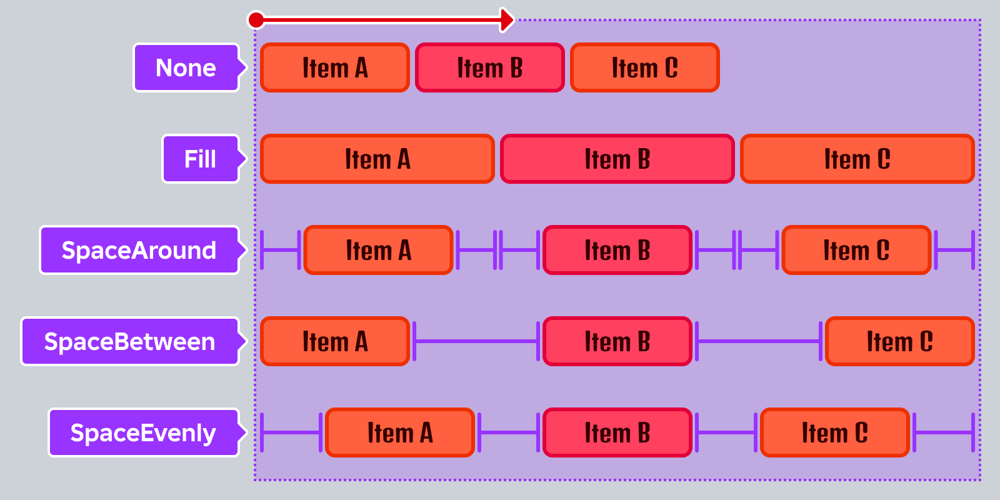 | `flex-layout-horizontal-optionen.png` | Vergleich der HorizontalFlex-Modi von UIListLayout: None, Fill, SpaceAround, SpaceBetween, SpaceEvenly. | Flex-Layouts verteilen Restplatz automatisch – ideal für Tab-Leisten und Button-Reihen über alle Auflösungen. | [ui/list-flex-layouts](https://create.roblox.com/docs/ui/list-flex-layouts) | [`content/en-us/assets/engine-api/classes/UIListLayout/HorizontalFlex-Options.png`](https://github.com/Roblox/creator-docs/blob/4e795e65a41fd48624fd85442292a81baa6bb3f5/content/en-us/assets/engine-api/classes/UIListLayout/HorizontalFlex-Options.png) |
| 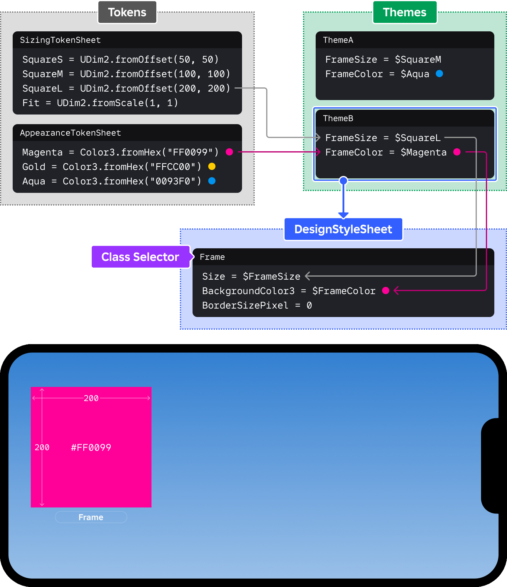 | `styling-selektor-flowchart-klasse.png` | Ablaufdiagramm des UI-Stylings: Tokens → Theme → StyleSheet mit Klassen-Selektor → magentafarbener 200×200-Frame. | Design-System-Denken: Farben/Größen als Tokens zentral definieren und per Theme austauschbar machen. | [ui/styling/index](https://create.roblox.com/docs/ui/styling) | [`content/en-us/assets/ui/ui-styling/Styling-Flowchart-Class.png`](https://github.com/Roblox/creator-docs/blob/4e795e65a41fd48624fd85442292a81baa6bb3f5/content/en-us/assets/ui/ui-styling/Styling-Flowchart-Class.png) |
| 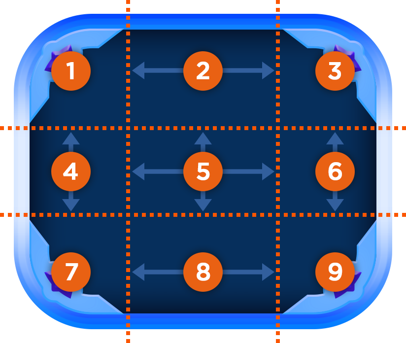 | `9-slice-konzept.png` | Ein UI-Rahmenbild in neun Zonen geteilt; Ecken bleiben fix, Kanten und Mitte strecken sich. | 9-Slice für skalierbare Panels/Buttons ohne verzerrte Ecken. | [ui/9-slice](https://create.roblox.com/docs/ui/9-slice) | [`content/en-us/assets/ui/9-slice/9-Slice-Concept-Diagram.png`](https://github.com/Roblox/creator-docs/blob/4e795e65a41fd48624fd85442292a81baa6bb3f5/content/en-us/assets/ui/9-slice/9-Slice-Concept-Diagram.png) |
| 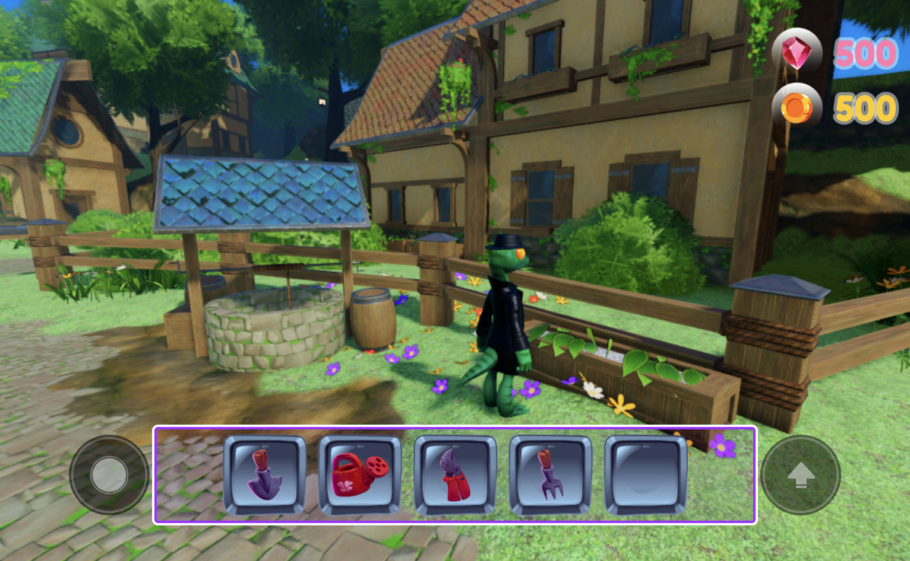 | `responsive-layout-querformat.jpg` | Inventarleiste horizontal am unteren Rand im Querformat. | Responsive Layout: Dieselbe UI ordnet sich je nach Ausrichtung um (Querformat). | [production/publishing/adaptive-design](https://create.roblox.com/docs/production/publishing/adaptive-design) | [`content/en-us/assets/publishing/cross-platform/Responsive-Layout-Landscape.jpg`](https://github.com/Roblox/creator-docs/blob/4e795e65a41fd48624fd85442292a81baa6bb3f5/content/en-us/assets/publishing/cross-platform/Responsive-Layout-Landscape.jpg) |
| 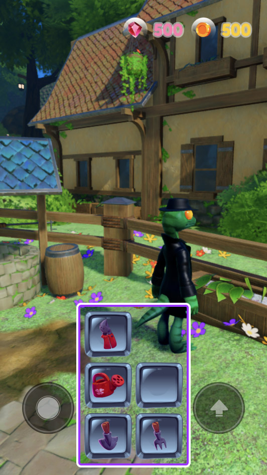 | `responsive-layout-hochformat.jpg` | Dieselbe Inventarleiste im Hochformat als 2er-Raster neu angeordnet. | Responsive Layout: Hochformat braucht andere Anordnung, nicht nur Skalierung. | [production/publishing/adaptive-design](https://create.roblox.com/docs/production/publishing/adaptive-design) | [`content/en-us/assets/publishing/cross-platform/Responsive-Layout-Portrait.jpg`](https://github.com/Roblox/creator-docs/blob/4e795e65a41fd48624fd85442292a81baa6bb3f5/content/en-us/assets/publishing/cross-platform/Responsive-Layout-Portrait.jpg) |
| 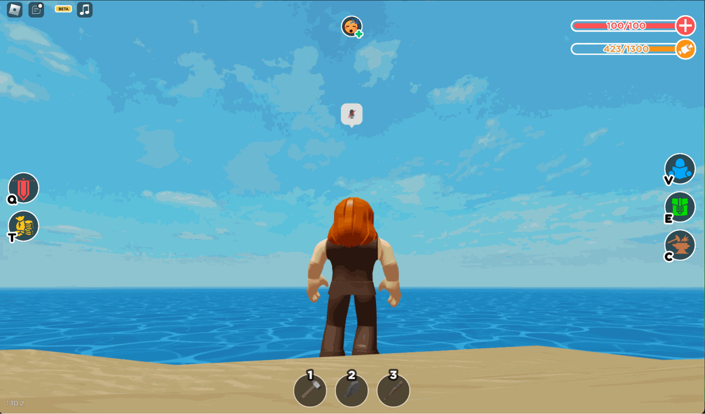 | `uiux-priorisierung-hud-survival.png` *auf 1600 px Breite verkleinert (Original 1999×1177)* | HUD aus The Survival Game: Lebens- und Hungerleiste oben rechts, Werkzeug-Hotbar (1–3) unten, Menü-Shortcuts (Q/T links, V/E/C rechts) an den Rändern – die Mitte bleibt frei. | Priorisierung: Überlebenswichtige Infos immer sichtbar, Spielwelt in der Mitte unverdeckt. | [production/game-design/ui-ux-design](https://create.roblox.com/docs/production/game-design/ui-ux-design) | [`content/en-us/assets/game-design/ui-ux-design/ui-ux-design-1.png`](https://github.com/Roblox/creator-docs/blob/4e795e65a41fd48624fd85442292a81baa6bb3f5/content/en-us/assets/game-design/ui-ux-design/ui-ux-design-1.png) |
| 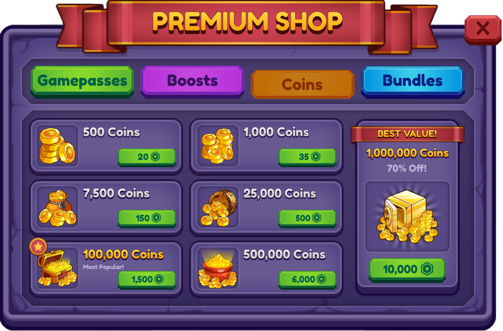 | `uiux-aufmerksamkeit-shop-bundles.png` *auf 1600 px Breite verkleinert (Original 1999×1317)* | Premium-Shop mit Coin-Bundles; das wertvollste Bundle ist größer, abgesetzt und mit „Best Value“ markiert (Dragon Adventures). | Aufmerksamkeit lenken über Größe, Abstand und Labels – das gewünschte Angebot visuell priorisieren. | [production/game-design/ui-ux-design](https://create.roblox.com/docs/production/game-design/ui-ux-design) | [`content/en-us/assets/game-design/ui-ux-design/ui-ux-design-9.png`](https://github.com/Roblox/creator-docs/blob/4e795e65a41fd48624fd85442292a81baa6bb3f5/content/en-us/assets/game-design/ui-ux-design/ui-ux-design-9.png) |
| 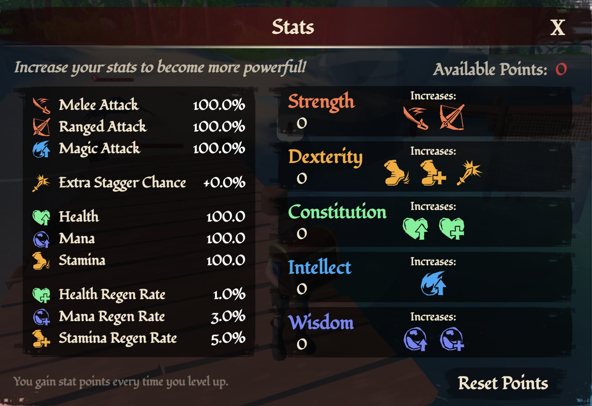 | `uiux-visuelle-sprache-stats.jpg` *auf 1600 px Breite verkleinert (Original 1938×1330), als JPG gespeichert* | Stats-Menü aus Winds of Fortune: Jede Stat-Kategorie hat eigene Farbe und Icon-Familie. | Konsistente visuelle Sprache: Farbe + Form kodieren Bedeutung, Spieler erkennen Zusammenhänge sofort. | [production/game-design/ui-ux-design](https://create.roblox.com/docs/production/game-design/ui-ux-design) | [`content/en-us/assets/game-design/ui-ux-design/ui-ux-design-11.png`](https://github.com/Roblox/creator-docs/blob/4e795e65a41fd48624fd85442292a81baa6bb3f5/content/en-us/assets/game-design/ui-ux-design/ui-ux-design-11.png) |

## Game Design (Core Loop, Onboarding, Quests, Prototyping)

| Vorschau | Datei | Was es zeigt | Designlehre | Original-Doku-Seite | Originaldatei-Pfad |
|---|---|---|---|---|---|
| 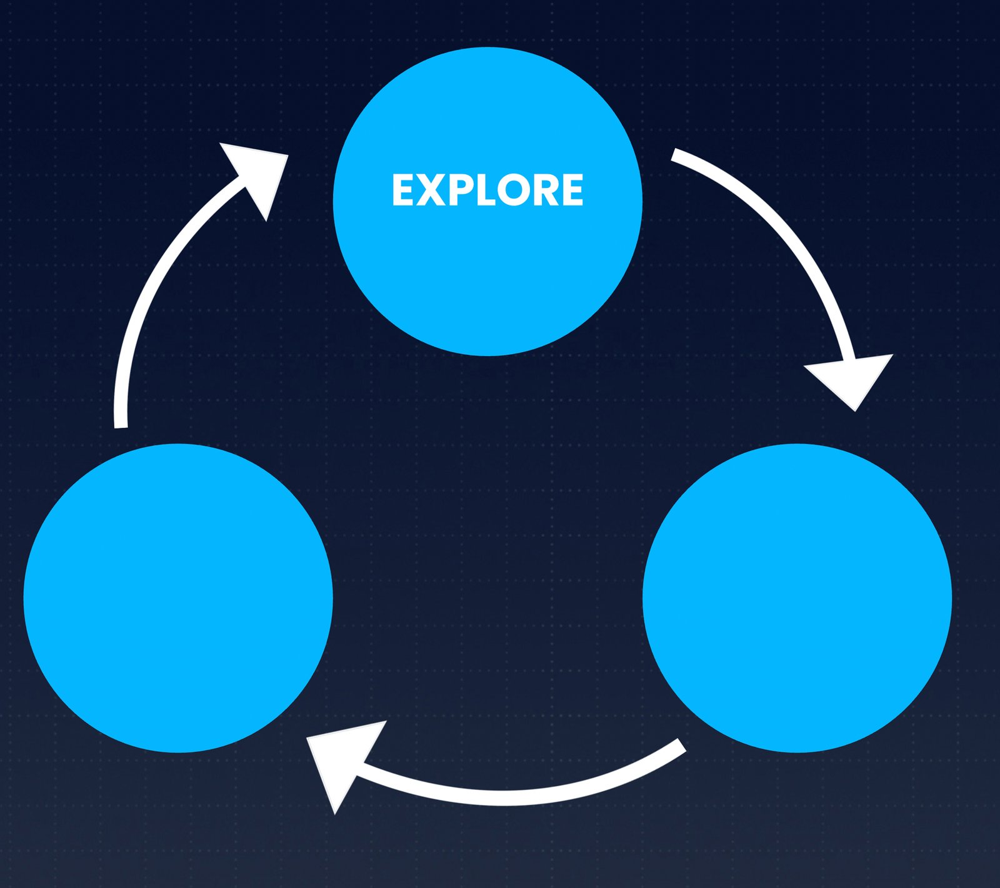 | `core-loop-minute-zu-minute.jpg` *auf 1600 px Breite verkleinert (Original 2000×1778), als JPG gespeichert* | Core-Loop-Diagramm (Action-RPG), Schritt 1: nur „Explore“ ist beschriftet. | Erster Baustein jedes Core Loops: die ständige Minute-zu-Minute-Interaktion. | [production/game-design/core-loops](https://create.roblox.com/docs/production/game-design/core-loops) | [`content/en-us/assets/game-design/core-loops/core-loops1.png`](https://github.com/Roblox/creator-docs/blob/4e795e65a41fd48624fd85442292a81baa6bb3f5/content/en-us/assets/game-design/core-loops/core-loops1.png) |
| 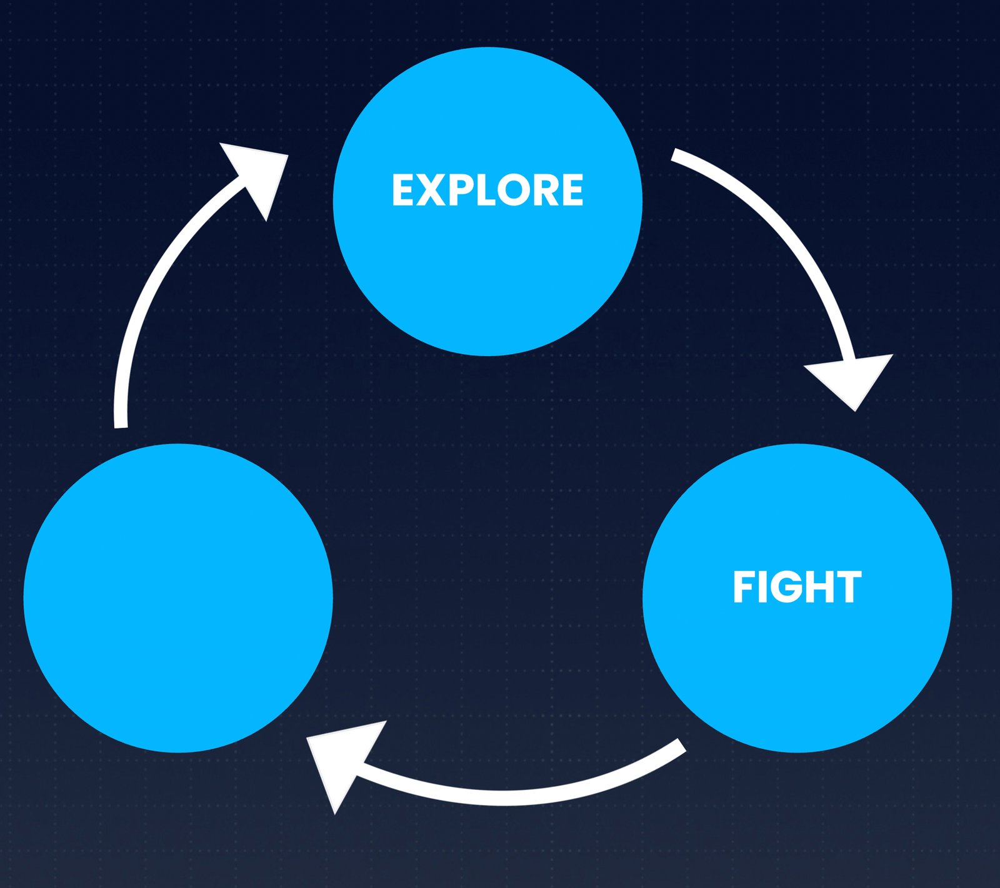 | `core-loop-wiederholte-aktionen.jpg` *auf 1600 px Breite verkleinert (Original 2000×1778), als JPG gespeichert* | Core-Loop-Diagramm, Schritt 2: „Explore → Fight“. | Zweiter Baustein: die am häufigsten wiederholte Aktionsfolge. | [production/game-design/core-loops](https://create.roblox.com/docs/production/game-design/core-loops) | [`content/en-us/assets/game-design/core-loops/core-loops2.png`](https://github.com/Roblox/creator-docs/blob/4e795e65a41fd48624fd85442292a81baa6bb3f5/content/en-us/assets/game-design/core-loops/core-loops2.png) |
| 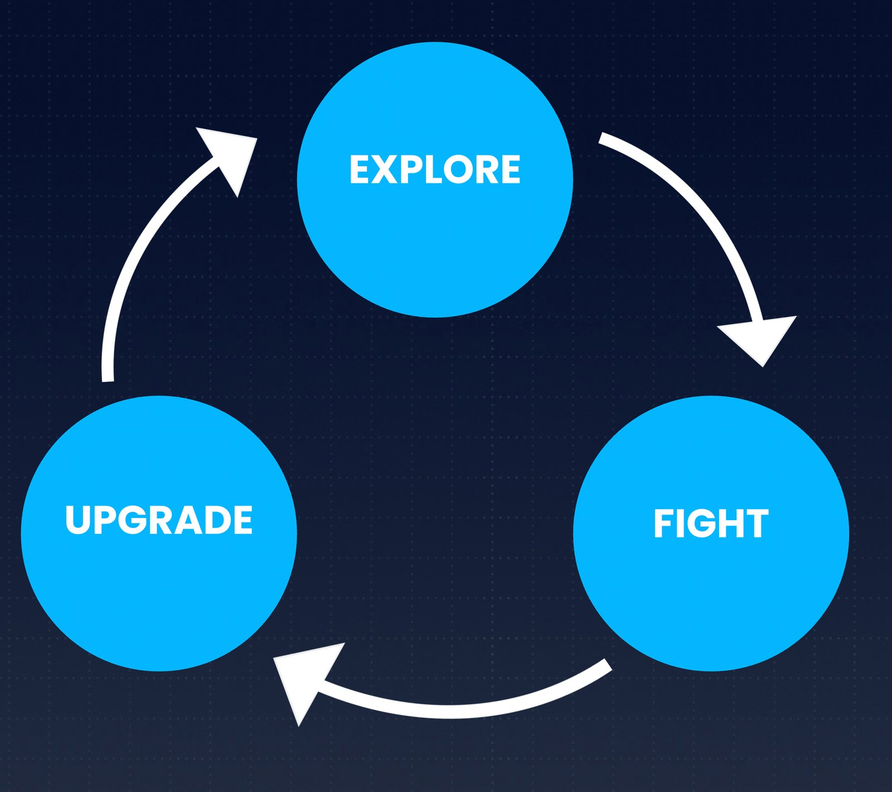 | `core-loop-progressionsmotor.jpg` *auf 1600 px Breite verkleinert (Original 2000×1778), als JPG gespeichert* | Vollständiger Core Loop: Explore → Fight → Upgrade → zurück zu Explore. | Ohne Progressionsmotor (Upgrade) wird der Loop repetitiv – Fortschritt speist die nächste Runde. | [production/game-design/core-loops](https://create.roblox.com/docs/production/game-design/core-loops) | [`content/en-us/assets/game-design/core-loops/core-loops3.png`](https://github.com/Roblox/creator-docs/blob/4e795e65a41fd48624fd85442292a81baa6bb3f5/content/en-us/assets/game-design/core-loops/core-loops3.png) |
| 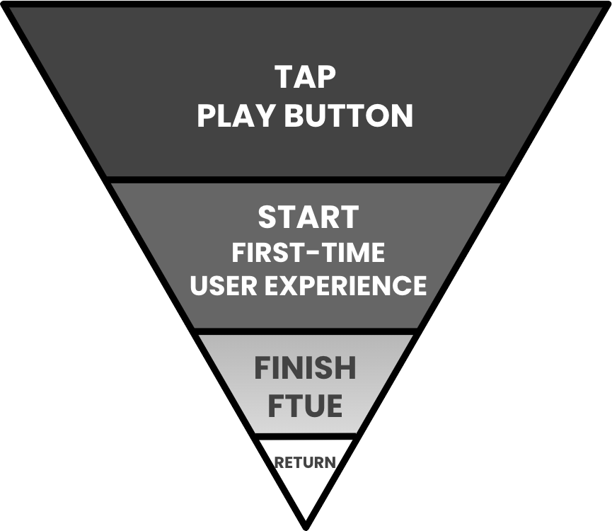 | `onboarding-d1-retention-pyramide.png` | Umgedrehte Trichter-Pyramide: Play drücken → FTUE starten → FTUE beenden → Zurückkehren. | Day-1-Retention als Player-Funnel denken und Lecks zwischen den Schritten stopfen. | [production/game-design/onboarding](https://create.roblox.com/docs/production/game-design/onboarding) | [`content/en-us/assets/game-design/onboarding/onboarding_1.png`](https://github.com/Roblox/creator-docs/blob/4e795e65a41fd48624fd85442292a81baa6bb3f5/content/en-us/assets/game-design/onboarding/onboarding_1.png) |
| 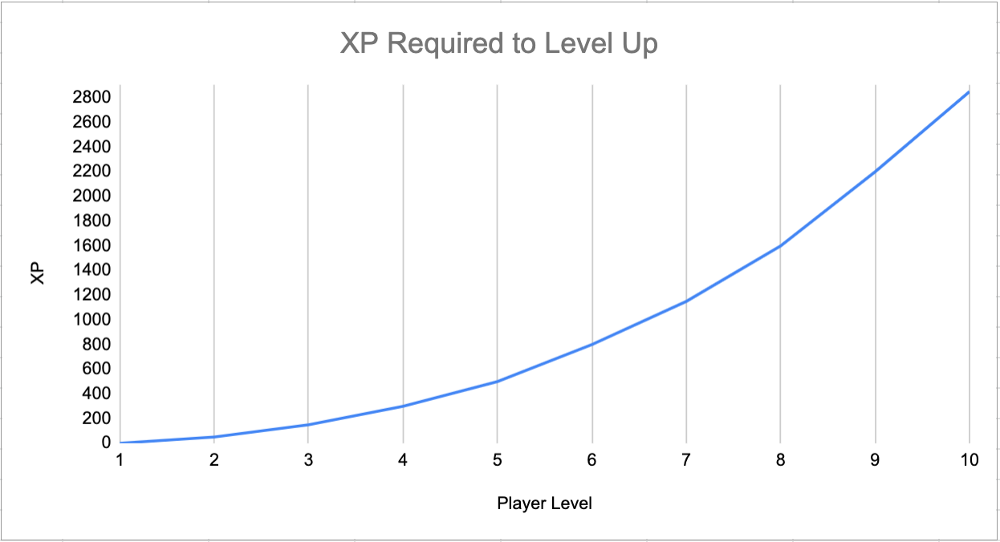 | `onboarding-progressionskurve.png` | Diagramm „XP Required to Level Up“: exponentiell steigende XP-Kurve über Level 1–10. | Frühe Level schnell erreichbar machen, damit neue Spieler sofort Fortschritt spüren. | [production/game-design/onboarding](https://create.roblox.com/docs/production/game-design/onboarding) | [`content/en-us/assets/game-design/onboarding/onboarding_3.png`](https://github.com/Roblox/creator-docs/blob/4e795e65a41fd48624fd85442292a81baa6bb3f5/content/en-us/assets/game-design/onboarding/onboarding_3.png) |
| 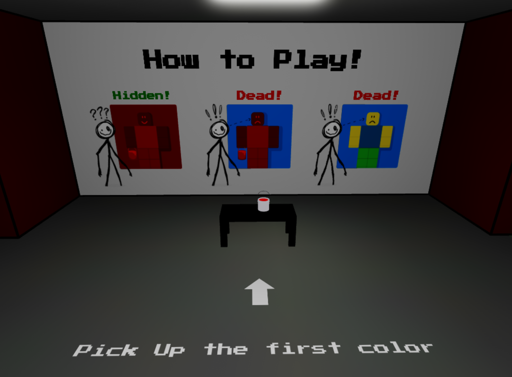 | `onboarding-visuelle-prominenz.png` *auf 1600 px Breite verkleinert (Original 2000×1473)* | Color or Die: Großes „How to Play!“-Schild direkt in Blickrichtung erklärt die Überlebensregel mit Bildern. | Erklärungen als Objekte in die Welt setzen statt leicht übersehbarer Text-Popups. | [production/game-design/onboarding-techniques](https://create.roblox.com/docs/production/game-design/onboarding-techniques) | [`content/en-us/assets/game-design/onboarding-techniques/visual-elements-2.png`](https://github.com/Roblox/creator-docs/blob/4e795e65a41fd48624fd85442292a81baa6bb3f5/content/en-us/assets/game-design/onboarding-techniques/visual-elements-2.png) |
| 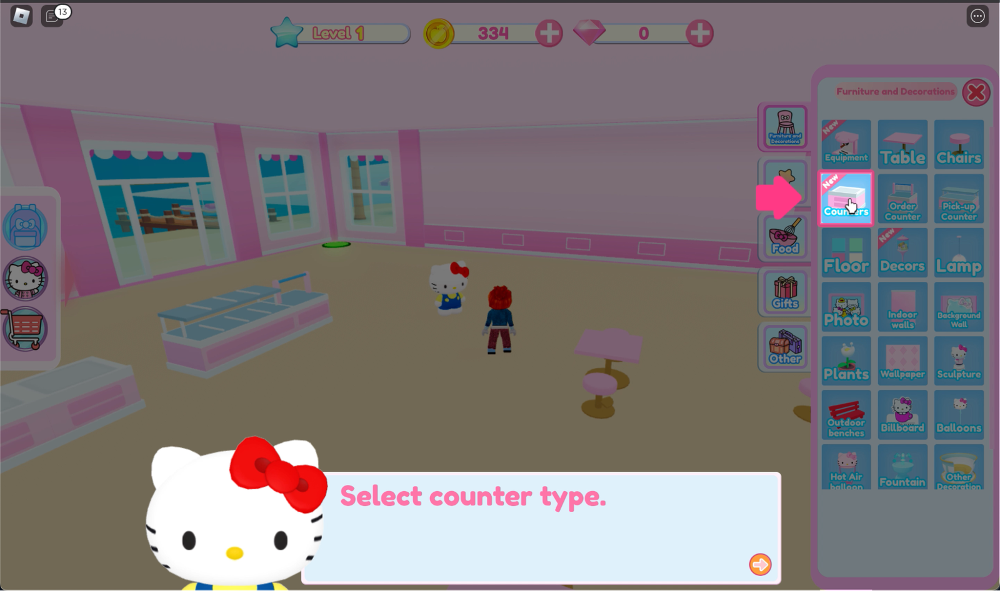 | `onboarding-highlights.png` *auf 1600 px Breite verkleinert (Original 1999×1182)* | Hello Kitty Cafe: Der gesuchte Button ist umrandet, ein Pfeil zeigt darauf, NPC-Dialog sagt was zu tun ist. | Highlights/Spotlights: Genau zeigen, wo geklickt werden soll, statt den Spieler suchen zu lassen. | [production/game-design/onboarding-techniques](https://create.roblox.com/docs/production/game-design/onboarding-techniques) | [`content/en-us/assets/game-design/onboarding-techniques/visual-elements-3.png`](https://github.com/Roblox/creator-docs/blob/4e795e65a41fd48624fd85442292a81baa6bb3f5/content/en-us/assets/game-design/onboarding-techniques/visual-elements-3.png) |
| 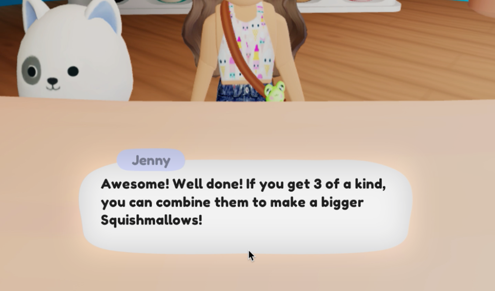 | `onboarding-kontext-tutorial.png` | Squishmallows: NPC-Dialog erklärt das Kombinieren genau dann, wenn der Spieler gleiche Figuren besitzt. | Kontextuelle Tutorials: Mechaniken erst erklären, wenn sie relevant werden. | [production/game-design/onboarding-techniques](https://create.roblox.com/docs/production/game-design/onboarding-techniques) | [`content/en-us/assets/game-design/onboarding-techniques/contextual-tutorial-1.png`](https://github.com/Roblox/creator-docs/blob/4e795e65a41fd48624fd85442292a81baa6bb3f5/content/en-us/assets/game-design/onboarding-techniques/contextual-tutorial-1.png) |
| 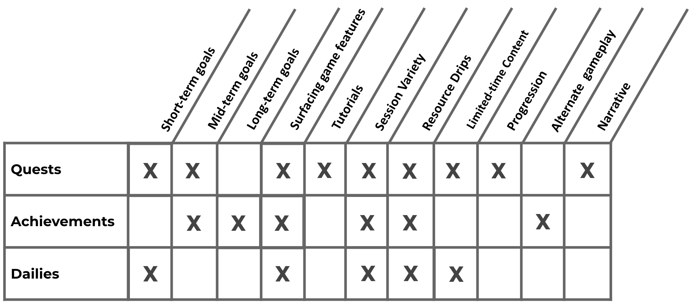 | `quests-achievements-dailies-matrix.png` | Matrix, welche Ziele Quests, Achievements und Dailies jeweils abdecken (kurz-/mittel-/langfristige Ziele, Tutorials, Resource Drip, Narrative …). | Quest-Typen gezielt nach Designzweck auswählen und kombinieren. | [production/game-design/introduction-to-quest-design](https://create.roblox.com/docs/production/game-design/introduction-to-quest-design) | [`content/en-us/assets/game-design/introduction-to-quest-design/quest-design-2.png`](https://github.com/Roblox/creator-docs/blob/4e795e65a41fd48624fd85442292a81baa6bb3f5/content/en-us/assets/game-design/introduction-to-quest-design/quest-design-2.png) |
| 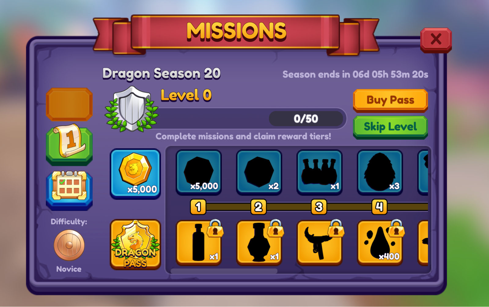 | `quests-missionen-progression.png` *auf 1600 px Breite verkleinert (Original 1999×1255)* | Missions-UI aus Dragon Adventures mit Saison-Level, Fortschrittsbalken und gestaffelten Belohnungs-Tiles. | Missionen als Progressionsmotor: sichtbarer Fortschritt + gestaffelte Belohnungen. | [production/game-design/introduction-to-quest-design](https://create.roblox.com/docs/production/game-design/introduction-to-quest-design) | [`content/en-us/assets/game-design/introduction-to-quest-design/quest-design-11.png`](https://github.com/Roblox/creator-docs/blob/4e795e65a41fd48624fd85442292a81baa6bb3f5/content/en-us/assets/game-design/introduction-to-quest-design/quest-design-11.png) |
| 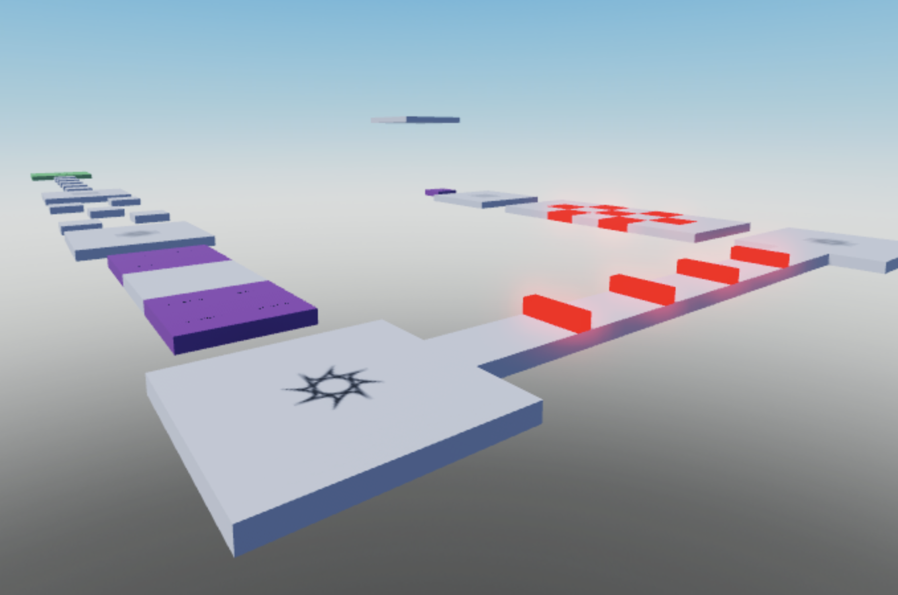 | `prototyp-greybox-obby.png` | Greybox-Obby aus einfachen grauen, lila und roten Parts ohne Deko. | Prototypen zuerst in Greybox testen – Spaß und Schwierigkeit vor Optik. | [production/game-design/prototyping](https://create.roblox.com/docs/production/game-design/prototyping) | [`content/en-us/assets/game-design/prototyping/prototyping-3.png`](https://github.com/Roblox/creator-docs/blob/4e795e65a41fd48624fd85442292a81baa6bb3f5/content/en-us/assets/game-design/prototyping/prototyping-3.png) |
| 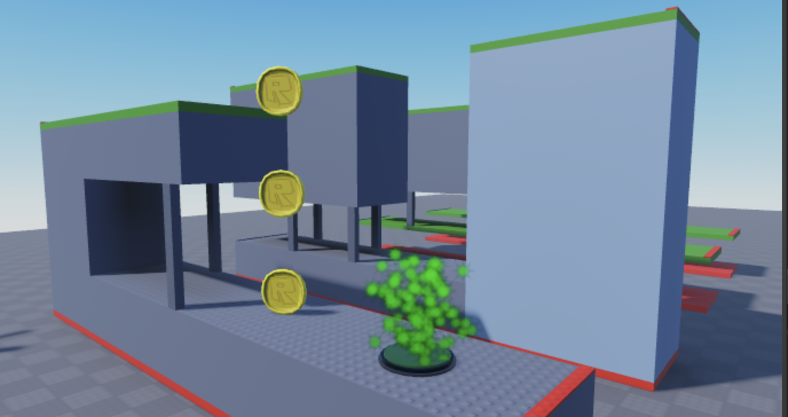 | `prototyp-obby-ausgearbeitet.png` | Weiterentwickelter Obby-Prototyp mit Texturen, Münzen und Partikel-Effekt. | Iteration: erst wenn der Kern funktioniert, Belohnungen und Feedback ergänzen. | [production/game-design/prototyping](https://create.roblox.com/docs/production/game-design/prototyping) | [`content/en-us/assets/game-design/prototyping/prototyping-4.png`](https://github.com/Roblox/creator-docs/blob/4e795e65a41fd48624fd85442292a81baa6bb3f5/content/en-us/assets/game-design/prototyping/prototyping-4.png) |

## Monetarisierung, Shop-UI, Wirtschaft & Live Ops

| Vorschau | Datei | Was es zeigt | Designlehre | Original-Doku-Seite | Originaldatei-Pfad |
|---|---|---|---|---|---|
| 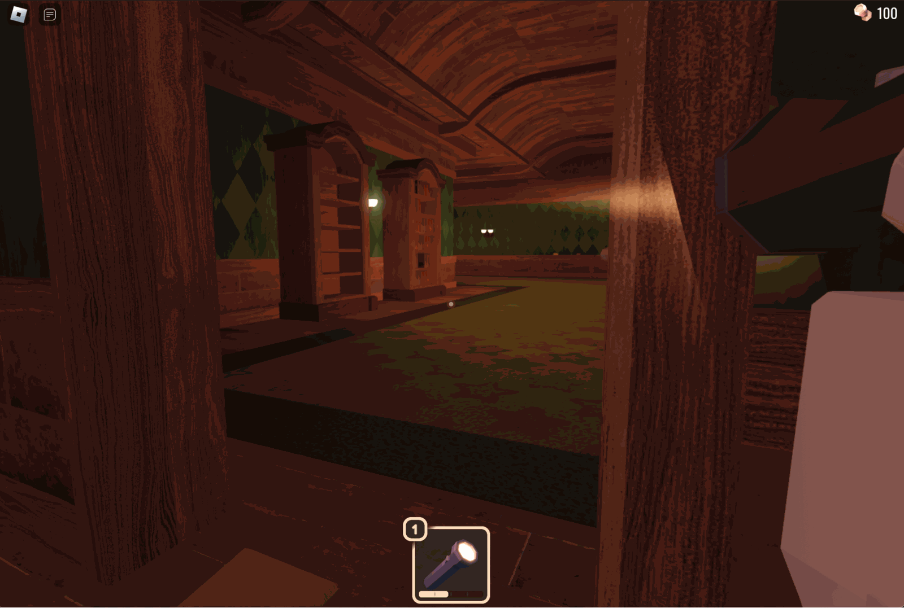 | `monetarisierung-item-zweck-taschenlampe.png` *auf 1600 px Breite verkleinert (Original 1999×1346)* | Doors: Spieler hält eine gekaufte Taschenlampe (Hotbar-Slot unten), um dunkle Räume auszuleuchten. | Jedes verkaufte Item braucht einen klaren, sofort verständlichen Zweck im Gameplay. | [production/game-design/monetization-foundations](https://create.roblox.com/docs/production/game-design/monetization-foundations) | [`content/en-us/assets/game-design/monetization-foundations/monetization-foundation-0.png`](https://github.com/Roblox/creator-docs/blob/4e795e65a41fd48624fd85442292a81baa6bb3f5/content/en-us/assets/game-design/monetization-foundations/monetization-foundation-0.png) |
|  | `season-pass-integriert-store-tab.png` | Season-Pass-Fenster aus Bot Clash Simulator mit Tabs Rewards/Missions/Store; ein Pfeil hebt den Store-Tab hervor. | Season Pass gut auffindbar und stilistisch integriert gestalten, klar vom restlichen Shop unterscheidbar. | [production/game-design/monetization-foundations](https://create.roblox.com/docs/production/game-design/monetization-foundations) | [`content/en-us/assets/game-design/monetization-foundations/monetization-foundation-18.png`](https://github.com/Roblox/creator-docs/blob/4e795e65a41fd48624fd85442292a81baa6bb3f5/content/en-us/assets/game-design/monetization-foundations/monetization-foundation-18.png) |
| 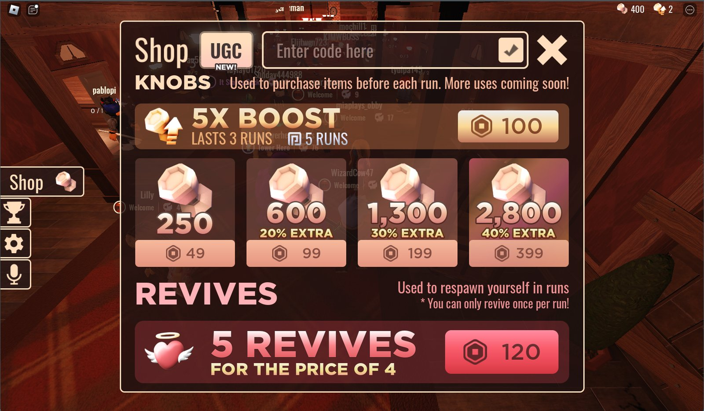 | `kontextkauf-vor-dem-spiel.jpg` *auf 1600 px Breite verkleinert (Original 1645×961), als JPG gespeichert* | Doors Pre-Run-Shop: Boosts, Knobs-Pakete und Revives werden direkt vor jeder Runde angeboten. | Pre-Play-Kontextkäufe: Verbrauchsgüter genau dann anbieten, wenn ihr Nutzen am klarsten ist. | [production/game-design/contextual-purchases](https://create.roblox.com/docs/production/game-design/contextual-purchases) | [`content/en-us/assets/game-design/contextual-purchases/contextual-purchases-3.png`](https://github.com/Roblox/creator-docs/blob/4e795e65a41fd48624fd85442292a81baa6bb3f5/content/en-us/assets/game-design/contextual-purchases/contextual-purchases-3.png) |
| 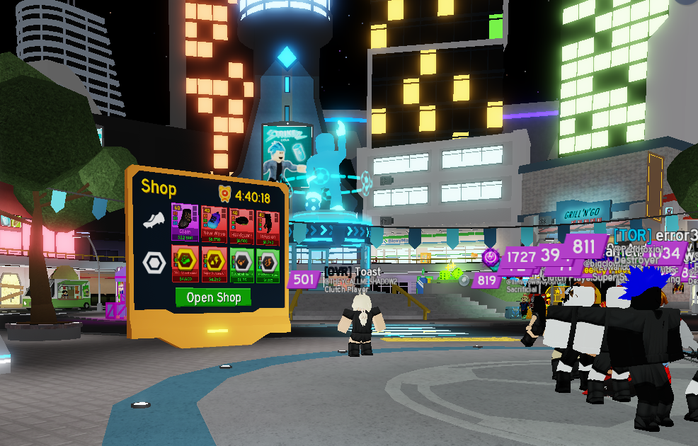 | `kontextkauf-lobby.png` | Super Striker League: 3D-Shop-Automat in der Lobby zeigt Angebote mit Countdown und „Open Shop“. | Lobby-Kontextkäufe über 3D-Objekte in der Welt bewerben; klar machen, ob das das ganze Sortiment ist. | [production/game-design/contextual-purchases](https://create.roblox.com/docs/production/game-design/contextual-purchases) | [`content/en-us/assets/game-design/contextual-purchases/contextual-purchases-5.png`](https://github.com/Roblox/creator-docs/blob/4e795e65a41fd48624fd85442292a81baa6bb3f5/content/en-us/assets/game-design/contextual-purchases/contextual-purchases-5.png) |
|  | `season-pass-uebersicht-jailbreak.png` | Jailbreak Season 13: zehn Stufen mit Belohnungen, darunter Season-Pass-Exklusivbelohnungen, Kauf- und Geschenk-Button. | Free- vs. Premium-Spur sichtbar nebeneinander – zeigt, was man mit dem Pass zusätzlich bekommt (auch in Onboarding- und Monetarisierungs-Doku verwendet). | [production/game-design/season-pass-design](https://create.roblox.com/docs/production/game-design/season-pass-design) | [`content/en-us/assets/game-design/season-pass-design/season-pass-design-0.png`](https://github.com/Roblox/creator-docs/blob/4e795e65a41fd48624fd85442292a81baa6bb3f5/content/en-us/assets/game-design/season-pass-design/season-pass-design-0.png) |
|  | `season-pass-stufen.png` | Jailbreak Season 15: die Reihe der zehn Season-Tiers ist hervorgehoben. | Etwa zehn Tiers als Startpunkt – häufige Fortschrittsmomente, aber nicht abschreckend lang. | [production/game-design/season-pass-design](https://create.roblox.com/docs/production/game-design/season-pass-design) | [`content/en-us/assets/game-design/season-pass-design/season-pass-design-5.png`](https://github.com/Roblox/creator-docs/blob/4e795e65a41fd48624fd85442292a81baa6bb3f5/content/en-us/assets/game-design/season-pass-design/season-pass-design-5.png) |
| 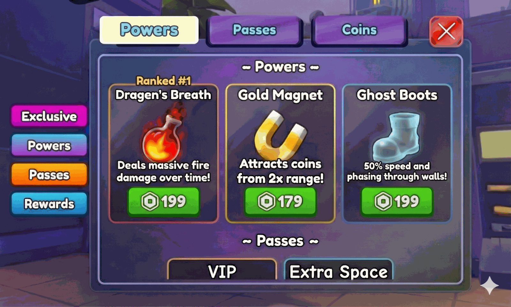 | `shop-items-nach-spieler-gerankt.png` *neu komprimiert* | In-Game-Shop, in dem drei Power-Items für den jeweiligen Spieler gerankt angezeigt werden („Ranked #1“). | Personalisierte Shop-Reihenfolge (RankProductsAsync) erhöht Relevanz der Angebote. | [production/monetization/developer-products](https://create.roblox.com/docs/production/monetization/developer-products) | [`content/en-us/assets/monetization/developer-products/RankedItems.png`](https://github.com/Roblox/creator-docs/blob/4e795e65a41fd48624fd85442292a81baa6bb3f5/content/en-us/assets/monetization/developer-products/RankedItems.png) |
| 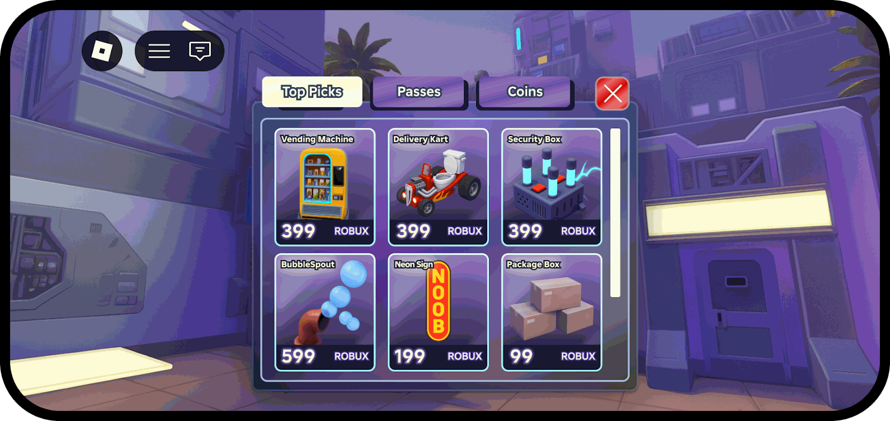 | `shop-top-picks-tab.png` *neu komprimiert* | Mobiler Shop mit „Top Picks“-Tab vor Passes und Coins. | Ein kuratierter Top-Picks-Tab als erste Shop-Seite verkürzt den Weg zum Kauf. | [production/monetization/developer-products](https://create.roblox.com/docs/production/monetization/developer-products) | [`content/en-us/assets/monetization/developer-products/StoreTopPicks.png`](https://github.com/Roblox/creator-docs/blob/4e795e65a41fd48624fd85442292a81baa6bb3f5/content/en-us/assets/monetization/developer-products/StoreTopPicks.png) |
| 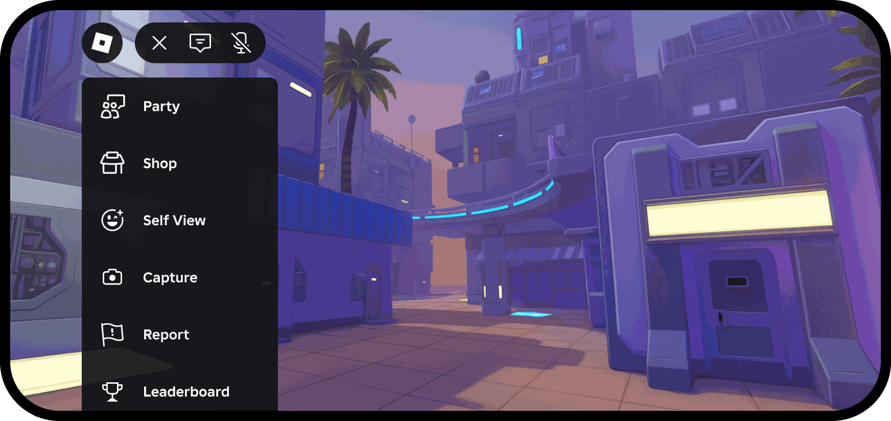 | `shop-ingame-menue.png` *auf 1600 px Breite verkleinert (Original 1744×826)* | Roblox-In-Game-Menü mit dem standardmäßigen Eintrag „Shop“. | Der Roblox-Shop ist zusätzlich über das Systemmenü erreichbar – bei eigener Shop-UI bewusst entscheiden. | [production/monetization/shop](https://create.roblox.com/docs/production/monetization/shop) | [`content/en-us/assets/monetization/shop/Shop-In-Game-Menu.png`](https://github.com/Roblox/creator-docs/blob/4e795e65a41fd48624fd85442292a81baa6bb3f5/content/en-us/assets/monetization/shop/Shop-In-Game-Menu.png) |
|  | `wirtschaft-event-unbalanciert.png` | Diagramm „Event Day – Not balanced“: Gold Spent schießt ab Stunde 13 hoch, Gold Purchased bleibt flach. | Ohne Vorab-Schätzung erzeugt ein Event Währungsüberschuss und Inflation. | [production/game-design/balance-virtual-economies](https://create.roblox.com/docs/production/game-design/balance-virtual-economies) | [`content/en-us/assets/game-design/balancing-virtual-economies/balancing-virtual-economies-1.png`](https://github.com/Roblox/creator-docs/blob/4e795e65a41fd48624fd85442292a81baa6bb3f5/content/en-us/assets/game-design/balancing-virtual-economies/balancing-virtual-economies-1.png) |
|  | `wirtschaft-event-balanciert.png` | Diagramm „Event Day – Balanced“: Gold Purchased und Gold Spent steigen gemeinsam. | Quellen und Senken im Gleichgewicht halten, z. B. mit eigener Event-Währung und Event-Shop. | [production/game-design/balance-virtual-economies](https://create.roblox.com/docs/production/game-design/balance-virtual-economies) | [`content/en-us/assets/game-design/balancing-virtual-economies/balancing-virtual-economies-4.png`](https://github.com/Roblox/creator-docs/blob/4e795e65a41fd48624fd85442292a81baa6bb3f5/content/en-us/assets/game-design/balancing-virtual-economies/balancing-virtual-economies-4.png) |
|  | `liveops-content-kadenz.png` | Update-Banner „The Dream Home Update!“ (Jailbreak) mit Liste neuer Features. | Regelmäßige Content-Kadenz und klare Kommunikation neuer Inhalte halten Spieler zwischen großen Updates. | [production/game-design/liveops-essentials](https://create.roblox.com/docs/production/game-design/liveops-essentials) | [`content/en-us/assets/game-design/live-ops/live-ops-1.png`](https://github.com/Roblox/creator-docs/blob/4e795e65a41fd48624fd85442292a81baa6bb3f5/content/en-us/assets/game-design/live-ops/live-ops-1.png) |
|  | `liveops-planung-angelturnier.jpg` *als JPG gespeichert* | In-Game-Event „Fishing Tournament“ mit Live-Leaderboard und Top-Preisen. | Live-Events planen: gewünschte Spieleraktionen, beeinflusste KPIs und Auswirkungen auf die Wirtschaft vorab definieren. | [production/game-design/liveops-planning](https://create.roblox.com/docs/production/game-design/liveops-planning) | [`content/en-us/assets/game-design/live-ops-planning/live-ops-planning.png`](https://github.com/Roblox/creator-docs/blob/4e795e65a41fd48624fd85442292a81baa6bb3f5/content/en-us/assets/game-design/live-ops-planning/live-ops-planning.png) |

## Analytics-Dashboards (Retention, Funnels, Economy, Benchmarks, Experimente)

| Vorschau | Datei | Was es zeigt | Designlehre | Original-Doku-Seite | Originaldatei-Pfad |
|---|---|---|---|---|---|
| 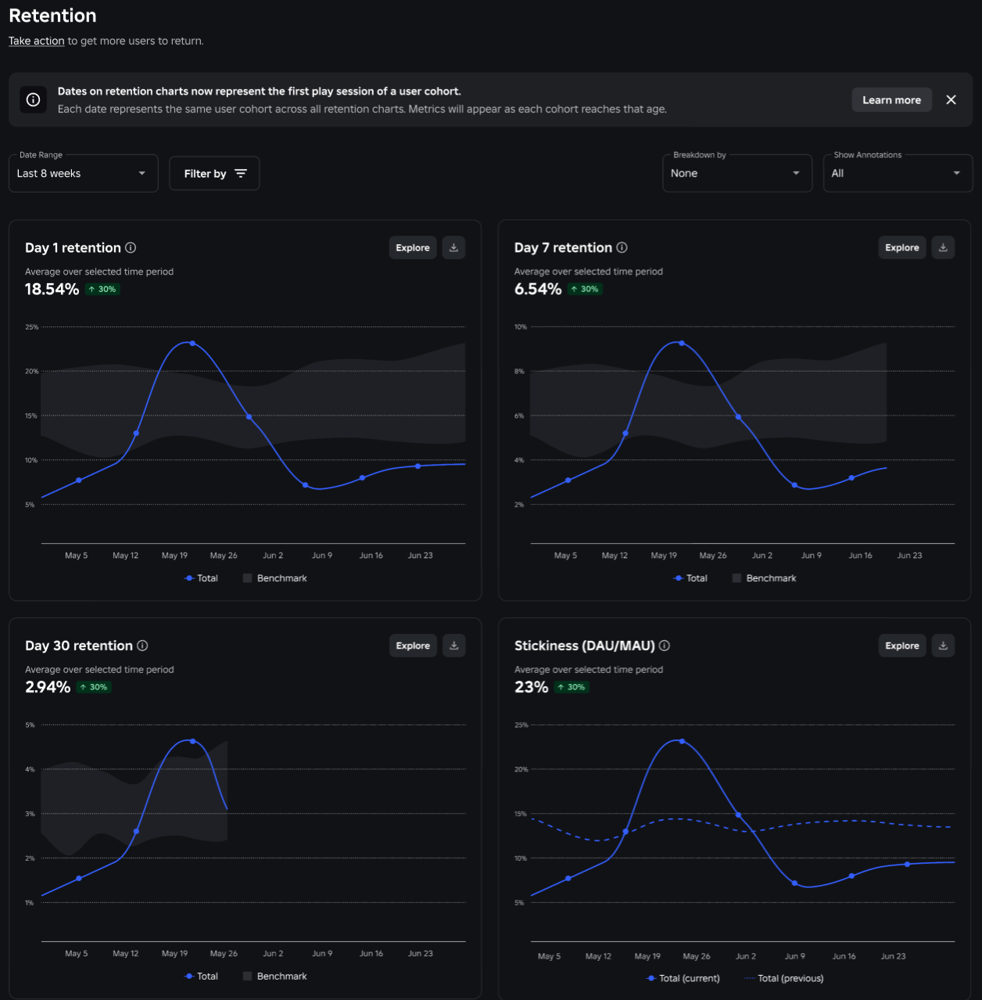 | `retention-diagramm.png` | Retention-Dashboard mit D1-, D7-, D30-Retention und Stickiness (DAU/MAU), inkl. Benchmark-Band. | Retention über mehrere Zeiträume lesen; Einbrüche nach großen Neuspieler-Wellen sind normal. | [production/analytics/retention](https://create.roblox.com/docs/production/analytics/retention) | [`content/en-us/assets/analytics/retention/AnalyticsRetentionChart.png`](https://github.com/Roblox/creator-docs/blob/4e795e65a41fd48624fd85442292a81baa6bb3f5/content/en-us/assets/analytics/retention/AnalyticsRetentionChart.png) |
| 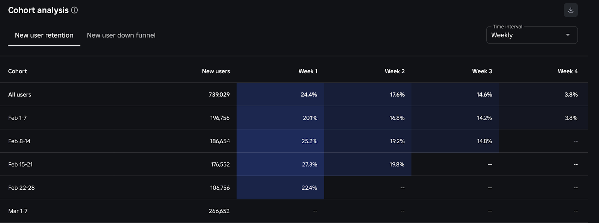 | `retention-kohortenanalyse.png` | Kohortentabelle (wöchentlich): neue Nutzer pro Woche und Retention in Woche 1–4. | Kohorten vergleichen, um den Effekt von Updates, Events oder Kampagnen zu messen. | [production/analytics/retention](https://create.roblox.com/docs/production/analytics/retention) | [`content/en-us/assets/analytics/retention/CohortAnalysis.png`](https://github.com/Roblox/creator-docs/blob/4e795e65a41fd48624fd85442292a81baa6bb3f5/content/en-us/assets/analytics/retention/CohortAnalysis.png) |
| 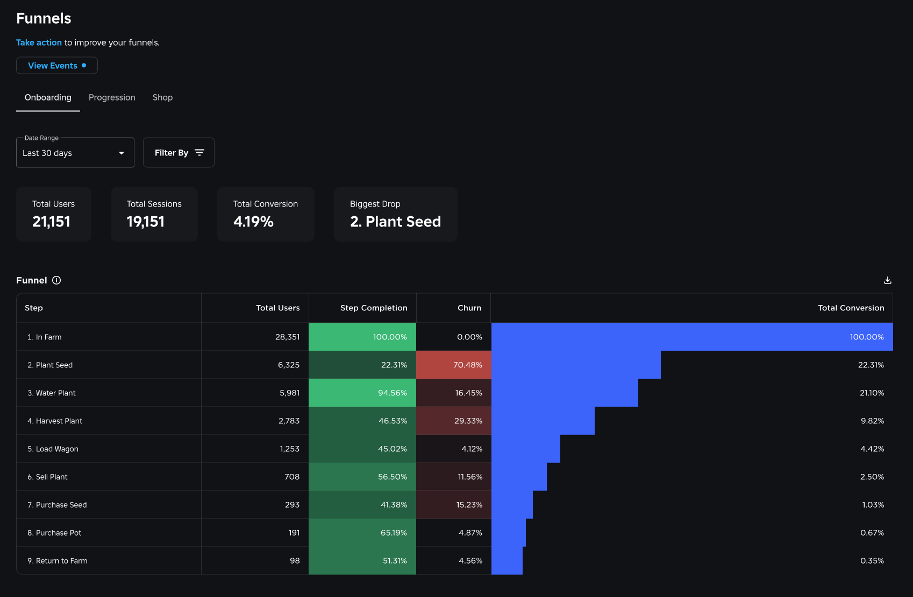 | `funnel-pflanzenspiel-dropoff.png` | Onboarding-Funnel des Beispiel-Pflanzenspiels: 70 % Drop-off zwischen „In Farm“ und „Plant Seed“. | Funnels zeigen den größten Abbruchschritt – dort zuerst das Onboarding verbessern. | [production/analytics/funnel-events](https://create.roblox.com/docs/production/analytics/funnel-events) | [`content/en-us/assets/analytics/event-types/Plant-Game-Funnel.png`](https://github.com/Roblox/creator-docs/blob/4e795e65a41fd48624fd85442292a81baa6bb3f5/content/en-us/assets/analytics/event-types/Plant-Game-Funnel.png) |
| 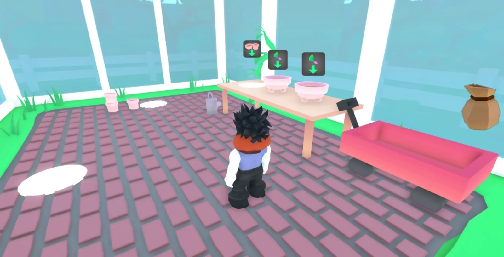 | `funnel-pflanzenspiel-ingame-prompts.png` *auf 1600 px Breite verkleinert (Original 1875×956)* | Die Gegenmaßnahme im Spiel: Pfeil-Prompts über den Blumentöpfen zeigen, wo gepflanzt wird. | Datengetriebene Iteration: Funnel-Erkenntnis → konkreter In-Game-Hinweis. | [production/analytics/funnel-events](https://create.roblox.com/docs/production/analytics/funnel-events) | [`content/en-us/assets/analytics/event-types/Plant-Game-Prompts.png`](https://github.com/Roblox/creator-docs/blob/4e795e65a41fd48624fd85442292a81baa6bb3f5/content/en-us/assets/analytics/event-types/Plant-Game-Prompts.png) |
| 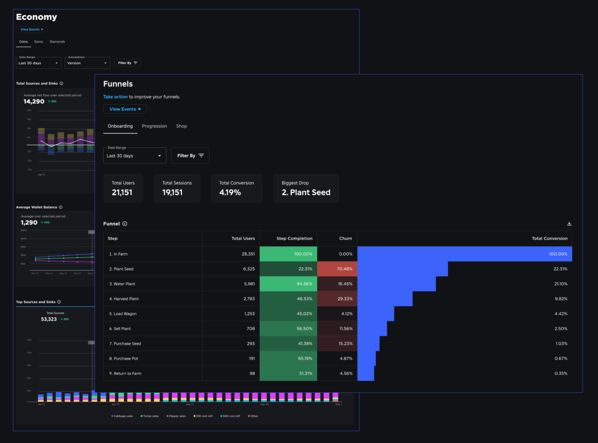 | `economy-und-funnel-dashboards.png` | Economy- und Funnels-Dashboard übereinander, gefüllt mit Daten aus Economy- und Funnel-Events. | Mit wenigen Events (Economy + Funnel) entstehen sofort nutzbare Dashboards. | [production/analytics/event-types](https://create.roblox.com/docs/production/analytics/event-types) | [`content/en-us/assets/analytics/event-types/Overview-Economy-Funnels.png`](https://github.com/Roblox/creator-docs/blob/4e795e65a41fd48624fd85442292a81baa6bb3f5/content/en-us/assets/analytics/event-types/Overview-Economy-Funnels.png) |
| 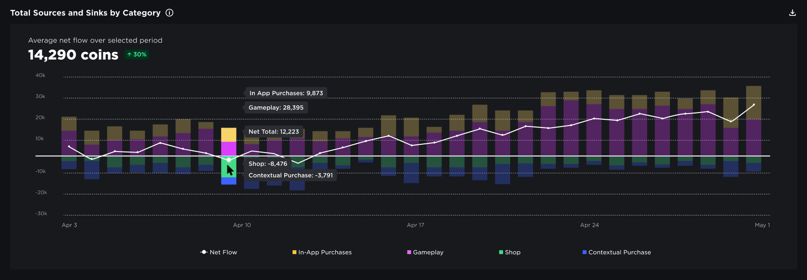 | `economy-quellen-senken-gesamt.png` | Gestapeltes Balkendiagramm aller Währungsquellen und -senken nach Kategorie mit Netto-Fluss-Linie. | Netto-Währungsfluss beobachten, um Inflation oder Mangel früh zu erkennen. | [production/analytics/economy-events](https://create.roblox.com/docs/production/analytics/economy-events) | [`content/en-us/assets/analytics/event-types/Total-Sources-Sinks.png`](https://github.com/Roblox/creator-docs/blob/4e795e65a41fd48624fd85442292a81baa6bb3f5/content/en-us/assets/analytics/event-types/Total-Sources-Sinks.png) |
|  | `economy-durchschnittliches-wallet.png` | Durchschnittliches Wallet-Guthaben über Zeit, getrennt nach Zahlern, allen Nutzern und Nicht-Zahlern. | Steigende Guthaben = zu wenige Senken; Segmentvergleich zeigt, wen es betrifft. | [production/analytics/economy-events](https://create.roblox.com/docs/production/analytics/economy-events) | [`content/en-us/assets/analytics/event-types/Average-Wallet.png`](https://github.com/Roblox/creator-docs/blob/4e795e65a41fd48624fd85442292a81baa6bb3f5/content/en-us/assets/analytics/event-types/Average-Wallet.png) |
| 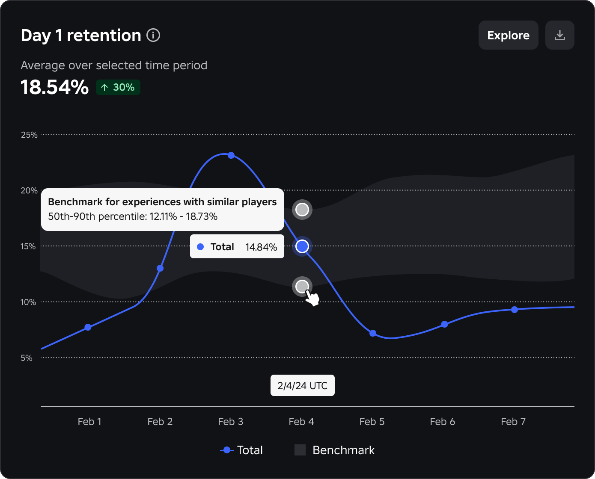 | `benchmark-aehnliche-spiele-d7.png` | Retention-Chart mit Benchmark-Band „experiences with similar players“ (50.–90. Perzentil) und Tooltip. | Eigene Kennzahlen immer gegen vergleichbare Spiele einordnen. | [production/analytics/analytics-dashboard](https://create.roblox.com/docs/production/analytics/analytics-dashboard) | [`content/en-us/assets/analytics/analytics-dashboard/benchmark-similar-exp.png`](https://github.com/Roblox/creator-docs/blob/4e795e65a41fd48624fd85442292a81baa6bb3f5/content/en-us/assets/analytics/analytics-dashboard/benchmark-similar-exp.png) |
| 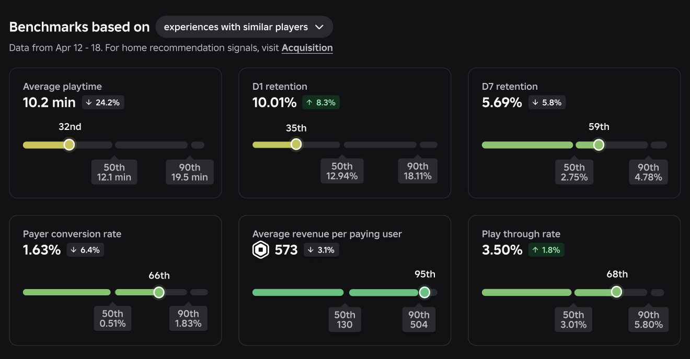 | `benchmark-scorecard-uebersicht.png` | Benchmark-Scorecard: Playtime, D1/D7-Retention, Payer Conversion, ARPPU, Play-Through-Rate mit Perzentil-Reglern. | Scorecards zeigen, welcher Bereich (Engagement, Monetarisierung, Akquise) am meisten Potenzial hat. | [production/analytics/index](https://create.roblox.com/docs/production/analytics) | [`content/en-us/assets/analytics/overview/Benchmarks-Similar.png`](https://github.com/Roblox/creator-docs/blob/4e795e65a41fd48624fd85442292a81baa6bb3f5/content/en-us/assets/analytics/overview/Benchmarks-Similar.png) |
| 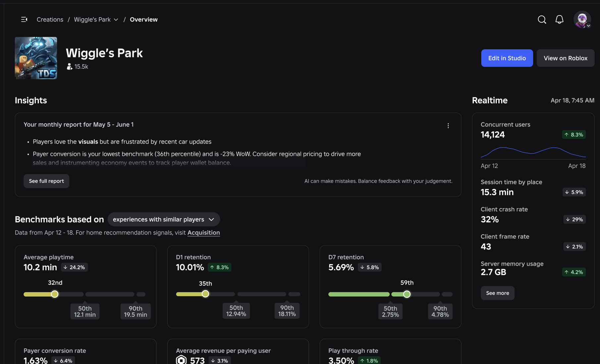 | `wachstum-uebersichtsseite.png` | Spielübersicht im Creator Hub mit KI-Insights, Benchmarks und Echtzeit-Werten (CCU, Crash-Rate, Frame-Rate). | Wöchentliche Routine: Übersicht prüfen, große Bewegungen erkennen, dann gezielt vertiefen. | [production/analytics/index](https://create.roblox.com/docs/production/analytics) | [`content/en-us/assets/analytics/overview/step3.png`](https://github.com/Roblox/creator-docs/blob/4e795e65a41fd48624fd85442292a81baa6bb3f5/content/en-us/assets/analytics/overview/step3.png) |
|  | `akquise-neue-nutzer-funnel.png` | Tabelle „New users funnel“ nach Quelle (Home Recommendation, Search, Friends, Sponsored Ads …) mit Conversion, D7-Retention, Playtime, Revenue. | Akquisequellen nach Qualität vergleichen, nicht nur nach Menge. | [production/analytics/acquisition](https://create.roblox.com/docs/production/analytics/acquisition) | [`content/en-us/assets/analytics/acquisition/New-Users-Funnel.png`](https://github.com/Roblox/creator-docs/blob/4e795e65a41fd48624fd85442292a81baa6bb3f5/content/en-us/assets/analytics/acquisition/New-Users-Funnel.png) |
| 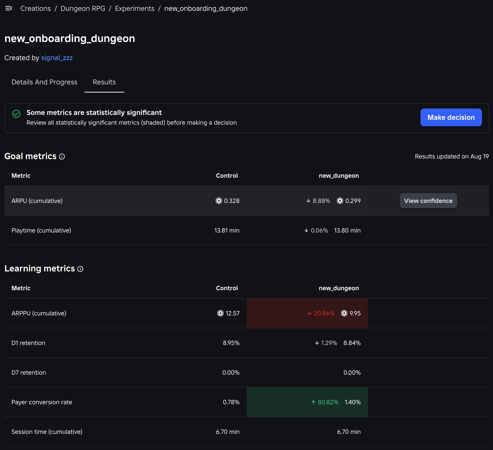 | `experiment-ergebnisse.png` | Ergebnisseite eines A/B-Experiments („new_onboarding_dungeon“) mit signifikanten Ziel- und Lernmetriken grün/rot markiert. | Nur statistisch signifikante Änderungen interpretieren; Ziel- und Leitplanken-Metriken getrennt betrachten. | [production/experiments](https://create.roblox.com/docs/production/experiments) | [`content/en-us/assets/analytics/configs/experiment-results.png`](https://github.com/Roblox/creator-docs/blob/4e795e65a41fd48624fd85442292a81baa6bb3f5/content/en-us/assets/analytics/configs/experiment-results.png) |
|  | `custom-dashboard-beispiel.png` | Eigenes Dashboard „Player Progression“ mit Summary-Cards und vier Charts (Waffen-Siege, Spielzeit pro Welt, Spieleranteil pro Welt, Erst-Session-Retention). | Eigene Dashboards für die zentrale Spielfrage bauen statt in Standardseiten zu suchen. | [production/analytics/custom-dashboards](https://create.roblox.com/docs/production/analytics/custom-dashboards) | [`content/en-us/assets/analytics/custom-dashboards/Custom-dashboard.png`](https://github.com/Roblox/creator-docs/blob/4e795e65a41fd48624fd85442292a81baa6bb3f5/content/en-us/assets/analytics/custom-dashboards/Custom-dashboard.png) |

## Discovery (Empfehlungsalgorithmus, Thumbnails, Icons)

| Vorschau | Datei | Was es zeigt | Designlehre | Original-Doku-Seite | Originaldatei-Pfad |
|---|---|---|---|---|---|
|  | `empfehlung-retrieval-ranking-diagramm.png` | Diagramm des Empfehlungssystems: alle Spiele → Candidate Generators (Ads, Today's Picks, Search, Charts, Friends …) → Ranking → Home „Recommended For You“. | Discovery ist zweistufig: erst Kandidat werden (Engagement-Signale), dann gut ranken. | [discovery](https://create.roblox.com/docs/discovery) | [`content/en-us/assets/analytics/discovery/Retrieval-And-Ranking-Diagram.png`](https://github.com/Roblox/creator-docs/blob/4e795e65a41fd48624fd85442292a81baa6bb3f5/content/en-us/assets/analytics/discovery/Retrieval-And-Ranking-Diagram.png) |
|  | `home-empfehlung-signale.png` | Dashboard „Home recommendation signals“ mit Play-Through-Rate und First-Play-Bounce-Rate inkl. Benchmark. | Thumbnail/Icon (PTR) und die ersten Minuten (Bounce) bestimmen die Home-Reichweite. | [discovery](https://create.roblox.com/docs/discovery) | [`content/en-us/assets/analytics/discovery/Home-Recommendation-Signals.png`](https://github.com/Roblox/creator-docs/blob/4e795e65a41fd48624fd85442292a81baa6bb3f5/content/en-us/assets/analytics/discovery/Home-Recommendation-Signals.png) |
|  | `thumbnail-relevant-urban-rush.jpg` | Gutes Thumbnail: Sportwagen und Helikopter vor Lichtstreifen – vermittelt sofort ein actionreiches Urban-Racing-Spiel. | Thumbnails müssen das Gameplay-Versprechen klar und relevant zeigen. | [production/publishing/thumbnails](https://create.roblox.com/docs/production/publishing/thumbnails) | [`content/en-us/assets/publishing/experience-metadata/Thumbnail-Urban-Rush.jpg`](https://github.com/Roblox/creator-docs/blob/4e795e65a41fd48624fd85442292a81baa6bb3f5/content/en-us/assets/publishing/experience-metadata/Thumbnail-Urban-Rush.jpg) |
|  | `thumbnail-unklar-schlecht.jpg` | Schlechtes Thumbnail: unklare Hochhaus-Szene mit zusammenhanglosem Schneeflocken-Logo oben rechts. | Unklare Motive und beliebige Grafik-Overlays senken die Klickrate. | [production/publishing/thumbnails](https://create.roblox.com/docs/production/publishing/thumbnails) | [`content/en-us/assets/publishing/experience-metadata/Thumbnail-Unclear.jpg`](https://github.com/Roblox/creator-docs/blob/4e795e65a41fd48624fd85442292a81baa6bb3f5/content/en-us/assets/publishing/experience-metadata/Thumbnail-Unclear.jpg) |
|  | `thumbnail-thema-komisch.jpg` | Thumbnail mit comichafter Figur, Hut-Turm und hellen Farben. | Farbstimmung und Stil an das Spielthema anpassen (lustig = hell, gesättigt). | [production/publishing/thumbnails](https://create.roblox.com/docs/production/publishing/thumbnails) | [`content/en-us/assets/publishing/experience-metadata/Thumbnail-Theme-Comical.jpg`](https://github.com/Roblox/creator-docs/blob/4e795e65a41fd48624fd85442292a81baa6bb3f5/content/en-us/assets/publishing/experience-metadata/Thumbnail-Theme-Comical.jpg) |
|  | `thumbnail-thema-horror.jpg` | Dunkles Horror-Thumbnail: Haus unter violettem Gewittersturm. | Horror-Spiele kommunizieren Stimmung über dunkle Palette und Kontrast. | [production/publishing/thumbnails](https://create.roblox.com/docs/production/publishing/thumbnails) | [`content/en-us/assets/publishing/experience-metadata/Thumbnail-Theme-Horror.jpg`](https://github.com/Roblox/creator-docs/blob/4e795e65a41fd48624fd85442292a81baa6bb3f5/content/en-us/assets/publishing/experience-metadata/Thumbnail-Theme-Horror.jpg) |
|  | `thumbnail-impressionen-graph.png` | Graph „Impressions by thumbnail“: drei aktive Thumbnails mit unterschiedlichen Impressionen über Zeit. | Mehrere Thumbnails aktiv lassen – Roblox personalisiert und man sieht, welches besser performt. | [production/publishing/thumbnails](https://create.roblox.com/docs/production/publishing/thumbnails) | [`content/en-us/assets/publishing/experience-metadata/Thumbnail-Impressions-Graph.png`](https://github.com/Roblox/creator-docs/blob/4e795e65a41fd48624fd85442292a81baa6bb3f5/content/en-us/assets/publishing/experience-metadata/Thumbnail-Impressions-Graph.png) |
|  | `icon-hohe-aufloesung.jpg` *neu komprimiert* | Scharfes, hochauflösendes quadratisches Icon (Helikopter über Lichtspuren). | Icons in hoher Auflösung (512×512+) hochladen – Vorher/Nachher mit dem unscharfen Icon. | [production/publishing/experience-icons](https://create.roblox.com/docs/production/publishing/experience-icons) | [`content/en-us/assets/publishing/experience-metadata/Icon-High-Res.jpg`](https://github.com/Roblox/creator-docs/blob/4e795e65a41fd48624fd85442292a81baa6bb3f5/content/en-us/assets/publishing/experience-metadata/Icon-High-Res.jpg) |
|  | `icon-niedrige-aufloesung.jpg` | Dasselbe Icon unscharf und niedrig aufgelöst. | Verschwommene Icons wirken unprofessionell und werden weniger geklickt. | [production/publishing/experience-icons](https://create.roblox.com/docs/production/publishing/experience-icons) | [`content/en-us/assets/publishing/experience-metadata/Icon-Low-Res.jpg`](https://github.com/Roblox/creator-docs/blob/4e795e65a41fd48624fd85442292a81baa6bb3f5/content/en-us/assets/publishing/experience-metadata/Icon-Low-Res.jpg) |
|  | `icon-relevant-freizeitpark.jpg` | Gutes Icon: Avatare in einer Achterbahn – Freizeitpark-Thema sofort erkennbar. | Icons zeigen den Kern des Spiels mit Figuren und Aktion. | [production/publishing/experience-icons](https://create.roblox.com/docs/production/publishing/experience-icons) | [`content/en-us/assets/publishing/experience-metadata/Icon-Theme-Park.jpg`](https://github.com/Roblox/creator-docs/blob/4e795e65a41fd48624fd85442292a81baa6bb3f5/content/en-us/assets/publishing/experience-metadata/Icon-Theme-Park.jpg) |
|  | `icon-mehrdeutiges-symbol.jpg` | Dasselbe Icon mit überflüssigem Schneeflocken-Symbol oben rechts. | Zusätzliche, mehrdeutige Grafiken verwässern die Aussage – weglassen. | [production/publishing/experience-icons](https://create.roblox.com/docs/production/publishing/experience-icons) | [`content/en-us/assets/publishing/experience-metadata/Icon-Theme-Park-Symbol.jpg`](https://github.com/Roblox/creator-docs/blob/4e795e65a41fd48624fd85442292a81baa6bb3f5/content/en-us/assets/publishing/experience-metadata/Icon-Theme-Park-Symbol.jpg) |
|  | `icon-farbe-fantasy-gesaettigt.jpg` | Icon mit hellen, gesättigten Blau-/Grüntönen für ein verträumtes Fantasy-Setting. | Farbwahl transportiert Genre und Stimmung. | [production/publishing/experience-icons](https://create.roblox.com/docs/production/publishing/experience-icons) | [`content/en-us/assets/publishing/experience-metadata/Icon-Colorization-A.jpg`](https://github.com/Roblox/creator-docs/blob/4e795e65a41fd48624fd85442292a81baa6bb3f5/content/en-us/assets/publishing/experience-metadata/Icon-Colorization-A.jpg) |
|  | `icon-farbe-horror-kontrast.jpg` | Gleiches Motiv in starkem Rot/Schwarz-Kontrast für ein Horror-Spiel. | Gleiche Komposition, andere Farbe = anderes Genre-Signal. | [production/publishing/experience-icons](https://create.roblox.com/docs/production/publishing/experience-icons) | [`content/en-us/assets/publishing/experience-metadata/Icon-Colorization-C.jpg`](https://github.com/Roblox/creator-docs/blob/4e795e65a41fd48624fd85442292a81baa6bb3f5/content/en-us/assets/publishing/experience-metadata/Icon-Colorization-C.jpg) |

## Level-Design & Umgebung (Greybox, Laser-Tag-Layout, Licht, Atmosphäre, Terrain)

| Vorschau | Datei | Was es zeigt | Designlehre | Original-Doku-Seite | Originaldatei-Pfad |
|---|---|---|---|---|---|
|  | `lasertag-layout-spawnzonen.jpg` | Draufsicht auf die Grundplatte: Spawnzonen beider Teams an gegenüberliegenden Enden. | Laser-Tag-Layout Schritt 1: Spawns symmetrisch und maximal entfernt platzieren. | [tutorials/curriculums/environmental-art/greybox-your-environment](https://create.roblox.com/docs/tutorials/curriculums/environmental-art/greybox-your-environment) | [`content/en-us/assets/tutorials/environmental-art-curriculum/Section1/ThreeLaneLayout-SpawnZones.jpg`](https://github.com/Roblox/creator-docs/blob/4e795e65a41fd48624fd85442292a81baa6bb3f5/content/en-us/assets/tutorials/environmental-art-curriculum/Section1/ThreeLaneLayout-SpawnZones.jpg) |
|  | `lasertag-layout-drei-hauptwege.jpg` | Drei Hauptwege (Interior, Middle, Exterior Primary Lane) verbinden die Spawnzonen. | Three-Lane-Layout: mehrere parallele Routen geben taktische Wahlmöglichkeiten. | [tutorials/curriculums/environmental-art/greybox-your-environment](https://create.roblox.com/docs/tutorials/curriculums/environmental-art/greybox-your-environment) | [`content/en-us/assets/tutorials/environmental-art-curriculum/Section1/ThreeLaneLayout-PrimaryLanes.jpg`](https://github.com/Roblox/creator-docs/blob/4e795e65a41fd48624fd85442292a81baa6bb3f5/content/en-us/assets/tutorials/environmental-art-curriculum/Section1/ThreeLaneLayout-PrimaryLanes.jpg) |
|  | `lasertag-layout-querwege.jpg` | Blaue Querwege kreuzen die drei Hauptwege. | Cross Lanes erlauben Spurwechsel und Flankenmanöver. | [tutorials/curriculums/environmental-art/greybox-your-environment](https://create.roblox.com/docs/tutorials/curriculums/environmental-art/greybox-your-environment) | [`content/en-us/assets/tutorials/environmental-art-curriculum/Section1/ThreeLaneLayout-CrossLanes.jpg`](https://github.com/Roblox/creator-docs/blob/4e795e65a41fd48624fd85442292a81baa6bb3f5/content/en-us/assets/tutorials/environmental-art-curriculum/Section1/ThreeLaneLayout-CrossLanes.jpg) |
|  | `lasertag-layout-kreuzungspunkte.jpg` | Gelb hervorgehoben: Kreuzungspunkte zwischen Haupt- und Querwegen. | Kreuzungen sind natürliche Kampfzonen – dort Deckung und Interessantes platzieren. | [tutorials/curriculums/environmental-art/greybox-your-environment](https://create.roblox.com/docs/tutorials/curriculums/environmental-art/greybox-your-environment) | [`content/en-us/assets/tutorials/environmental-art-curriculum/Section1/ThreeLaneLayout-IntersectingPoints.jpg`](https://github.com/Roblox/creator-docs/blob/4e795e65a41fd48624fd85442292a81baa6bb3f5/content/en-us/assets/tutorials/environmental-art-curriculum/Section1/ThreeLaneLayout-IntersectingPoints.jpg) |
|  | `lasertag-greybox-gesamt.jpg` | Fertige Greybox-Geometrie mit eingeblendetem Wegenetz (orange Hauptwege, blaue Querwege, Spawns). | Das abstrakte Wegeschema direkt in Greybox-Wände und Räume übersetzen. | [tutorials/curriculums/environmental-art/greybox-your-environment](https://create.roblox.com/docs/tutorials/curriculums/environmental-art/greybox-your-environment) | [`content/en-us/assets/tutorials/environmental-art-curriculum/Section1/CreatingPlayableAreas-Intro1.jpg`](https://github.com/Roblox/creator-docs/blob/4e795e65a41fd48624fd85442292a81baa6bb3f5/content/en-us/assets/tutorials/environmental-art-curriculum/Section1/CreatingPlayableAreas-Intro1.jpg) |
|  | `lasertag-greybox-platzhalter-materialien.jpg` | Schräge Draufsicht auf die Greybox mit farbcodierten Platzhalter-Böden (rot/blau Teamseiten, grün Spawns, gelb Außenbereich). | Farbcodierung im Greybox macht Teamseiten und Zonen beim Playtest sofort lesbar. | [tutorials/curriculums/environmental-art/greybox-your-environment](https://create.roblox.com/docs/tutorials/curriculums/environmental-art/greybox-your-environment) | [`content/en-us/assets/tutorials/environmental-art-curriculum/Section1/PlaceholderMaterials.jpg`](https://github.com/Roblox/creator-docs/blob/4e795e65a41fd48624fd85442292a81baa6bb3f5/content/en-us/assets/tutorials/environmental-art-curriculum/Section1/PlaceholderMaterials.jpg) |
|  | `lasertag-spawnzone-ausgaenge.jpg` | Spawnzone mit Pfeilen zu mehreren Ausgängen in verschiedene Wege. | Mehrere Spawn-Ausgänge verhindern Spawn-Camping. | [tutorials/curriculums/environmental-art/greybox-your-environment](https://create.roblox.com/docs/tutorials/curriculums/environmental-art/greybox-your-environment) | [`content/en-us/assets/tutorials/environmental-art-curriculum/Section1/SpawnZone-ExitPoints.jpg`](https://github.com/Roblox/creator-docs/blob/4e795e65a41fd48624fd85442292a81baa6bb3f5/content/en-us/assets/tutorials/environmental-art-curriculum/Section1/SpawnZone-ExitPoints.jpg) |
|  | `lasertag-artstyle-referenzcollage.jpg` *als JPG gespeichert* | Moodboard für das Laser-Tag-Spiel: brutalistische Architektur, Basaltsäulen, Lochblech, Moos, Wasserfall, Farn. | Vor dem Asset-Bau einen Art Style mit Referenzbildern festlegen (Moodboard). | [tutorials/curriculums/environmental-art/develop-polished-assets](https://create.roblox.com/docs/tutorials/curriculums/environmental-art/develop-polished-assets) | [`content/en-us/assets/tutorials/environmental-art-curriculum/Section2/Art-Style.png`](https://github.com/Roblox/creator-docs/blob/4e795e65a41fd48624fd85442292a81baa6bb3f5/content/en-us/assets/tutorials/environmental-art-curriculum/Section2/Art-Style.png) |
|  | `lasertag-fertige-welt.jpg` *als JPG gespeichert* | Die fertig gebaute Laser-Tag-Arena: futuristisches Gebäude mit Türmen in grüner Felsenlandschaft. | Endergebnis Greybox → Asset-Bibliothek → fertige Welt zum Vergleich mit der Greybox. | [tutorials/curriculums/environmental-art/construct-your-world](https://create.roblox.com/docs/tutorials/curriculums/environmental-art/construct-your-world) | [`content/en-us/assets/tutorials/environmental-art-curriculum/Section4/Overview.png`](https://github.com/Roblox/creator-docs/blob/4e795e65a41fd48624fd85442292a81baa6bb3f5/content/en-us/assets/tutorials/environmental-art-curriculum/Section4/Overview.png) |
|  | `insel-sprungspiel-hoehenstufen.jpg` | Greybox des Island-Jump-Spiels: Zylinder-Plattformen in sieben beschrifteten Höhenstufen. | Vertikale Progression: jede Höhenstufe ist ein Schwierigkeits-/Fortschrittsschritt. | [tutorials/curriculums/core/building/greybox-a-playable-area](https://create.roblox.com/docs/tutorials/curriculums/core/building/greybox-a-playable-area) | [`content/en-us/assets/tutorials/block-out-a-playable-area/Platform-Levels.jpg`](https://github.com/Roblox/creator-docs/blob/4e795e65a41fd48624fd85442292a81baa6bb3f5/content/en-us/assets/tutorials/block-out-a-playable-area/Platform-Levels.jpg) |
|  | `lichtstil-realistic.jpg` | Bibliothek mit LightingStyle „Realistic“: kräftige Kerzenlichter, harte Schatten, Tiefe. | Lichttechnik-Vergleich: Realistic für stimmungsvolle, kontrastreiche Szenen. | [environment/lighting](https://create.roblox.com/docs/environment/lighting) | [`content/en-us/assets/lighting-and-effects/lighting-properties/LightingStyle-Realistic.jpg`](https://github.com/Roblox/creator-docs/blob/4e795e65a41fd48624fd85442292a81baa6bb3f5/content/en-us/assets/lighting-and-effects/lighting-properties/LightingStyle-Realistic.jpg) |
|  | `lichtstil-soft.jpg` | Dieselbe Bibliothek mit LightingStyle „Soft“: flacher, weicher, Retro-Roblox-Look. | Soft für stilisierte/kindliche Spiele und bessere Lesbarkeit. | [environment/lighting](https://create.roblox.com/docs/environment/lighting) | [`content/en-us/assets/lighting-and-effects/lighting-properties/LightingStyle-Soft.jpg`](https://github.com/Roblox/creator-docs/blob/4e795e65a41fd48624fd85442292a81baa6bb3f5/content/en-us/assets/lighting-and-effects/lighting-properties/LightingStyle-Soft.jpg) |
|  | `aussen-beleuchtung-vorher.jpg` *als JPG gespeichert* | Waldlichtung mit Lagerfeuer vor der Lichtbearbeitung: neutral, flach, Mittagslicht. | Vorher-Bild: Ohne Lichtdesign wirkt selbst gute Geometrie leblos. | [tutorials/use-case-tutorials/lighting/enhance-outdoor-environments](https://create.roblox.com/docs/tutorials/use-case-tutorials/lighting/enhance-outdoor-environments) | [`content/en-us/assets/tutorials/enhancing-outdoor-environments/Intro-Before.png`](https://github.com/Roblox/creator-docs/blob/4e795e65a41fd48624fd85442292a81baa6bb3f5/content/en-us/assets/tutorials/enhancing-outdoor-environments/Intro-Before.png) |
|  | `aussen-beleuchtung-nachher.jpg` *als JPG gespeichert* | Dieselbe Lichtung nach dem Tutorial: tiefe Sonne, warme Atmosphäre, Dunst, leuchtendes Feuer. | Tageszeit, Ambient-Farbe, Atmosphäre und lokale Lichter erzeugen Stimmung. | [tutorials/use-case-tutorials/lighting/enhance-outdoor-environments](https://create.roblox.com/docs/tutorials/use-case-tutorials/lighting/enhance-outdoor-environments) | [`content/en-us/assets/tutorials/enhancing-outdoor-environments/Intro-After.png`](https://github.com/Roblox/creator-docs/blob/4e795e65a41fd48624fd85442292a81baa6bb3f5/content/en-us/assets/tutorials/enhancing-outdoor-environments/Intro-After.png) |
|  | `innen-lichtleck-ohne-huelle.jpg` | Innenraum, dessen Mesh-Wände/Decke nicht mit Parts umschlossen sind: Außenlicht dringt ein und hellt alles auf. | Innenräume lichtdicht machen, sonst kontrolliert man die Innenbeleuchtung nicht. | [tutorials/use-case-tutorials/lighting/enhance-indoor-environments](https://create.roblox.com/docs/tutorials/use-case-tutorials/lighting/enhance-indoor-environments) | [`content/en-us/assets/tutorials/enhancing-indoor-environments/Cabin-NoParts.jpg`](https://github.com/Roblox/creator-docs/blob/4e795e65a41fd48624fd85442292a81baa6bb3f5/content/en-us/assets/tutorials/enhancing-indoor-environments/Cabin-NoParts.jpg) |
|  | `innen-lichtleck-mit-huelle.jpg` | Derselbe Raum mit umschließenden Parts: dunkler, nur Innenlichter wirken. | Erst nach dem Abdichten lohnen sich gezielte lokale Lichtquellen. | [tutorials/use-case-tutorials/lighting/enhance-indoor-environments](https://create.roblox.com/docs/tutorials/use-case-tutorials/lighting/enhance-indoor-environments) | [`content/en-us/assets/tutorials/enhancing-indoor-environments/Cabin-WithParts.jpg`](https://github.com/Roblox/creator-docs/blob/4e795e65a41fd48624fd85442292a81baa6bb3f5/content/en-us/assets/tutorials/enhancing-indoor-environments/Cabin-WithParts.jpg) |
|  | `atmosphaere-dichte-0.jpg` | Wüstenlandschaft mit Atmosphere.Density 0: klare Fernsicht, harte Silhouetten. | Atmosphäre-Vergleich: ohne Dichte keine Tiefenstaffelung. | [environment/atmosphere](https://create.roblox.com/docs/environment/atmosphere) | [`content/en-us/assets/lighting-and-effects/atmosphere/Density-A.jpg`](https://github.com/Roblox/creator-docs/blob/4e795e65a41fd48624fd85442292a81baa6bb3f5/content/en-us/assets/lighting-and-effects/atmosphere/Density-A.jpg) |
|  | `atmosphaere-dichte-035.jpg` | Gleiche Szene mit Density 0,35: entfernte Felsen verblassen im Dunst. | Luftperspektive schafft Tiefe und kaschiert das Weltende. | [environment/atmosphere](https://create.roblox.com/docs/environment/atmosphere) | [`content/en-us/assets/lighting-and-effects/atmosphere/Density-B.jpg`](https://github.com/Roblox/creator-docs/blob/4e795e65a41fd48624fd85442292a81baa6bb3f5/content/en-us/assets/lighting-and-effects/atmosphere/Density-B.jpg) |
|  | `terrain-wueste-showcase.jpg` | Mit dem Terrain-System gebaute Wüstenlandschaft mit Dünen und Bergen im Hintergrund. | Terrain für große organische Landschaften statt Parts verwenden. | [workspace/index](https://create.roblox.com/docs/workspace) | [`content/en-us/assets/modeling/terrain/Showcase.jpg`](https://github.com/Roblox/creator-docs/blob/4e795e65a41fd48624fd85442292a81baa6bb3f5/content/en-us/assets/modeling/terrain/Showcase.jpg) |

## Performance (Streaming, SLIM/LOD, Optimierung)

| Vorschau | Datei | Was es zeigt | Designlehre | Original-Doku-Seite | Originaldatei-Pfad |
|---|---|---|---|---|---|
|  | `slim-zonen-diagramm.jpg` | Diagramm der vier SLIM-Render-Zonen als konzentrische Ringe um den Spieler. | LOD nach Entfernung: je weiter weg, desto vereinfachter wird gerendert. | [workspace/streaming/slim](https://create.roblox.com/docs/workspace/streaming/slim) | [`content/en-us/assets/optimization/streaming/SLIM-Zones.jpg`](https://github.com/Roblox/creator-docs/blob/4e795e65a41fd48624fd85442292a81baa6bb3f5/content/en-us/assets/optimization/streaming/SLIM-Zones.jpg) |
|  | `slim-deaktiviert.jpg` | Straßenszene mit SLIM aus: entfernte Gebäude sind nicht gestreamt, die Welt wirkt leer. | Vorher-Bild: Streaming ohne LOD lässt die Ferne verschwinden. | [workspace/streaming/slim](https://create.roblox.com/docs/workspace/streaming/slim) | [`content/en-us/assets/optimization/streaming/SLIM-Disabled.jpg`](https://github.com/Roblox/creator-docs/blob/4e795e65a41fd48624fd85442292a81baa6bb3f5/content/en-us/assets/optimization/streaming/SLIM-Disabled.jpg) |
|  | `slim-aktiviert.jpg` | Dieselbe Szene mit SLIM: entfernte Häuser werden als vereinfachte Modelle gezeigt. | SLIM-LOD erhält die Silhouette der Stadt bei geringer Last. | [workspace/streaming/slim](https://create.roblox.com/docs/workspace/streaming/slim) | [`content/en-us/assets/optimization/streaming/SLIM-Enabled.jpg`](https://github.com/Roblox/creator-docs/blob/4e795e65a41fd48624fd85442292a81baa6bb3f5/content/en-us/assets/optimization/streaming/SLIM-Enabled.jpg) |
|  | `streaming-modell-atomic.png` | Hierarchie-Diagramm: Ein Modell im Modus Atomic wird mit allen Kindern gemeinsam gestreamt. | Zusammengehörige Objekte (z. B. mit Skripten) als Atomic markieren, damit nichts halb geladen ist. | [workspace/streaming/index](https://create.roblox.com/docs/workspace/streaming) | [`content/en-us/assets/optimization/streaming/Model-Streaming-Mode-Atomic.png`](https://github.com/Roblox/creator-docs/blob/4e795e65a41fd48624fd85442292a81baa6bb3f5/content/en-us/assets/optimization/streaming/Model-Streaming-Mode-Atomic.png) |
|  | `lod-original.jpg` | Globus-Modell in Originaldetail. | LOD-Vergleich, Stufe 1: volle Geometrie in der Nähe. | [reference/engine/enums/ModelLevelOfDetail](https://create.roblox.com/docs/reference/engine/enums/ModelLevelOfDetail) | [`content/en-us/assets/modeling/model-objects/LevelOfDetail-Original.jpg`](https://github.com/Roblox/creator-docs/blob/4e795e65a41fd48624fd85442292a81baa6bb3f5/content/en-us/assets/modeling/model-objects/LevelOfDetail-Original.jpg) |
|  | `lod-slim.jpg` | Derselbe Globus als SLIM-Vereinfachung. | LOD-Vergleich, Stufe 2: vereinfachte Form für mittlere Distanz. | [reference/engine/enums/ModelLevelOfDetail](https://create.roblox.com/docs/reference/engine/enums/ModelLevelOfDetail) | [`content/en-us/assets/modeling/model-objects/LevelOfDetail-Slim.jpg`](https://github.com/Roblox/creator-docs/blob/4e795e65a41fd48624fd85442292a81baa6bb3f5/content/en-us/assets/modeling/model-objects/LevelOfDetail-Slim.jpg) |
|  | `lod-imposter.jpg` | Derselbe Globus als grober Imposter. | LOD-Vergleich, Stufe 3: Imposter für große Entfernungen. | [reference/engine/enums/ModelLevelOfDetail](https://create.roblox.com/docs/reference/engine/enums/ModelLevelOfDetail) | [`content/en-us/assets/modeling/model-objects/LevelOfDetail-Imposter.jpg`](https://github.com/Roblox/creator-docs/blob/4e795e65a41fd48624fd85442292a81baa6bb3f5/content/en-us/assets/modeling/model-objects/LevelOfDetail-Imposter.jpg) |
|  | `duvall-streaming-radius-64.jpg` *als JPG gespeichert* | Mystery of Duvall Drive mit kleinem Streaming-Radius (64): Haus im Hintergrund fehlt. | Zu kleiner Streaming-Radius zerstört Blickziele – Vergleich mit Radius 1024. | [resources/the-mystery-of-duvall-drive/stream-in-immersion](https://create.roblox.com/docs/resources/the-mystery-of-duvall-drive/stream-in-immersion) | [`content/en-us/assets/resources/mystery-of-duvall-drive/streaming-in-immersion/64-max-distance.png`](https://github.com/Roblox/creator-docs/blob/4e795e65a41fd48624fd85442292a81baa6bb3f5/content/en-us/assets/resources/mystery-of-duvall-drive/streaming-in-immersion/64-max-distance.png) |
|  | `duvall-streaming-radius-1024.jpg` *als JPG gespeichert* | Dieselbe Szene mit großem Radius (1024): das Haus als Ziel ist sichtbar. | Streaming-Distanzen an die wichtigsten Sichtachsen anpassen. | [resources/the-mystery-of-duvall-drive/stream-in-immersion](https://create.roblox.com/docs/resources/the-mystery-of-duvall-drive/stream-in-immersion) | [`content/en-us/assets/resources/mystery-of-duvall-drive/streaming-in-immersion/1024-max-distance.png`](https://github.com/Roblox/creator-docs/blob/4e795e65a41fd48624fd85442292a81baa6bb3f5/content/en-us/assets/resources/mystery-of-duvall-drive/streaming-in-immersion/1024-max-distance.png) |
|  | `duvall-gewundener-weg.png` *neu komprimiert* | Draufsicht mit rot markiertem gewundenem Pfad und schraffierten blockierenden Waldflächen. | Streaming-freundliches Level-Design: kurvige Wege und Sichtblocker verbergen nicht geladene Bereiche. | [resources/the-mystery-of-duvall-drive/stream-in-immersion](https://create.roblox.com/docs/resources/the-mystery-of-duvall-drive/stream-in-immersion) | [`content/en-us/assets/resources/mystery-of-duvall-drive/streaming-in-immersion/winding-path.png`](https://github.com/Roblox/creator-docs/blob/4e795e65a41fd48624fd85442292a81baa6bb3f5/content/en-us/assets/resources/mystery-of-duvall-drive/streaming-in-immersion/winding-path.png) |
|  | `performance-workflow.png` | Kreislauf-Diagramm Design → Identify → Improve → Monitor. | Performance ist ein Prozess: von Anfang an mitdesignen und nach Releases überwachen. | [performance-optimization/index](https://create.roblox.com/docs/performance-optimization) | [`content/en-us/assets/optimization/Perf-Flow.png`](https://github.com/Roblox/creator-docs/blob/4e795e65a41fd48624fd85442292a81baa6bb3f5/content/en-us/assets/optimization/Perf-Flow.png) |
|  | `geometrie-optimierung-tuerme.jpg` | Zwei Türme im Laser-Tag-Spiel: links aus vielen Einzel-Assets, rechts zu einem Mesh zusammengefasst (dunkel markiert). | Weniger einzigartige Meshes = weniger Draw Calls. | [tutorials/curriculums/environmental-art/optimize-your-experience](https://create.roblox.com/docs/tutorials/curriculums/environmental-art/optimize-your-experience) | [`content/en-us/assets/tutorials/environmental-art-curriculum/Section5/OptimizingGeo-Towers.jpg`](https://github.com/Roblox/creator-docs/blob/4e795e65a41fd48624fd85442292a81baa6bb3f5/content/en-us/assets/tutorials/environmental-art-curriculum/Section5/OptimizingGeo-Towers.jpg) |

## Audio (Audio-API-Verkabelung, Rolloff, Mixing)

| Vorschau | Datei | Was es zeigt | Designlehre | Original-Doku-Seite | Originaldatei-Pfad |
|---|---|---|---|---|---|
|  | `audio-2d-verkabelung.png` | Signalfluss für 2D-Audio: AudioPlayer → Wire → AudioDeviceOutput. | Neue Audio-API: Klang fließt wie in einem Mischpult über Wire-Verbindungen. | [audio/objects](https://create.roblox.com/docs/audio/objects) | [`content/en-us/assets/audio/audio-objects/2D-Audio-Diagram.png`](https://github.com/Roblox/creator-docs/blob/4e795e65a41fd48624fd85442292a81baa6bb3f5/content/en-us/assets/audio/audio-objects/2D-Audio-Diagram.png) |
|  | `audio-3d-verkabelung.png` | Signalfluss für 3D-Audio: AudioPlayer → AudioEmitter (in der Welt) und AudioListener → AudioDeviceOutput. | Positionsabhängiger Sound braucht Emitter am Objekt und Listener an Kamera/Charakter. | [audio/objects](https://create.roblox.com/docs/audio/objects) | [`content/en-us/assets/audio/audio-objects/3D-Audio-Diagram.png`](https://github.com/Roblox/creator-docs/blob/4e795e65a41fd48624fd85442292a81baa6bb3f5/content/en-us/assets/audio/audio-objects/3D-Audio-Diagram.png) |
|  | `audio-distanzdaempfung-kurve.png` | Distanzdämpfungskurve eines AudioEmitters: Lautstärke 1 bei 0, 0,5 bei 50, 0 bei 70 Studs. | Hörweite gezielt formen – Sounds sollen nur dort hörbar sein, wo sie spielrelevant sind. | [audio/objects](https://create.roblox.com/docs/audio/objects) | [`content/en-us/assets/audio/audio-objects/DistanceAttenuation.png`](https://github.com/Roblox/creator-docs/blob/4e795e65a41fd48624fd85442292a81baa6bb3f5/content/en-us/assets/audio/audio-objects/DistanceAttenuation.png) |
|  | `audio-effekte-kette.png` | Drei AudioPlayer laufen über Wires durch einen gemeinsamen Audio-Effekt zum Ausgang. | Ein Effekt kann viele Quellen bearbeiten – spart Objekte und hält den Mix konsistent. | [audio/effects](https://create.roblox.com/docs/audio/effects) | [`content/en-us/assets/audio/effects/AudioEffect-Multiple.png`](https://github.com/Roblox/creator-docs/blob/4e795e65a41fd48624fd85442292a81baa6bb3f5/content/en-us/assets/audio/effects/AudioEffect-Multiple.png) |
|  | `audio-effekte-parallel.png` | Mehrere Player → Effekt 1 → Effekt 2 → Ausgang (Effektkette in Serie). | Die Reihenfolge der Effekte verändert den Klang (z. B. Chorus vor Distortion). | [audio/effects](https://create.roblox.com/docs/audio/effects) | [`content/en-us/assets/audio/effects/AudioEffect-Layered.png`](https://github.com/Roblox/creator-docs/blob/4e795e65a41fd48624fd85442292a81baa6bb3f5/content/en-us/assets/audio/effects/AudioEffect-Layered.png) |
|  | `sound-volumetrisch-diagramm.jpg` | Volumetrische Soundquelle: rote Fläche als Klangvolumen, Messlinien von Position A und B. | Volumetrischer Sound umhüllt den Spieler innerhalb des Volumens und wird außerhalb gerichtet. | [sound/objects](https://create.roblox.com/docs/sound/objects) | [`content/en-us/assets/audio/sound-objects/Volumetric-Sound-Diagram.jpg`](https://github.com/Roblox/creator-docs/blob/4e795e65a41fd48624fd85442292a81baa6bb3f5/content/en-us/assets/audio/sound-objects/Volumetric-Sound-Diagram.jpg) |
|  | `sound-rolloff-modi-kurven.png` | Vergleich der RollOffMode-Kurven Linear, Linear Square, Inverse und Inverse Tapered (Lautstärke über Distanz). | Abklingkurve passend zur Soundart wählen (realistisch vs. gut kontrollierbar). | [sound/objects](https://create.roblox.com/docs/sound/objects) | [`content/en-us/assets/audio/sound-objects/RollOffMode-Chart.png`](https://github.com/Roblox/creator-docs/blob/4e795e65a41fd48624fd85442292a81baa6bb3f5/content/en-us/assets/audio/sound-objects/RollOffMode-Chart.png) |
|  | `soundgroup-mix-baum.png` | Hierarchie von SoundGroups: High (GUI, Waffen), Medium (Foley), Low (3D/2D-Ambience). | Mix-Prioritäten über verschachtelte Gruppen und Ducking steuern. | [sound/groups](https://create.roblox.com/docs/sound/groups) | [`content/en-us/assets/audio/sound-groups/Mix-Tree.png`](https://github.com/Roblox/creator-docs/blob/4e795e65a41fd48624fd85442292a81baa6bb3f5/content/en-us/assets/audio/sound-groups/Mix-Tree.png) |
|  | `duvall-volumetrisches-audio.jpg` *als JPG gespeichert* | Mystery of Duvall Drive: Quader-Volumen über einem Gartenbereich als volumetrische Klangquelle. | Ambience-Zonen mit Volumen statt Punktquellen für immersive Soundscapes. | [resources/the-mystery-of-duvall-drive/design-dark-soundscapes](https://create.roblox.com/docs/resources/the-mystery-of-duvall-drive/design-dark-soundscapes) | [`content/en-us/assets/resources/mystery-of-duvall-drive/designing-dark-soundscapes/audio-volume.png`](https://github.com/Roblox/creator-docs/blob/4e795e65a41fd48624fd85442292a81baa6bb3f5/content/en-us/assets/resources/mystery-of-duvall-drive/designing-dark-soundscapes/audio-volume.png) |

## Effekte (Partikel, Beams, Lichtquellen, Highlights)

| Vorschau | Datei | Was es zeigt | Designlehre | Original-Doku-Seite | Originaldatei-Pfad |
|---|---|---|---|---|---|
|  | `partikel-farbbeispiele.jpg` | Drei gleiche Partikel-Emitter mit roten, blauen und gelben Partikeln. | Partikelfarbe als Signal (Team, Element, Status) einsetzen. | [effects/particle-emitters](https://create.roblox.com/docs/effects/particle-emitters) | [`content/en-us/assets/lighting-and-effects/particle-emitter/Color-Examples.jpg`](https://github.com/Roblox/creator-docs/blob/4e795e65a41fd48624fd85442292a81baa6bb3f5/content/en-us/assets/lighting-and-effects/particle-emitter/Color-Examples.jpg) |
|  | `partikel-flipbook-explosion-8x8.png` | 8×8-Flipbook-Textur einer Explosion: 64 Einzelbilder vom Aufblitzen bis zum Rauch. | Flipbooks erzeugen animierte Partikel mit nur einer Textur. | [effects/particle-emitters](https://create.roblox.com/docs/effects/particle-emitters) | [`content/en-us/assets/lighting-and-effects/particle-emitter/8x8-Explosion.png`](https://github.com/Roblox/creator-docs/blob/4e795e65a41fd48624fd85442292a81baa6bb3f5/content/en-us/assets/lighting-and-effects/particle-emitter/8x8-Explosion.png) |
|  | `beam-kruemmung-diagramm.png` | Diagramm eines gebogenen Beams zwischen Attachment0/1 mit CurveSize0/1 als Bézier-Kontrollpunkte. | Beams für Laser, Seile, Energiebögen – Form über Attachments und CurveSize steuern. | [effects/beams](https://create.roblox.com/docs/effects/beams) | [`content/en-us/assets/engine-api/classes/Beam/Curvature-Diagram.png`](https://github.com/Roblox/creator-docs/blob/4e795e65a41fd48624fd85442292a81baa6bb3f5/content/en-us/assets/engine-api/classes/Beam/Curvature-Diagram.png) |
|  | `lichtquellen-diner-nacht.jpg` | Nächtliche Stadtszene: Diner mit mehreren lokalen Lichtquellen als Blickfang. | Lokale Lichter lenken den Blick und markieren Ziele in dunklen Szenen. | [effects/light-sources](https://create.roblox.com/docs/effects/light-sources) | [`content/en-us/assets/lighting-and-effects/light-sources/Showcase.jpg`](https://github.com/Roblox/creator-docs/blob/4e795e65a41fd48624fd85442292a81baa6bb3f5/content/en-us/assets/lighting-and-effects/light-sources/Showcase.jpg) |
|  | `lichtquelle-schatten-an.jpg` | Diner-Ecke mit aktivierten Schatten der Lichtquelle: Fensterrahmen werfen Schatten auf den Gehweg. | Schatten geben Tiefe – Vorher/Nachher-Vergleich. | [effects/light-sources](https://create.roblox.com/docs/effects/light-sources) | [`content/en-us/assets/lighting-and-effects/light-sources/Light-Shadows-True.jpg`](https://github.com/Roblox/creator-docs/blob/4e795e65a41fd48624fd85442292a81baa6bb3f5/content/en-us/assets/lighting-and-effects/light-sources/Light-Shadows-True.jpg) |
|  | `lichtquelle-schatten-aus.jpg` | Dieselbe Ecke ohne Schatten: flaches, gleichmäßiges Licht. | Schatten nur dort aktivieren, wo sie wirken – spart Performance. | [effects/light-sources](https://create.roblox.com/docs/effects/light-sources) | [`content/en-us/assets/lighting-and-effects/light-sources/Light-Shadows-False.jpg`](https://github.com/Roblox/creator-docs/blob/4e795e65a41fd48624fd85442292a81baa6bb3f5/content/en-us/assets/lighting-and-effects/light-sources/Light-Shadows-False.jpg) |
|  | `highlight-immer-sichtbar.jpg` | Zwei Objekte hinter Säulen mit Highlight DepthMode AlwaysOnTop: komplett durch die Säulen sichtbar. | Highlights durch Wände für Ziele, Teammitglieder oder Quest-Objekte. | [effects/highlighting](https://create.roblox.com/docs/effects/highlighting) | [`content/en-us/assets/ui/highlighting-objects/DepthMode-AlwaysOnTop.jpg`](https://github.com/Roblox/creator-docs/blob/4e795e65a41fd48624fd85442292a81baa6bb3f5/content/en-us/assets/ui/highlighting-objects/DepthMode-AlwaysOnTop.jpg) |
|  | `highlight-verdeckt.jpg` | Gleiche Szene mit DepthMode Occluded: nur die sichtbaren Teile sind hervorgehoben. | Occluded für dezente Hervorhebung ohne Wallhack-Effekt. | [effects/highlighting](https://create.roblox.com/docs/effects/highlighting) | [`content/en-us/assets/ui/highlighting-objects/DepthMode-Occluded.jpg`](https://github.com/Roblox/creator-docs/blob/4e795e65a41fd48624fd85442292a81baa6bb3f5/content/en-us/assets/ui/highlighting-objects/DepthMode-Occluded.jpg) |
